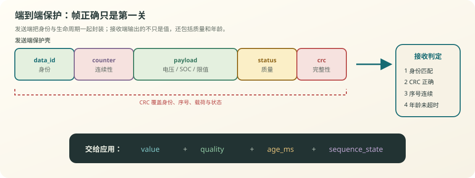
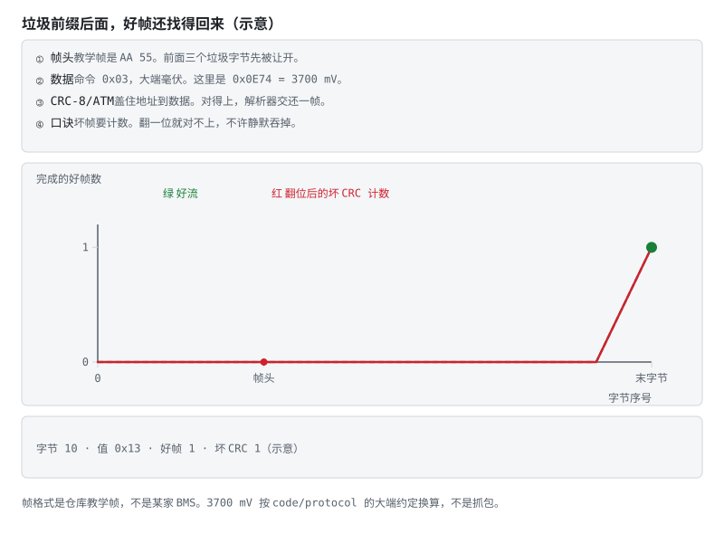

# 第 18 章 通信：一帧正确，不等于数据可信

::: story 现场
整车仪表连续收到合法 CAN 帧：CRC 正确、长度正确、SOC 也在 0–100%。但屏幕上的 63% 已经三秒没变：发送任务卡死，控制器只是在重复最后一帧。

链路层会告诉你“这一帧没有明显传输错误”，却不会替你回答：**它是谁发的、是不是新数据、是否连续、现在还能不能用于决策。**
:::

<aside class="reading-bet" aria-label="开读押注">
<p class="reading-bet__eyebrow">开读押注 · CRC 全对也可能判废</p>
<p>一帧每 100 ms 准时到达，CRC 每次都正确，但滚动计数器一直不变。它算“新数据”吗？</p>
<ol><li>算，CRC 正确就能用</li><li>不算，它可能只是在重复旧样本</li><li>只要 SOC 没越界就算</li></ol>
</aside>

第一次读这一章，先沿图 18-1 走一帧：发送端把身份、序号、载荷与状态一起校验，接收端先验完整性和连续性，再把值、质量与新鲜度交给应用。§18.3 说清新鲜度为什么不能写成一个固定超时；§18.4 讲启动、复位与休眠这三个最容易漏的生命周期；§18.5 回答更实际的问题——丢了数据以后，系统该怎样明确降级，而不是拿上一次的值继续用。

## 18.1 通信可靠性的四个问题

一条 BMS 数据进入控制逻辑前，至少要回答四个问题：

**表 18-1**　通信可靠性四问：机制与缺失后果（定性对照）

| 问题 | 典型机制 | 只缺这一项会怎样 |
|---|---|---|
| 身份：是谁的数据？ | 消息 ID、数据 ID、节点/会话标识 | 把别的报文当成目标报文 |
| 完整：内容被改了吗？ | CRC、长度、端到端校验 | 位翻转后仍被使用 |
| 连续：中间漏了多少？ | 滚动计数器、序号 | 丢帧与重复帧不可见 |
| 新鲜：现在还有效吗？ | 接收时间、超时、有效期 | 使用三秒前的“正确旧值” |

CAN 自带帧级错误检测，UART 协议也常带校验和，但它们主要保护一次传输。应用层还要保护“从生产者到消费者”的语义：信号在网关、任务调度、缓存与重发过程中，仍可能被延迟、重复或串台。

::: principle 一句话
链路 CRC 检测传输错误；**身份、连续性、质量和时序共同决定数据能否使用。** CRC 存在漏检概率，也不提供发送者认证；端到端检查不是对数据真实性的数学证明。
:::

## 18.2 一份最小端到端保护壳

<figure>

<figcaption>图 18-1　端到端保护壳。发送端把身份、序号、载荷与状态一起校验；接收端先验完整性和连续性，再把值、质量与新鲜度交给应用。</figcaption>
</figure>

一个教学版保护壳可以写成：

```text
data_id | counter | payload | status | crc
```

- `data_id` 防止“长度相同的另一类报文”被误接收；
- `counter` 每次发布新采样结果时递增，用模运算处理回绕；重发旧样本不能冒充新采样；
- `payload` 是电压、SOC、功率限值等业务数据；
- `status` 明示传感器故障、降级、初始化与无效；
- `crc` 覆盖前面所有字段，而不是只覆盖 payload。

接收端不应只有 `valid = crc_ok`。更有用的接口是：

```text
value, quality, age_ms, sequence_state
```

其中 `sequence_state` 至少区分首次、连续、重复、跳号和乱序。这样应用层才能区分“一帧被污染”和“生产者已经停摆”。

## 18.3 新鲜度不是一个固定超时

接收端自己就能算的那个数据年龄：

$$
t_{since\_new}=t_{now}-t_{last\_accepted\_new}
$$

它是距“接纳新样本”的本地时间，不是源端采样年龄。旧帧重复到达，不能刷新这个时间；若网关给旧 payload 重新编号，接收端仍会受骗。因此需要保留源端样本序号和质量；要量源端年龄，还需可比较的采样时间戳与时钟误差上界，或已知延迟上界。

难点在于“多老算过期”。超时预算要盖住周期、抖动、传输与调度几段延迟，下限至少包含：

$$
t_{timeout} \ge t_{period}+t_{jitter}+t_{transport}+t_{schedule\_margin}
$$

如果发送周期 100 ms，调度抖动 20 ms，最坏传输与网关排队 30 ms，再留 50 ms 余量，那么 200 ms 是一个可解释的起点。直接写“连续三帧没收到就超时”，只有在周期稳定时才等价；系统降频、休眠或总线拥塞后，它可能误报。

不同信号不能共用一个超时：

**表 18-2**　不同信号过期后的风险与降级方向（定性对照）

| 信号 | 过期后的风险 | 常见降级方向 |
|---|---|---|
| 单体最高电压 | 继续充电可能越限 | 禁止充电或转本地保护 |
| 最高温度 | 热边界不可见 | 降功率，必要时停机 |
| SOC | 续航显示与策略偏差 | 保留最后值并标无效，限制深充深放 |
| 软件版本/序列号 | 几乎不随时间变化 | 缓存，不做周期超时 |

还要验证“超时 + 降级动作延迟”不超过该信号允许的故障反应窗口；没有可行区间，就修改周期或架构。所以超时是**信号安全属性**，不是通信驱动里的统一常量。

## 18.4 启动、复位与休眠：最容易漏的生命周期

滚动计数器并不天然可靠。发送 ECU 复位后，计数可能从 0 重新开始；接收端若把它当成乱序，会永久拒绝。反过来，如果任何“计数归零”都被当成合法复位，攻击或串扰又能绕过连续性检查。

工程上通常要组合处理：

1. 用启动/会话标识区分一次新的发送生命周期；
2. 上电后先发布 `init/invalid`，等传感器与算法稳定再置有效；
3. 接收端允许受控重同步，但要记录原因与次数；
4. 唤醒后的第一帧不能直接沿用休眠前的“新鲜”状态；
5. 计数器回绕是正常事件，跳号、倒退与会话切换要分开统计。

例如 4 bit 计数器取 d=(new−last) mod 16：d=1 连续，d=0 重复；可约定 d=2…7 为有限丢帧，d=8 为歧义，d=9…15 为迟到候选。此判定要求未观测跨度小于半个计数空间；超过半圈就应转入失同步，不能靠模差硬猜。按信号策略决定跳号后是否接纳新值，并记录缺帧数。

> 先自己判断：上一帧计数 14，这一帧计数 1。是倒退、复位，还是丢了帧？

先算模差：d = (1 − 14) mod 16 = **3**。按上面的约定，这是正常回绕后丢了 **2 帧**（15、0 没收到），不是倒退。只看“1 比 14 小”，就会把一次普通回绕误判成乱序或复位；真正的复位要靠会话标识来认，不能靠数字变小来猜。

这也是为什么第 29 章的字节流重同步只是底座：解析器把帧找回来以后，应用层还要判断这帧是否属于当前生命周期。

## 18.5 丢数据以后，系统要明确降级

“通信故障”不是一个统一动作。先按安全影响给信号分级，再定义替代行为：

- **保护级信号**：失去就不能证明安全，转入安全状态；
- **控制级信号**：允许短时保持，但限值要收紧并启动超时；
- **估计级信号**：可用模型短时预测，同时增大不确定度；
- **显示级信号**：可冻结显示，但必须显式标灰或报陈旧。

替代值也不是越保守越好。把丢失的温度直接替成 200 °C 可能触发错误动作；把它替成 25 °C 又会掩盖风险。更稳妥的接口是“值 + 无效状态”，由拥有安全语义的上层决定停机、限功率还是保持。

::: trap 坑
收到合法帧就立刻清除通信故障。偶发恢复一帧可能只是接触不良；恢复也应去抖，例如要求连续 N 帧身份、CRC、计数和时序都正确，再退出降级。
:::

<figure class="book-motion" data-animation="protocol-resync.svg" data-mode="static">

<button type="button" data-book-motion v-book-motion aria-pressed="false" hidden>播放动画</button>
<figcaption>图 18-2　字节流重同步：垃圾、坏帧和合法帧交错到来时，解析器恢复边界；这是语义可信判断之前的底座。看丢弃的是当前坏候选头还是整段输入；后一种做法可能把下一帧一起丢掉。解析器找回帧后，为什么还必须检查身份、序号和新鲜度？</figcaption>
</figure>

## 18.6 把可靠性写成可注入的验收

一套通信验收至少要主动制造这些故障：

1. 翻转 payload、counter、data_id 与 CRC 中的单个位；
2. 丢 1 帧、连续丢 N 帧、重复 1 帧、交换相邻两帧；
3. 让发送端复位、计数回绕、休眠后唤醒；
4. 延迟报文，直到刚好跨过超时边界；
5. 让网关重复最后一帧，同时保持链路层 CRC 合法；
6. 恢复通信，验证故障退出需要的连续好帧数。

验收记录不要只写“通过”。至少保存发送序号、接收序号、接收时间、数据年龄、错误分类、降级动作与恢复时刻。这样才能回答：系统是没发现、发现太晚，还是发现了却没执行。

::: lab 动手
跑 `python code/frame_parser.py`，把它当“找回帧边界”的底座。再在纸上给每帧加 `data_id + counter + status`：依次模拟重复、跳号、延迟与发送端复位，写出接收端的 `quality`、`age_ms` 和降级动作。第 29 章再深入实现八个解析边界。
:::

## 练习

1. 某 SOC 报文周期 100 ms，最大调度抖动 15 ms、网关延迟 25 ms。给出一个可解释的超时预算，并说明超时后显示层与功率控制层为何不能同样处理。
2. 设计一个 4 bit 滚动计数器的接收规则，分别处理正常回绕、重复、丢一帧、发送端复位与乱序。
3. 为“单体最高电压、最高温度、SOC、软件版本”各写一条通信故障注入用例：输入、期望降级、恢复条件和必须保存的证据。

## 参考资料

- BMS-Z 阶段 5：https://github.com/zhuguang-ZFG/BMS-Z/blob/main/docs/stages/stage-5-通信与集成.md
- BMS-Z PC 全链路五天：https://github.com/zhuguang-ZFG/BMS-Z/blob/main/docs/共学/08-pc全链路五天.md
- BMS-Z `frames.py`：https://github.com/zhuguang-ZFG/BMS-Z/blob/main/code/protocol/frames.py
- 第 29 章：帧状态机的八个边界
