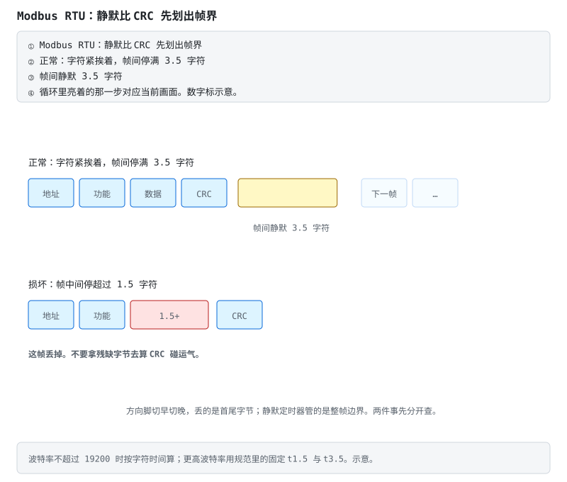
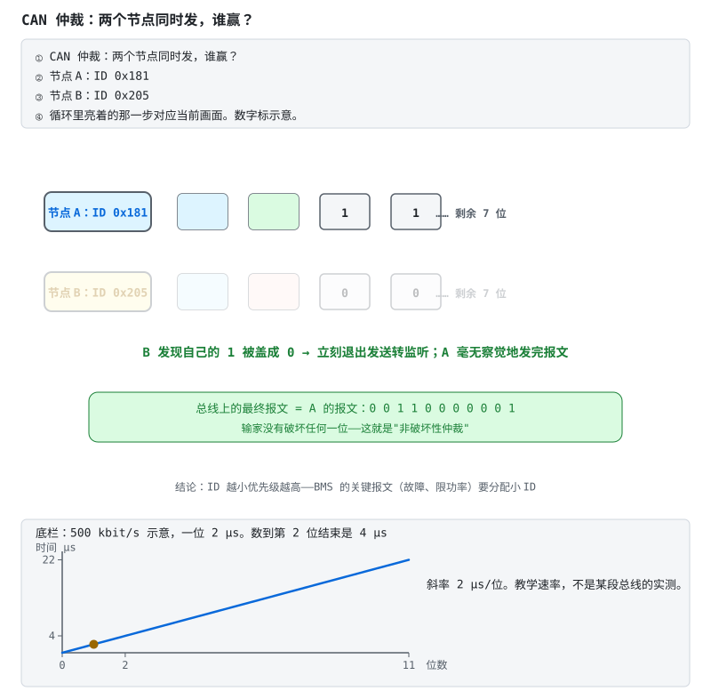

# 第 19 章 总线全景

::: story 现场
拆开一台储能 BMS 的盖板，你会同时看到三种“通信”：AFE 与 MCU 之间是板内的 SPI 走线，几厘米；主控与几块从板之间是菊花链，几十厘米；对外端子上挂着一对双绞线，RS485，要穿过整个集装箱去找逆变器。

三种连接，三种脾气：板内讲速度，板间讲隔离，对外讲“对方只认这一种”。本章把四条最常见的对外总线摆在一起看：什么时候用哪条、各自的坑在哪里。
:::

第一次读这一章，先看表 19-1 把三条线分开：板内是 AFE 到 MCU、板间是从板到主控、对外接上位机与整车。然后按场景记方言：§19.2 的 UART、§19.3 的 Modbus 静默划帧（图 19-1）、§19.4 的 CAN 仲裁（图 19-2）。别把“接上了”当成“可信”：§19.6 的超时账与上锁清单，才是通信能进保护链的前提。

## 19.1 通信在 BMS 里的三个层级

**表 19-1**　BMS 通信三个层级与典型接口（定性对照）

| 层级 | 连接 | 典型接口 |
|---|---|---|
| 板内 | AFE ↔ MCU | I2C / SPI / isoSPI |
| 板间 | CMU 从板 ↔ BMU 主控 | isoSPI / CAN 菊花链 |
| 对外 | BMS ↔ 上位机/逆变器/整车/手机 | UART / RS485-Modbus / CAN / SMBus / BLE |

第 5、6 章解决了板内这条测量链；第 18 章解决了“字节怎么变成帧”；本章解决“帧走哪条线”。注意表里每一格都是三层东西的叠加：物理层、帧格式、寄存器映射（或 DBC），是三件不同的事。

::: principle 一句话
**物理层、帧、寄存器映射是三件不同的事。** RS485 只是差分物理层，Modbus 才是跑在上面的协议。两者常被混着叫，先分清层，再谈兼容。
:::

## 19.2 UART：商用 BMS 的方言

调试口、监控口最常见的就是 UART。各家帧格式像方言，细节不同，骨架却惊人一致：

`[帧头 2B][地址/命令 1-2B][长度 1B][数据 NB][CRC 1-2B]`

这是常见抽象，不是法律：有的协议没有长度字段、有的 CRC 位置不同。**拿到新协议先抓包或读厂商文档确认帧结构，别套模板。** JK 协议的事实文档就是 esphome-jk-bms 的源码与 README：帧格式、命令字、数据偏移、单位换算全在代码里。

- 字节时间 t = 10000/波特率（ms）：9600 是 1.042 ms，115200 是 0.087 ms。波特率越高越贴近 0，但不到 0。
- 衔接第 18 章：帧状态机负责找帧界，CRC 错了要计数并重新找帧头，坏帧不能静默丢掉还不计数。
- 两个动手前的提醒：**先量电平再插线**（3.3 V TTL 还是 ±12 V 的 RS232 电平，插反可能烧口）；**共地要过脑子**：UART 共地意味着电脑和电池包连成一体，笔记本用电池供电、或加隔离 USB 串口，别把市电地引进电池包。

## 19.3 RS485 与 Modbus：储能世界的老干部

- **物理层 RS485**：A/B 差分、半双工。三个必考点：总线两端各一颗 120 Ω 终端电阻（少了就回波丢包）；偏置电阻让总线空闲时电平确定；方向脚 DE/RE 切换收发。**切换时序是新手第一坑**：切早了丢尾字节，切晚了丢首字节。
- **协议层 Modbus RTU**：功能码记四个就够干活：`0x03` 读保持、`0x04` 读输入、`0x06` 写单寄存器、`0x10` 写多寄存器；帧 = 地址 + 功能码 + 数据 + CRC16（反射多项式 `0xA001`）；BMS 厂商给“寄存器映射表”（SOC 在 `0x0100`、单体 1 电压在 `0x0101`……），照表实现。
- 帧边界靠 **3.5 字符静默间隔**：帧间至少停 3.5 个字符时间，接收端才敢说上一帧结束；帧中间停超过 1.5 个字符时间，这帧作废，不要拿残缺字节去碰 CRC。波特率不超过 19200 时按字符时间算；再高就用规范里的固定间隔。注意方向脚切早切晚丢掉的是首尾字节，和这个静默定时器不是同一件事。

<figure class="book-motion" data-animation="modbus-rtu-silence.svg" data-mode="static">

<button type="button" data-book-motion v-book-motion aria-pressed="false" hidden>播放动画</button>
<figcaption>图 19-1　Modbus RTU 静默划帧：帧内超间隔与帧间静默承担不同角色；字符时间受波特率与串口格式影响。分清最后一个字节到达与确认帧结束的时刻；一次串口 read 返回不等于一整帧。先声明串口格式的每字符位数，再算 9600 波特下的 3.5 字符间隔。</figcaption>
</figure>

## 19.4 CAN：车上的官话

- **帧结构**：ID（标准 11 位/扩展 29 位）+ DLC + 最多 8 字节（CAN FD 到 64）。
- **仲裁**是最优雅的设计：显性 0 盖过隐性 1，标识符从高位开始逐位比，小的留下；输家自动退出发送，**赢家甚至不知道发生过竞争**，所以叫非破坏性仲裁。BMS 的故障、限功率报文要拿小 ID，单体明细拿大 ID。
- 仲裁只比标识符，不检查载荷；载荷对不对看后面的 CRC。先抢到发言权，再读格子里的数。
- **物理层**：CAN_H/CAN_L 差分，两端 120 Ω 终端；电池包上**必须隔离**（隔离收发器 + 隔离电源）。
- **DBC 文件**是 CAN 世界的“寄存器映射表”：每条报文里每个信号的起始位、长度、因子、偏移、单位。会读 DBC，车规通信就会了一半；换一家协议，字节位置和比例都会变，打开 DBC 再写解析。
- **位填充**：连续五个相同位就插入一个相反位。教学示意（不是标准摘录）：500 kbit/s 时一位 2 µs，64 位数据段无填充是 128 µs，最坏 12 个填充位拉到 152 µs。按 128 µs 排总线，最坏的 152 µs 会挤进下一帧。

GB/T 27930 的直流充电握手也走 CAN，流程想成“**先对暗号、再谈条件、最后才给电**”。四步依次是：辨识与握手（互报身份、协议版本）→ 参数配置（BMS 报电池类型、总压、允许上限；桩确认能力）→ 充电循环（BMS 周期下发需求电流/电压，桩跟随并回传实测）→ 正常结束或故障中止。工程要点（细则以现行国标文本为准）：

1. **BMS 是需求方**：桩按 BMS 当前允许的电流/电压输出，所以 SOP 与温度降额必须实时写进“充电需求”报文；
2. 对方超时未应答，视为通信失败，**必须停充**，不能“假装还连着”继续灌电；
3. 通信 OK ≠ 可以合接触器，仍要走第 7 章的预充与合闸时序。

储能侧与 PCS 的对接协议各家不同，但“辨识 → 参数 → 周期设定点 → 超时停机”四段骨架高度同构。

::: principle 一句话
**车先说要多少，充电机跟着给。超时就停，不要猜。**
:::

<figure class="book-motion" data-animation="can-arbitration.svg" data-mode="static">

<button type="button" data-book-motion v-book-motion aria-pressed="false" hidden>播放动画</button>
<figcaption>图 19-2　CAN 仲裁：节点 0x181 与 0x205 逐位竞争，显性 0 覆盖隐性 1，失败节点退出。图中 ID 与练习不同，但机制相同。在第一次不同位暂停：发送隐性 1 却读到显性 0 的节点，应停止发送而不破坏赢家。把两个 ID 写成 11 bit 二进制，找出第一次分歧；仲裁赢了能证明载荷正确吗？</figcaption>
</figure>

## 19.5 SMBus 与 BLE：笔记本的与手机的

**表 19-2**　SMBus 与 BLE 的形态、标准化与典型坑（定性对照）

| | SMBus | BLE |
|---|---|---|
| 主场 | 笔记本电池 | 手机 App 监控 |
| 形态 | I2C 物理层 + SBS 标准命令集 | GATT：服务 → 特征值（read/notify） |
| 标准化 | `Voltage()`、`Current()`、`RelativeStateOfCharge()` 等命令字固定 | 厂商私有服务里跑各自的串口透传协议 |
| 典型坑 | 电压原始值不是 SOC | 长帧要协商 MTU + 分包重组 |

- SMBus 细节：`Voltage()` 是 `0x09`，两个字节、单位 mV、低字节在前；7 位地址常见 `0x0B`，先扫再假定；电量百分比是另一条命令，不要把电压原始值当成 SOC。
- BLE 细节：默认 ATT MTU 是 23 字节、有效载荷大约 20 字节；一帧 BMS 数据往往更长，会被切成多条通知，接收端按帧头和长度把片拼回去，超时的半帧丢掉。**只连得上却收不到完整数据，八成是 MTU 没谈拢。** MTU 谈大了片数变少，重组还是要做。

## 19.6 可靠与安全：超时账与上锁清单

板间菊花链断了以后，你等的主要是超时，不是那点飞行时间。教学示意（**不是某颗 AFE 的手册时序，也不是标准摘录**）：t = 2.0 + 0.05k（ms），k 是断点前面还答得上的跳数。第一跳就沉默 2.00 ms，断在第 3 跳之后 2.15 ms，六跳之后才断 2.30 ms。最后一次答得上的节点，就是断点的上游；恢复动作是停用下游，**不是把超时改短来“快点报故障”**：超时若短于健康节点的真实应答，活的节点会被判死。

对外通信还必须考虑信息安全。强制性国标 GB 44495-2024《汽车整车信息安全技术要求》于 2024-08-23 发布、2026-01-01 实施；管理体系可对照 ISO/SAE 21434，出口型式批准还会涉及 UN R155。通信安全已经成为产品准入的一部分。

攻击面可从近到远逐层检查：

- UART/RS485 维护口：出厂时锁定，现场服务使用签名令牌，不保留通用密码；
- CAN：报文白名单与网关隔离，控制报文检查计数器，不接受陌生 ID 的写请求；
- BLE：绑定配对，弃用固定 PIN，密钥不得明文写入日志；
- 云端 MQTT/TLS：每台设备独立凭据，固件更新必须验签；
- UDS 刷写口：按会话划分 0x27 安全访问等级，写参数先验身份，镜像同时具备签名与回滚保护。

为什么 CAN 自己防不了：CAN 帧没有源地址认证。19.4 的仲裁只解决“谁先说”，不解决“说的是不是真话”。任何插上总线的人都能用任意 ID 发报文，所以身份、完整性、新鲜度三件事要在系统层补齐，而不是指望协议层天生安全。最后别忘物理层：JTAG/SWD 调试口出厂要熔断或口令保护。壳被拆开之后，软件上的一切锁只剩壳的强度。

::: trap 坑
能写进去的口，都要先验明身份；只读的口，也要防着被人灌满。种子-响应算法用固定密钥等于没锁，解锁等级和被保护的写服务没对上等于留后门。
:::

::: lab 动手
回 BMS-Z 做三件事。① 打开阶段 5 的 CAN 仲裁动画与菊花链沉默动画，把“显性 0 盖过隐性 1”“发现断链，大头是超时”各讲一遍。② `cd code/protocol && python -m pytest tests/ -q`，先用仓库的 CRC 基准向量证明你的 CRC 程序是对的，再去碰未知协议。③ 手上有商用板（JK/JBD/小象任一）就用 ESP32 + 隔离串口抓真实帧，对照 esphome-jk-bms 源码逐字节读。
:::

## 练习

1. 给一台 16 串储能柜选对外总线（逆变器在 50 m 外，后台要上云），分别说出物理层、帧格式、寄存器映射各是什么。
2. Modbus RTU 在 9600 波特下，用 t = 10000/波特率 算一个字符时间，再算出 3.5 字符静默间隔约多少毫秒。
3. CAN 上 `0x100` 与 `0x200` 同时发，谁留下？仲裁赢了是否说明载荷一定正确？

## 参考资料

- BMS-Z 阶段 5：https://github.com/zhuguang-ZFG/BMS-Z/blob/main/docs/stages/stage-5-通信与集成.md
- BMS-Z 共学·协议五天：https://github.com/zhuguang-ZFG/BMS-Z/blob/main/docs/共学/02-协议五天.md
- BMS-Z 代码走读：https://github.com/zhuguang-ZFG/BMS-Z/blob/main/code/README.md
- Bosch《CAN Specification 2.0》：CAN 帧结构、仲裁与位填充机制的原始规范，本章 19.4 总线协议内容的依据
