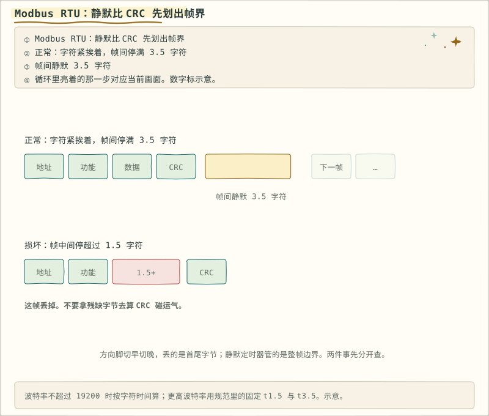
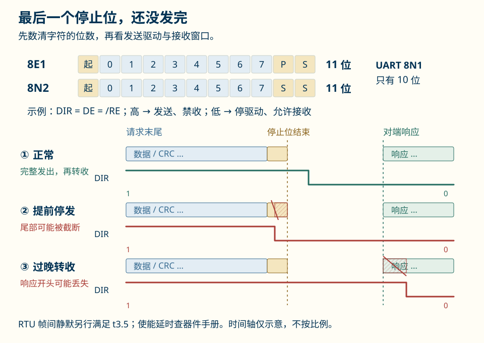
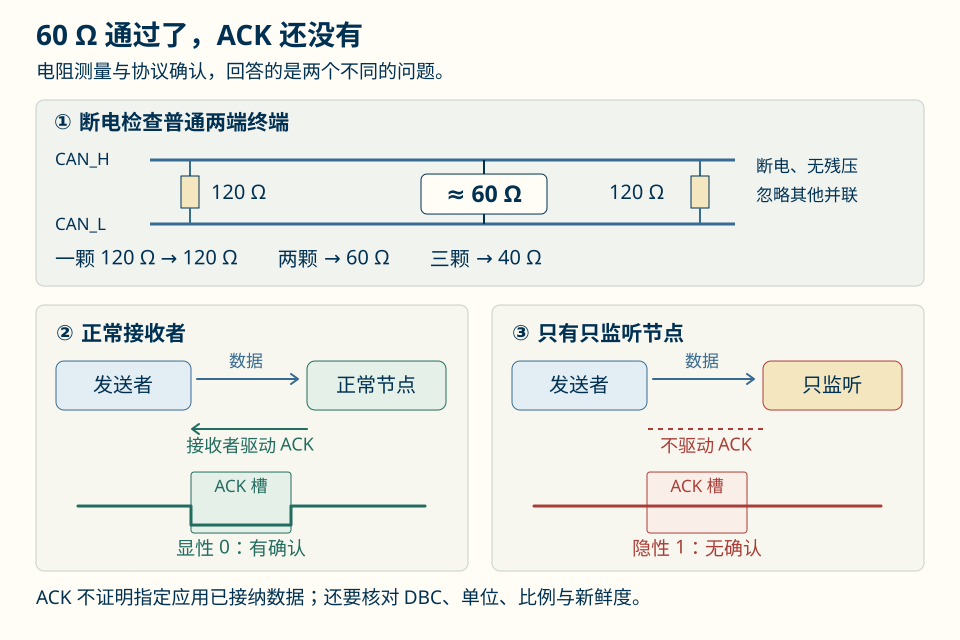
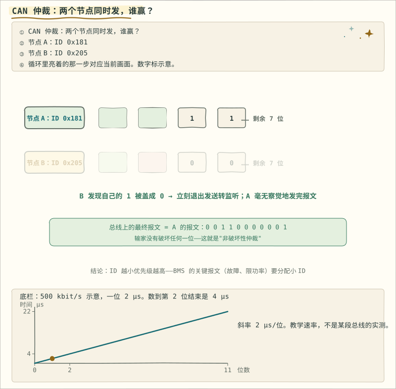
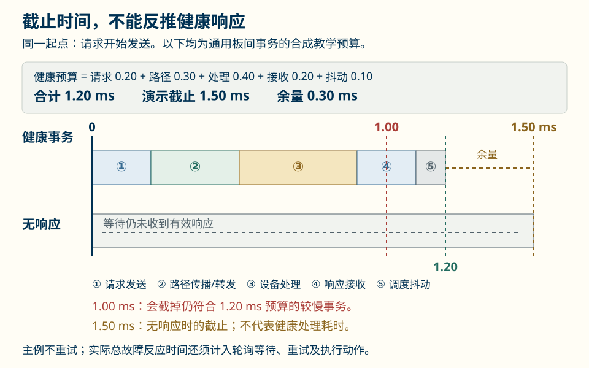
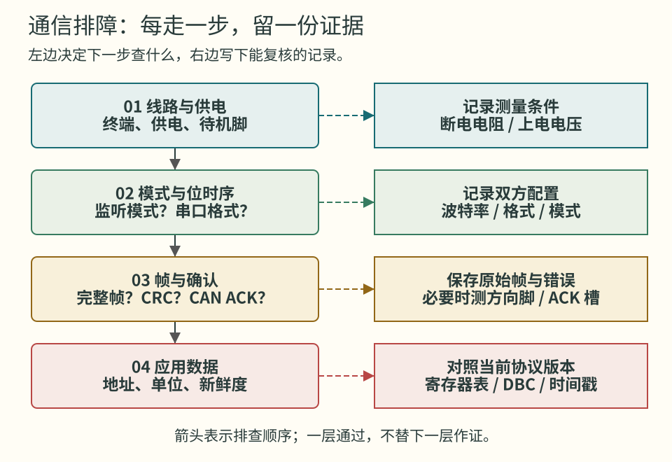
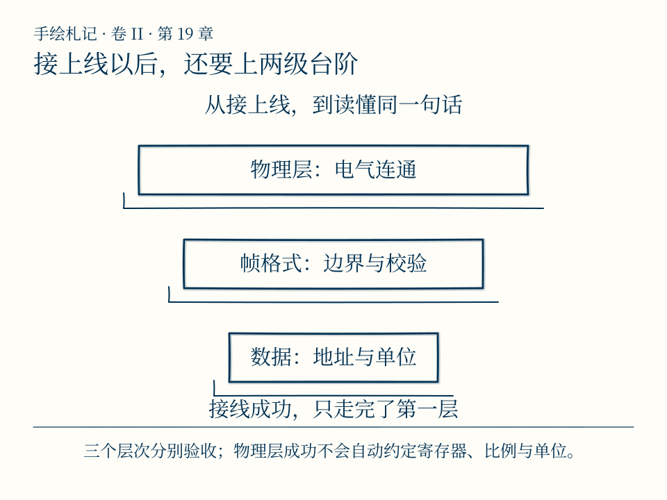

# 第 19 章 总线全景

::: story 现场
拆开一台储能 BMS 的盖板，你会同时看到三种“通信”：AFE 与 MCU 之间是板内的 SPI 走线，几厘米；主控与几块从板之间是菊花链，几十厘米；对外端子上挂着一对 RS485 双绞线，要穿过整个集装箱去找逆变器。

三种连接的要求不同：板内优先速度，板间关注隔离，对外还要匹配协议与设备生态。
:::

> **难度**：L1 入门
> **先修**：第 18 章的帧边界。
> **学完你应能**：区分各总线的电气连接与协议，复算 RTU 定时，并沿“接线—帧—数据含义”排查一次通信故障。

::: chapter-route 阅读路径

- **第一次主线**：读 §19.1–§19.4。先分清板内、板间与对外通信，再认识 UART、RS485／Modbus 和 CAN 的核心差异。
- **第二遍深挖**：读 §19.5–§19.6。补齐 SMBus、BLE、超时、认证与写操作边界。
- **动手验证**：读 §19.7–§19.8，复算字符时间与超时预算，再用三张图解释丢尾字节、缺 ACK 和健康节点误报。
:::

**先自己判断**　两块设备都带 RS485 接口，是否意味着它们接线后一定能互相读懂？

## 19.1 通信在 BMS 里的三个层级

**表 19-1**　BMS 通信三个层级与典型接口（定性对照）

| 层级 | 连接 | 典型接口 |
|---|---|---|
| 板内 | AFE ↔ MCU | I2C / SPI / isoSPI |
| 板间 | CMU 从板 ↔ BMU 主控 | isoSPI / CAN 菊花链 |
| 对外 | BMS ↔ 上位机/逆变器/整车/手机 | UART / RS485-Modbus / CAN / SMBus / BLE |

第 5、6 章处理板内测量链，第 18 章处理字节成帧。到了对外接口，还要把物理层、帧格式、寄存器映射（或 DBC）分别对上；三者少一个都不能叫兼容。

::: principle 一句话
**物理层、帧、寄存器映射是三件不同的事。** RS485 只是差分物理层，Modbus 才是跑在上面的协议。两者常被混着叫，先分清层，再谈兼容。
:::

<figure>
<figcaption>图 19-1　总线选型像塔台开航线。同一片空域，不同航线有不同调度规矩：波特率、帧格式、仲裁与超时各管一段。选总线先问「这条航线谁来指挥、撞机谁先让」，再问线有多快。</figcaption>
</figure>

## 19.2 UART：商用 BMS 的私有协议

调试口和监控口常使用 UART。各家帧格式不同，但通常包含相近的基本字段：

`[帧头 2B][地址/命令 1-2B][长度 1B][数据 NB][CRC 1-2B]`

这是常见抽象，不是法律：有的协议没有长度字段、有的 CRC 位置不同。**拿到新协议先抓包或读厂商文档确认帧结构，别套模板。** JK 协议的事实文档就是 esphome-jk-bms 的源码与 README：帧格式、命令字、数据偏移、单位换算全在代码里。

- 本节用 **8N1**：1 个起始位、8 个数据位、无校验、1 个停止位，共 10 位。字符时间 t = 10000/波特率（ms）：9600 是 1.042 ms，115200 是 0.087 ms。换成带校验或两个停止位，时间也要重算。
- 衔接第 18 章：帧状态机负责找帧界，CRC 错了要计数并重新找帧头，坏帧不能静默丢掉还不计数。
- 两个动手前的提醒：**先量电平再插线**（3.3 V TTL 还是 ±12 V 的 RS232 电平，插反可能烧口）；**共地要过脑子**：UART 共地意味着电脑和电池包连成一体，笔记本用电池供电、或加隔离 USB 串口，别把市电地引进电池包。

## 19.3 RS485 与 Modbus：储能设备的常用组合

请求前面的字节都能收到，末尾 CRC 却总不完整。先别换 CRC 算法：发送器是不是在最后一个停止位结束前就被关掉了？要回答这个问题，得把三件事分开。

**RS485 管线路。** 本节讨论两线半双工：差分线沿总线连接，终端阻值按电缆特性阻抗选择，常见为两端各 120 Ω；空闲偏置与收发器自身的失效保护一起核对。DE 控制发送驱动，低有效的 /RE 控制接收。DE 提前拉低可能截断请求尾部；/RE 过晚拉低则可能漏掉响应开头。若两脚绑在同一个 DIR 上，转收太晚还可能继续占用总线。

**Modbus 管消息。** RTU 帧由地址、功能码、数据和 CRC16 组成（反射多项式 `0xA001`）。常用功能码有 `0x03` 读保持寄存器、`0x04` 读输入寄存器、`0x06` 写单寄存器、`0x10` 写多寄存器。SOC、单体电压各在哪个寄存器、用什么单位，仍要查当前厂商映射表；`0x0100` 或 `0x0101` 不是通用地址。

**静默时间管帧界。** Modbus 串行线指南 V1.02 §2.5.1 使用 11 位字符：默认 8E1（起始 1 + 数据 8 + 偶校验 1 + 停止 1）；无校验时用 8N2，仍是 11 位。按这个格式，在 9600 bit/s 下：

\[
T_{\mathrm{char}}=\frac{11}{9600}\ \mathrm{s}\approx1.146\ \mathrm{ms},\qquad
t_{1.5}\approx1.719\ \mathrm{ms},\quad t_{3.5}\approx4.010\ \mathrm{ms}
\]

波特率不超过 19200 时，帧间至少静默 3.5 个字符时间；帧内停顿超过 1.5 个字符时间，接收方应丢弃不完整帧。高于 19200 时，指南 §2.5.1.1 推荐固定 `t1.5 = 750 µs`、`t3.5 = 1.750 ms`，不能一直按字符时间缩短。如果设备要求 8N1，先确认厂商的兼容约定，不把它当成指南默认配置。

<figure class="book-motion" data-animation="modbus-rtu-silence.svg" data-mode="static">

<button type="button" data-book-motion v-book-motion aria-pressed="false" hidden>播放动画</button>
<figcaption>图 19-2　Modbus RTU 静默划帧：帧内超间隔与帧间静默承担不同角色；字符时间受波特率与串口格式影响。分清最后一个字节到达与确认帧结束的时刻；一次串口 read 返回不等于一整帧。先声明串口格式的每字符位数，再算 9600 波特下的 3.5 字符间隔。</figcaption>
</figure>

写函数返回、FIFO 已空或 DMA 搬完数据，都不必然表示线上最后一个停止位已发完。切换方向前，要核对所用 MCU 的“发送完成”标志究竟覆盖到哪一步，再把收发器使能延时算进去。图 19-3 只画先后关系，不替某颗器件规定延时。

<figure>

<figcaption>图 19-3　先等最后停止位完整发出，再释放总线并及时恢复接收。DIR 高时发送、禁止接收，低时关闭驱动、允许接收；这是图中的接法。RTU 静默定时与方向脚延时要分别核对。原理示意 / 非实拍，时间轴不按比例。</figcaption>
</figure>

> **看图核对**　写函数已返回，还应等什么？应确认线上的最后停止位已发送完成；若只等软件缓冲区清空，尾字节仍可能被截断。随后也要让接收器在对方响应前就绪。

开源实现能帮助找检查点。[libmodbus 的固定版本](https://github.com/stephane/libmodbus/blob/a9b025d12289855490b10d77461c99e001abfc0f/src/modbus-rtu.c)计算字符时间时包含校验位和停止位，可选的软件 RTS 路径也安排了发送前后等待。不过，它的[官方说明](https://libmodbus.org/reference/)明确指出，RTU 接收主要按预期字符数判断完整性，不能把这段实现当成规范定时的逐项证明。

接收器打开后，还要分别回答“这一帧结束了吗”和“业务响应等到什么时候”。前者看 t1.5/t3.5；后者看 §19.6 的事务预算。

## 19.4 CAN：车辆网络的常用总线

- **帧结构**：ID（标准 11 位/扩展 29 位）+ DLC + 最多 8 字节（CAN FD 到 64）。
- **仲裁**：显性 0 盖过隐性 1。以本章同类标准数据帧为例，标识符从高位开始逐位比，小的优先；输家退出发送，不破坏赢家的帧。故障、限功率等报文的优先级要按整网时限设计。
- 仲裁决定发送次序；CRC 检查其覆盖字段的传输一致性。CRC 通过，也不能证明 SOC 的单位、比例因子或源数据正确。
- **物理层**：高速 CAN 用 CAN_H/CAN_L 差分，普通线形总线两端各设 120 Ω 终端。是否需要隔离，要看安全边界、参考地差和收发器共模范围；跨高压电池域到外部可触及设备时，需要明确隔离路径及供电。差分通信本身不提供安全隔离。
- **DBC 文件**记录每条报文里各信号的起始位、长度、因子、偏移和单位。换一家协议，字节位置和比例都可能变化；解析代码必须对着当前 DBC 写。
- **位填充**：连续五个相同位后插入一个相反位，填充位也参与后续连续计数。先做一个**计数从段首开始**的 64 位独立教学例：500 kbit/s 下，无填充为 128 µs；全 0 或全 1 每五个原始位插一位，共 ⌊64/5⌋ = **12** 位，得到 **152 µs**。要达到本例最多的 **15** 位，原始位应先同值 5 位，再每 4 位翻转一次，让上一填充位与下一组同值：1 + ⌊(64−5)/4⌋ = 15，总计 **158 µs**。真实 CAN 帧不会在数据段入口重置计数，要从 SOF 连续算到 CRC 序列；158 µs 不能直接当实际数据字段或整帧的最坏时间。

### 量到 60 Ω 之后，还要查什么

两端各装了 120 Ω，断电测 CAN_H 与 CAN_L 得到约 60 Ω。上电后发送仍报 ACK 错误。这组教学场景里，60 Ω 已经证明了什么？

它只说明表计看到了相应的直流等效通路。在确认断电、无残压，且忽略其他并联网络的模型里，两颗 120 Ω 并联是 60 Ω，一颗是 120 Ω，三颗是 40 Ω。读数不能证明终端装在正确位置，也不能证明上电后的波形、位时序或 ACK 正常。

<figure>

<figcaption>图 19-4　先断电查终端，再上电查 ACK，两步的证据不能互换。图中下半只有两个节点；只监听分析仪不参与确认。原理示意 / 非实拍，波形只表示显性与隐性，不代表仪器实测电压。</figcaption>
</figure>

TI 的 CAN 物理层报告说明，发送消息需要另一接收节点确认 ACK。[E2E 的 TCAN4550 讨论](https://e2e.ti.com/support/interface-group/interface/f/interface-forum/1346154/tcan4550-q1-listen-only-mode)则指出，开启该器件的 MON 监控模式会关闭发送驱动。两条放在一起，就能解释：分析仪可能看见流量，却因处于只监听模式而不替发送者确认。帖子中的 `0x1018[5]` 属于 TCAN4550，其他控制器要查自己的手册。

排查时依次留下四类证据：

1. **线路与供电**：断电检查终端与接线；上电核对收发器供电、待机脚和允许共模范围。
2. **节点模式与位时序**：双方波特率、采样点和帧格式匹配；确认除发送者外还有能正常接收并驱动 ACK 的节点。
3. **ACK 与错误信息**：记录控制器错误类型和计数变化，必要时观察 ACK 槽。缺 ACK 不必然一路增长到 bus-off，要按控制器状态和错误约束判断。
4. **应用数据**：确认目标应用收到了所需 ID，并按当前 DBC 解释单位、比例与新鲜度。

> **看图核对**　有 ACK，能证明指定的 BMS 应用已经正确解释 SOC 吗？不能。ACK 不标识哪个接收应用，也不证明它已接纳数据。

在已配置的 Linux SocketCAN 接口上，可先读取状态，再同时接收数据和错误消息：

```sh
ip -details -statistics link show can0
candump -e -d 'can0,0:0,#FFFFFFFF'
```

`#FFFFFFFF` 订阅错误消息，`-e` 把它们解释成可读文本，`-d` 监测内核接收队列丢弃；错误上报仍取决于硬件和驱动。[candump 源码](https://github.com/linux-can/can-utils/blob/834ceef1f1eabec67625389172eebf1050d2f42b/candump.c)与 [SocketCAN 文档](https://docs.kernel.org/networking/can.html)说明了这些边界。默认日志里没有错误帧，不能据此判断线路无错。上述命令是 Linux 示例，未作为本书的实物测试记录；vcan、控制器回环和本地回显也不能替代总线上的 ACK 证据。

GB/T 27930 的直流充电握手也走 CAN。四步依次是：辨识与握手（互报身份、协议版本）→ 参数配置（BMS 报电池类型、总压、允许上限；桩确认能力）→ 充电循环（BMS 周期下发需求电流/电压，桩跟随并回传实测）→ 正常结束或故障中止。工程要点（细则以现行国标文本为准）：

1. **BMS 是需求方**：桩按 BMS 当前允许的电流/电压输出。SOP 与温度降额因此必须实时写进“充电需求”报文；
2. 对方超时未应答，视为通信失败，**必须停充**，不能“假装还连着”继续灌电；
3. 通信 OK ≠ 可以合接触器，仍要走第 7 章的预充与合闸时序。

储能侧与 PCS 的对接协议各家不同，但“辨识 → 参数 → 周期设定点 → 超时停机”四段骨架高度同构。

::: principle 一句话
车辆先发送充电需求，充电机按协商值输出。需求或状态报文超时后应进入停机流程，不能继续沿用过期设定点。
:::

<figure class="book-motion" data-animation="can-arbitration.svg" data-mode="static">

<button type="button" data-book-motion v-book-motion aria-pressed="false" hidden>播放动画</button>
<figcaption>图 19-5　CAN 仲裁：节点 0x181 与 0x205 逐位竞争，显性 0 覆盖隐性 1，失败节点退出。图中 ID 与练习不同，但机制相同。在第一次不同位暂停：发送隐性 1 却读到显性 0 的节点，应停止发送而不破坏赢家。把两个 ID 写成 11 bit 二进制，找出第一次分歧；仲裁赢了能证明载荷正确吗？</figcaption>
</figure>

## 19.5 SMBus 与 BLE：笔记本的与手机的

**表 19-2**　SMBus 与 BLE 的形态、标准化与典型坑（定性对照）

| | SMBus | BLE |
|---|---|---|
| 主场 | 笔记本电池 | 手机 App 监控 |
| 形态 | I2C 物理层 + SBS 标准命令集 | GATT：服务 → 特征值（read/notify） |
| 标准化 | `Voltage()`、`Current()`、`RelativeStateOfCharge()` 等命令字固定 | 厂商私有服务里跑各自的串口透传协议 |
| 典型坑 | 电压原始值不是 SOC | 长帧要协商 MTU + 分包重组 |

- SMBus 细节：`Voltage()` 是 `0x09`，两个字节、单位 mV、低字节在前；7 位地址常见 `0x0B`，先扫再假定；电量百分比是另一条命令，不要把电压原始值当成 SOC。
- BLE 细节：默认 ATT MTU 是 23 字节、有效载荷大约 20 字节；一帧 BMS 数据往往更长，会被切成多条通知，接收端按帧头和长度把片拼回去，超时的半帧丢掉。只连得上却收不到完整数据，先查 MTU 与分包重组。MTU 谈大了片数变少，重组还是要做。

## 19.6 可靠与安全：超时账与上锁清单

一次请求迟迟等不到回答。把超时调短，确实能早一点结束等待；但健康响应来得及赶上新截止吗？先把两条时间线放到同一起点。

下面是通用板间请求／应答的**合成教学预算**，不是某颗 AFE 的时序，也不是 9600 bit/s 的 Modbus 参数。从请求开始发送计时，假设各项上界分别为：请求发送 0.20 ms、路径总传播／转发 0.30 ms、设备处理 0.40 ms、响应接收完成 0.20 ms、调度抖动 0.10 ms。这些项互不重复，保守相加：

\[
T_{\mathrm{healthy,max}}=0.20+0.30+0.40+0.20+0.10=1.20\ \mathrm{ms}
\]

演示中把截止设为 1.50 ms，给健康预算留下 0.30 ms 余量。若改成 1.00 ms，一次按预算在 1.20 ms 完成的健康事务也会被误判。这里不能说“所有健康节点都会误判”：提前完成的事务仍能赶上。

<figure>

<figcaption>图 19-6　健康预算与故障等待共用 t=0，但含义不同。健康事务上界为 1.20 ms，演示截止为 1.50 ms；无响应时等到截止，不能据此反推健康端也处理了 1.50 ms。原理示意 / 非实拍，五项均为教学假设。</figcaption>
</figure>

> **看图核对**　把截止设成 1.50 ms，健康响应就一定耗时 1.50 ms 吗？不会。预算上界、配置截止和一次实测耗时是三个量，要分别记录。

真实截止既要容纳最坏健康响应，又要满足系统允许的故障反应期限。物理断线若发生在轮询间隙，发现它还要先等下一次请求；重试也会增加总耗时。因此，单次事务 timeout 不等于“从断线到保护动作”的总时间。本例不重试；产品应另计检测前等待、重试和执行动作预算。

对外通信还必须考虑信息安全。强制性国标 GB 44495-2024《汽车整车信息安全技术要求》于 2024-08-23 发布；原定 2026-01-01 实施，经第 1 号修改单延期 6 个月，2026-07-01 起对新申请型式批准的车型实施，在产车型 2028-01-01 前整改到位；管理体系可对照 ISO/SAE 21434，出口型式批准还会涉及 UN R155。通信安全已经成为产品准入的一部分。

攻击面可从近到远逐层检查：

- UART/RS485 维护口：出厂时锁定，现场服务使用签名令牌，不保留通用密码；
- CAN：报文白名单与网关隔离，控制报文要检查计数器，不接受陌生 ID 的写请求；
- BLE：绑定配对，弃用固定 PIN，密钥不得明文写入日志；
- 云端 MQTT/TLS：每台设备独立凭据，固件更新必须验签；
- UDS 刷写口：按会话划分 0x27 安全访问等级，写参数先验身份，镜像同时具备签名与回滚保护。

CAN 帧没有源地址认证。19.4 的仲裁只决定谁先发送；身份、完整性和新鲜度仍要在系统层补齐。物理调试口也在攻击面内：JTAG/SWD 出厂要熔断或加访问保护，否则拆壳后可以绕过上层通信限制。

::: trap 坑
能写进去的口，都要先验明身份；只读的口，也要防着被人灌满。种子-响应算法用固定密钥等于没锁，解锁等级和被保护的写服务没对上等于留后门。
:::

::: lab 动手
回 BMS-Z 做三件事。① 打开阶段 5 的 CAN 仲裁动画与菊花链沉默动画，把“显性 0 盖过隐性 1”“发现断链，大头是超时”各讲一遍。② `cd code/protocol && python -m pytest tests/ -q`，先用仓库的 CRC 基准向量证明你的 CRC 程序是对的，再去碰未知协议。③ 手上有商用板（JK/JBD/小象任一）就用 ESP32 + 隔离串口抓真实帧，对照 esphome-jk-bms 源码逐字节读。
:::

## 19.7 跟做实验：把三张总线的账算成数字

19.2–19.6 的定时账都能用一段标准库脚本复现。存成 `bus_ledger.py` 跑 `python bus_ledger.py`：

```python
def rtu_timers(baud):
    char_ms = 11_000 / baud          # 8E1 或 8N2：11 位
    if baud <= 19_200:
        return char_ms, 1.5 * char_ms, 3.5 * char_ms
    return char_ms, 0.750, 1.750     # 指南推荐的高速率固定值


for baud in (9600, 115200):          # UART 8N1：10 位
    print(f"UART 8N1 {baud}：字符 {10_000 / baud:.3f} ms")
for baud in (9600, 19200, 19201, 115200):
    char, t15, t35 = rtu_timers(baud)
    print(f"RTU {baud}：字符 {char:.3f} ms，t1.5 {t15:.3f} ms，t3.5 {t35:.3f} ms")

bit_us = 2                          # 500 kbit/s 的独立数据段教学例
stuff = 1 + (64 - 5) // 4
same = 64 // 5                      # 计数从段首开始；全同值不是最坏
print(f"64 位全同值：填充 {same} 位 → {(64 + same) * bit_us} µs")
print(f"64 位独立段无填充 {64 * bit_us} µs；最多填充 {stuff} 位 → {(64 + stuff) * bit_us} µs")
for a, b in ((0x100, 0x200), (0x181, 0x205)):  # 同类标准数据帧
    print(f"{a:#05x} vs {b:#05x} → {min(a, b):#05x} 留下")
for count in (1, 2, 3):
    print(f"{count} 颗 120 Ω 并联：{120 / count:.0f} Ω")

healthy = sum((0.20, 0.30, 0.40, 0.20, 0.10))  # §19.6 的合成预算
deadline = 1.50
print(f"健康上界 {healthy:.2f} ms；截止 {deadline:.2f} ms；余量 {deadline - healthy:.2f} ms")
print(f"1.00 ms 截止是否早于健康上界：{1.00 < healthy}")
```

**成功判据**：

- UART 8N1：9600 与 115200 的字符时间分别约 1.042、0.087 ms。
- RTU 11 位：9600 的字符时间约 1.146 ms，t1.5≈1.719 ms，t3.5≈4.010 ms；19200 的 t3.5≈2.005 ms；19201 与 115200 都采用推荐的 0.750/1.750 ms 固定定时。
- 计数从段首开始的 64 位独立段：无填充 128 µs，全同值填充 12 位后为 152 µs，最坏位型填充 15 位后为 158 µs；真实帧要连续计数，不能直接套用。
- 仲裁：0x100 留下（对 0x200），0x181 留下（对 0x205）；一、二、三颗 120 Ω 并联分别为 120、60、40 Ω。
- 合成健康预算 1.20 ms，截止 1.50 ms，余量 0.30 ms；改成 1.00 ms 会误判仍符合预算的较慢事务。

算完后，把 19200 改成 19201 看一遍：改变的是推荐定时规则，不是字符突然变长了。这段脚本只复算教学数字，不验证实际串口、CAN 线路或设备响应上界。

## 19.8 翻车对照：接上了 ≠ 读得懂

先把故障停在能复核的那一层：电阻读数、线上帧、应用数值，各能证明不同的事。按图 19-7 留下记录，再用下表找对应症状。

<figure>

<figcaption>图 19-7　先定位，再取证。虚线连接检查项与记录，实线箭头表示排查顺序；图中的顺序不表示信号流向。原理示意 / 非实拍。</figcaption>
</figure>

**表 19-3**　接上了 ≠ 读得懂

| 症状 | 可能原因 | 排查或对照 |
|---|---|---|
| 两台 RS485 设备接上仍互不相认 | RS485 只是物理层，协议与寄存器映射未对（19.1、19.3） | 物理层、帧格式、寄存器映射逐项核对 |
| 偶发丢包、长线越远越糟 | 终端不匹配或位置不对，可能有反射（19.3） | 按电缆阻抗与总线拓扑核对终端，再复测波形 |
| 请求尾部或响应开头缺失 | DE 提前关闭截断尾部；/RE 过晚恢复漏掉响应开头（19.3） | 对照最后停止位、方向脚和对端响应；别只看 write 返回 |
| 拿帧中间停顿后的残缺字节碰 CRC | 帧内静默超限，RTU 帧不完整（19.3） | 丢弃残帧并计数，按静默间隔重新划界；高速率用推荐固定值 |
| 按 128 µs 排总线，偶尔挤进下一帧 | 把无填充的独立数据段当成整帧预算（19.4） | 全帧连续计数；另计帧间隔和重发，不能直接套用 158 µs |
| 60 Ω 正常，发送仍报 ACK 错误 | 终端检查未覆盖位时序、节点模式和 ACK（19.4） | 核对供电、待机、位时序与正常接收节点，订阅错误消息 |
| 把超时缩到 1.00 ms 后出现误报 | 合成例允许健康事务在 1.20 ms 完成（19.6） | 从同一起点列健康预算；本例 1.50 ms 截止留 0.30 ms 余量 |
| 把 SMBus 的 Voltage() 读数当 SOC | 电压原始值（mV）与百分比是两条命令（19.5） | 按 SBS 命令字分开取值 |
| 收到陌生 CAN ID 的写请求就执行 | CAN 帧没有源地址认证（19.6） | 白名单 + 计数器，身份在系统层补齐 |

<figure class="reading-sketch">

<figcaption>图 19-8　电平、帧格式和数据含义要逐层对账。灯亮、能收字节、能解释成一个数字，分别只证明了局部条件。 原理示意 / 非实拍。</figcaption>
<p class="visual-question"><strong>看图追问：</strong>同一对 RS485 线能收字节，为什么仍可能读不出正确温度？</p>
</figure>

## 19.9 跨卷同构点

CAN 仲裁的显性 0 覆盖隐性 1，与卷 I 第 5 章开漏输出的"线与"是同一条物理规则：I2C 主机发 1 时释放总线、读到 0 就认输退出，CAN 节点发隐性位时侦听到显性位同样停发。两者都把"判决权"交给物理层电平，而不是交给某台主机的软件仲裁。卷 I 5.9 从电路侧推了一遍这个对应；协议侧看的是同一件事：仲裁丢失的节点自动退出且不破坏赢家帧，与线与电路上"拉低者赢"是同一纪律的两个层面。

## 本讲服务知识点

<!-- kp-backlink:start -->
本章服务 4 个知识点；每条都能回到[核心问题地图](../../docs/核心问题地图.md)的 L1–L5 五级入口。这一节由 `curriculum/concepts.json` 的 `book` 字段生成。

**表 19-4**　本章服务的知识点与其梯子入口

| 知识点 ID | 标题 | 阶段 | 梯子到 | 握证 |
|---|---|---:|---|---|
| [`hv-daisy-isolation`](../../docs/核心问题地图.md#kp-hv-daisy-isolation) | 高压从板与隔离 | 3 | L3 | 手算纸 |
| [`comm-three-layers`](../../docs/核心问题地图.md#kp-comm-three-layers) | 通信分三层 | 5 | L3 | 日志 |
| [`can-arbitration-dbc`](../../docs/核心问题地图.md#kp-can-arbitration-dbc) | 仲裁与DBC解码 | 5 | L3 | 手算纸 |
| [`gbt-27930-handshake`](../../docs/核心问题地图.md#kp-gbt-27930-handshake) | 充电握手四段 | 5 | L4 | 日志 |

**高压从板与隔离：几十串以上，采样怎么传回主控？**

串数一多，每块从板的参考地都跟着电池堆往上抬，板与板之间出现几十到几百伏的共模差。普通导线把两边地连起来，就把高压引到了低压侧。isoSPI（隔离串行外设接口）用变压器耦合传差分信号，两侧没有电气直连；数据逐级接收、再生、转发，主控只碰隔离后的低压侧。

**教学算例：沿着这组输入做一遍**

1. 单颗 LTC6811 覆盖 12 串；96 串包按 96÷12=8 颗从板来分。
2. 8 颗从板串成一条菊花链，每级之间都过隔离变压器，共模差留在各自那一段。
3. 核对所选隔离器件、供电和主控接口的额定边界，不能把示意隔离符号当作已完成安全验证。
4. 所以链路长度增加的是转发级数和超时，不是把各地直接连成一张网。

**边界与反例**　变压器与隔离布局都有额定耐压、爬电距离及通信配置要求。没有直流导通不等于可承受任意共模差，必须按适用手册与整机条件核验。

**看图任务**　看红色共模线怎样随串数抬高、蓝色差分线怎样穿过变压器；两侧地有没有直接连在一起。

**对应图解**　[bq769-evb-isospi](../../docs/circuits/assets/bq769-evb-isospi.svg)

**先自己判断**　96 串包用 12 串从板，算需要几块、几级菊花链，并说明主控侧怎么隔离。

完成后再展开标准；先保留自己的计算、判断或运行记录。

<details class="kp-retrieval-check">
<summary>核对通过标准</summary>

8 块 8 级；主控侧仍需隔离接口，不能直连从板地。

</details>


**通信分三层：说「BMS 通信」时，到底在说哪一层？**

先问数据正在跨哪一层：板内是 AFE 把测量交给主控，板间是从板把多串读数交给汇总端，对外才轮到上位机、充电机或整车。每层的电平、隔离和故障判据不同。断链时延迟常由等待超时主导，不是线上的传播时间；盲目把超时缩短，会把本来能及时回答的设备误判失联。

**教学算例：沿着这组输入做一遍**

1. 教学式 t=2.0+0.05k ms 中，2.0 ms 是固定等待，k 是经过的跳数。
2. 第一处沉默约 2.00 ms，三跳后约 2.15 ms，六跳后约 2.30 ms；增加几跳只多零点几毫秒。
3. 沿最后一次成功应答的节点定位断点上游，再分别核对物理连线、等待条件和节点状态。

**边界与反例**　传播预算只在该教学拓扑下成立。降低超时必须有最坏应答时间与调度证据，不能为了报故障快就任意减小。

**看图任务**　把板内、板间、对外三层分别沿一遍，定位断链在哪一层，再比较等待尺与传播尺。

**对应图解**　[daisy-fault-recover](../../docs/circuits/assets/daisy-fault-recover.svg)

**先自己判断**　按 t=2.0+0.05k ms 算第一跳、第 3 跳后、第 6 跳后断链的发现时间，并说明怎么定位断点。

完成后再展开标准；先保留自己的计算、判断或运行记录。

<details class="kp-retrieval-check">
<summary>核对通过标准</summary>

2.00、2.15、2.30 ms；最后一次成功应答的节点是断点上游；注明示意。

</details>


**仲裁与DBC解码：仲裁赢了，载荷就一定是对的吗？**

CAN 多个节点同时开始发时，先用标识符仲裁：显性 0 能盖过隐性 1，发现自己发 1 却读到 0 的节点退出，让优先消息继续。这不叫数据互相撞坏。仲裁赢了也不代表载荷真实；后面的校验、应用层身份与新鲜度还要分别查。DBC 则说明字节怎样换算成物理量，不负责决定谁先发送。

**教学算例：沿着这组输入做一遍**

1. 500 kbit/s 下每位 2 µs，单算 11 位标识符为 22 µs，不能把它当整帧时长。
2. 计数从段首开始，64 位独立段全同值填充 12 位，为 152 µs；先同值 5 位、再每 4 位翻转的最坏位型填充 15 位，为 158 µs。
3. 158 µs 仍只是这里的数据段量级；排总线还要加入其他字段、帧间隔和重发预算。

**边界与反例**　ID 的数值来自实际协议，不是看到教学 0x180 就认定某厂固定用途。总线调度必须按真实帧格式、填充与负载验证。

**看图任务**　逐位找第一次 0 与 1 不同的位置，看退出的是哪个发送者；再把仲裁段和载荷段分开计时。

**对应图解**　[can-arbitration](../../docs/circuits/assets/can-arbitration.svg) · [can-bit-stuff](../../docs/circuits/assets/can-bit-stuff.svg)

**先自己判断**　500 kbit/s 下算 11 位时间；计数从段首开始，比较 64 位全同值与最坏位型的填充数和时长。

完成后再展开标准；先保留自己的计算、判断或运行记录。

<details class="kp-retrieval-check">
<summary>核对通过标准</summary>

22 µs；全同值为 12 位、152 µs；最坏位型为 15 位、158 µs。真实帧从 SOF 连续计数，数据段入口不重置。

</details>


**充电握手四段：充电机和 BMS 谁说了算，怎么对上？**

充电不是一接线就送大电流，而是一段段建立共同条件：先确认连接与辅助电源，再辨识协议和设备，交换电池与充电机边界，最后按请求与反馈调整输出。每一步都要能及时等到对方。失联后继续沿用最后一次大电流请求，会把‘曾经允许’误当成‘现在仍允许’。停止和结束也需要明确握手。

**教学算例：沿着这组输入做一遍**

1. 按正文对应版本区分 BHM/CHM 的辨识、BCP/CTS/CML 的参数阶段，再进入充电中的请求与反馈。
2. 教学周期 BCL=50 ms、CCS=50 ms；若示例允许连续缺失 5 周期，则超时量级为 5×50=250 ms。
3. 超时处理按既定安全时序先降低输出再断主回路，记录缺失的是哪条消息，不做无限等待。

**边界与反例**　250 ms 是给定周期与缺失次数的教学乘法，不是所有版本的统一条文。交流 CP 占空比与这里的直流协议流程不能混作一套。

**看图任务**　每个阶段只追一种请求和对应答复；对方沉默时，哪条状态边让系统退出而不是继续充？

**对应图解**　[gbt-27930-handshake](../../docs/circuits/assets/gbt-27930-handshake.svg) · [cc-cp-duty](../../docs/circuits/assets/cc-cp-duty.svg)

**先自己判断**　BCL/CCS 周期 50 ms，连续 5 个周期无对侧报文，算判超时时间并写出动作顺序。

完成后再展开标准；先保留自己的计算、判断或运行记录。

<details class="kp-retrieval-check">
<summary>核对通过标准</summary>

250 ms；先降流再断主回路，记录故障码，不无限重试。

</details>

<!-- kp-backlink:end -->

## 练习

1. 给一台 16 串储能柜选对外总线（逆变器在 50 m 外，后台要上云），说出物理层、帧格式、寄存器映射各是什么。
2. Modbus RTU 按 8E1，在 9600 bit/s 下算字符时间、t1.5 和 t3.5；改成无校验时指南要求几个停止位？在 115200 bit/s 下推荐用什么定时值？
3. 两条标准 CAN 数据帧 `0x100` 与 `0x200` 同时发，谁优先？若终端测得约 60 Ω，发送仍缺 ACK，应继续查什么？有 ACK 能证明指定应用已经正确解释 SOC 吗？

## 参考资料

- **RTU 定时与实现**：Modbus Organization《Serial Line Protocol and Implementation Guide》V1.02（2006-12-20），§2.5.1–§2.5.1.1，pp.12–13；响应超时见 §2.4.1，p.9：[官方 PDF](https://www.modbus.org/file/secure/modbusoverserial.pdf)。对读 libmodbus [RTU 源码](https://github.com/stephane/libmodbus/blob/a9b025d12289855490b10d77461c99e001abfc0f/src/modbus-rtu.c)（固定 a9b025d）与[官方 RTU Context](https://libmodbus.org/reference/)，区分字符格式、软件 RTS 和接收实现。
- **CAN 原厂依据与论坛**：TI [SLLA270](https://www.ti.com/lit/an/slla270/slla270.pdf)（2008-01），p.3 的 ACK、pp.5–7 的拓扑与终端、p.10 的隔离时延；[SLOA101B](https://www.ti.com/lit/an/sloa101b/sloa101b.pdf)（2016-05 修订）的 CAN 概述。[TCAN4550-Q1 数据手册](https://www.ti.com/lit/ds/symlink/tcan4550-q1.pdf) SLLSEZ5D（2022-06 修订）p.75 的 CCCR.MON，与 [E2E 工程师回复](https://e2e.ti.com/support/interface-group/interface/f/interface-forum/1346154/tcan4550-q1-listen-only-mode)（2024-04-05）对读；帖子不代表本书实测。
- **Linux 诊断工具**：linux-can/can-utils [candump.c](https://github.com/linux-can/can-utils/blob/834ceef1f1eabec67625389172eebf1050d2f42b/candump.c)（固定 834ceef）及 [SocketCAN 官方文档](https://docs.kernel.org/networking/can.html)：错误消息过滤、本地回显和接口统计。以上新增外部资料核对于 2026-11-25。
- **仓库内跟做与协议背景**：[阶段 5](https://github.com/zhuguang-ZFG/BMS-Z/blob/main/docs/stages/stage-5-通信与集成.md)、[共学·协议五天](https://github.com/zhuguang-ZFG/BMS-Z/blob/main/docs/共学/02-协议五天.md)、[代码走读](https://github.com/zhuguang-ZFG/BMS-Z/blob/main/code/README.md)；Bosch《CAN Specification 2.0》用于 CAN 帧结构、仲裁与位填充背景。
