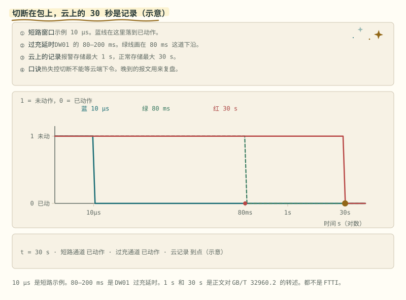

# 第 20 章 上位机与数据链

::: story 现场
充电中，一串电压越过包内阈值。软件去抖后断开充电 MOS，硬件比较器仍按本地分压保持能切断的状态；车载终端按正常周期把数据放进存储，平台要等这条记录上传。若当时没被标成 3 级报警，存储间隔仍按不超过 30 s 那一档。

只看平台的人事后复盘：“云端没有及时保护。”可保护从来没有等过云：包上这一拍就断，云上的报文可以晚半分钟。这一章讲上位机在这条链里能做什么、不能做什么。
:::

第一次读这一章，先跟着 §20.2 分清第 48 拍判决与第 49 拍执行反馈，再看 §20.3 的五份产物如何逐帧对账。平台为何晚到读 §20.5；真正复盘时，用 §20.7 的三种时间戳，不拿“收到时间”冒充“发生时间”。

## 20.1 上位机干什么：搭台，不抢戏

先把“上位机”摆正：它是观察者、回放者与注入者，不是保护回路的一部分。BMS-Z 的 PC 全链路仿真把这条边界做成了工程结构：电芯是 Thevenin 模型，故障在**采样端**注入，状态机是仓库里那份原版 bms.c（226 行），桥接 pc_bridge.c 只有 80 行。Python 只通过带超时的管道喂数字、读 JSON，**状态机逻辑不复制**。

为什么不拿 Python 重写一遍状态机？重写就有两份实现，两份就会分家：教程说的和读者跑的不再是同一套判决逻辑。走真进程还有个副作用：超时成了真约束，10 秒拿不到回复就抛错，而不是靠一句 assert 假装。编译用 -std=c99 -Wall -Wextra -Werror，警告即错误，编得过本身就是一条断言。

喂给它的一行是八个数：四串电压、电流、温度、充电器在不在、SOC；一次回车返回一行 JSON 状态。例如 4150 4150 4150 4150 2000 250 1 76，回来的是 STANDBY、无故障、soc_pct 76。整个实验不接电池；1 秒一拍是教学节奏，真实短路硬件保护的反应预算另行验证。

## 20.2 一拍之内，谁先谁后

固件不是一堆 if，是四层加一台状态机：采样层、估算层、判决层、执行层。示意的信号预算把一拍拆成采样 8 ms、估算 3 ms、判决 1 ms、执行 0.2 ms。认顺序，不认数。

在 1 秒一拍的仿真里能看到两个“晚”：

- **判决晚**：第 46、47 拍越限先记账，第 48 拍为连续第三拍越限，确认 OVP 并关断充电 MOS；从首次越限到确认跨两个采样间隔。仿真每拍 1 s，拍数不能直接等同于器件的 20 ms 延时档；
- **执行晚**：第 48 拍动作（充电使能翻 0），电流第 49 拍才被掐掉：这一拍加进来的电流，要看**上一拍**的命令允不允许。

有人嫌三拍确认慢，想改成一拍就动作。需要权衡输入噪声、滤波和故障反应预算：少确认可能误停机，多确认可能延误。真实短路另有快速比较器通路；本实验的本拍 SCD 是教学状态机行为，不能代替硬件反应时间的实测。

::: principle 一句话
**采样、估算、判决、执行，一拍之内，顺序就是纪律。** 能在逐拍记录上指出“哪一拍判决、哪一拍执行到位”，才算看懂了这条链。
:::

## 20.3 五份产物，逐帧对账

一条命令约 2 秒，跑出五份产物：samples.csv（逐拍采样，100 行）、telemetry.csv（解出来的遥测帧，99 行）、wire.bin（原始字节流，3003 B）、events.json（状态或故障变化的那几拍）、report.json（验收报告）。

报告不是一句“跑完了”就完事：它说的是八项检查全对上了。100 帧里第 13 帧发出前被故意异或最后一个字节，CRC 对不上，解析器按规矩扔掉它、计数 bad_crc = 1，再重新同步；resyncs 计 4 次：一次为被扔的第 13 帧，三次为脚本塞进去的三个垃圾字节 00 ff 19。最终 received 99、缺的正是 [13]，一帧没多、一帧没少。

resyncs 与 bad_crc 是两本账：前者是字节流失去对齐后重新找回边界的次数，后者是帧找到了但校验不过的帧数，4 比 1 不是矛盾，是两桩不同性质的事故各记各的账。还有一条规矩：CRC 必须**重算后比对**，不能照着帧里的抄一遍。只改 CRC 字段而接收端不重算，就发现不了；改负载而接收端重算，是校验在干活。帧状态机本身的细节在第 18 章；这里记住上位机的读法：拿原始字节流和接收日志逐帧对账，坏帧要计数，静默丢数据最贵。

## 20.4 上位机的另一面：注入与听诊

没有真值，上位机照样能听诊。恒流段的新息中位数 0.219 mV 是基线；三段采样端注入分别喊出 71.7 mV（过压）、585.2 mV（短路）、29.2 mV（过热），全在基线的百倍量级以上。新息只用到自己手里的量：模型预测与仪表读数，不需要参考 SOC。过压注入那段尤其值得看：电压被人为抬到 4300 mV，估算器不知道，新息先叫，保护随后到。两条独立的线指向同一个采样。

温度注入喊得最轻，不是注入不够狠：温度不进观测方程，估算器只看电流和端电压，残差只对它见过的那两个量负责（判定方法见第 17 章）。快照锁存的是第一现场：第一次判出 OVP 的第 48 拍、4300 mV 被冻结，后面 52 拍状态再动、电压再变，也不覆盖。事故复盘要的就是这一拍，不是“最后的状态”。

## 20.5 数据链的边界：云到包外为止

帧出了包，时间尺度就换了。GB/T 32960.2—2016 对车载终端的写法：实时数据采集不低于 1 次/s；正常时内部存储间隔最大不超过 30 s；出现该标准所指的 3 级报警时，存储间隔最大不超过 1 s；上传另见 GB/T 32960.3；通信中断先存本地，恢复后再补发。这是**监控记录**，不是保护时限。包上的切断走自己的去抖和硬件速度：短路示例 10 µs、过充窗口 80–200 ms，都早于那 30 s。

把三档时间摆在对数轴上：10 µs、80–200 ms、30 s，横跨六个数量级。“保护”与“监控”的分工，就是被这条时间轴划开的：左边的归包上的比较器，右边的归终端和平台，中间的软件去抖各管一段。

本地缓冲也有顶。示意：采样 1 Hz、缓冲深度 60，掉线后攒下的点数为 n = min(60, t)（t 按秒）：30 s 攒 30 点，60 s 装满，90 s 仍是 60：最早的 30 秒已被新点盖掉，而云端在整段掉线里收到的是 0。水平那段就是渐近线：深度有限，样本数不会跟着掉线时间一直涨。

- **必须留在包上**：过充、过放、过流、短路、过温的切断；开线检测；绝缘与接触器粘连的安全状态。这些不依赖蜂窝信号。
- **可以放在云上**：车队统计、SOH 模型的离线更新、一份“建议标定”。建议值写进包之前要走参数区的版本、CRC、双备份，并且不得放宽硬件比较器；OTA 只换应用区，bootloader 不被覆盖。

云上到底能看见什么？开源的 OVMS 网页仪表盘（MIT 许可）是个具体的参照：单车的 SOC、续航、电池电压、电流、温度和 SOH。它是车载监控网页，不是商业车队云的后台，也不在切断回路里。画面里没有电池单体电压和包内 DTC。

::: trap 坑
三种把链路用错的方式：平台半分钟没报警，就当没有过充；用云端标定把软件过充点改高来消“误报”，还把硬件比较器一并放宽，独立的第二道就没了；把热失控切断做成“等云端下令”。云上的曲线安静，不等于包里安静。
:::

<figure class="book-motion" data-animation="cloud-vs-pack-protection.svg" data-mode="static">

<button type="button" data-book-motion v-book-motion aria-pressed="false" hidden>播放动画</button>
<figcaption>图 20-1　包内保护与云端记录的时间尺度：快速动作留在包内，晚到上报用于监控与复盘。时限按具体系统确认。把本地采样、故障动作和平台收到报文分别落在时间轴上；同一事件有三种时间。平台晚收到异常，能否推断包内晚切断？需要对齐哪份快照与反馈？</figcaption>
</figure>

## 20.6 链路的尽头是证据

回看整条链：包内这一拍完成判决与执行；上位机注入故障、收帧对账、锁住第一现场；云端收晚到的记录，做车队统计与离线模型。每一环的证据各管一段，谁也不越位：晚到的报文用来复盘，不用来决定这一秒断不断。

复盘时认时间戳：包内 DTC 和快照的时间，早于平台上同一条电压；平台曲线在切断之后才出现尖峰，或因补发而晚到。把监控上报当成保护动作，是这条链上最贵的误读。

帧收上来之后呢？拿去标定模型、训练算法之前，先验这份数据的身份：文件、行、语义三层，第 21 章讲数据准备。

## 20.7 一次事件有三种时间，不能拿晚到证明晚动作

同一个 OVP 至少有三只钟：传感器采到越限的**样本时间**、状态机确认并下命令的**判决时间**、平台真正收到报文的**接收时间**。三者回答不同问题。若只保留平台时间，补发会把昨天的故障画成今天刚发生；若只保留样本时间，又看不见软件与执行器花了多久。

**表 20-1**　同一教学事件的三种时间与可回答问题

| 字段 | 教学示例 | 它能回答什么 | 它不能证明什么 |
|---|---:|---|---|
| `sample_seq / t_sample` | 48 / 48.000 s | 哪一份物理样本触发判决 | 接触器何时真的断开 |
| `t_decision / t_feedback` | 48.012 s / 下一拍确认 | 软件延迟与动作反馈间隔 | 云端何时看见 |
| `t_receive` | 76.400 s | 报文何时到达平台 | 包内在 76.400 s 才保护 |

示例里平台晚到 28.4 s，但包内判决只比样本晚 12 ms；这两笔延迟不在同一条安全预算里。可靠的事件身份可以写成 `device_id + boot_id + sample_seq + event_counter`：设备 ID 防串车，boot ID 区分重启前后，样本序号定位原始行，事件计数器区分同一拍里的不同状态迁移。时间戳用于排序和算延迟，身份元组用于证明“这几份文件说的是同一件事”；两者不能互相替代。

时钟也会漂。跨 ECU 对齐时要记录同步来源和误差上界；无法同步，就只对同一节点使用单调时钟算时长，把墙上时间当显示字段。复盘报告至少同时给出原始时间、接收时间、时钟域、同步状态与事件 ID。这样平台曲线即使晚到、乱序或补发，仍能回到包内那一拍。

::: lab 动手
在 BMS-Z 仓库根跑 `python code/firmware/pc_demo.py --out code/firmware/pc-demo-output`（需要 gcc，约 2 秒）。先读 report.json 的八项检查与 passed，再去 telemetry.csv 确认缺的正是哪一帧；然后故意给一个假编译器 `--cc not-a-compiler`，看退出码 2 的负控。最后回答：第 48 拍和第 49 拍各发生了什么？
:::

## 练习

1. 平台上 30 秒没有报警，能说明包没有过充吗？用 GB/T 32960.2 的存储间隔回答。
2. 掉线 100 s（采样 1 Hz、缓冲深度 60，示意），链路恢复后云端最多能补回多少秒的数据？最早的哪一段去了哪里？
3. 仿真里第 46 拍电压已越限，为什么第 48 拍才动作、第 49 拍电流才归零？把“判决”与“执行”各自延迟的原因说清。

## 参考资料

- BMS-Z 共学·PC 全链路五天：https://github.com/zhuguang-ZFG/BMS-Z/blob/main/docs/共学/08-pc全链路五天.md
- BMS-Z 阶段 6（§6.2.6 云端诊断停在包外）：https://github.com/zhuguang-ZFG/BMS-Z/blob/main/docs/stages/stage-6-精通与毕业项目.md
- BMS-Z 阶段 3（§3.4 固件架构）：https://github.com/zhuguang-ZFG/BMS-Z/blob/main/docs/stages/stage-3-AFE-MCU智能BMS.md
