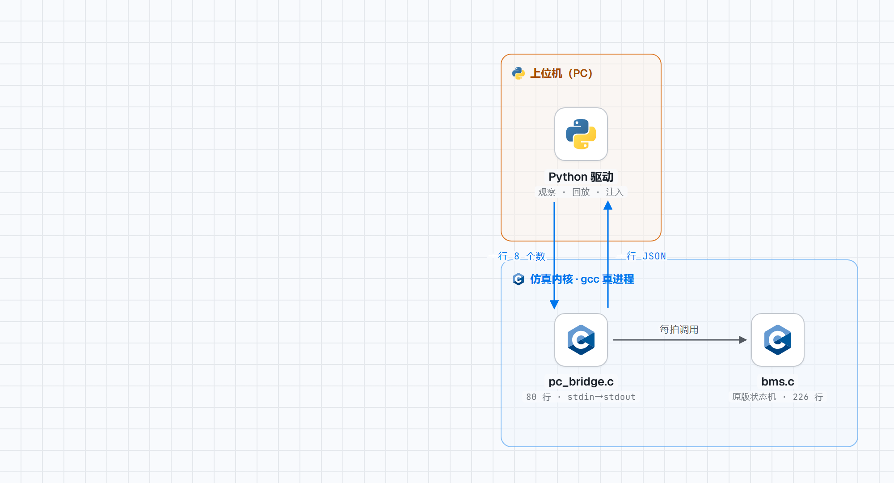
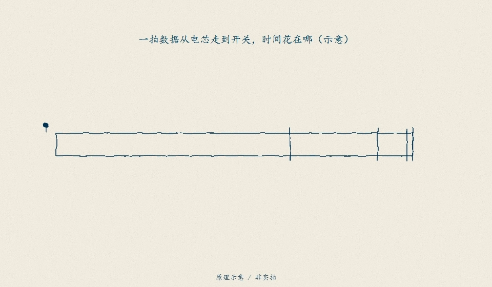
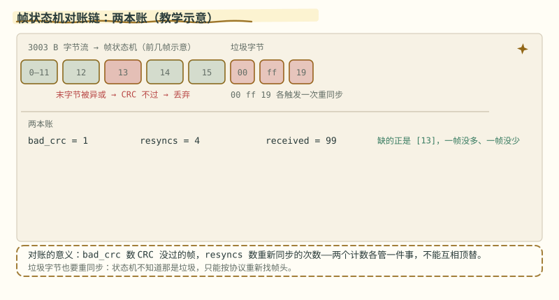
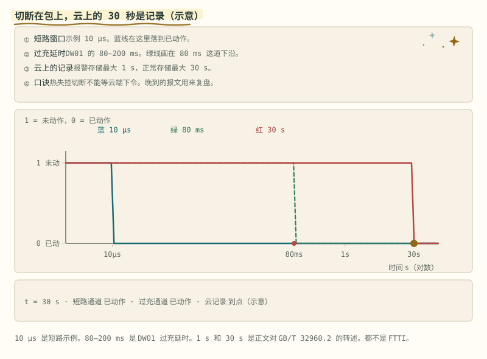

# 第 20 章 上位机与数据链

::: story 现场
充电中，一串电压越过包内阈值。软件去抖后断开充电 MOS，硬件比较器仍按本地分压保持切断能力；车载终端按正常周期把数据放进存储，平台要等这条记录上传。若当时没被标成 3 级报警，存储间隔仍按不超过 30 s 那一档。

只看平台的人事后复盘：“云端没有及时保护。”可保护从来没有等过云：包上这一拍就断，云上的报文可以晚半分钟。这一章讲上位机在这条链里能做什么、不能做什么。
:::

::: chapter-route 阅读路径

- **第一次主线**：读 §20.1–§20.3。分清包内保护、PC 回放和五份逐帧证据，确认上位机只观察与注入，不承担最终保护。
- **第二遍深挖**：读 §20.4–§20.7。再处理云端边界、注入诊断和发生／记录／接收三种时间。
- **动手验证**：运行 PC 全链路，逐帧对齐输入、固件 JSON、CSV、故障快照和报告。
:::

**先自己判断**　平台在故障发生 20 s 后才收到报文，能否据此证明包内保护晚了 20 s？

## 20.1 上位机负责观察、回放与注入

先把“上位机”摆正：它是观察者、回放者与注入者，不是保护回路的一部分。BMS-Z 的 PC 全链路仿真把这条边界做成了工程结构：电芯是 Thevenin 模型，故障在**采样端**注入，状态机是仓库里那份原版 bms.c（226 行），桥接层 pc_bridge.c 只有 80 行。Python 只通过带超时的管道喂数字、读 JSON，**状态机逻辑不复制**。

为什么不拿 Python 重写一遍状态机？重写就有两份实现，两份就会分家：教程说的和读者跑的不再是同一套判决逻辑。走真进程还有个副作用：超时成了真约束，10 秒拿不到回复就抛错，而不是靠一句 assert 假装。编译用 -std=c99 -Wall -Wextra -Werror，警告即错误，编得过本身就是一条断言。

喂给它的一行是八个数：四串电压、电流、温度、充电器在不在、SOC；一次回车返回一行 JSON 状态。例如 4150 4150 4150 4150 2000 250 1 76，回来的是 STANDBY、无故障、soc_pct 76。整个实验不接电池；1 秒一拍是教学节奏，真实短路硬件保护的反应预算另行验证。

<figure>

<figcaption>图 20-1　PC 全链路仿真的真进程边界：Python 驱动经管道与真进程对话——一行 8 个数进，一行 JSON 状态出，10 秒拿不到回复就抛错；pc_bridge.c（80 行）每拍调用仓库原版 bms.c 状态机（226 行），编译 -std=c99 -Wall -Wextra -Werror。上位机只观察、回放与注入，不在保护回路里。</figcaption>
</figure>

## 20.2 一拍之内，谁先谁后

固件不是一堆 if，是四层加一台状态机：采样层、估算层、判决层、执行层。示意的信号预算把一拍拆成采样 8 ms、估算 3 ms、判决 1 ms、执行 0.2 ms。认顺序，不认数。

在 1 秒一拍的仿真里能看到两个“晚”：

- **判决晚**：第 46、47 拍越限先记账，第 48 拍为连续第三拍越限，确认 OVP 并关断充电 MOS；从首次越限到确认跨两个采样间隔。仿真每拍 1 s，拍数不能直接等同于器件的 20 ms 延时档；
- **执行晚**：第 48 拍动作（充电使能翻 0），电流第 49 拍才被掐掉：这一拍加进来的电流，要看**上一拍**的命令允不允许。

<figure class="book-motion" data-animation="bms-signal-budget.webp" data-mode="static">

<button type="button" data-book-motion v-book-motion aria-pressed="false" hidden>播放动画</button>
<figcaption>图 20-2　一拍内必须按采样、估算、判决、执行的顺序走。教学预算累计为 8、11、12、12.2 ms，大头在采样；这些数值不是某颗 MCU 的实测，短路硬件比较器也不经过这条软件链。</figcaption>
</figure>

有人嫌三拍确认慢，想改成一拍就动作。需要权衡输入噪声、滤波和故障反应预算：少确认可能误停机，多确认可能延误。真实短路另有快速比较器通路；本实验的本拍 SCD 是教学状态机行为，不能代替硬件反应时间的实测。

::: principle 一句话
逐拍记录必须标出采样、判决、命令和执行反馈所在的拍。只记录命令，无法证明动作何时到位。
:::

## 20.3 五份产物，逐帧对账

一条命令约 2 秒，跑出五份产物：

- `samples.csv`：逐拍采样，100 行；
- `telemetry.csv`：解出来的遥测帧，99 行；
- `wire.bin`：原始字节流，3003 B；
- `events.json`：状态或故障变化的那几拍；
- `report.json`：验收报告。

报告不是一句“跑完了”就完事：它说的是八项检查全对上了。100 帧里第 13 帧发出前被故意异或最后一个字节，CRC 对不上，解析器按规矩扔掉它、计数 bad_crc = 1，再重新同步。resyncs 计 4 次：一次为被扔的第 13 帧，三次为脚本塞进去的三个垃圾字节 00 ff 19。最终 received 99、缺的正是 [13]，一帧没多、一帧没少。

resyncs 与 bad_crc 是两本账：前者是字节流失去对齐后重新找回边界的次数，后者是帧找到了但校验不过的帧数，4 比 1 不是矛盾，是两桩不同性质的事故各记各的账。CRC 必须**重算后比对**，不能照着帧里的字段抄一遍。只改 CRC 字段而接收端不重算，就发现不了；改负载而接收端重算，才能验证校验是否生效。帧状态机的细节见第 18 章；上位机应拿原始字节流和接收日志逐帧对账，坏帧要计数，不能静默丢弃。

<figure class="book-motion" data-animation="frame-resync-ledger.svg" data-mode="static">

<button type="button" data-book-motion v-book-motion aria-pressed="false" hidden>播放动画</button>
<figcaption>图 20-3　一次实跑的对账链：3003 B 字节流里第 13 帧末字节被异或，CRC 重算不过即丢弃并重新同步；三个垃圾字节 00 ff 19 各触发一次重同步。bad_crc = 1 与 resyncs = 4 是两本账；最终 received 99，缺的正是 [13]，一帧没多、一帧没少。</figcaption>
<p class="visual-guide"><strong>先看哪里：</strong>跟住帧槽 0–5：第 13 帧位置红叉、计数 bad_crc 跳到 1；右侧垃圾字节 00 ff 19 逐个触发重同步，resyncs 依次跳 4 次；末尾对账行 received 99、missing [13] 亮起。</p>
<p class="visual-question"><strong>看完追问：</strong>为什么扔掉 1 帧却计 4 次重同步？回看上文「两本账」的口径，再想 00 ff 19 每个字节各做了什么。</p>
</figure>

## 20.4 上位机还用于注入与诊断

没有独立真值时，上位机仍可比较残差结构。恒流段（充电 + 放电共 50 拍）的新息中位数 0.219 mV 是基线；三段采样端注入的峰值分别为 71.7 mV（过压）、585.2 mV（短路）、29.2 mV（过热），约为基线的 330、2680、130 倍。同样三段的新息中位数则为 41.8、411.3、18.1 mV，比较前必须说明采用峰值还是中位数。新息只依赖模型预测与仪表读数，不需要参考 SOC。

> 先自己判断：三段注入里，过热是最危险的一类故障。为什么它的新息反而喊得最轻？

温度注入喊得最轻，不是注入不够狠：温度不进观测方程，估算器只看电流和端电压，残差只对它见过的那两个量负责（判定方法见第 17 章）。快照锁存的是第一现场：第一次判出 OVP 的第 48 拍、4300 mV 被冻结，后面 52 拍状态再动、电压再变，也不覆盖。事故复盘要的就是这一拍，不是“最后的状态”。

## 20.5 数据链的边界：云到包外为止

帧出了包，时间尺度就换了。GB/T 32960.2—2016 对车载终端的写法：实时数据采集不低于 1 次/s；正常时内部存储间隔最大不超过 30 s；出现该标准所指的 3 级报警时，存储间隔最大不超过 1 s。上传另见 GB/T 32960.3：通信中断先存本地，恢复后再补发。这是**监控记录**，不是保护时限。包上的切断走自己的去抖和硬件速度：短路示例 10 µs、过充窗口 80–200 ms，都早于那 30 s。

把三档时间摆在对数轴上：10 µs、80–200 ms、30 s，横跨六个数量级。“保护”与“监控”的分工，就是被这条时间轴划开的：左边的归包上的比较器，右边的归终端和平台，中间的软件去抖各管一段。

本地缓冲也有顶。示意：采样 1 Hz、缓冲深度 60，掉线后攒下的点数为 n = min(60, t)（t 按秒）。30 s 攒 30 点，60 s 装满，90 s 仍是 60：最早的 30 秒已被新点盖掉，而云端在整段掉线里收到的是 0。水平那段就是渐近线：深度有限，样本数不会跟着掉线时间一直涨。

- **必须留在包上**：过充、过放、过流、短路、过温的切断；开线检测；绝缘与接触器粘连的安全状态。这些不依赖蜂窝信号。
- **可以放在云上**：车队统计、SOH 模型的离线更新、一份“建议标定”。建议值写进包之前要走参数区的版本、CRC、双备份，并且不得放宽硬件比较器；OTA 只换应用区，bootloader 不被覆盖。

云上到底能看见什么？开源的 OVMS 网页仪表盘（MIT 许可）是个具体的参照：单车的 SOC、续航、电池电压、电流、温度和 SOH。它是车载监控网页，不是商业车队云的后台，也不在切断回路里。画面里没有电池单体电压和包内 DTC。

::: trap 坑
三种把链路用错的方式：平台半分钟没报警，就当没有过充；用云端标定把软件过充点改高来消“误报”，还把硬件比较器一并放宽，独立的第二道就没了；把热失控切断做成“等云端下令”。云上的曲线安静，不等于包里安静。
:::

<figure class="book-motion" data-animation="cloud-vs-pack-protection.svg" data-mode="static">

<button type="button" data-book-motion v-book-motion aria-pressed="false" hidden>播放动画</button>
<figcaption>图 20-4　包内保护与云端记录的时间尺度：快速动作留在包内，晚到上报用于监控与复盘。时限按具体系统确认。把本地采样、故障动作和平台收到报文分别落在时间轴上；同一事件有三种时间。平台晚收到异常，能否推断包内晚切断？需要对齐哪份快照与反馈？</figcaption>
</figure>

## 20.6 复盘先找包内证据

平台曲线出现越限时，先找包内 DTC、触发快照和执行器反馈。快照说明当时测到了什么、状态机判了什么；反馈用于核对开关实际状态。平台接收时间只说明记录何时上传，三份证据要用同一事件 ID 对齐。

若反馈缺失，只能证明发出了命令，不能证明通路已经切断。若包内快照缺失，也不能用平台上晚到的电压点反推准确的判决时刻。

## 20.7 一次事件有三种时间，不能拿晚到证明晚动作

同一个 OVP 至少有三只钟：传感器采到越限的**样本时间**、状态机确认并下命令的**判决时间**、平台收到报文的**接收时间**。三者回答不同问题。若只保留平台时间，补发会把昨天的故障画成今天刚发生；若只保留样本时间，又看不见软件与执行器花了多久。

**表 20-1**　毫秒级教学时间轴示意（非前文 1 s 一拍的 PC 回放实测）

| 字段 | 教学示例 | 它能回答什么 | 它不能证明什么 |
|---|---:|---|---|
| `sample_seq / t_sample` | 48 / 48.000 s | 哪一份物理样本触发判决 | 接触器何时真的断开 |
| `t_decision / t_feedback` | 48.012 / 48.020 s | 软件延迟与动作反馈间隔 | 云端何时看见 |
| `t_receive` | 76.400 s | 报文何时到达平台 | 包内在 76.400 s 才保护 |

示意中平台比采样晚 28.4 s，包内判决比采样晚 12 ms，反馈再晚 8 ms；应分别按各自预算核对。事件身份可用 `device_id + boot_id + sample_seq + event_counter`：设备、重启轮次、样本序号和事件计数器共同定位一件事。时间戳用于排序和计算延迟，身份字段用于关联文件；两者不能互相替代。

时钟也会漂。跨 ECU 对齐时要记录同步来源和误差上界；无法同步，就只对同一节点使用单调时钟算时长，把墙上时间当显示字段。复盘报告至少同时给出原始时间、接收时间、时钟域、同步状态与事件 ID。这样平台曲线即使晚到、乱序或补发，仍能回到包内那一拍。

把这些数据用于模型标定或训练之前，还要核对文件、行和字段语义。第 21 章接着处理数据准备。

::: lab 动手
在 BMS-Z 仓库根跑 `python code/firmware/pc_demo.py --out code/firmware/pc-demo-output`（需要 gcc，约 2 秒）。先读 report.json 的八项检查与 passed，再去 telemetry.csv 确认缺的正是哪一帧；然后故意给一个假编译器 `--cc not-a-compiler`，看退出码 2 的负控。最后回答：第 48 拍和第 49 拍各发生了什么？
:::

## 20.8 跟做实验：把一拍的时间账和缓冲账算清

本章的信号预算、本地缓冲与三种时间都能用一段标准库脚本复现。存成 `link_ledger.py` 跑 `python link_ledger.py`：

```python
stages = (("采样", 8.0), ("估算", 3.0), ("判决", 1.0), ("执行", 0.2))   # 20.2 教学预算
total = 0.0
for name, ms in stages:
    total += ms
    print(f"{name} {ms} ms → 累计 {total:.1f} ms")

for t in (30, 60, 90, 100):        # 20.5：n = min(60, t)，采样 1 Hz
    print(f"掉线 {t} s：云端可补回 {min(60, t)} 点")

payload, detail = 23 - 3, 120      # 知识点：默认 ATT MTU 23、扣 3 B 头
print(f"120 B 明细需 {(detail + payload - 1) // payload} 包；MTU 247 时 1 包")

sample, decision, feedback, receive = 48.000, 48.012, 48.020, 76.400   # 20.7 教学轴
print(f"判决晚 {decision - sample:.3f} s，反馈再晚 {feedback - decision:.3f} s，平台晚 {receive - sample:.1f} s")

base = 0.219                       # 20.4：恒流段新息中位数基线（mV）
for tag, peak in (("过压", 71.7), ("短路", 585.2), ("过热", 29.2)):
    print(f"{tag} 峰值 {peak} mV ≈ 基线 {peak / base:.0f} 倍")
```

**成功判据**（全部对上才算跑通）：

- 累计预算 8、11、12、12.2 ms，大头在采样。
- 缓冲：30/60/90/100 s 掉线可补 30/60/60/60 点，最早 40 s 被覆盖。
- MTU 23 时 120 B 明细需 6 包；MTU 247 时 1 包。
- 判决晚 12 ms、反馈再晚 8 ms、平台晚 28.4 s。
- 注入倍数约 330/2680/130（与 20.4 取整值一致）。

对不上时先查两处：缓冲是否取 min(60, t)；MTU 载荷有没有扣 3 字节 ATT 头。
## 20.9 翻车对照：链路把人骗走的三条路

下表把 20.1–20.7 出现过的误用压成一页。共同点：包内其实已经动作，或包内证据还没被翻开。

**表 20-2**　链路把人骗走的三条路

| 症状 | 可能原因 | 排查或对照 |
|---|---|---|
| 平台 30 s 没报警就当没过充 | 无 3 级报警时存储间隔 ≤30 s；上传另计（20.5） | 翻包内 DTC、快照与执行器反馈 |
| 云端标定改高过充点来消“误报” | 放宽了硬件比较器；独立第二道没了（20.5） | 参数区版本、CRC、双备份；比较器不动 |
| 热失控切断设计成等云端下令 | 蜂窝不保证在线（20.5） | 过充/过流/过温切断留在包上 |
| 第 48 拍动作就说电流同时归零 | 电流第 49 拍才掐；看的是上一拍命令（20.2） | 逐拍标采样/判决/命令/执行反馈 |
| 收到 99 帧就判链路完好 | bad_crc=1 与 resyncs=4 两本账没分（20.3） | 原始字节流 + 接收日志逐帧对账 |
| 改 CRC 字段验证校验是否生效 | 接收端不重算就发现不了（20.3） | 接收端重算后比对 |
| 拿平台接收时间反推包内判决时刻 | 接收时间 ≠ 样本/判决时间（20.7） | 三只钟按 sample/decision/receive 分列 |
| 掉线 90 s 仍等云端补 90 s 数据 | 缓冲深度 60；最早的 30 s 已被覆盖（20.5） | 按 n = min（深度、掉线时长）算 |

> **同构点**　本章“上位机只观察、回放与注入，不在保护回路里”与卷 I 第 16 章《排故五步法》“一接探头就停振，探头电容参与了环路”互为镜像：观察通道一旦进入被测对象，它自己的行为就成了证据链的一环；复盘时要把观察证据与执行证据分开落拍。

## 本讲服务知识点

<!-- kp-backlink:start -->
本章服务 1 个知识点；每条都能回到[核心问题地图](../../docs/核心问题地图.md)的 L1–L5 五级入口。这一节由 `curriculum/concepts.json` 的 `book` 字段生成。

**表 20-3**　本章服务的知识点与其梯子入口

| 知识点 ID | 标题 | 阶段 | 梯子到 | 握证 |
|---|---|---:|---|---|
| [`smbus-ble-boundaries`](../../docs/核心问题地图.md#kp-smbus-ble-boundaries) | SMBus与BLE边界 | 5 | L3 | 日志 |

**SMBus与BLE边界：笔记本电池和手机 App，读的是同一类接口吗？**

SMBus 常把电池量放进有约定含义的寄存器，主机按地址读取；BLE 把量放进可读写或通知的特征值，长数据还要考虑分片。它们方便上报，不应承担第一道切断保护。无线一断、主机一忙，包内仍必须自己执行安全边界。先分清传输承载，再讨论字段语义和权限。

**教学算例：沿着这组输入做一遍**

1. 默认 ATT MTU=23 字节，去掉 3 字节 ATT 头，只剩 20 字节有效载荷。
2. 120 字节明细至少要 ⌈120/20⌉=6 包，还要明确序号、总长度和重组超时。
3. 协商 MTU=247 时，载荷为 244 字节，可装下同一明细；协商成功才可用新上限，不是本机想发多少就多少。

**边界与反例**　SMBus 不等于完整电池语义标准，BLE 连接也不自动给出正确字段或写权限。上报失败不能成为包内保护停止的理由。

**看图任务**　先数每片真正装了多少数据，再追组包和超时；把遥测路径与安全切断路径分开。

**对应图解**　[smbus-sbs-roundtrip](../../docs/circuits/assets/smbus-sbs-roundtrip.svg) · [ble-mtu-reassembly](../../docs/circuits/assets/ble-mtu-reassembly.svg)

**先自己判断**　默认 MTU 23 时算有效载荷与 120 字节明细的包数；再算协商到 MTU 247 后的包数。

完成后再展开标准；先保留自己的计算、判断或运行记录。

<details class="kp-retrieval-check">
<summary>核对通过标准</summary>

20 字节、6 包；MTU 247 给 244 字节、1 包；记得扣 3 字节 ATT 头。

</details>

<!-- kp-backlink:end -->

## 练习

1. 平台上 30 秒没有报警，能说明包没有过充吗？用 GB/T 32960.2 的存储间隔回答。
2. 掉线 100 s（采样 1 Hz、缓冲深度 60，示意）。链路恢复后，云端最多能补回多少秒的数据？最早的哪一段去了哪里？
3. 仿真里第 46 拍电压已越限，为什么第 48 拍才动作、第 49 拍电流才归零？把“判决”与“执行”各自延迟的原因说清。

## 参考资料

- BMS-Z 共学·PC 全链路五天：https://github.com/zhuguang-ZFG/BMS-Z/blob/main/docs/共学/08-pc全链路五天.md
- BMS-Z 阶段 6（§6.2.6 云端诊断停在包外）：https://github.com/zhuguang-ZFG/BMS-Z/blob/main/docs/stages/stage-6-精通与毕业项目.md
- BMS-Z 阶段 3（§3.4 固件架构）：https://github.com/zhuguang-ZFG/BMS-Z/blob/main/docs/stages/stage-3-AFE-MCU智能BMS.md
