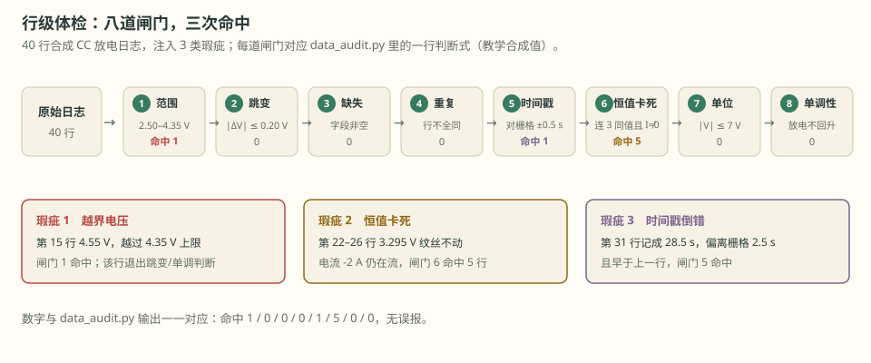
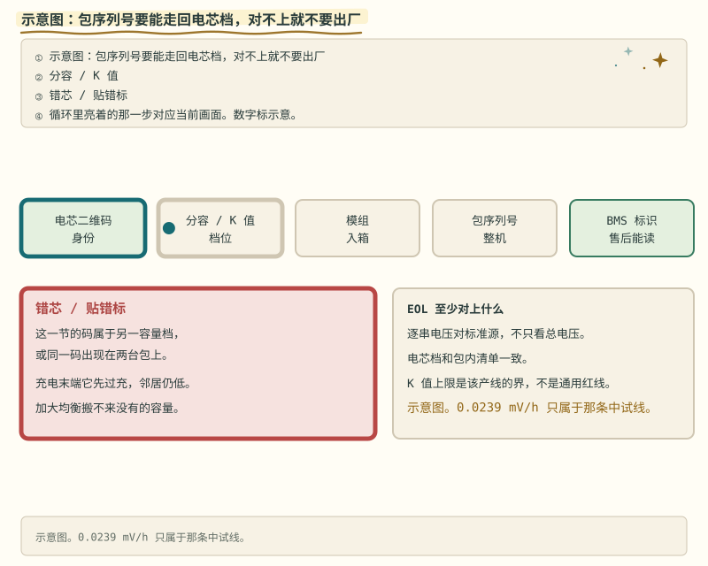

# 第 21 章 数据准备：先验身份，再用数据

::: story 现场
同一个 CSV，在两台机器上 SHA-256 不一样：一台算出 a1b2…，另一台算出 c3d4…。团队第一反应是“数据坏了”。虚惊一场——文件一个字没变，是 Git 的 autocrlf 在签出时把行尾从 LF 换成了 CRLF（教学合成）。哈希没骗人，它只对字节诚实，不对“你所以为的字节”诚实。

BMS-Z 的 NASA RW3 数据准备更偏执：25,461 行按用途切成四段（19,120 / 725 / 3,003 / 2,613），哈希在 metadata、CSV、报告三处对得上；改 1 个字节就被拦下。但哈希通过，仍可能选错行——所以还要有行级体检和负控。
:::

<figure>

<figcaption>图 21-1　行级体检流水线：八道闸门、三次命中，数字与 data_audit.py 输出一一对应。</figcaption>
</figure>

## 21.1 数据的三层身份

**表 21-1**　数据三层身份的检验问题与手段（教学框架）

| 层 | 问题 | 手段 |
|---|---|---|
| 文件身份 | 这份文件是不是我以为的那份？ | SHA-256、大小、来源 URL |
| 行身份 | 这段数据属于哪个工况/电芯/温度？ | 分段、元数据、时间戳 |
| 语义身份 | 电流符号、单位、SOC 口径是什么？ | 与已知量对照、画图、物理检查 |

只做第一层，你会“拿着正确的文件做错的分析”。

## 21.2 先验身份，再谈使用

SHA-256 **能**：证明字节级一致；发现下载损坏；发现“同一路径换了内容”。**不能**：证明来源合法、字段含义正确、你选对了行、模型适配。

两个最常见的坑都在字节层：

- **行尾**：autocrlf 签出换行尾，哈希立刻不同；解法是用 .gitattributes 固定（`*.csv text eol=lf`，或干脆 `*.csv -text` 当二进制管）。
- **编码**：UTF-8 BOM 让文件头悄悄多三个字节，哈希与解析一起翻车。

数据卡八要素：来源、许可、采集条件、切分方式、哈希、已知瑕疵、版本、责任人。缺一项，三个月后一定有人踩。

BMS-Z 的负控有三道：改 CSV 一个字节 → 哈希门拦下；只改 metadata 的行数声明 → 计数门拦下；两边一起改并重算哈希 → 门都放行。**信任根是人写的 metadata，哈希不负责“选对了行”。**

::: trap 坑
把“公开数据”当“免费数据”。很多数据集有非商业许可或署名要求；NASA 数据可自由使用，也仍要写明来源与口径。用于产品前，数据卡的许可栏必须打钩。
:::

## 21.3 行级体检：八项检查

哈希只到文件层；行层要一项项过（判断式见 `code/data_audit.py`）：

**表 21-2**　行级体检八项检查与判断式（`data_audit.py` 示例阈值）

| 检查 | 判断式（示例阈值） |
|---|---|
| 范围 | 2.50 V ≤ V ≤ 4.35 V |
| 跳变 | 相邻有效行 abs(ΔV) ≤ 0.20 V |
| 缺失 | 字段非空且可解析 |
| 重复 | 相邻两行不得全同 |
| 时间戳对齐 | abs(t_k − t_0 − k·Δt) ≤ 0.5·Δt |
| 恒值卡死 | 电流 ≠ 0 时不得连 3 点同值 |
| 单位 | abs(V) ≤ 7 V（防 mV/V 混用） |
| 单调性 | 放电段相邻不回升超 5 mV |

体检也出“结论账”。BMS-Z NASA RW3（2026-10 实测）：容量标定 2.009 Ah，低流组 2.119 Ah——同一颗电芯两个数都对，因为条件不同；R0 取脉冲两个沿的平均，82.0 mΩ。这些数进报告前，都先过了分段与哈希。

跑 `python code/data_audit.py`：40 行合成日志注入 3 类瑕疵（越界、卡死、时间戳倒错），八项检查命中 1/0/0/0/1/5/0/0，无误报。

## 21.4 切分与泄漏

BMS-Z 把 25,461 行按用途切四段：ocv 19,120 行、capacity 725 行、pulse 3,003 行做标定；validation 2,613 行只做回放。标定回答“参数是多少”，验证回答“参数行不行”——同一段数据既标定又评估，等于自己给自己批卷。

泄漏的典型形态：在 validation 段上反复调 Q/R，把 4.92 个点的残差压到 2 个点，再宣称“验证精度 2 个点”。这不是验证，是换了个地方拟合。第 12 章的 trap（参考值当真值）与第 17 章的无真值诊断，都是这条纪律的延长线。

<figure class="book-motion" data-animation="cell-trace-chain.svg" data-mode="static">

<button type="button" data-book-motion v-book-motion aria-pressed="false" hidden>播放动画</button>
<figcaption>图 21-2　数据与电芯追溯链：实物身份、测试记录、批次和文件需要相互对应，哈希只保护已经选定的字节。看哪条边把数据文件连回实物和工况；文件完整不证明数据属于正确电芯。如果行范围选错但哈希仍匹配，哪一层证据应该发现问题？</figcaption>
</figure>

## 21.5 无真值时的诚实标注

NASA 回放报告的参考 SOC，是用同一套实测电流、独立标定容量积出来的——和被评估的估算器共享误差源。报告不宣称“精度 4.92%”，而是写清口径：

- `independent_soc_truth`（报告字段，JSON 值为 false）：没有独立测得的 SOC 真值；
- `model_fitted_on_validation = false`：没有在验证段上调参；
- RMSE 20.74 → 4.92 个点（generic → calibrated）：只是换参数后的自洽性对比，不是绝对精度。

引用别人的数据，就把这几行一起抄走。缺了它们，4.92 会被传成“这台 BMS 精度 4.92%”。

::: principle 一句话
**哈希管“没变”，分段管“选对”，体检管“行内没病”，物理检查管“说得通”。** 四层都过，数据才算可用；任何一层偷懒，后面全是空中楼阁。
:::

## 21.6 分发边界：给程序，也给 AI

同一份数据，三种给法：

- **给程序**：原始 CSV + metadata.json + 哈希值。程序靠哈希对账，不靠文件名。
- **给人**：数据卡 + 三张图（电压–SOC、电流–时间、温度–时间）+ 已知瑕疵清单。
- **给 AI**：只给左栏——可回链的原文（报告字段、行数、哈希、判断式）。让模型凭记忆答“NASA 那颗电芯容量大概 2 Ah”就输了；贴 `capacity_ah = 2.009` 原文，错了能查、能回链。这正是第 24 章的左栏右栏之分。

判据一句话：凡是会写进报告、进产品、进阈值的数字，都要能回链到一份哈希对得上的文件。

::: lab 动手
先跑 `python code/data_audit.py`，确认 3 类瑕疵全被抓到、无误报。再在 BMS-Z 仓库跑 `python code/soc/real_data.py`，打开 `code/soc/real-data-output/report.json`，找出 `csv_sha256`、`independent_soc_truth`、`model_fitted_on_validation` 三行，与 `code/soc/data/nasa_rw3/metadata.json` 核对是否一致。
:::

## 21.7 三笔自检账：数据卡上的字段不是装饰

数据卡八要素里最容易被当成"填完就忘"的，是电流符号约定、时间戳口径与容量标定。这一节给三笔能动手算的对账账——每笔都有判据，判据不过先怀疑数据身份，不要先怪电芯。

**第一笔：电量守恒对账。** 同一段放电里，安时积分 `∫I dt` 除以容量标定，应当与 OCV 静置点读出的 `ΔSOC` 对得上。差多少算对得上？把两项已知误差加起来当容差。第一项是电流零漂：`code/soc/compare.py` 的传感器缺陷给了 +2 mA 的电流零漂（第 12 章那个 2 mA 是 BMS 静态自耗、不在采样通道里，第 12 章的传感器偏置示例是 0.1 A；这里借同一量级做算例），它按 `b·T` 累积，**与电流大小无关**——

```
2 mA × 16 920 s ÷ 3 600 = 9.4 mAh
9.4 mAh ÷ 10 000 mAh = 0.094%（对 10 Ah 电芯）
```

（16 920 s 是 `compare.py` 同款 4.7 h 工况的时长。）第二项是时间戳口径误差：测量时基若带一个比例误差 `ε`，电荷误差是 `ε·∫I dt`——**只有电流非零时才累积**，静置段对电量没有贡献（但记录的时间本身会漂：见第二笔）。两项合起来，容差约等于 `b·T + ε·∫I dt`。**判据**：对账差超过这两项之和，先查数据身份——符号反了、时基错了、单位混了，三选一通常就中；直接把锅甩给电芯老化，是把最便宜的检查留到最后做。

**第二笔：时基对账。** 采样周期标称 1 s，若真实是 1.01 s，每一拍多记 1% 的时间：

```
10 min = 600 拍：600 × 0.01 s = 6 s 累积
1 h = 3 600 拍：3 600 × 0.01 s = 36 s 累积
```

两笔账的分工要分清：**零漂作恶与电流无关**（`b·T`，静置一夜照样把电量记歪），**时基误差作恶要有电流**（`ε·∫I dt`）；而时基那 1% 让时间戳本身漂了 36 s/h，凡是"按时间"的逻辑——窗口长度、τ 拟合、时间同步、日志对齐——都被它牵连。所以两条判据缺一不可：电流零漂要在静置段查（那里最灵敏），时基误差要跑满一段带电流的工况才看得出来。**判据**：时间戳必须单调（21.3 的对齐检查只管局部），另要与独立时钟比对一次绝对偏差；两条都过，才允许把"1 s"写进数据卡。

**第三笔：符号与量纲对账。** 充电为正还是为负，必须在数据卡里写死，然后**用一次已知分段做极性断言**：取一段明确是放电的工况，其 `I` 均值必须与约定同号——约定"放电为正"，均值就该是正的；反了，说明字段含义与约定不符。符号判反的后果不是报错，是静默地得到一条越充越"满"越错的 SOC 曲线。画图"看曲线顺眼"不算验证——那是用肉眼消化误差，不是用断言拦住它。三笔账共同的底层逻辑是第 21.1 节的三层身份：哈希过了只说明字节没变，语义身份要靠这些对账账单独建立。

## 21.8 坏值与缺口：处理账要进质量位

体检抓出坏值之后呢？这一节算两笔账：怎么判坏，以及缺口怎么记。

**单点跳变的检出规则。** 用两个统计量交叉：相邻点差分抓"突变"，滚动中位数抓"孤立点被均值带偏"。阈值规则写成可检查的形式——差分超过滚动中位数绝对偏差（MAD）的 K 倍才判坏。K 是策略参数，**写进数据卡**，与判断式一起被哈希保护；写进代码注释里，三个月后没人记得当时为什么选 5 不选 3。这延续 21.3 的原则：判断式进数据卡，不进口头约定。

**缺口处理三分法。** 缺口不是一种东西，分三种，各有各的账：

**表 21-3**　数据缺口三分法及各自的影响边界（教学口径）

| 缺口类型 | 处理 | 对 SOC / 参数辨识的影响边界 |
|---|---|---|
| 短缺口（≤ 2 个采样周期） | 线性插值，质量位标"插值" | 误差小且可上界，不影响后续记账 |
| 长缺口 | 标记为未知，停用该段 | 该段不进安时积分、不进参数辨识；SOC 锚点要等下一个静置点 |
| 跨工况缺口 | 断开分段 | 缺口两侧是不同工况，硬连会把两段的身份混成一段 |

短缺口可以插值，是因为相邻采样点的物理量变化有上界（21.3 的跳变检查就是这条上界）；长缺口停用，是因为插值等于**编造数据**——编出来的电流进了安时积分，编出来的电压进了参数辨识，两个下游都中毒；跨工况缺口必须断开，否则切分段的身份污染会顺着泄漏进验证集（21.4 的教训）。

**长缺口不记账的代价能算出来。** 连续丢 30 s 的 1C 放电（10 Ah 电芯，1C = 10 A）：

```
30 s × 10 A = 300 A·s ÷ 3 600 = 83 mAh
83 mAh ÷ 10 000 mAh = 0.83%
```

缺口如果被当 0 处理（电流记零），这 83 mAh 就从账上消失了——每丢一次，容量记账虚低 0.83%。把缺口记为"未知"而不是 0，不是完美主义，是让每一次丢数据都有账可查。**判据**：任何进报告的安时积分，必须同时报告缺口时长与质量位覆盖率；覆盖率不足的段不许单独出结论。

## 练习

1. 行尾案：什么条件下两台机器对同一 CSV 算出的 SHA-256 必然相同？（提示：.gitattributes）
2. 给你一段含 3 类瑕疵的电压序列（越界、恒值卡死、时间戳倒错），写出体检清单：每项检查的判断式与预期命中行号。
3. 举一个“切分泄漏”的具体场景，说明它会让哪个数字虚高、虚高多少。

## 参考资料

- BMS-Z 数据准备五天：https://github.com/zhuguang-ZFG/BMS-Z/blob/main/docs/共学/11-数据准备五天.md
- BMS-Z SOC 真实数据专题：https://github.com/zhuguang-ZFG/BMS-Z/blob/main/docs/SOC真实数据专题.md
- BMS-Z `prepare_nasa.py`：https://github.com/zhuguang-ZFG/BMS-Z/blob/main/code/soc/prepare_nasa.py
