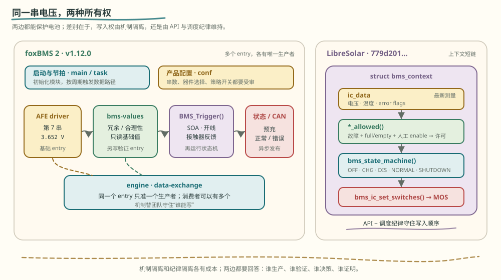
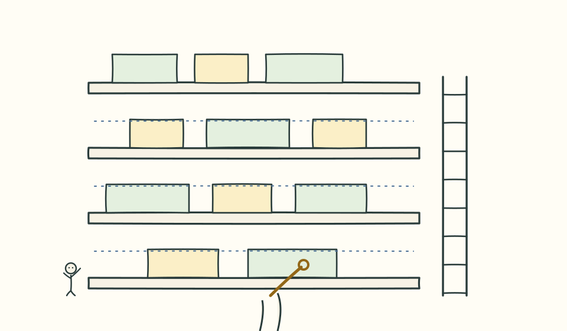
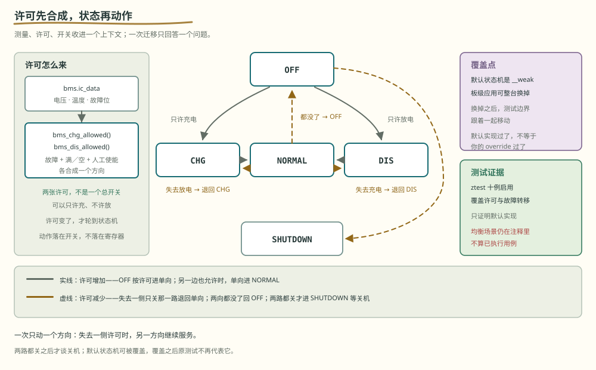
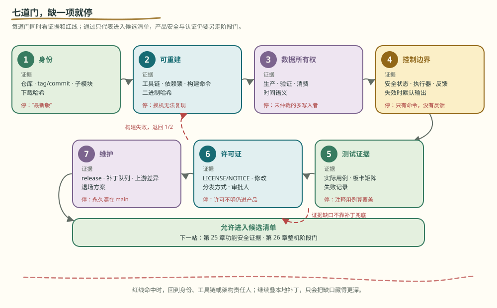
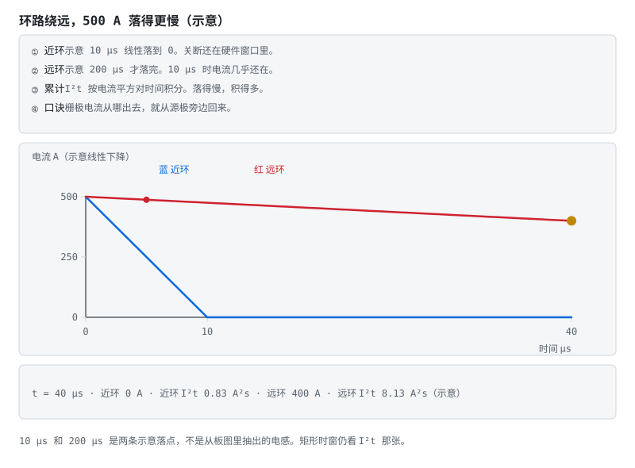

# 第 22 章 开源架构：沿一条信号读懂取舍

::: story 现场
你把 foxBMS 2 的 CAN 驱动搬进自己的应用层，改了十处适配，跑通了。三个月后 upstream 更新，你 merge 了三天，还丢了两个补丁：一个去抖计数、一个故障快照。（教学合成场景）

问题出在**边界**。你只搬了实现，没有带走数据由谁产生、谁有权改、故障在哪层闭合、哪组测试证明它仍成立。补丁于是散进应用层的褶皱里，upstream 甚至不知道它们存在过。
:::

<figure>

<figcaption>图 22-1　同一串电压，两种所有权。foxBMS 2 用 data-exchange entry 隔离生产者；LibreSolar 把路径收进一个上下文，靠 API 与调度纪律维持写入顺序。图中是职责和数据流，不是仓库目录树。</figcaption>
</figure>

::: chapter-route 阅读路径

- **第一次主线**：读 §22.1–§22.4。先冻结版本，再跟着“第 7 串电压”走过生产、验证、决策和动作。
- **第二遍深挖**：读 §22.5–§22.9。处理安全论证、许可证、准入七问、五步读法和供应商管理。
- **动手验证**：选一个开源仓库，记录完整 commit、构建工具链、许可证、最小测试和本地补丁位置。
:::

**先自己判断**　某开源仓库星数很高、最新提交也很活跃，能否据此把 `main` 分支直接当成产品基线？

## 22.1 先冻结证据，再谈架构

<figure>

<figcaption>图 22-2　开源架构是开放式层架：层与层之间留有缝隙，模块可以抽取替换；社区的手递进来的是扳手不是胶水。分层边界为定性示意。</figcaption>
</figure>

开源仓库每天会动。“foxBMS 把状态机放在哪”如果不带版本，半年后就可能变成一句无法复核的印象。本章在 **2026-10-23** 固定两份阅读快照：

**表 22-1**　两份开源项目的核对点与发布、许可证边界（2026-10-23 固定快照）

| 项目 | 本章核对点 | 发布边界 | 许可证边界 |
|---|---|---|---|
| foxBMS 2 | release `v1.12.0`，commit `73dbde670f7e…` | `v1.12.0` 是正式 release，源码与对应版本文档可互相回链 | 软件 BSD-3-Clause；硬件与文档 CC BY 4.0 |
| LibreSolar `bms-firmware` | `main` commit `779d20199bff…` | `main` 是持续开发；仓库说明 release 需通过多块板测试，GitHub 最新 release 为 `v23.1` | 固件 Apache-2.0 |

星数说明传播度，安全完整性要另查；`main` 最近有提交，也不能把它变成稳定 release。工程记录至少写四项：**仓库、完整 commit、检索日期、你实际构建的工具链**。只写“用了最新版”，等于没有版本证据。

## 22.2 foxBMS 2 的五道边界

把 foxBMS 简写成 application／engine／driver 三层，适合第一眼看图，却不能拿来定位代码。`v1.12.0` 的 `src/app/` 里实际并列 `application`、`engine`、`driver`、`hal`、`main`、`task`；仓库根还有 `conf/`。

读这种仓库，先按责任画五道边界：

**表 22-2**　foxBMS 2 的五道源码边界与评审问题（v1.12.0 快照）

| 边界 | 当前源码位置 | 主要问题 |
|---|---|---|
| 启动与节拍 | `src/app/main`、`src/app/task` | 谁初始化模块，谁按周期触发它 |
| MCU 抽象与器件访问 | `src/app/hal`、`src/app/driver` | 寄存器、总线和具体 AFE 怎样藏在接口后 |
| 跨模块机制 | `src/app/engine` | 数据交换、诊断等公共机制怎样保证一致语义 |
| 电池应用 | `src/app/application` | 测量验证、SOA、均衡、估计和 BMS 状态机怎样组合 |
| 产品配置 | `conf/` 与各配置头 | 串数、器件选择和策略开关怎样变成受审数据 |

这里有个容易传播的误读：**当前 BMS 主状态机在 `src/app/application/bms/bms.c`，不在 `engine` 目录。** 文件里的 `BMS_Trigger()` 先读最新测量，检查电压、温度、电流、开线与接触器反馈，再运行状态机；状态变化后才异步发送 CAN 状态。

目录名只负责带路。安全论证要看调用顺序。

### 一条单体电压怎样穿过 foxBMS

把“第 7 串 3.652 V”沿源码追到底，会经过三种身份：

1. **原始生产者**：AFE driver 把基础电压表写进 data-exchange module；这是采样结果，不自动等于可信控制量。
2. **验证生产者**：`BMSVL_UpdateSystemValues()` 读取基础表，做冗余或合理性检查，只用有效通道计算最小、最大与平均值，再写入“已验证电压”和 pack 值表。
3. **决策消费者**：`BMS_Trigger()` 读取这些表，执行 SOA、开线和反馈检查，随后状态机决定预充、正常、待机或错误路径。

foxBMS 文档把 data-exchange module 定义为**单生产者、多消费者**：同一个 entry 只能有一个写入者。AFE 拥有基础测量 entry，`bms-values` 拥有验证后 entry；两层都在“写电压”，写的却是两个数据身份。

若两个模块共写一个 entry，其中的最终值、时间戳和质量来源便失去唯一解释，数据库自身也无法保证完整性。

> 先自己判断：验证层发现第 7 串这一路开线了。它应该把那个 3.652 V 改成无效值，还是另写一份？

**另写一份。** 基础 entry 归 AFE driver 所有，验证层只读，把判断写进自己拥有的“已验证”entry。若回头覆盖基础值，故障后便分不清采样错了还是判据错了；同一个 entry 也从此有了两个写入者。

多存这一份，换来原始值、判断结果和责任边界都能追溯。

::: principle 一句话
**值、质量、时间戳还不够，还要有唯一生产者。** 谁能写，是数据契约的一部分。
:::

<figure>

<figcaption>图 22-3　LibreSolar 把测量、许可和开关收进一个上下文：两张许可各自合成，状态机只在许可变化时迁移。实线是许可增加，虚线是许可减少——失去一侧许可只关那一路，另一方向继续服务；两路都关之后才进关机等待。默认状态机声明为 __weak，板级整台换掉之后，原有测试不再代表它。</figcaption>
</figure>

看图时只追一条线：许可怎么变成开关动作。允许条件先合成许可，状态机再按许可迁移；`OFF`、`CHG`、`DIS`、`NORMAL`、`SHUTDOWN` 五个状态各自只回答一个问题——现在能不能充、能不能放、两向都行、还是准备关机。

## 22.3 LibreSolar：一个上下文，一台显式状态机

LibreSolar 走的是另一条路。`struct bms_context` 把当前状态、充放使能、满／空标志、SOC、容量、OCV 表、BMS IC 配置与最新测量放在同一个上下文里。默认 `bms_state_machine()` 直接把允许条件变成 MOS 动作：

- `OFF`：按充放许可进入 `DIS` 或 `CHG`；
- `CHG`／`DIS`：方向不再允许就关两路开关回 `OFF`，另一方向也允许则进 `NORMAL`；
- `NORMAL`：某一方向失去许可，只关闭对应方向并退回单向状态；
- `SHUTDOWN`：两路关闭后等待关机完成。

测量从 `bms.ic_data` 进入，`bms_chg_allowed()` 与 `bms_dis_allowed()` 把 error flags、`full`／`empty` 和人工 enable 合成许可，状态机再调用 `bms_ic_set_switches()`。整条路很短，适合资源受限平台。

foxBMS 用 database entry 隔离生产者；LibreSolar 的共享上下文则靠 API 与调度纪律维持写入顺序和所有权。

默认状态机声明为 `__weak`，板级应用可以覆盖它。扩展点很实用，测试边界也随之移动。

固定快照的 `tests/bms/src/state_machine.c` 有 **10 个启用的 ztest**，覆盖 OFF／CHG／DIS／NORMAL 之间的许可与故障转移；文件底部的均衡场景仍在块注释中。默认测试通过，只能证明默认实现。你的 override 要重测，注释里的场景也不能算作已执行用例。

## 22.4 同一条信号，两种架构账

**表 22-3**　同一条信号在两种架构下的对账与评审问题（固定快照源码）

| 对账位置 | foxBMS 2 `v1.12.0` | LibreSolar `779d201…` | 评审时要问 |
|---|---|---|---|
| 原始测量 | driver 发布基础 entry | BMS IC driver 更新 `ic_data` | 原始值与验证值是否分身份 |
| 质量门 | application 验证后发布新 entry | error flags 与 `*_allowed()` 合成许可 | 无效值能否继续进入控制 |
| 数据所有权 | 每个 entry 单生产者、多消费者 | 一个 `bms_context`，靠调用纪律维护 | 谁能写、何时写、并发怎样封口 |
| 状态决策 | `BMS_Trigger()` 调 SOA／诊断后跑多层状态机 | 显式五状态直接控制 MOS | 请求、动作与反馈是否是三件事 |
| 测试证据 | database、应用模块与状态机均有对应 unit-test 入口 | ztest 逐条验证状态转移 | 测的是默认实现还是产品 override |
| 发布证据 | release 与同版本文档对应 | `main` 持续开发，release 另行冻结 | 你拿的是 commit、tag 还是印象中的最新版 |

两种结构要放回系统规模里评。大系统需要把异步任务、冗余测量和多 pack string 的所有权写进机制；小系统更看重路径短、资源少和一眼能追完。迁移架构时，带走四个问题就够了：**谁生产、谁验证、谁决策、谁证明。**

## 22.5 小项目把边界画得更显眼

**SmartBMS** 用 Cell Module、Control Unit、Limiter 与 App 把低成本系统拆成四件；可借鉴的是物理分工，但不能因为“组件齐全”，就推出冗余采样、绝缘监测或粘连诊断已经满足目标产品要求。

**diyBMS** 的旧仓库明确指向后续 v4。它的节点式采样与被动均衡适合观察分布式边界，也提醒你：仓库被替代后，旧 issue、旧固件和新硬件不能混在一起，当作同一个版本来声称。

**esphome-jk-bms** 是接入层：经 UART-TTL 或 BLE 读取现成 BMS，再暴露给 Home Assistant。它最值得学的是**不越权**：家庭自动化拿到的是遥测，不因此进入毫秒级保护闭环。

## 22.6 顺着分发方式读许可证

**表 22-4**　四类许可证的义务要点与筛查重点（工程筛查参考，非法律意见）

| 类型 | 以本章项目为例 | 工程筛查重点 |
|---|---|---|
| BSD-3-Clause | foxBMS 2 软件 | 分发源码或二进制时保留版权、许可证与免责声明；不得借贡献者名称背书产品 |
| Apache-2.0 | LibreSolar 固件 | 除版权许可外还有明确专利授权；分发时附许可证、标明修改，若上游含 `NOTICE` 还要传递相应 notices |
| GPL | 其他社区组件可能采用 | FSF FAQ 将静态或动态链接形成的组合作为 combined work 讨论；义务是否触发还取决于是否分发、组合方式与具体事实 |
| CC BY／BY-SA | foxBMS 硬件与文档等内容 | 适合文档、图纸等材料；Creative Commons 官方不建议用 CC 许可证给软件代码，因其缺少源代码分发与软件专利条款 |

“宽松／传染”两种颜色装不下这些义务。至少保存 LICENSE 原文、NOTICE、依赖图、修改清单、分发形态和法务结论。这里给的是工程筛查，不是法律意见；边界不清时，停在准入门外，别靠 README 一句话自行判案。

## 22.7 开源准入的七道门

前两道门先回答“拿到的究竟是哪一版，换台机器还能不能造出同一份二进制”。中间两道门检查关键量由谁写、失效时执行器落到哪里。最后三道门再收测试、许可证和长期维护证据。

图 22-4 给每道门各放了一条停止红线。任何一条命中，组件都留在候选清单外；第 25 章的功能安全证据和第 26 章的整机阶段门，不能替它补上游身份。

<figure>

<figcaption>图 22-4　七道门按顺序收证据，任一红线命中就停。构建失败退回身份或工具链，数据冲突退回所有权，只有命令没有反馈则退回控制边界；本地补丁不能替这些证据兜底。</figcaption>
</figure>

## 22.8 五步把仓库读透

读大项目别从 `main` 顺序啃，按五步走：

1. **定身份**：先记 tag／commit、工具链与许可证；
2. **追一条量**：从 driver 的原始值追到验证值、决策和执行器；
3. **画状态机**：列出允许转移、非法转移、安全状态和反馈；
4. **找反证**：搜无效位、超时、开线、拒动和恢复路径，不只看 happy path；
5. **数真测试**：打开测试注册点与 CI 命令，区分启用、注释、mock、板上测试与 release 门。

审查时要答出四个问题：“第 7 串电压由谁第一次写、谁把它判成可信、谁用它断开、哪条测试故意让它失真”。目录清单只能说明文件在哪里，不能证明数据路径和失效分支。

## 22.9 把开源当供应商

用开源组件，按供应商管理，不做一次性搬运：

- **版本钉死**：产品基线锁 tag 或 commit；研究 `main` 可以，交付不能漂；
- **补丁分层**：上游通用修复尽量回流，产品策略留在自己的适配层。每个补丁记录原因、上游 issue／PR 与退场条件；
- **差异验证**：升级时先看 upstream 差异影响哪条数据路径，再重跑相应用例，不用“编译过了”代替回归；
- **SBOM 与退场**：列组件、版本、许可证、工具链与替代方案；漏洞或项目停更时，知道哪条产品需求受影响。

<figure class="book-motion" data-animation="gate-return-loop.svg" data-mode="static">

<button type="button" data-book-motion v-book-motion aria-pressed="false" hidden>播放返工路径</button>
<figcaption>图 22-5　七道门回答“能不能进入候选”，返工路径回答“没通过该退到哪里”。播放后观察失败证据如何回到需求、设计或实现层；上游修复驱动，不会自动验证你改过的状态机。</figcaption>
</figure>

开头丢掉的两个补丁应该分开归档：去抖若是通用缺陷修复，带测试回流上游；故障快照若是产品策略，留在自己的适配层。升级时，两条差异也分开验证。

开源降低起步成本，不降低理解成本，更不降低认证成本。

下一章把这套读法用到一个具体工具上：PyBaMM。模型会忠实传播输入假设——参数集代表谁，输出才代表谁。

::: trap 坑
看到测试目录、CI 徽章或大量 stars，就宣布“工业级”。先问测试有没有执行、在哪块板上执行、覆盖的是默认实现还是你的 override，以及这一 commit 是否属于 release。
:::

::: lab 动手
用本章两份固定快照，各选一条“单体电压 → 允许充电／关闭充电”的路径，填写四栏证据：生产者、质量门、状态转移、测试。每栏给一个可打开的源码链接；找不到的一栏写“未知”，不要用架构图代填。
:::

## 本讲服务知识点

<!-- kp-backlink:start -->
本章服务 4 个知识点；每条都能回到[核心问题地图](../../docs/核心问题地图.md)的 L1–L5 五级入口。这一节由 `curriculum/concepts.json` 的 `book` 字段生成。

**表 22-5**　本章服务的知识点与其梯子入口

| 知识点 ID | 标题 | 阶段 | 梯子到 | 握证 |
|---|---|---:|---|---|
| [`bms-three-forms`](../../docs/核心问题地图.md#kp-bms-three-forms) | 三种形态怎么选 | 1 | L3 | 手算纸 |
| [`fault-latch-recovery`](../../docs/核心问题地图.md#kp-fault-latch-recovery) | 故障锁存与快照 | 3 | L3 | 日志 |
| [`loop-slack-watchdog`](../../docs/核心问题地图.md#kp-loop-slack-watchdog) | 周期预算与喂狗 | 3 | L3 | 手算纸 |
| [`pcb-five-disciplines`](../../docs/核心问题地图.md#kp-pcb-five-disciplines) | 原理图五条纪律 | 3 | L4 | 照片 |

**三种形态怎么选：保护板、智能 BMS、分布式，差别到底在哪？**

固定保护板把检测和动作写在器件内部，适合职责有限的系统；智能 BMS 加入可编程主控，才有状态估算、通信与更复杂策略。串数继续增长时，多个从板可在电芯附近采样，再传给主控。分布式省掉部分长测量线和集中扫描时间，却增加通信、隔离和同步开销，不是简单的升级排行榜。

**教学算例：沿着这组输入做一遍**

1. 教学集中式扫描取 T=0.10N ms；分布式取 T=1.20+0.0125N ms，1.20 ms 是固定开销。
2. 比较两式，交点约在 N=14。串数很少时，固定开销足以让分布式更慢。
3. 96 节时，集中式示意 9.6 ms，分布式示意 2.4 ms；换结论的是条件，不是名字。

**边界与反例**　这两条时间式只比较教学扫描预算。实际选型还要看诊断覆盖、隔离、线束、成本与安全要求，不能只按快慢或车辆类别决定。

**看图任务**　盯住两条线的起点和交点：固定开销从哪里来，串数变大后又是哪一项占主导？

**对应图解**　[topology-scan-time](../../docs/circuits/assets/topology-scan-time.svg)

**先自己判断**　用 T=0.10×N 与 T=1.20+0.0125×N 算 N=4、14、96 时两种架构的扫描时间。

完成后再展开标准；先保留自己的计算、判断或运行记录。

核对通过标准

96 节得 9.6 ms 与 2.4 ms；交叉点约 14 节；指出分布式大头是固定 1.2 ms。

**故障锁存与快照：电压已经回到安全侧，故障灯为什么还亮着？**

故障锁存把发生过和现在是否仍越限分开记。电压越线时置位并关断；即使电压回到安全侧，锁存位仍保持，故障灯不灭。要离开故障，得同时满足两件事：原因已经消失，且有人明确清锁存。少一件就留在故障态，避免在门槛附近反复开关。

**教学算例：沿着这组输入做一遍**

1. 4.28 V 越过教学门槛 4.25 V，进入故障并锁存，充电 MOS 关断。
2. 电压掉到 4.10 V，已经低于恢复线 4.15 V，但锁存仍为 1，MOS 仍关。
3. 此时清锁存且电压仍在 4.15 V 以下，两个条件同时满足，才允许离开故障。
4. 快照要记触发瞬间的电压、电流和温度，事后才能分清是哪一路先越限。

**边界与反例**　锁存只防止自动重合，不证明故障原因已排除；原因还在时清锁存会再次进入故障，不能把能清当成已修好。

**看图任务**　看电压已经降到恢复线以下，锁存框是不是还亮着；只有清除信号加上安全侧条件同时出现才翻。

**对应图解**　[fault-latch](../../docs/circuits/assets/fault-latch.svg) · [state-machine](../../docs/circuits/assets/state-machine.svg)

**先自己判断**　按教学门槛 4.25/4.15 V，判定 4.28 V 越线、掉到 4.10 V、清锁存三个时刻的状态与 MOS 行为。

完成后再展开标准；先保留自己的计算、判断或运行记录。

核对通过标准

进故障并关断、仍锁存不开、清锁存且仍安全才离开；指出这是教学门槛不是产品阈值。

**周期预算与喂狗：重读几次之后，这一拍就交不出帧了？**

周期是一个固定预算，读、校验、计算、通信都要从里面扣。重试不是免费的：每多读一整帧，就多占一次帧时间，扣到最后会超周期。看门狗独立计时，喂狗只是把计数清零；漏喂后计数从上次成功那一刻继续爬，到超时就复位。重试上限和喂狗余量要一起算。

**教学算例：沿着这组输入做一遍**

1. 10 ms 周期里固定开销：读 2.0+校验 0.4+SOC（剩余电量）1.0+限值 0.5+报文 1.0=4.9 ms，剩 5.1 ms。
2. 每次整帧重读再占 2.0 ms；重读 1 次剩 3.1 ms，重读 2 次剩 1.1 ms。
3. 重读 3 次要 6.0 ms，5.1−6.0=−0.9 ms，这一拍已经交不出帧。
4. 喂狗每 80 ms 一次、超时 100 ms；漏一脚后从上次成功算起，80+100=180 ms 撞线复位。

**边界与反例**　4.9 ms 与 80/100 ms 是教学预算，不是某块板的实测；真实耗时要自己量，重试和看门狗余量不能互相挤占。

**看图任务**　看斜线每次喂狗折回原点；漏掉 160 ms 那一脚后，计数没有清零，继续爬到 180 ms。

**对应图解**　[mcu-loop-slack](../../docs/circuits/assets/mcu-loop-slack.svg) · [watchdog-window-saw](../../docs/circuits/assets/watchdog-window-saw.svg)

**先自己判断**　算不重读与重读 3 次的剩余时间、零点在第几次；再算漏喂后哪一毫秒撞上超时。

完成后再展开标准；先保留自己的计算、判断或运行记录。

核对通过标准

5.1 ms、−0.9 ms、2.55 次；180 ms（80+100）；注明是教学预算。

**原理图五条纪律：采样线没接错，读数里为什么还有尖峰？**

采样点决定你量到的是谁。两线取样把检流电阻本体的压降和铜皮、焊盘的压降一起收进来；开尔文接法从电阻本体两端单独引测量线，把大电流路径上的额外压降留在外面。走线再短，只要取样点落在功率路径上，读数就会随电流和温度变。

**教学算例：沿着这组输入做一遍**

1. 1 mΩ 检流电阻过 20 A，本体压降是 20 A×1 mΩ=20 mV。
2. 正文假定这段铜皮与焊接路径合计约0.5 mΩ，同一20 A在上面再压出10 mV；长度与铜厚不足以单独确定电阻，还要知道宽度等条件。
3. 两线取样把两段串起来，读到 30 mV；仍按 1 mΩ 换算，就会把 20 A 读成 30 A 量级。
4. 开尔文接法只取本体两端，能把那 10 mV 留在功率回路里，不进入测量。

**边界与反例**　开尔文只解决公共铜箔压降，不解决磁通耦合和地弹；线接对了仍可能有尖峰，还要看回路面积与屏蔽。

**看图任务**　对比两张图的取样点：两线图把焊盘和铜皮圈进来，四线图只碰电阻本体两端。

**对应图解**　[kelvin-vs-twowire](../../docs/circuits/assets/kelvin-vs-twowire.svg) · [s3-sense-route](../../docs/stages/assets/s3-sense-route.svg)

**先自己判断**　按 1 mΩ 检流电阻、20 A 电流、额外 0.5 mΩ 铜箔压降，算开尔文接法能省回多少毫伏。

完成后再展开标准；先保留自己的计算、判断或运行记录。

核对通过标准

约 10 mV，相当于把 20 A 读成 30 A；结论是测量线必须引自电阻本体。

<!-- kp-backlink:end -->

## 练习

1. 在 foxBMS 2 `73dbde670f7e…` 中，把“AFE 基础电压 → 已验证电压 → BMS 状态机”写成三段路径。为什么基础 entry 与验证 entry 可以各有生产者，而同一个 entry 不能有两个生产者？
2. LibreSolar `779d20199bff…` 的默认状态机测试能证明什么，不能证明什么？至少区分：启用的 ztest、块注释里的均衡场景、产品覆盖的 `__weak` 状态机。
3. 你准备把 LibreSolar `main` 的一个驱动放进闭源储能产品。写一张准入结论：版本身份、构建与板测证据、Apache-2.0 分发材料、一个 go 条件和一个 no-go 红线。

## 参考资料

- foxBMS 2：release `v1.12.0` <https://github.com/foxBMS/foxbms-2/releases/tag/v1.12.0>；本章快照 <https://github.com/foxBMS/foxbms-2/tree/73dbde670f7e9ec59afc33855bcf27576bd874de>；data-exchange 文档 <https://docs.foxbms.org/software/modules/engine/database/database.html>；BMS 状态机 <https://github.com/foxBMS/foxbms-2/blob/73dbde670f7e9ec59afc33855bcf27576bd874de/src/app/application/bms/bms.c>
- LibreSolar：本章快照 <https://github.com/LibreSolar/bms-firmware/tree/779d20199bff2666e01371ce2f562dcda4d6bda3>；默认状态机测试 <https://github.com/LibreSolar/bms-firmware/blob/779d20199bff2666e01371ce2f562dcda4d6bda3/tests/bms/src/state_machine.c>；release `v23.1` <https://github.com/LibreSolar/bms-firmware/releases/tag/v23.1>
- 许可证原文与解释边界：Apache-2.0 <https://www.apache.org/licenses/LICENSE-2.0>；GNU GPL FAQ <https://www.gnu.org/licenses/gpl-faq.html#LinkingWithGPL>；Creative Commons 软件 FAQ <https://creativecommons.org/faq/#can-i-apply-a-creative-commons-license-to-software>
- 社区对照：SmartBMS <https://github.com/Green-bms/SmartBMS>；diyBMS <https://github.com/stuartpittaway/diyBMS>；esphome-jk-bms <https://github.com/syssi/esphome-jk-bms>
