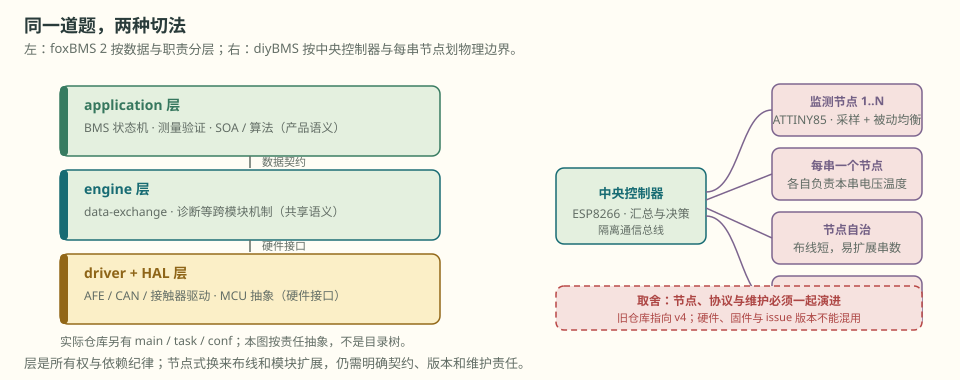
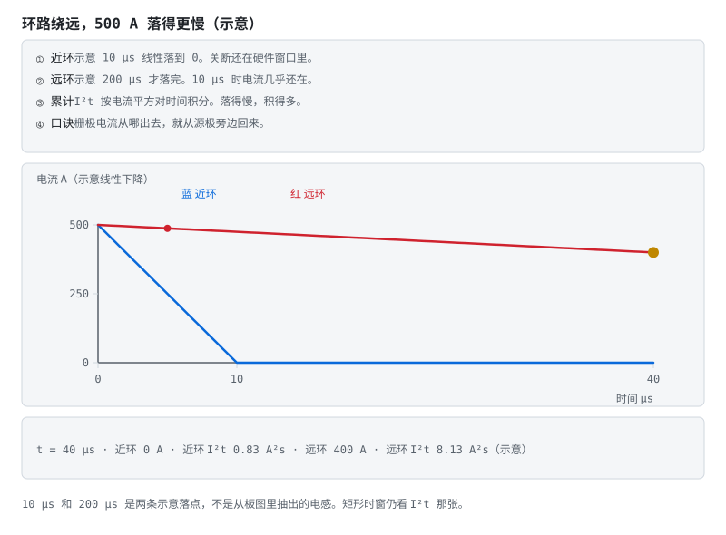

# 第 22 章 开源架构：读结构，也读取舍

::: story 现场
你把 foxBMS 2 的 CAN 驱动搬进自己的应用层，改了十处适配，跑通了。三个月后 upstream 更新，你 merge 了三天，还丢了两个补丁：一个去抖计数、一个故障快照。（教学合成场景）

问题不在 git，在**边界**。你搬走的是实现，却没有带走数据由谁产生、谁有权改、故障在哪层闭合、哪组测试证明它仍成立。补丁于是散进应用层的褶皱里，upstream 不会知道这些补丁存在过。
:::

<figure>

<figcaption>图 22-1　教学抽象：大项目靠职责和数据契约拆层，小项目靠节点和物理边界拆分。左图不是 foxBMS 2 当前仓库目录的逐项抄录；目录与真实数据路径见 22.2。</figcaption>
</figure>

第一次读这一章，先记住一句：先冻结证据，再谈架构。§22.2 把 foxBMS 2 拆成五道源码边界，§22.3 看 LibreSolar 怎样用一个上下文和一台显式状态机解决同样的问题；§22.4 的表 22-3 用同一条信号把两种账并排对照。真要引一个开源件进来，从 §22.7 的七问和 §22.8 的五步读法开始，别从 `git clone` 开始。

## 22.1 先冻结证据，再谈架构

开源仓库每天会动。“foxBMS 把状态机放在哪”如果不带版本，半年后就可能变成一句无法复核的印象。本章在 **2026-10-23** 固定两份阅读快照：

**表 22-1**　两份开源项目的核对点与发布、许可证边界（2026-10-23 固定快照）

| 项目 | 本章核对点 | 发布边界 | 许可证边界 |
|---|---|---|---|
| foxBMS 2 | release `v1.12.0`，commit `73dbde670f7e…` | `v1.12.0` 是正式 release，源码与对应版本文档可互相回链 | 软件 BSD-3-Clause；硬件与文档 CC BY 4.0 |
| LibreSolar `bms-firmware` | `main` commit `779d20199bff…` | `main` 是持续开发；仓库说明 release 需通过多块板测试，GitHub 最新 release 为 `v23.1` | 固件 Apache-2.0 |

星数只说明传播度，不说明安全完整性；`main` 最近有提交，也不等于这一提交是稳定 release。工程记录至少写四项：**仓库、完整 commit、检索日期、你实际构建的工具链**。只写“用了最新版”，等于没有版本证据。

## 22.2 foxBMS 2：不是三层目录，而是五道边界

把 foxBMS 简写成 application／engine／driver 三层，适合第一眼看图，却不能拿来定位代码。`v1.12.0` 的 `src/app/` 里实际并列 `application`、`engine`、`driver`、`hal`、`main`、`task`；仓库根还有 `conf/`。更准确的读法是按责任画五道边界：

**表 22-2**　foxBMS 2 的五道源码边界与评审问题（v1.12.0 快照）

| 边界 | 当前源码位置 | 主要问题 |
|---|---|---|
| 启动与节拍 | `src/app/main`、`src/app/task` | 谁初始化模块，谁按周期触发它 |
| MCU 抽象与器件访问 | `src/app/hal`、`src/app/driver` | 寄存器、总线和具体 AFE 怎样藏在接口后 |
| 跨模块机制 | `src/app/engine` | 数据交换、诊断等公共机制怎样保证一致语义 |
| 电池应用 | `src/app/application` | 测量验证、SOA、均衡、估计和 BMS 状态机怎样组合 |
| 产品配置 | `conf/` 与各配置头 | 串数、器件选择和策略开关怎样变成受审数据 |

这也修正一个容易传播的误读：**当前 BMS 主状态机在 `src/app/application/bms/bms.c`，不在 `engine` 目录。** 文件里的 `BMS_Trigger()` 先读最新测量，检查电压、温度、电流、开线与接触器反馈，再运行状态机；状态变化后才异步发送 CAN 状态。目录名不是安全论证，调用顺序才是。

### 一条单体电压怎样穿过 foxBMS

把“第 7 串 3.652 V”沿源码追到底，会经过三种身份：

1. **原始生产者**：AFE driver 把基础电压表写进 data-exchange module；这是采样结果，不自动等于可信控制量。
2. **验证生产者**：`BMSVL_UpdateSystemValues()` 读取基础表，做冗余或合理性检查，只用有效通道计算最小、最大与平均值，再写入“已验证电压”和 pack 值表。
3. **决策消费者**：`BMS_Trigger()` 读取这些表，执行 SOA、开线和反馈检查，随后状态机决定预充、正常、待机或错误路径。

foxBMS 文档把 data-exchange module 定义为**单生产者、多消费者**：同一个 entry 只能有一个写入者。两层都“写电压”并不冲突，因为 AFE 拥有基础测量 entry，`bms-values` 拥有验证后 entry；它们是两个身份，不是一块共享内存被轮流覆盖。若两个模块都写同一 entry，最后值、时间戳和质量来源便失去唯一解释，数据库自身也无法保证完整性。

> 先自己判断：验证层发现第 7 串这一路开线了。它应该把那个 3.652 V 改成无效值，还是另写一份？

**另写一份。** 基础 entry 归 AFE driver 所有，验证层只读不写；它把判断写进自己拥有的"已验证"entry。若验证层回头覆盖基础值，两件事会同时丢：出问题时再也分不清是采样错了还是判据错了，而且从此那个 entry 有两个写入者，时间戳和质量来源都没有唯一解释。**保留原始值并另记一份判断，是可追溯的前提**，不是多存一份数据的浪费。

::: principle 一句话
**值、质量、时间戳还不够，还要有唯一生产者。** 谁能写，是数据契约的一部分。
:::

## 22.3 LibreSolar：一个上下文，一台显式状态机

LibreSolar 走的是另一条路。`struct bms_context` 把当前状态、充放使能、满／空标志、SOC、容量、OCV 表、BMS IC 配置与最新测量放在同一个上下文里。默认 `bms_state_machine()` 直接把允许条件变成 MOS 动作：

- `OFF`：按充放许可进入 `DIS` 或 `CHG`；
- `CHG`／`DIS`：方向不再允许就关两路开关回 `OFF`，另一方向也允许则进 `NORMAL`；
- `NORMAL`：某一方向失去许可，只关闭对应方向并退回单向状态；
- `SHUTDOWN`：两路关闭后等待关机完成。

这里没有 foxBMS 那套 producer／consumer database。测量由 `bms.ic_data` 进入。`bms_chg_allowed()` 与 `bms_dis_allowed()` 把 error flags、`full`／`empty` 和人工 enable 合成许可。状态机再调用 `bms_ic_set_switches()`。好处是路径短、适合资源受限平台；代价是共享上下文的写入顺序与所有权主要靠 API 和调度纪律维持，不会由数据库 entry 自动隔离。

默认状态机声明为 `__weak`，板级应用可以覆盖它。这个扩展点很实用，也带来一条测试边界。仓库里的 `tests/bms/src/state_machine.c` 在固定快照中有 **10 个启用的 ztest**，覆盖 OFF／CHG／DIS／NORMAL 之间的许可与故障转移。文件底部的均衡场景仍在块注释中。默认测试通过，不能证明你的 override，也不能把“测试文件里搜得到”误算成“用例实际执行”。

## 22.4 同一条信号，两种架构账

**表 22-3**　同一条信号在两种架构下的对账与评审问题（固定快照源码）

| 对账位置 | foxBMS 2 `v1.12.0` | LibreSolar `779d201…` | 评审时要问 |
|---|---|---|---|
| 原始测量 | driver 发布基础 entry | BMS IC driver 更新 `ic_data` | 原始值与验证值是否分身份 |
| 质量门 | application 验证后发布新 entry | error flags 与 `*_allowed()` 合成许可 | 无效值能否继续进入控制 |
| 数据所有权 | 每个 entry 单生产者、多消费者 | 一个 `bms_context`，靠调用纪律维护 | 谁能写、何时写、并发怎样封口 |
| 状态决策 | `BMS_Trigger()` 调 SOA／诊断后跑多层状态机 | 显式五状态直接控制 MOS | 请求、动作与反馈是否是三件事 |
| 测试证据 | database、应用模块与状态机均有对应 unit-test 入口 | ztest 逐条验证状态转移 | 测的是默认实现还是产品 override |
| 发布证据 | release 与同版本文档对应 | `main` 持续开发，release 另行冻结 | 你拿的是 commit、tag 还是印象中的最新版 |

两种结构没有脱离规模谈输赢。大系统需要把异步任务、冗余测量和多 pack string 的所有权写进机制；小系统更看重路径短、资源少和一眼能追完。能迁移的不是目录名，而是四个问题：**谁生产、谁验证、谁决策、谁证明。**

## 22.5 小项目教边界，不替你补安全论证

**SmartBMS** 用 Cell Module、Control Unit、Limiter 与 App 把低成本系统拆成四件；可借鉴的是物理分工，不能由“组件齐全”推出冗余采样、绝缘监测或粘连诊断已经满足目标产品。

**diyBMS** 的旧仓库明确指向后续 v4。它的节点式采样与被动均衡适合观察分布式边界，也提醒你：仓库被替代后，旧 issue、旧固件和新硬件不能混成一个版本声称。

**esphome-jk-bms** 是接入层：经 UART-TTL 或 BLE 读取现成 BMS，再暴露给 Home Assistant。它最值得学的是**不越权**：家庭自动化拿到的是遥测，不因此进入毫秒级保护闭环。

## 22.6 许可证不是颜色标签

**表 22-4**　四类许可证的义务要点与筛查重点（工程筛查参考，非法律意见）

| 类型 | 以本章项目为例 | 工程筛查重点 |
|---|---|---|
| BSD-3-Clause | foxBMS 2 软件 | 分发源码或二进制时保留版权、许可证与免责声明；不得借贡献者名称背书产品 |
| Apache-2.0 | LibreSolar 固件 | 除版权许可外还有明确专利授权；分发时附许可证、标明修改，若上游含 `NOTICE` 还要传递相应 notices |
| GPL | 其他社区组件可能采用 | FSF FAQ 将静态或动态链接形成的组合作为 combined work 讨论；义务是否触发还取决于是否分发、组合方式与具体事实 |
| CC BY／BY-SA | foxBMS 硬件与文档等内容 | 适合文档、图纸等材料；Creative Commons 官方不建议用 CC 许可证给软件代码，因其缺少源代码分发与软件专利条款 |

所以不能只在表里涂“宽松／传染”两种颜色。至少保存：LICENSE 原文、NOTICE、依赖图、修改清单、分发形态和法务结论。这里给的是工程筛查，不是法律意见；边界不清时，停在准入门外，不靠 README 一句话自行判案。

## 22.7 开源准入：七问而不是一次 `git clone`

**表 22-5**　开源准入七问：证据与红线（定性对照）

| 准入门 | 必须交出的证据 | 红线 |
|---|---|---|
| 身份 | 仓库、tag／commit、子模块与下载哈希 | 只写“最新版” |
| 可重建 | 工具链、依赖锁、构建命令与二进制哈希 | 换台机器无法重建同一配置 |
| 数据所有权 | 关键量的生产者、验证者、消费者和时间语义 | 同一控制量有多个未仲裁写入者 |
| 控制边界 | 安全状态、执行器、反馈与失效时默认输出 | 只看到命令位，没有物理反馈 |
| 测试证据 | 实际执行的用例、板卡矩阵、失败记录 | 注释用例或未运行文件被计入覆盖 |
| 许可证 | LICENSE／NOTICE、修改与分发方式、审批人 | 许可证不明仍进产品分支 |
| 维护 | release 模型、补丁队列、上游差异和退场方案 | 永久跟随 `main`，没有回滚点 |

这张表只判一个组件能否进入候选清单；第 25 章负责功能安全证据，第 26 章负责整机阶段门。组件准入不能替代产品认证，产品流程也不能替你补丢失的上游身份。

<figure class="book-motion" data-animation="gate-return-loop.svg" data-mode="static">

<button type="button" data-book-motion v-book-motion aria-pressed="false" hidden>播放动画</button>
<figcaption>图 22-2　开源组件准入失败时，证据要回到身份、架构或需求层，不能永远在本地补丁上打补丁。沿失败证据向上回查：构建失败、数据所有权冲突和安全边界缺失，分别应退回哪一层。上游修复了驱动，但你的产品补丁改过状态机；两者应怎样分开验证？</figcaption>
</figure>

## 22.8 五步读法：从身份读到反证

读大项目别从 `main` 顺序啃，按五步走：

1. **定身份**：先记 tag／commit、工具链与许可证；
2. **追一条量**：从 driver 的原始值追到验证值、决策和执行器；
3. **画状态机**：列出允许转移、非法转移、安全状态和反馈；
4. **找反证**：搜无效位、超时、开线、拒动和恢复路径，不只看 happy path；
5. **数真测试**：打开测试注册点与 CI 命令，区分启用、注释、mock、板上测试与 release 门。

能答出“第 7 串电压由谁第一次写、谁把它判成可信、谁用它断开、哪条测试故意让它失真”，才算读懂架构。只列目录，是参观；沿一条量走完，才是审查。

## 22.9 把开源当供应商

用开源组件，按供应商管理，不做一次性搬运：

- **版本钉死**：产品基线锁 tag 或 commit；研究 `main` 可以，交付不能漂；
- **补丁分层**：上游通用修复尽量回流，产品策略留在自己的适配层；每个补丁记录原因、上游 issue／PR 与退场条件；
- **差异验证**：升级时先看 upstream 差异影响哪条数据路径，再重跑相应用例，不用“编译过了”代替回归；
- **SBOM 与退场**：列组件、版本、许可证、工具链与替代方案；漏洞或项目停更时，知道哪条产品需求受影响。

回到开头：丢掉的去抖补丁，本来不该塞进 CAN driver；故障快照若是产品策略，也不该伪装成上游通用改动。开源降低起步成本，不降低理解成本，更不降低认证成本。

::: trap 坑
看到测试目录、CI 徽章或大量 stars，就宣布“工业级”。先问测试有没有执行、在哪块板上执行、覆盖的是默认实现还是你的 override，以及这一 commit 是否属于 release。
:::

::: lab 动手
用本章两份固定快照，各选一条“单体电压 → 允许充电／关闭充电”的路径，填写四栏证据：生产者、质量门、状态转移、测试。每栏给一个可打开的源码链接；找不到的一栏写“未知”，不要用架构图代填。
:::

## 练习

1. 在 foxBMS 2 `73dbde670f7e…` 中，把“AFE 基础电压 → 已验证电压 → BMS 状态机”写成三段路径。为什么基础 entry 与验证 entry 可以各有生产者，而同一个 entry 不能有两个生产者？
2. LibreSolar `779d20199bff…` 的默认状态机测试能证明什么，不能证明什么？至少区分：启用的 ztest、块注释里的均衡场景、产品覆盖的 `__weak` 状态机。
3. 你准备把 LibreSolar `main` 的一个驱动放进闭源储能产品。写一张准入结论：版本身份、构建与板测证据、Apache-2.0 分发材料、一个 go 条件和一个 no-go 红线。

## 参考资料

- foxBMS 2：release `v1.12.0` <https://github.com/foxBMS/foxbms-2/releases/tag/v1.12.0>；本章快照 <https://github.com/foxBMS/foxbms-2/tree/73dbde670f7e9ec59afc33855bcf27576bd874de>；data-exchange 文档 <https://docs.foxbms.org/software/modules/engine/database/database.html>；BMS 状态机 <https://github.com/foxBMS/foxbms-2/blob/73dbde670f7e9ec59afc33855bcf27576bd874de/src/app/application/bms/bms.c>
- LibreSolar：本章快照 <https://github.com/LibreSolar/bms-firmware/tree/779d20199bff2666e01371ce2f562dcda4d6bda3>；默认状态机测试 <https://github.com/LibreSolar/bms-firmware/blob/779d20199bff2666e01371ce2f562dcda4d6bda3/tests/bms/src/state_machine.c>；release `v23.1` <https://github.com/LibreSolar/bms-firmware/releases/tag/v23.1>
- 许可证原文与解释边界：Apache-2.0 <https://www.apache.org/licenses/LICENSE-2.0>；GNU GPL FAQ <https://www.gnu.org/licenses/gpl-faq.html#LinkingWithGPL>；Creative Commons 软件 FAQ <https://creativecommons.org/faq/#can-i-apply-a-creative-commons-license-to-software>
- 社区对照：SmartBMS <https://github.com/Green-bms/SmartBMS>；diyBMS <https://github.com/stuartpittaway/diyBMS>；esphome-jk-bms <https://github.com/syssi/esphome-jk-bms>
