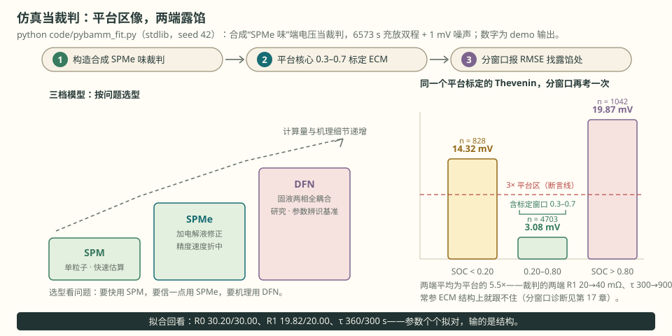

# 第 23 章 PyBaMM：模型不是答案

::: story 现场
仿真说这台车能跑 400 km，实车只跑了 310 km。你拿报告去质问模型，模型不会道歉：它只放大你给它的参数。（教学合成场景）

错不在 PyBaMM，在**把参数当圣旨**。参数是集，不是常量；模型是放大器，参数错，它把错误放大得更漂亮。
:::

<figure>

<figcaption>图 23-1　三步：①构造合成“SPMe 味”裁判 → ②平台核心 0.3–0.7 标定一阶 Thevenin → ③分窗口报 RMSE。左：三档模型按计算量与用途排队；右：平台区 3.08 mV、两端 14.32/19.87 mV（demo 输出）；拟合回看 R0 30.20/30.00、R1 19.82/20.00、τ 360/300 s；参数个个拟对，输的是结构。</figcaption>
</figure>

## 23.1 三档模型一句话

**表 23-1**　SPM、SPMe、DFN 三档模型的取舍与用途（教学定位）

| 模型 | 计算量 | 一句话 | 丢掉了什么 | 用途 |
|---|---|---|---|---|
| SPM 单粒子 | 低 | 每极一粒，忽略电解液 | 电解液浓度与电位梯度 | 快速估算、教学 |
| SPMe 扩展单粒子 | 中 | SPM 加电解液修正 | 高阶电解液梯度、电极内不均匀 | 精度与速度折中 |
| DFN | 高 | 固液两相全耦合 | 只丢未建模机制（析锂、产气、开裂） | 研究、参数辨识基准 |

三档共享同一组物理项：固相扩散、界面电荷转移、电解液输运、欧姆与热。第 1 章的 Fick 方程与 Butler–Volmer 就是同一组方程在这一章的样子。差别不在“有没有物理”，在**留着哪几项、把哪几项近似掉**。所以选型要问的是：这个工况里，被你近似掉的那一项还小吗？

### 三个时间尺度决定谁可以省

把那句“还小吗”变成比值问题（教学量级）：

**表 23-2**　三个特征时间尺度的算式与代入量级（教学量级）

| 时间尺度 | 式子 | 代入 | 量级 |
|---|---|---|---|
| 电解液扩散 | τ_e = L² ÷ (D_e·ε^1.5) | L = 80 µm、D_e = 2.5×10⁻¹⁰ m²/s、ε = 0.4（Bruggeman 指数 1.5 → D_eff ≈ 6.3×10⁻¹¹ m²/s） | ≈ 100 s |
| 固相扩散 | τ_s = R_p² ÷ D_s | R_p = 5 µm、D_s = 1×10⁻¹⁴ m²/s | ≈ 2500 s（约 42 min） |
| 放电时间 | t_d = 3600 s ÷ C-rate | 1C → 3600 s；10C → 360 s | — |

三行读完就能读出三件事：

- τ_e ≪ t_d 时电解液接近“瞬时平衡”，浓度梯度可以按常数近似，这就是 SPM 敢省掉电解液的理由（1C 时 τ_e/t_d ≈ 0.03）；
- 倍率上去，t_d 缩到与 τ_e 同量级（10C 时 360/100 ≈ 3.6），梯度开始跟不上，SPM 的假设就破了，至少要 SPMe；
- τ_s 与放电时间同量级甚至更慢，所以模型“记得住历史”：同样的电流、不同的历史，端电压不一样。第 10 章的 RC 尾巴、第 13 章 HPPC 的时间窗，量到的都是这条时间尺度。

DFN 的成本也由此而来：它同时解径向（颗粒内）与轴向（电极厚度方向）两套偏微分方程。量级上 SPM 的状态数约 10²（径向节点 × 两个电极），DFN 还要加上轴向各节点的电解液浓度与电位，常见 10³–10⁴；PyBaMM 官方性能示例把 SPM 与 DFN 放进同一次容差扫描对比耗时，两者差两个数量级：那是你为“多留一项物理”付的钱。

## 23.2 参数集是“某次实验”的拟合

Chen2020、Marquis2019、Mohtat2020 这类参数集，名字像常数，但只是“某颗电芯、某次实验、某个温度”的拟合快照。

### 参数集里装了什么

五类，外加一批温度修正：

**表 23-3**　参数集五类内容与取值形态（教学归纳）

| 类别 | 典型参数 | 形态 |
|---|---|---|
| 几何 | 电极厚度 L、孔隙率 ε、颗粒半径 R_p、比表面积 a_s | 常数 |
| 输运 | 固相扩散 D_s、电解液扩散 D_e、电解液电导率 | 常数 + 温度函数 |
| 动力学 | 反应速率常数 k（决定交换电流密度 j₀） | 常数 + Arrhenius 修正 |
| 热力学 | 负极/正极开路电位 OCP(x) | 曲线 |
| 热 | 导热、比热、熵热系数 | 常数或函数 |

一半内容是**函数**：D_s(T)、k(T)、OCP(x) 都是曲线。写错一个采样点，整条曲线跟着偏，而曲线在平台区又最不敏感，错在那里最不容易被发现。

### 可辨识性：定得出的是组合量

端电压只暴露“组合量”。以交换电流密度为例：

j₀ = k·√( c_e · c_s,max · x(1 − x) )，其中 x = c_s,surf ÷ c_s,max

k、比表面积 a_s = 3ε_s/R_p、最大嵌锂浓度 c_s,max 在多数工况下以**乘积**进入端电压：把 k·a_s 当成一个数去拟合，曲线能对得很漂亮；单改 k 与单改 a_s 给出相似的结果。所以“拟合出 k = 2.3×10⁻¹¹”这种结论，必须同时交代 a_s 与 c_s,max 从哪里来，否则那个数字只是乘积的一个分支。

- **定得住**：OCV(SOC) 的形状（慢速、低倍率）、R0（瞬时跳变，∂U/∂R0 就等于工况电流 I）、时间常数的量级（中频段）；
- **定不住**：动力学与比表面积的分工、真实 D_s 与颗粒尺寸分布的等价替换、以及没有激励时的任何参数（第 15 章“激励不足就冻结参数更新”说的正是这件事）；
- **要盯住**：参数集是快照。温度（低温下 D_s 能差一个量级）、老化（活性材料与锂存量都变了）、批次差异，全都落在上面那张五类表里。

所以“我用的是 Chen2020”只说明起点，不说明正确。

## 23.3 仿真到查表的六步流水线

1. 选模型：SPM/SPMe 快速迭代，DFN 校验。验证点：同工况下两档模型的端电压差多少；
2. 定参数：数据手册起步，HPPC 辨识。验证点：脉冲处的电压跳变对不对得上 R0；
3. 跑工况：温度 × 倍率 × SOC 起点。验证点：SOC 轨迹是否覆盖 0–1 的工作窗；
4. 提特征：OCV–SOC、R0(SOC,T)、时间常数。验证点：曲线单调、有界、量纲对；
5. 做表：三维查表加插值。验证点：查表回放误差小于目标值；
6. 回测：真实工况验证。验证点：误差在独立工况上仍成立，不在验证集上调参。

每一步都有一句“怎么确认没算错”。跳步的人，最后一步一起还。

### 每一步都要过的审计三件套

不管跑哪一步，交付前至少过三关：

1. **量纲**：电流 A、容量 Ah、时间 s，C-rate 无量纲（1/h）。单位错一位不会让曲线变丑，只会让它变错；
2. **守恒**：安时吞吐必须等于容量乘 ΔSOC（第 11 章的 CC-CV 账就是这么核的）；能量账 ∫U·I dt 要与生热和储能对得上（第 30 章的四项账）；颗粒里的锂也要守恒；
3. **极限**：I → 0 时端电压必须回到 OCV；倍率越大容量读数越小（极化吃掉窗口）；温度升高内阻必须下降。任何一条反了，先修模型，再谈标定。

再加一条数值关：**网格与容差要一起声明**。径向/轴向节点数与求解器的 atol/rtol 都会改变结果（PyBaMM 官方示例专门扫过容差对耗时与精度的影响），报告里不写这几项，别人复不出你的曲线。第 17 章的分窗 RMSE 是**结构误差**的探针，网格与容差是**数值误差**的探针，两者别混着读。

## 23.4 用仿真当裁判给 ECM 打分

更进一步的用法：让仿真给 ECM 打分。demo `code/pybamm_fit.py` 构造一颗合成“SPMe 味”电芯当裁判：四项 OCV（第 10 章的结构、另一组教学数值）加 R0 30 mΩ，加一阶扩散 RC；极化电阻与扩散时间常数在 SOC 两端变大（R1 20 → 40 mΩ，τ 300 → 900 s，教科书行为，教学合成值）。对一段 6573 s 的充放双程工况叠加 1 mV 噪声（固定种子），把一阶 Thevenin 放在平台核心（SOC 0.3–0.7）做最小二乘标定，再分窗口报 RMSE。

demo 的实测输出（教学合成值）：

- 标定本身很收敛：OCV 缩放 1.0002，R0 估得 30.20 mΩ，R1 估得 19.82 mΩ；
- 分窗口：SOC < 0.20 处 RMSE 14.32 mV，0.20–0.80 处 3.08 mV，> 0.80 处 19.87 mV；
- 两端各约为平台区的 4.6 倍与 6.4 倍：常参数 ECM 在两端系统性露馅。

整体一个 RMSE 会把两端平均掉；分窗口看才看得见结构误差躲在哪儿（分窗口诊断的思路见第 17 章）。

### 裁判也要体检：两条硬标尺

**其一，Butler–Volmer 的线性区间。** 界面电流密度 j = 2j₀·sinh(Fη ÷ 2RT)（第 1 章的原式），25 °C 时 F/(2RT) = 96485 ÷ (2 × 8.314 × 298.15) ≈ 19.46 V⁻¹：

**表 23-4**　过电位多大时 sinh 项偏离线性（25 °C 公式计算）

| 过电位 η | sinh 项 | 与线性项 Fη/2RT 之比 | 读法 |
|---|---|---|---|
| 10 mV | 0.1958 | 1.006（高 0.6%） | 看上去像电阻 |
| 60 mV | 1.452 | 1.244（高 24%） | 已经不是电阻 |
| 120 mV | 5.12 | 2.19（高 119%） | 进入 Tafel 指数段 |

可见，“内阻”只在**毫伏级**过电位里成立。大电流下把整段电压损失塞进一个常数 R，是给非线性现象套线性帽子。第 10 章的 R0 定义、第 14 章的功率账都盯着这条边界。

**其二，扩散时间。** τ_s = R_p² ÷ D_s：5 µm 配 1×10⁻¹⁴ m²/s 得 2500 s（约 42 min）。本章合成裁判把两端的 R1 抬到 40 mΩ、τ 抬到 900 s，量级正是“颗粒深处还没跟上”，与第 13 章 40 秒窗为什么骗人同源。

所以裁判的用法有两面：它的**优势**是标准答案已知，能把模型结构误差算得清清楚楚；它的**局限**是它自己也是模型：真实电芯没有标准答案，只有实验。

## 23.5 仿真进不了签字链

边界必须说死：PyBaMM 的输出进不了签字链，只能进开发链。三条理由，一条比一条硬：

- **参数来源**：参数是拟合来的，不是测来的（见 23.2 的组合量问题）；
- **未建模机制**：析锂、产气、机械开裂在日常工况里老老实实为零，一旦越界就不在这页账管；
- **不可追溯**：同一句“能跑 400 km”，换参数集数字就变。签字要的是“按哪组参数、哪个温度、哪段工况”，而不是一个数。

开发链里它很好用：生成查表初值、检查参数合理性、给 ECM 打分发窗口、给实验设计划边界。签字链里它不够格：能解释、能陪练、不能签字（三圈边界见第 24 章）。

## 23.6 上手三件事

```bash
pip install pybamm
```

官方最小例是“建模型 → 定实验 → 解 → 画”，改三处就能回答本章的问题：

```python
import pybamm

model = pybamm.lithium_ion.SPMe()
experiment = pybamm.Experiment([
    "Discharge at 1C until 2.5 V",
    "Rest for 1 hour",
    "Charge at C/2 until 4.2 V",
    "Hold at 4.2 V until C/50",
])
sim = pybamm.Simulation(model, experiment=experiment,
                        parameter_values=pybamm.ParameterValues("Chen2020"))
sol = sim.solve()
sol.plot(["Voltage [V]",
          "X-averaged reaction overpotential [V]",
          "X-averaged concentration overpotential [V]",
          "X-averaged electrolyte ohmic losses [V]"])
```

三件值得先做的事：

1. **把三档模型放在同一条工况上**：`SPM()`、`SPMe()`、`DFN()` 各跑一遍，量两条端电压的差。差值就是“电解液那一项”在你这个倍率下值多少毫伏，和 23.1 的 τ_e/t_d 对不对得上；
2. **扫一个参数**：把电流设成输入（`params.update({"Current function [A]": "[input]"})`），一次跑一批电流看容量读数怎么掉，那是极化在吃工作窗；
3. **拆电压**：反应过电位、浓度过电位、电解液欧姆损失分三条画。平台区到底谁在主导，一条总曲线是看不出来的。

再改一个参数看灵敏度：R0 加倍，端电压阶跃立刻加倍，因为 dU/dR0 就等于工况电流 I（教学合成值：2.5 A 下，R0 从 30 mΩ 加到 60 mΩ，阶跃从 75 mV 变 150 mV）。

本机 demo 不需要装 pybamm：它用解析合成的“SPMe 味”端电压当裁判，并已诚实标注不是 PyBaMM 运行结果。

::: principle 一句话
**仿真是可解释的假设，不是测量。** 它能生成查表、检查参数、解释趋势；不能替你证明精度。
:::

::: trap 坑
拿默认参数跑一条漂亮曲线就当自家电芯。默认参数对应某颗特定电芯；换化学体系、换批次、换温度，曲线全变。参数集里还有一半是温度函数与 OCP 曲线：它们比那几十个常数更容易被忽略。
:::

::: lab 动手
跑 `python code/pybamm_fit.py`，把裁判的 R1 两端值再加大 10 mΩ 重跑，看分窗口 RMSE 怎么动。然后装 pybamm，把官方例子的截止电压从 3.3 V 改成 3.0 V，看容量读数差多少；再把径向节点数加倍，看端电压变化是否落在你声明的容差里。
:::

## 练习

1. 用 τ_e = L² ÷ (D_e·ε^1.5)（L = 80 µm、D_e = 2.5×10⁻¹⁰ m²/s、ε = 0.4、Bruggeman 指数 1.5）估算电解液扩散时间，并分别算 1C 与 10C 的放电时间；SPM“电解液均匀”的假设从哪个倍率开始明显破损？
2. 用 j = 2j₀·sinh(Fη ÷ 2RT)、F/(2RT) ≈ 19.46 V⁻¹ 算 η = 10 mV 与 60 mV 时 sinh 项相对线性项高出多少；为什么“大电流下用一个常数内阻”会失真？
3. 参数可辨识性：用 j₀ = k·√(c_e·c_s,max·x(1 − x)) 说明哪几个量在端电压里以乘积出现，并指出需要什么额外实验才能把这个乘积拆开。

## 参考资料

- Sulzer et al., *Python Battery Mathematical Modelling (PyBaMM)*, Journal of Open Research Software, 2021, DOI 10.5334/jors.309
- PyBaMM 官方文档（模型阶梯、参数集与求解器设置）：https://docs.pybamm.org/
- PyBaMM：https://github.com/pybamm-team/PyBaMM
- BMS-Z 扩散与常相位专题：https://github.com/zhuguang-ZFG/BMS-Z/blob/main/docs/扩散与常相位专题.md