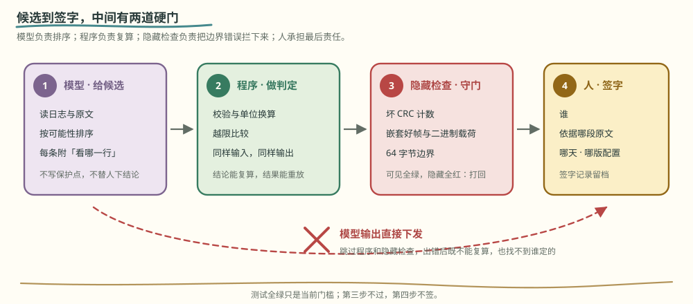
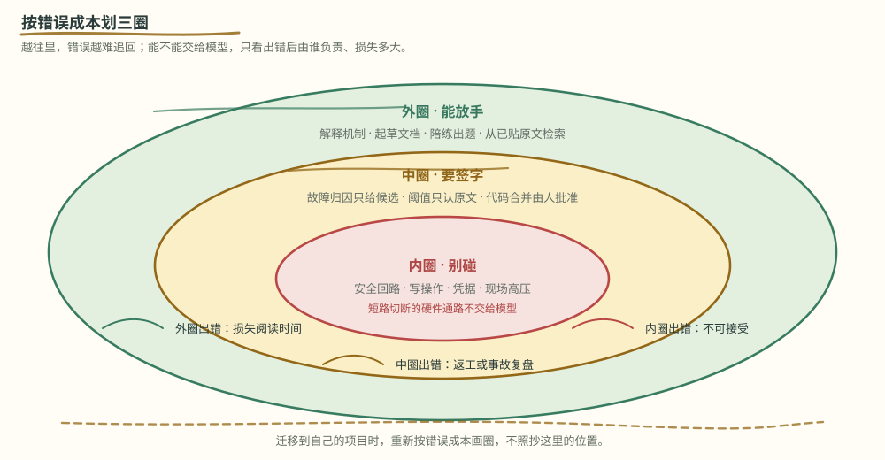
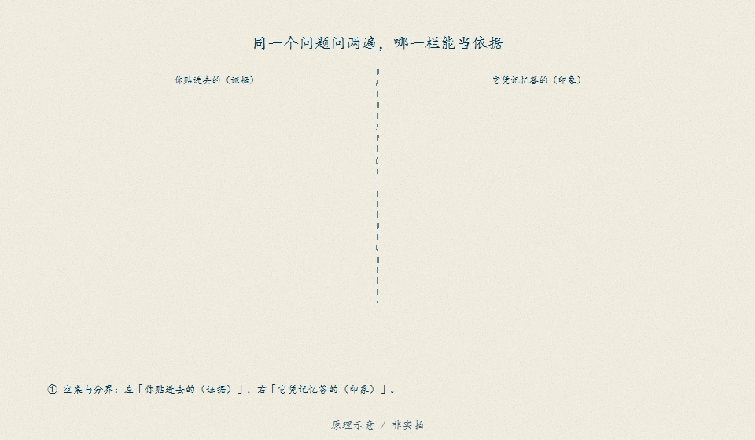
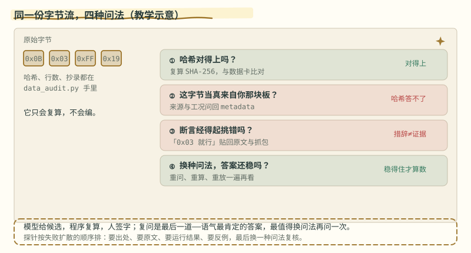
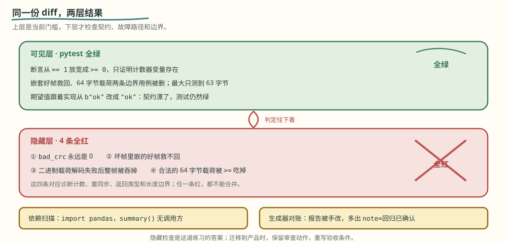
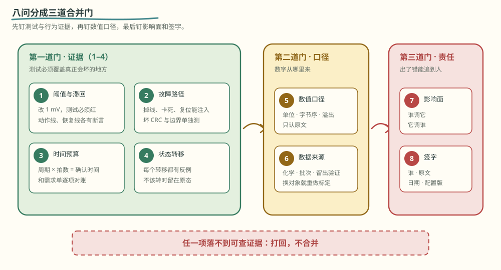
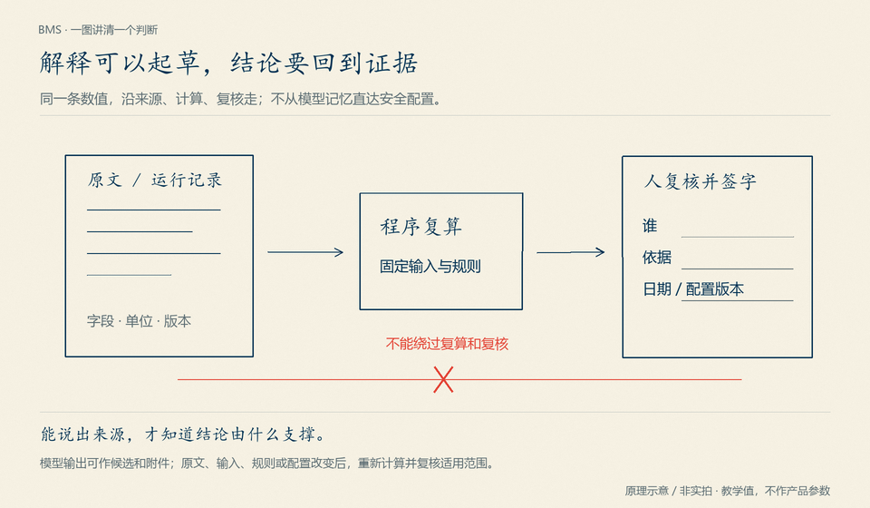

# 第 24 章 BMS × AI：能解释，不能签字

::: story 现场
AI 改了一段接收电池通信数据的程序。公开测试全部通过，审查者换了四种边界输入，四项都失败了。

失败分别是：坏数据没有计数；坏数据中夹着的好数据没找回来；二进制内容解码失败后被直接丢掉；长度刚好 64 字节的合法数据被误判为非法。这份改动和测试放在 BMS-Z 的 `challenges/03-ai-review`，可以逐项复现。

公开测试全绿，只说明代码通过了已检查的样例。
:::

<figure>

<figcaption>图 24-1　模型给候选，程序复算，隐藏检查守门，人签字。跳过中间两步直接下发，结论既不能复算，也找不到谁定的。</figcaption>
</figure>

<aside class="reading-bet" aria-label="开读押注">

开读押注 · 可见全绿，隐藏全红

AI 改的代码通过全部可见测试，四条隐藏检查却全红。下一步最像工程动作的是：

<ol><li>先合并，线上再观察</li><li>让 AI 多解释一次</li><li>把隐藏失败改写成验收条件，先红后绿再审</li></ol>
</aside>

::: chapter-route 阅读路径

- **第一次主线**：读 §24.1–§24.3。先划清可放手、需签字和禁止自动执行的边界，再用失败模式检查 AI 输出。
- **第二遍深挖**：打开本章进阶页，处理数据驱动 SOH、对抗测试、责任签字、代码八问和陪练流程。
- **动手验证**：把隐藏失败改写成测试，先复现红灯，再修代码并保留 diff、日志与人工复核结论。
:::

## 24.1 三圈边界

**表 24-1**　三圈边界：能做什么、错误成本与例子（定性对照）

| 圈 | 能做什么 | 错误成本 | BMS 专属例子 |
|---|---|---|---|
| 外圈：能放手 | 解释机制、起草文档、陪练出题、从你贴的原文里检索 | 浪费时间 | 让模型解释一次过压保护，再回第 7 章核对 |
| 中圈：要签字 | 故障归因只给候选、阈值只认电芯规格书、改代码合并要人点 | 返工或事故 | 模型根据寄存器表找电量和电压位置；人再对照原表与实际通信记录确认 |
| 内圈：别碰 | 安全回路、寄存器与凭据写操作、无人复核的自动动作、现场高压 | 不可接受 | AFE 阈值寄存器的写操作、短路切断的硬件通路，模型永远不伸手 |

越靠近电池，越要人手签字。**能解释、能起草、能陪练；能给候选，不能给结论。**

三圈划分出自本仓库的实践，标准和芯片手册里没有这条规定：阶段 5 的协议逆向落在外圈，阶段 6 的功能安全与 OTA 验签落在内圈。用到自己的项目时，按「这一格出错由谁负责、损失多大」重新划分。

画圈的依据是表 24-1 的「错误成本」一列，越往里越高。外圈出错，损失的是阅读时间；中圈出错，要返工或做事故复盘，所以每一格都要记录签字人；内圈不按「概率低」放行，短路切断的硬件通路不交给模型。

<figure>

<figcaption>图 24-2　三圈按错误成本向内收紧。外圈错了还能重查，中圈要留下签字记录，内圈不用「概率低」换放行。</figcaption>
</figure>

## 24.2 证据与印象

把输入分两栏：

- **左边**：你贴进上下文的 datasheet、寄存器表、抓包日志、esphome-jk-bms 源码、BMS-Z 仓库正文；
- **右边**：模型凭记忆答的参数量、旧项目习惯、相似型号、看起来很顺的解释。

凡是寄存器地址、功能码、阈值、位宽，只认左边。要问清的是：SOC 在 0x0100 还是 0x1000，功能码用 0x03 还是 0x04，电压是两个字节低字节在前还是高字节在前，4250 mV 这条教学 OVP 线对应哪一份固件。左边出错，可以顺着出处查到是哪份资料错了；右边出错，责任在签字的人。

同一个问题问两遍，模型可能给出两个都很通顺、内容却不同的答案。语言模型生成的是通顺的下文；除非你把原文贴进上下文，它没有你的板子和 datasheet。一句话能归入左栏，要同时满足两条：原文确实贴进了上下文，你自己也能查到出处。

右栏的回答被挡回后，不要只让它「再想想」，要改问题：把「设多少」改成「由哪几层决定、各层依据什么」，问机制，不问保护点。模型给出「建议设成 4.25 V，留一点余量」时，要在提问一端纠正，不能指望它下次自己变谨慎。

::: principle 一句话
AI 可以用于解释机制；阈值、时限和器件参数必须回到原始手册或数据验证。回答是否通顺，不能证明数值正确。
:::

<figure class="book-motion" data-animation="ai-context-vs-truth.webp" data-mode="static">

<button type="button" data-book-motion v-book-motion aria-pressed="false" hidden>播放动画</button>
<figcaption>图 24-3　AI 上下文与真值边界：提供材料可以改善回答，却不能把回答自动升级为已验证的事实。模型总结只负责解释，验证要回到原始观测、运行输出和独立验证。</figcaption>
</figure>

## 24.3 五种失败模式与五个探针

**表 24-2**　五种失败模式与对应探针（定性对照）

| 失败模式 | BMS 场景 | 探针 |
|---|---|---|
| 编数字 | 「均衡启动阈值建议 20 mV，留点余量」：全句没有 datasheet 原句 | 要出处：哪一页、哪一行 |
| 串型号 | 把 SMBus 常见的 7 位地址 0x0B 套到你的 AFE；把 JK 的命令字套到 JBD 板 | 让它复述你贴的原文 |
| 过时手册 | 「功能码 0x03 就行」：可 JK 协议的事实文档是 esphome-jk-bms 源码，厂商新版已改私有命令 | 贴运行结果/抓包/报错 |
| 漏边界 | 只讲常态解析，不说 64 字节载荷、坏 CRC 重同步、断线卡值怎么走 | 问反例：故障注入怎么走 |
| 自信的错 | 「这颗 AFE 也是 0x0B 地址吧」：语气最肯定的那一条 | 换问法再问，看是否矛盾 |

这五种失败描述的是使用方式，不是某一家模型的评测结论。更换模型也消除不了，只能逐条核对证据。探针按失败扩散的顺序排列：要出处、要原文、要运行结果、要反例，最后换一种问法复核。先接受了一个编出来的数字，才会拿它去套相似型号。

同一份字节流换四种问法，探针就落地成一条流水线：

<figure class="book-motion" data-animation="re-ask-pipeline.svg" data-mode="static">

<button type="button" data-book-motion v-book-motion aria-pressed="false" hidden>播放动画</button>
<figcaption>图 24-4　四种问法过一份字节流（教学示意）：① 复算 SHA-256 与数据卡比对——对得上；② 来源与工况问回 metadata——哈希答不了；③ 把「0x03 就行」贴回原文与抓包——措辞≠证据；④ 重问、重算、重放一遍再看——稳得住才算数。裁判是 data_audit.py 与抄录的原字节，语气最肯定的答案最值得复问。</figcaption>

<strong>先看哪里：</strong>左侧字节 0x0B 0x03 0xFF 0x19 逐个进入，四张答题卡从上到下依次亮起：①④绿、②③黄；哈希这关过得去，来源与断言两关全靠追问。

<strong>看完追问：</strong>第②问「哈希答不了」卡在哪一层？回看 §21.2 的信任根与 §24.2 的左栏，想想哪份证据能替哈希回答它。

</figure>

第五种最难发现。前四种藏在内容里，对照原文就能查出；第五种藏在语气里。模型说「一定是因为采样电阻温漂」时，「一定」是生成出来的措辞，与证据无关。一次排查通常只查出其中一种，所以要把探针写成清单逐项过。

## 24.4 数据驱动 SOH：能提特征，不能免标定

BMS-Z 的 NASA RW3 真实回放（2613 个样本，`report.json` 可查）给出两条锚点：

- 同一颗电芯、同一个 EKF，参数从未标定改为独立标定后，相对库仑参考的 RMSE 从 20.74 个百分点降到 4.92 个百分点；
- 不需要真值的新息 RMS 从 15.1 mV 降到 3.7 mV。

估计器本身没变，改变的是参数标定。

ML 在 SOH 上的正确位置是**特征候选**：从曲线里挑出增量容量峰高（老化让它变矮，第 15 章）、脉冲内阻 R0（第 13 章 HPPC）、充放电温升（第 14 章的热账）这些候选。候选再交回物理量签字：窗口容量法 Q = ΔAh/ΔSOC，不确定度 σ_Q = 0.02/ΔSOC（教学合成值）。每个特征都要能换算回安时、毫欧或摄氏度；换算不回去的特征不能作为证据。

跨电芯泛化是另一个坑。RW3 报告自己写明 `independent_soc_truth = false`：这是同一颗电芯早期的一次留出验证，尚未跨电芯、跨寿命、跨环境温度。同型号不同批次的电芯，内阻分布可以差出几十毫欧。在一批电芯上训出来的 SOH 回归，换一批就可能整体跑偏。签字前问一句：训练集之外，哪一颗电芯替我验证过？

::: trap 坑
拿 ML 的 SOH 估计值直接发布，跳过窗口容量法的 σ_Q 账。模型给的是候选特征，签字要的是标定后的物理量；少了标定，特征再漂亮也只是相关，不是因果。
:::

## 24.5 AI 审查的对抗试验

challenges/03-ai-review 的机制可以整套抄回自己的项目：

1. **只给 diff**：先读改动、不许看答案，写审查记录，逐项给出文件:行、危险信号、要补的测试、判定（打回 / 拆成单独改动 / 先讨论）；
2. **五看逐项过**：测试（断言是否放宽、用例是否被删）、异常（是否吞掉）、行为（默认值、单位、边界是否漂移）、依赖（是否新塞包）、生成物（报告是否被手改）；
3. **对答案**：ANSWER.md 里五类问题六处，行为漂移占两处；
4. **跑自检**：`python challenges/03-ai-review/verify.py` 的退出码 0 只表示夹具完整：可见测试绿、4 条隐藏检查红、依赖扫描发现 pandas、生成器对账不一致。判定要看红的，不看绿的。

<figure>

<figcaption>图 24-5　同一份 diff 的两层结果：可见测试全绿，隐藏检查全红。绿的那层是被改宽的门槛，红的那层才是判据；`verify.py` 退出码 0 只证明夹具完整。</figcaption>
</figure>

夹具里埋的六处，正好按五看各归各位，每处各有判定：

- **测试**：断言从 `gate.bad_crc == 1` 放宽成 `>= 0`，计数器永远 >= 0，这条断言只证明变量存在，证明不了「坏 CRC 被计数」；两条边界用例（嵌套好帧救回、64 字节载荷送达）被删，正好是那两处行为漂移的唯一守卫；期望值还跟着实现从 `b"ok"` 改成 `"ok"`，这是改契约，不是更新测试。判定：打回。
- **异常**：载荷本是任意字节，`decode("ascii")` 失败后整帧静默丢弃，不计坏帧、不留日志。对调用方来说，「没有帧」和「我扔了一帧」看起来一模一样。判定：打回。
- **行为**：坏 CRC 不再计数、也不再逐字节重扫，`bad_crc` 永远是 0，嵌在坏帧里的好帧救不回；长度检查从 `>` 改成 `>=`，合法的 64 字节载荷被当成非法。可见测试最大只测到 63 字节，所以照样绿。判定：打回，边界一处拆成单独改动再议。
- **依赖**：协议模块里新增 `import pandas`，`summary()` 没有任何调用方，换一台没装 pandas 的机器就是 ImportError。判定：先讨论。
- **生成物**：`gates_report.txt` 被手改，`bad_crc=0` 本来是坏帧计数回归的直接证据，还多了一行生成器不会打印的 `note=回归已确认`。判定：打回。

修复也要按顺序做：

1. 恢复断言和两条被删的用例，先确认它们会失败；
2. 恢复坏帧计数与逐字节重扫，再把长度检查改回 `>`；
3. 让 `feed()` 继续返回 `bytes`，去掉 pandas；
4. 重跑生成器，再跑完整门禁。

一次只改一处，先红后绿。如果把所有修复塞进同一个 diff，审查难度会和原 diff 一样。

这道题声明了自己的边界：它是静态 diff 审查的练习夹具，不是产品协议实现；隐藏检查是这道题的答案，不是产品验收标准。真实项目要按自己的契约补测试，可以照搬的是审查步骤，不是这些数字。

::: lab 动手
先只看 challenges/03-ai-review/review.diff，按五类各写一条审查记录，再开 ANSWER.md 对照，最后跑 verify.py。然后把它搬回自己的项目：挑一份 AI 改过的 diff，先写记录，再谈合并。
:::

## 24.6 谁签字

请求先进模型：读日志和原文，给出可能原因并排序，每条附上「看哪一行」。接着交给程序：校验、单位换算和越限比较都由确定性代码完成，同样输入必须得到同样输出。最后由人签字，记下四要素：**谁、依据哪一段原文、哪天、哪版配置**。

判断一个环节能否交给模型，看出错时能否把那条结论重新算一遍。模型输出候选排序，程序输出可复算的判定，签字人承担责任。无法复算的环节不应由模型承担。

另一条路径是「模型输出直接下发」，跳过了程序判定和人工签字。它最省事，但出错后查不到是谁做的决定，只能整批回滚。

## 24.7 验收一把 AI 写的 BMS 代码：八问清单

24.5 审的是一份现成 diff。这一节把同样的动作整理成合并前清单，适用于所有 AI 生成或辅助编写的 BMS 代码。按 24.1 的三圈边界，合并代码属于中圈，需要人批准；清单列出批准前要问清的问题，每一问都要有可查的证据。

**表 24-3**　AI 代码合并前八问：问什么、怎么验证（定性对照）

| # | 合并前问 | 怎么验证 |
|---|---|---|
| 1 | 阈值与滞回写进测试了吗，还是只写在注释里 | 找出断言这条阈值的用例；把 4250 mV 这条教学 OVP 线改一个最小步长重跑（4250 mV − 1 mV = 4249 mV，行内算式），测试必须红；顺带追问 20 mV 这种「建议值」的原文出处 |
| 2 | 故障路径有用例吗：传感器掉线、ADC 卡死、看门狗复位 | 逐条故障注入：64 字节载荷、坏 CRC 重同步、断线卡值各要一个用例；删掉其中一条，看审查时有没有人发现 |
| 3 | 时间预算可复算吗：采样周期、去抖拍数、超时拍数 | 现场列式：采样周期 × 去抖拍数 = 实际确认时间，与需求单的毫秒数对账；对不上就回到人 |
| 4 | 状态机每个转移有反例输入吗 | 每个转移配一个「不该转」的输入，断言留在原态；主状态机侧跑 test_bms，看是不是只测了顺路 |
| 5 | 数值口径声明了吗：单位、字节序、定点还是浮点、溢出 | 每个寄存器值答得出单位与字节序：SOC 在 0x0100 还是 0x1000、电压两个字节谁在前；再补一条溢出边界用例 |
| 6 | 训练/生成数据见过目标电池化学吗 | 要生成记录与数据出处；RW3 报告写明 independent_soc_truth = false；换化学、换批次，标定与回归重走 |
| 7 | 影响面闭包列全了吗：谁调它、它调谁 | 调用方与被调方各列一份清单；跑依赖扫描与生成器对账：函数里多一个 import pandas，扫描先红 |
| 8 | 出了错谁签字 | 合并记录按四要素核对：谁、依据哪一段原文、哪天、哪版配置，缺一不入库 |

<figure>

<figcaption>图 24-6　八问分成三道门：第 1–4 问查测试与行为，第 5–6 问查数值口径与数据来源，第 7–8 问查影响面与签字。任一项落不到可查证据，就不合并。</figcaption>
</figure>

> 先自己判断：一份 AI 写的过压保护，测试全绿。你把 4250 mV 这条线改成 4249 mV 重跑，测试**还是**全绿。这是好消息吗？

不是。阈值改了 1 mV 测试仍然通过，说明没有任何断言覆盖这条线，原来的「全绿」与它无关。第 1 问因此要求做变异检查：把阈值改动一个最小步长，测试必须失败。

### 先让测试和数值露出证据

前两问针对 24.3 的「编数字」与「漏边界」。阈值只写在注释里不算覆盖，必须有断言。滞回同理：动作线与恢复线各要一条用例，缺一条就没有验证滞回。

故障路径上，传感器掉线、ADC 卡死、看门狗复位各至少要有一个注入用例。少一条，就等于把首次验证留到现场。帧层的坏帧计数与重同步，在 `code/protocol` 下跑 `python -m pytest tests/ -q`；主状态机侧的去抖、故障快照与锁存，则编译并运行 `test_bms`。AI 改的若是这两处，先跑出这两项结果再继续审查。

第 3 问把时间预算变成算术。例：需求单写「过压确认 200 ms」，代码是 10 ms 一拍、去抖 20 拍，10 ms × 20 = 200 ms（教学合成值算式），对得上才签。对不上时，要么拍数错，要么需求单已过期；两种情况都要交回人处理，不能按「差不多」合并。

第 4 问要求每个转移都配一个反例：不该触发的输入，必须断言「留在原态」。电流毛刺把充电态带进故障态是误跳，把故障态带回充电态是事故，两个方向都要测。

第 5 问把 24.2 的左右两栏落到代码里：寄存器地址、功能码、阈值、位宽只认原文，每个数都要答得出单位、字节序、定点还是浮点、溢出往哪边饱和。第 6 问延续 24.4：RW3 报告写明 `independent_soc_truth = false`，只是同一颗电芯的留出验证。换化学或换批次，标定与验证都要重做。

### 再把影响面和签字补齐

第 7 问要两份清单：谁调用它，它调用谁。如果改了被多处调用的解析函数，却只测其中一处，其余调用方就没有得到验证。依赖扫描与生成器对账，分别对应五看里的「依赖」与「生成物」。

第 8 问对应 24.6 的分工：模型给候选，程序做判定，人签字。

使用方式与 24.5 相同：把八问写进审查记录，逐条标「过 / 打回 / 先讨论」，八条全过才合并。清单只覆盖已知的五种失败模式；每次打回发现新问题，就补进清单。

## 24.8 陪练：把审查动作练成日常

清单管合并那一天，陪练管其余的日子。BMS-Z 的 AI 陪练卡把同一套动作铺成日常：18 张知识卡、每张 6 条提示，共 108 条，六种类型按固定顺序排（出题、类比、批改、边界、证据链、反例）。前四条练记忆与理解，后两条查证据与边界：证据链针对编数字，反例针对只讲常态。这两条最容易被省略。

一次陪练只走三步：

1. **贴原文**：把正在读的那一节贴进上下文。没贴的部分，模型只能凭印象回答；
2. **选角色**：一次只做一件事。角色混着用，回答会又像老师又像裁判；
3. **回仓库对账**：把每个数值、单位、位宽和地址拿回正文找原句。找不到的记「待查」，不记「它说过」。

第二步可以从下面六个角色中选一个：

**表 24-4**　陪练六角色：让它干什么、不让它干什么（定性对照）

| 角色 | 让它干 | 不让它干 |
|---|---|---|
| 出题官 | 出 3 道只考机制的题，先不给答案 | 编新数字、替你填阈值 |
| 类比教练 | 用生活类比讲机制，再指出类比在哪失效 | 用类比替代 datasheet |
| 审稿人 | 只对你贴的原文挑错，标出缺证据的句子 | 替你重写一份带新事实的答案 |
| 反方 | 只追问证据，攻击你的结论 | 替你换结论、编反例数字 |
| 安全员 | 检查文字里有没有危险建议 | 批准实物操作、替代保护回路 |
| 书记员 | 把本轮整理成错题本三列 | 补你没说过的结论 |

对账落在一张取证单上，共四格：模型的话、自称出处、我在仓库找到的原句、判定。判定只有四种：

- **可用**：原文有这句，单位和适用条件也对得上；
- **降级**：机制讲得通，但数值没有出处，只能用于讨论，不能上板；
- **待查**：仓库里没找到，不等于错。记下要查哪本手册、哪一页；
- **打回**：编数字、串型号、与贴进去的原文冲突，或建议绕过保护。

出现以下任一情况，就要停止追问。

如果问题在于回答缺少证据，先换问法：

- 给出能直接写进固件的阈值；
- 说「一般来说」「业内通常」，却给不出处；
- 与贴进去的原文冲突，还坚持自己是对的。

此时把「设多少」改成「由哪几层决定、各层依据什么」。

如果涉及安全或凭据，直接结束本轮：

- 建议短接真电池、绕过保护、带电操作，或把通信芯片放进安全回路；
- 越问越肯定，却拿不出新证据；
- 向你要凭据、密钥或 OTA 私钥。

结束后，回到正文、手册和实物保护。

::: principle 一句话
AI 可以批改，读者仍要回仓库核对；AI 给出未经来源支持的阈值时，停止采用。评分对象是读者自己：机制、证据、边界、复述四个维度各 0 到 2 分，8 分制里达到 6 分，且「机制」「边界」都不为 0，才通过这一轮。
:::

要让它写代码，同一套卡里还有「写代码的五个关卡」：

1. **需求单**：只写四行——要什么、怎么验、只许改什么、不许碰什么。缺少验收条件时，模型往往会自定一个最容易满足的条件；
2. **最小改动**：一次只修一个问题，diff 大了先拆；
3. **跑真门**：原样记录命令、退出码和关键输出，「应该能过」不算证据；
4. **差异审查**：按 24.7 的八问清单逐项核对；
5. **人签字**：将结果写进代码交付单。

交付单共八行：任务、改动、没碰什么、新增测试、本机跑的、已知风险、回滚、签字。最常空着的是「已知风险」；这一栏空着，通常说明风险还没分析过。

## 本讲服务知识点

<!-- kp-backlink:start -->
本章服务 5 个知识点；每条都能回到[核心问题地图](../../docs/核心问题地图.md)的 L1–L5 五级入口。这一节由 `curriculum/concepts.json` 的 `book` 字段生成。

**表 24-5**　本章服务的知识点与其梯子入口

| 知识点 ID | 标题 | 阶段 | 梯子到 | 握证 |
|---|---|---:|---|---|
| [`ai-boundary`](../../docs/核心问题地图.md#kp-ai-boundary) | AI 边界 | 7 | L5 | 日志 / 手算纸 |
| [`ai-evidence-first`](../../docs/核心问题地图.md#kp-ai-evidence-first) | 先抓包再问模型 | 7 | L4 | 日志 |
| [`ai-role-circles`](../../docs/核心问题地图.md#kp-ai-role-circles) | 三圈边界 | 7 | L4 | 日志 |
| [`ai-signoff-chain`](../../docs/核心问题地图.md#kp-ai-signoff-chain) | 解释归模型判定归程序 | 7 | L5 | 日志 |
| [`ai-failure-probes`](../../docs/核心问题地图.md#kp-ai-failure-probes) | 五种失败模式与探针 | 7 | L5 | 日志 |

**AI 边界：AI 能帮 BMS 做什么，哪些决定绝不能交给它？**

AI能压缩阅读与起草成本，但它的输出没有测量链路。判断一项工作能否交给它，看出错时能否把结论重新算一遍：能复算的解释与草稿可放手；阈值、判定与签字必须留在可验证程序和人；安全回路、实时切断与凭据写操作不接模型。能力大小不改变这条责任边界。

**教学算例：沿着这组输入做一遍**

1. 拿一条AI建议，圈出其中所有数字。
2. 逐个标成“原文”“运行记录”或“无证据”。
3. 无证据的数字不得进入配置。
4. 对保护动作追问：谁量的、量了几次、拿什么对照、谁签字。

**边界与反例**　通过现有测试只说明这些用例没抓到问题，不证明修改可进实时保护链；测试覆盖与安全论证是两件事。

**看图任务**　盯红点从模型记忆跨向证据时是否被挡回，蓝点是否在签字格停下。

**对应图解**　[ai-context-vs-truth](../../docs/circuits/handraw/exports/ai-context-vs-truth.webp) · [ai-signoff-split](../../docs/circuits/assets/ai-signoff-split.svg) · [re-ask-pipeline](../../docs/circuits/assets/re-ask-pipeline.svg)

**先自己判断**　对一段 AI 生成的 BMS 说明跑五个探针，记录每个探针的结论。

完成后再展开标准；先保留自己的计算、判断或运行记录。

核对通过标准

五个探针各有结论；至少指出一处无来源数字或越界承诺。

**先抓包再问模型：一块没有文档的 BMS，先让模型读还是先抓包？**

模型没接在总线上，它输出的是文字，不是读数。没有文档时先抓完整会话，改变一个已知量，再让模型解释。单变量对照能证明哪一列跟着已知量动，模型列字段只能产生候选。若先让模型给映射表，它会把相似型号和常见做法补成看似完整的测量，错误无法回链。

**教学算例：沿着这组输入做一遍**

1. 抓完整会话。
2. 只改一个已知量，例如电压或电流，逐格对齐两段报文。
3. 随已知量改变的列只是候选；一个量可能影响多个字段，还要排除计数器、时间戳和校验字段的联动。
4. 再让模型解释，并列出被否掉的候选。

**边界与反例**　单变量对照只证明这一列随该量变，不证明位宽、单位与缩放；映射表仍要datasheet或更多对照。

**看图任务**　盯两段报文逐格对齐后唯一变动的列；别把字段清单当寄存器表。

**对应图解**　[s7-known-quantity-diff](../../docs/stages/assets/s7-known-quantity-diff.svg)

**先自己判断**　比较 A/B/C 三种做法，说明各自能产出什么、风险在哪。

完成后再展开标准；先保留自己的计算、判断或运行记录。

核对通过标准

A 得可复核证据；B 只在抓包后列候选；C 凭空补齐测量与地址。

**三圈边界：哪些事能让模型放手做，哪些必须有人签字？**

按错误后果划三圈，而不是按模型说得多专业来划。解释、整理已提供资料和起草练习可以交给模型；故障归因只能给候选，芯片或电芯参数必须回原厂数据手册，代码合并仍要复核。实时保护、真实寄存器写入、凭据和升级签名等高后果动作不交给无人监督的模型。越接近改变电池实际行为，越要把证据、权限和责任人写清楚。

**教学算例：沿着这组输入做一遍**

1. 把待办逐项写进三圈。
2. 外圈例：整理已经抓到的协议报文并提出字段候选；确认协议和执行真实写操作不因‘逆向’这个名字自动获得授权。
3. 中圈例：据寄存器表找电压位置，人对照原表与抓包确认。
4. 内圈例：AFE阈值寄存器写操作、短路切断硬件通路，模型不伸手。

**边界与反例**　三圈分法来自本仓库实践，不是芯片手册或标准条文；换项目要按错误成本重划，不能照抄。

**看图任务**　盯黄点在哪一圈停下；内圈停下表示审批等级，不是模型出错概率低。

**对应图解**　[ai-role-map](../../docs/circuits/assets/ai-role-map.svg)

**先自己判断**　把五项任务分别归入三圈：写注释、给故障候选、改保护阈值、写寄存器、做界面文案。

完成后再展开标准；先保留自己的计算、判断或运行记录。

核对通过标准

写注释与界面文案外圈；故障候选与寄存器写操作中圈；改保护阈值属内圈，只认 datasheet 原文。

**解释归模型判定归程序：谁在保护动作上签字？**

模型读日志与原文，给候选原因排序并标依据行；确定性程序做校验、单位换算与越限比较，同一输入应得同一输出；最后人签字并留下谁、依据哪段原文、哪天、哪版配置。模型原文只能作附件，不能代替这张记录。程序、输入或规则版本一变，旧签字失效，必须重跑并复核。

**教学算例：沿着这组输入做一遍**

1. 请求进入模型，输出候选并附依据行。
2. 候选进入程序，用固定规则复算判定。
3. 人在签字格记录四要素：谁、依据、日期、配置版本。
4. 用就地检查法把回答里的数字标成原文、运行记录或无证据，最后一类不进配置。

**边界与反例**　签字只覆盖当次输入与规则版本；换了配置或数据仍沿用旧签字，等于没有签字，也无法复算当时的判定。

**看图任务**　盯蓝点走请求、候选、程序、签字；红点从模型直接拐向执行时应被打回。

**对应图解**　[ai-context-vs-truth](../../docs/circuits/handraw/exports/ai-context-vs-truth.webp)

<figure>

<figcaption>图 24-7　解释归模型判定归程序。原理示意 / 非实拍；数字沿用本节教学条件，不作产品参数。</figcaption>
</figure>

**先自己判断**　拿一段模型回答，把所有数字标成原文、运行记录或无证据三类，并统计各类数量。

完成后再展开标准；先保留自己的计算、判断或运行记录。

核对通过标准

三类标注齐全；无证据一类明确列出并排除在配置之外。

**五种失败模式与探针：模型答得通顺，怎么当场试出它在编？**

通顺只说明语言像，不说明数值对。五种失败各有探针：编数字要出处页码行号；串型号要复述已给原文对应行；过时手册要看读回值或报错；漏边界要问断线、超时与故障注入谁兜底；自信的错换问法复问并比对依据。答不出出处或两次数值矛盾，就不得进配置。

**教学算例：沿着这组输入做一遍**

1. 先问bq769x0的单体电压LSB是多少。
2. 再问量程5V、12位时1LSB约多少。
3. 若两答一个1.22mV、一个2.44mV，至少一处是凭记忆补的。
4. 回datasheet核对，不一致的候选全部降级。

**边界与反例**　探针只能暴露可疑，不能证明未暴露的部分正确；探针表现不是某家模型的评测结论，也不替代原文核对。

**看图任务**　盯同一字段两次问法是否给出同一数值与同一依据；术语专业不代表有出处。

**对应图解**　[ai-context-vs-truth](../../docs/circuits/handraw/exports/ai-context-vs-truth.webp)

**先自己判断**　为同一参数设计两条不同问法的复问，并说明如何判定不一致。

完成后再展开标准；先保留自己的计算、判断或运行记录。

核对通过标准

两问须导出同一物理量；两答数值不同即判至少一处无据，回原文核对。

<!-- kp-backlink:end -->

## 练习

1. 一段 AI 修改的 diff：断言从 == 1 改成 >= 0、两条边界用例被删、`except UnicodeDecodeError` 后整帧静默丢弃、函数里新增 import pandas。按「断言是否放宽 / 异常是否吞掉 / 依赖是否新增」列问题清单，每条给判定（打回 / 拆成单独改动 / 先讨论），最后按先红后绿排出最小修复顺序。
2. 设计一个数据驱动 SOH 方案：列出至少三个特征、每个特征的标注物理量与出处，并写清跨电芯验证怎么分组（训练、验证各自留到哪一层）。
3. 针对「编数字」与「过时手册」各写一个探针问题，要求一问就能把它钉回证据。

## 参考资料

- BMS-Z 阶段 7（BMS × AI）：https://github.com/zhuguang-ZFG/BMS-Z/blob/main/docs/stages/stage-7-BMS与AI.md
- BMS-Z AI 陪练卡（18 张卡、108 条提示）：https://github.com/zhuguang-ZFG/BMS-Z/blob/main/docs/AI陪练卡.md
- BMS-Z 第 3 练 · 审一段 AI 改过的 diff：https://github.com/zhuguang-ZFG/BMS-Z/blob/main/challenges/03-ai-review/README.md
- BMS-Z 第 3 练参考答案（五类问题六处、最小修复顺序）：https://github.com/zhuguang-ZFG/BMS-Z/blob/main/challenges/03-ai-review/ANSWER.md
