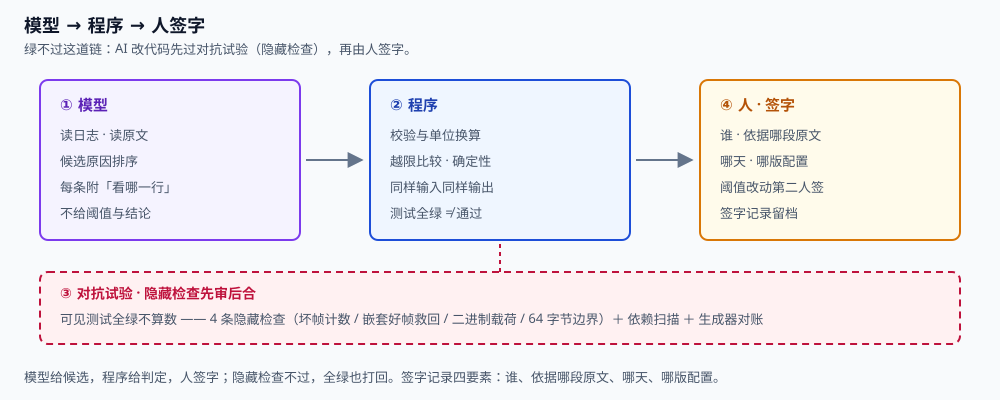
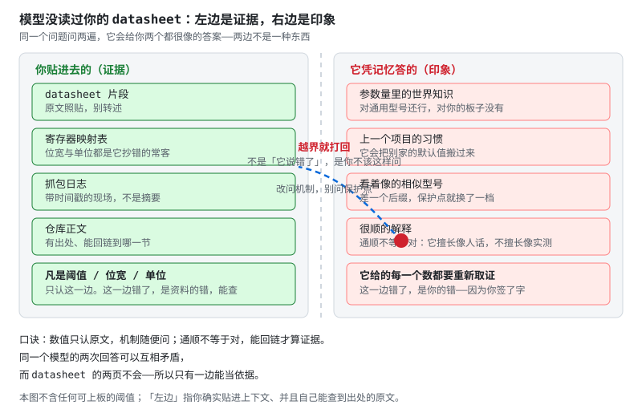

# 第 24 章 BMS × AI：能解释，不能签字

::: story 现场
BMS-Z 的 challenges/03-ai-review 里有一份 AI 改过的 diff：教学帧闸门，可见 pytest 全绿，报告也「更新」了。主代理照样打回——隐藏检查 4 条全红：坏帧计数没了、坏帧里嵌的好帧救不回、二进制载荷被解码失败吞掉、64 字节边界被当成非法。

绿的不是代码，是门槛。这一章把这场对抗拆成能复用的流程。
:::

<figure>

<figcaption>图 24-1　模型 → 程序 → 人签字。候选可以来自模型，判定必须回到程序，签字只能由人；「测试全绿」过不了这道链。</figcaption>
</figure>

## 24.1 三圈边界

**表 24-1**　三圈边界：能做什么、错误成本与例子（定性对照）

| 圈 | 能做什么 | 错误成本 | BMS 专属例子 |
|---|---|---|---|
| 外圈：能放手 | 解释机制、起草文档、陪练出题、从你贴的原文里检索 | 浪费时间 | 让模型讲清 Modbus 功能码 0x03/0x04/0x06/0x10 的分工，再回第 19 章核对 |
| 中圈：要签字 | 故障归因只给候选、阈值只认 datasheet、改代码合并要人点 | 返工或事故 | 模型按厂商寄存器映射表指出 SOC 在 0x0100、单体 1 电压在 0x0101，与抓包对不上——单位换算式与阈值仍由人签 |
| 内圈：别碰 | 安全回路、寄存器与凭据写操作、无人复核的自动动作、现场高压 | 不可接受 | AFE 阈值寄存器的写操作、短路切断的硬件通路，模型永远不伸手 |

越靠近电池，越要人手签字。**能解释、能起草、能陪练；能给候选，不能给结论。**

## 24.2 证据与印象

把输入分两栏：

- **左边**：你贴进上下文的 datasheet、寄存器表、抓包日志、esphome-jk-bms 源码、BMS-Z 仓库正文；
- **右边**：模型凭记忆答的参数量、旧项目习惯、相似型号、看起来很顺的解释。

凡是寄存器地址、功能码、阈值、位宽，只认左边：SOC 在 0x0100 还是 0x1000，功能码用 0x03 还是 0x04，电压是两个字节低字节在前还是高字节在前，4250 mV 这条教学 OVP 线对应哪一份固件——左边错了是资料的错，能查、能回链；右边错了是你的错，因为你签了字。

::: principle 一句话
**数值只认原文，机制随便问。通顺不等于对，能回链才算证据。**
:::

## 24.3 五种失败模式与五个探针

**表 24-2**　五种失败模式与对应探针（定性对照）

| 失败模式 | BMS 场景 | 探针 |
|---|---|---|
| 编数字 | 「均衡启动阈值建议 20 mV，留点余量」——全句没有 datasheet 原句 | 要出处：哪一页、哪一行 |
| 串型号 | 把 SMBus 常见的 7 位地址 0x0B 套到你的 AFE；把 JK 的命令字套到 JBD 板 | 让它复述你贴的原文 |
| 过时手册 | 「功能码 0x03 就行」——可 JK 协议的事实文档是 esphome-jk-bms 源码，厂商新版已改私有命令 | 贴运行结果/抓包/报错 |
| 漏边界 | 只讲常态解析，不说 64 字节载荷、坏 CRC 重同步、断线卡值怎么走 | 问反例：故障注入怎么走 |
| 自信的错 | 「这颗 AFE 也是 0x0B 地址吧」——语气最肯定的那一条 | 换问法再问，看是否矛盾 |

## 24.4 数据驱动 SOH：能提特征，不能免标定

BMS-Z 的 NASA RW3 真实回放（2613 个样本，report.json 可查）给了两条锚点：同一颗电芯、同一个 EKF，参数从未标定到独立标定，相对库仑参考的 RMSE 从 20.74 个百分点降到 4.92 个百分点；不需要真值的新息 RMS 从 15.1 mV 降到 3.7 mV。模型换得动数字，是因为标定换了底。

ML 在 SOH 上的正确位置是**特征候选**：从曲线里挑出增量容量峰高（老化让它变矮，第 15 章）、脉冲内阻 R0（第 13 章 HPPC）、充放电温升（第 14 章的热账）这些候选，再交回物理量签字：窗口容量法 Q = ΔAh/ΔSOC，不确定度 σ_Q = 0.02/ΔSOC（教学合成值）。每个特征都要能换算回安时、毫欧、摄氏度；换算不回去的，只是形状，不是证据。

跨电芯泛化是另一个坑。RW3 报告自己写明 `independent_soc_truth = false`：这是同一颗电芯早期的一次留出验证，尚未跨电芯、跨寿命、跨环境温度。同型号不同批次的电芯，内阻分布可以差出几十毫欧——在一批电芯上训出来的 SOH 回归，换一批就可能整体跑偏。签字前问一句：训练集之外，哪一颗电芯替我验证过？

::: trap 坑
拿 ML 的 SOH 估计值直接发布，跳过窗口容量法的 σ_Q 账。模型给的是候选特征，签字要的是标定后的物理量；少了标定，特征再漂亮也只是相关，不是因果。
:::

<figure class="book-motion" data-animation="ai-context-vs-truth.svg" data-mode="static">

<button type="button" data-book-motion v-book-motion aria-pressed="false" hidden>播放动画</button>
<figcaption>图 24-2　AI 上下文与真值边界：提供材料可以改善回答，却不能把回答自动升级为已验证的事实。</figcaption>

<strong>先看哪里：</strong>跟着引用回到原始观测与运行输出：模型总结是解释层，验证仍要落回证据。

<strong>看完追问：</strong>AI 写出一个更漂亮的误差数字时，必须保存哪些输入和独立验证结果？

</figure>

## 24.5 AI 审查的对抗试验

challenges/03-ai-review 的机制可以整套抄回自己的项目：

1. **只给 diff**：先读改动、不许看答案，写审查记录——文件:行、危险信号、要补的测试、判定（打回 / 拆成单独改动 / 先讨论）；
2. **五看逐项过**：测试（断言是否放宽、用例是否被删）、异常（是否吞掉）、行为（默认值、单位、边界是否漂移）、依赖（是否新塞包）、生成物（报告是否被手改）；
3. **对答案**：ANSWER.md 里五类问题六处，行为漂移占两处；
4. **跑自检**：`python challenges/03-ai-review/verify.py` 的退出码 0 只表示夹具完整——可见测试绿、4 条隐藏检查红、依赖扫描发现 pandas、生成器对账不一致。红才是真相。

BMS-Z 的 AI 陪练卡把同一套动作铺成日常陪练：18 张卡 × 6 条 = 108 条提示（出题、类比、批改、边界、证据链、反例）；「写代码的五个关卡」从需求单一路走到人签字。陪练练的是审查动作，不是替你验收。

::: lab 动手
先只看 challenges/03-ai-review/review.diff，按五类各写一条审查记录，再开 ANSWER.md 对照，最后跑 verify.py。然后把它搬回自己的项目：挑一份 AI 改过的 diff，先写记录，再谈合并。
:::

## 24.6 谁签字

请求进来，先过模型：读日志、读原文、给可能原因并排序，每条附「看哪一行」。然后必须回到程序：校验、单位换算、越限比较——确定性代码，同样输入永远同样输出。最后人签字，记录四要素：**谁、依据哪一段原文、哪天、哪版配置**。

支路是「模型输出直接下发」：省掉判定，也省掉签字。读起来最顺，也最像真的；一旦错了，你查不到是谁定的。

## 练习

1. 一段 AI 修改的 diff：断言从 == 1 改成 >= 0、两条边界用例被删、`except UnicodeDecodeError` 后整帧静默丢弃、函数里新增 import pandas。按「断言是否放宽 / 异常是否吞掉 / 依赖是否新增」列问题清单，每条给判定（打回 / 拆成单独改动 / 先讨论）。
2. 设计一个数据驱动 SOH 方案：列出至少三个特征、每个特征的标注物理量与出处，并写清跨电芯验证怎么分组（训练、验证各自留到哪一层）。
3. 针对「编数字」与「过时手册」各写一个探针问题，要求一问就能把它钉回证据。

## 参考资料

- BMS-Z 阶段 7（BMS × AI）：https://github.com/zhuguang-ZFG/BMS-Z/blob/main/docs/stages/stage-7-BMS与AI.md
- BMS-Z AI 陪练卡（18 张卡、108 条提示）：https://github.com/zhuguang-ZFG/BMS-Z/blob/main/docs/AI陪练卡.md
- BMS-Z 第 3 练 · 审一段 AI 改过的 diff：https://github.com/zhuguang-ZFG/BMS-Z/blob/main/challenges/03-ai-review/README.md
