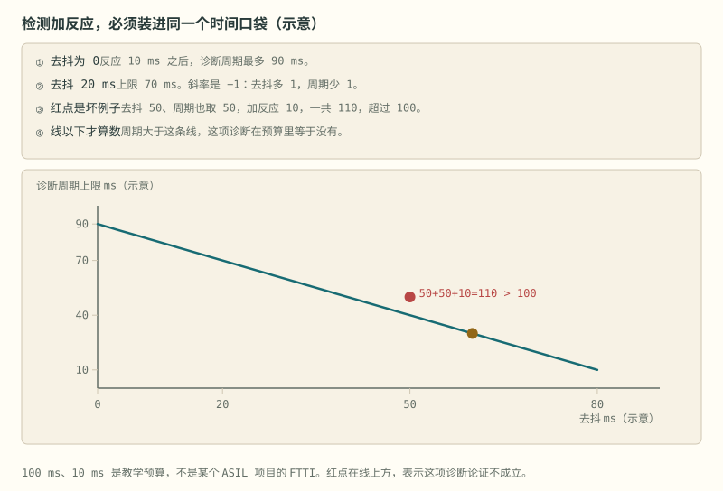

# 第 25 章 功能安全与量产

::: story 现场
充电末端，某一节总是先碰到软件过充点，邻居们还明显更低。出厂时总电压及格、通信也通，谁都没发现问题。售后按包序列号回查，才看见这一节的二维码属于另一个容量档：贴标时张冠李戴了。

保护切断这一节是对的，但切断解释不了“为什么只有它高”。能从包序列号一路走回电芯的分容、内阻和 K 值，才叫量产；走不回去，就只能加大均衡电流硬抹，而均衡搬的是已经存在的电量差，搬不来另一档的容量。这就是产线追溯值钱的原因。
:::

第一次读这一章，先沿 §25.1 把危害走到技术安全需求，再用图 25-1 算 FTTI 口袋。DTC 与产线分别看 §25.4–§25.6；最后读 §25.7，分清“注入了多少故障”与“危险故障是否被独立机制及时覆盖”。

## 25.1 功能安全落地：从 HARA 到技术方案

ISO 26262 / GB/T 34590 的流程听起来抽象，走一遍就具体。这一节的办法是**同一条链走两遍**：左边一条是高压，右边一条是过充，两条用的是同一张骨架。看表时竖着读一列是一个案例，横着读一行才是本节真正要给的东西——**链条的形状与危害无关**。

**表 25-1**　同一条安全链走两个危害：七步逐行对照（教学示例，不是定级结论）

| 步 | 「非预期输出高压」 | 「单体过充」 |
|---|---|---|
| 1 危害识别 | 维修人员接触带电母线 → 可能致命 | 单体过充 → 热失控起火 |
| 2 场景分析 | 下电后母线残压未泄完、接插件被打开、绝缘下降（§32.3、§32.5） | 采样失效、MOS 粘连、充电机失控 |
| 3 ASIL 定级 | 按 S/E/C 三问组合定级 | 同左，按本车型场景单独评 |
| 4 安全目标 | 非授权状态下，高压不得出现在接插件端子 | 任何单点失效不得导致单体电压超过安全限值 |
| 5 功能安全要求 | 监控层独立于功能层 | 双通道独立保护：MCU 软件 + AFE／独立保护 IC 硬件 |
| 6 技术安全要求 | 常开触点失电即断；HVIL 串联监督所有接插件；每次下电做粘连检测 | ADC 自检与开线检测周期按 FTTI 推导；MOS 驱动回路诊断；通信 CRC + 超时；独立看门狗 |
| 7 验证 | 断开 HVIL 任一段，确认禁止上高压；下电后按本包 τ 核对粘连判据窗口（§8.3） | 失效注入：拔采样线、短 MOS、停喂狗，逐项确认**硬件通道独立生效** |

第 3 步的三问值得单独记，因为它决定后面四步（安全目标、功能安全要求、技术安全要求、验证）要做到多严：**严重度**（真出了事有多糟）、**暴露率**（这种场景多久遇上一次）、**可控性**（出了事还救不救得回来）。这三项就是标准里的 S（Severity）、E（Exposure）、C（Controllability），三者组合出 ASIL A 到 D，D 最严。再往下还有一档 **QM**，意思是「按常规质量管理做就够，不必套这整套安全流程」——注意 QM 不是「第五个安全等级」，它是「这条危害不需要安全等级」。本书不给定级结论：同一个危害在不同车型、不同使用场景下可以落在不同等级，**定级是项目的结论，不是书的结论**。

两条链并排看，还能看出一件容易被忽略的事：第 5 步和第 6 步的区别不是「粗和细」，而是**「要什么」和「怎么给」**。「监控层独立于功能层」是要求，「常开触点失电即断」是实现手段；审评时追的是第 6 步能不能把第 5 步兑现，而不是第 6 步写得够不够多。

::: principle 一句话
**一个单点失效 → 还有一道独立防线 → 电池仍然安全。** 这就是功能安全的全部朴素思想。
:::

## 25.2 安全状态与三层监控

安全状态的物理实现（上下拉钳位、常开触点、窗口与问答式看门狗），第 8 章已经讲过：安全不靠软件靠谱，靠断电即安全。这一节要回答的是：它在功能安全流程里属于哪一层、谁监督谁。

E-Gas 三层监控在 BMS 的映射：

**表 25-2**　E-Gas 三层监控在 BMS 的职责划分（教学映射示例）

| 层 | 职责 | BMS 实例 |
|---|---|---|
| Level 1 功能层 | 正常功能 | 主 AFE 采样、SOC 算法、均衡控制 |
| Level 2 监控层 | 监督功能层输出合理性 | 冗余比较：软件阈值复核、双通道采样交叉校验、问答式看门狗 |
| Level 3 硬件层 | 独立硬件兜底 | 二级保护芯片：独立比较器直接驱动保险丝/接触器，不经过主控软件 |

**三级保护的精髓是独立性**：Level 3 不参与软件的任何假设：软件全错了，它也能切断。

## 25.3 FTTI 预算：一个口袋装三件事

从故障发生到必须做完安全动作，只有一个口袋。检测（诊断周期）、去抖、反应都要装进去：

**诊断周期的上限 = 口袋 − 反应 − 去抖。** 去抖多 1 ms，允许的诊断周期就少 1 ms。

教学账（示意，不是某个 ASIL 项目的 FTTI，只说明不等式怎么约束周期）：口袋 100 ms、反应 10 ms 时，去抖为 0 则周期最多 90 ms，去抖 20 ms 则最多 70 ms。坏例子：去抖 50 ms、周期也取 50 ms，再加反应 10 ms，一共 110 ms，装不进 100 ms 的口袋。线以上等于这项诊断没做。同理，教学案例里“ADC 自检与开线检测 < 100 ms”是那条教学路径的取值，不是从标准条款抄来的唯一数字；切断演示里的反应时间 10 ms 与 100 ms 口袋是同一笔示意 FTTI，**不是认证结论**。

教学案例“开线被当成过充”：充电中第 3 串的 ADC 连续三拍高于软件过充阈值，其余串仍在充电平台；软件切断充电 MOS，DTC 记成过充，但开线检测位没有被读。采样线断开时，检测电流可以把悬空脚推向异常电平，读数可以像过充，也可以像过放，和电芯真实电压不是同一件事。两条根因必须能在记录里分开：**真过充**，不经过这颗 MCU 的硬件比较器也应切断，软件停了这条通路还在；**开线**，根因是线束，记成过充，维修会去换电芯，或者把阈值放宽。验证就两下：拔掉这根采样线，确认报的是开线（或开线优先于“这是过充”）；用模拟电压抬高这一串并停掉喂狗，确认硬件通道仍切断。

::: trap 坑
三条误诊路：只信 ADC，不开线检测就定过充；为了还能充电，用标定或云端把软件阈值放宽；硬件比较器被短接或没装。**读数冲高，先问是不是线，再问是不是过充。**
:::

<figure class="book-motion" data-animation="ftti-time-budget.svg" data-mode="static">

<button type="button" data-book-motion v-book-motion aria-pressed="false" hidden>播放动画</button>
<figcaption>图 25-1　FTTI 预算图：检测、确认与执行共享总窗口，任何一段增加都挤占剩余时间。数字为教学示例。把三段时间加到同一口袋，而不是分别宣布每段够快；红点代表预算论证失效。 100 ms 窗口中去抖 20 ms、反应 10 ms，诊断周期还能分到多少？</figcaption>
</figure>

## 25.4 DTC 五要素与快照回放

每个故障五要素：**触发条件 + 去抖 + 等级 + 恢复条件 + 是否锁存**。快照是灵魂：触发瞬间冻结电压、电流、温度、SOC、时间戳，写进 Flash 快照区（双备份），断电不丢，是事故分析的黑匣子。关键 DTC（绝缘、粘连）置位后即使条件恢复也不能自动清除，需要维修确认后用诊断仪清除，防止故障被“颠簸没了”掩盖。客户说“昨天充不进电”，你先要快照，不先要故事。

回放是事后把冻结那一拍再读出来，并确认后面的故障没有把它盖掉。BMS-Z 的 PC 演示 `hil_replay`（阈值与 `test_bms` 相同：过充 4250 mV、去抖 3 拍、短路 30 A，锂电教学示例，不是产品规格）打两段。**案例 A**：充电中把第 3 串写成 4300 mV，第三拍冻结“过充、4300 mV、+2000 mA”并断开充电。下一拍改注入 −40 A，显示主故障升级成短路、两路都断，但快照里的故障码、电压和电流仍是过充那一帧。**案例 B**：把一串写成 0 mV，去抖之后快照是欠压：这个骨架没有开线标志，0 mV 只能落到欠压；真实验台要另注入断线并核对开线 DTC，不能把案例 B 的欠压当成开线已经测过。

::: principle 一句话
**后来的故障可以改显示，已经冻住的第一现场不改。** 否则办公室里只剩短路，看不出它发生在过充之后。
:::

## 25.5 EOL 与 HIL：出厂前的最后一道筛

产线 EOL（末端）测试：

**表 25-3**　产线 EOL 测试项与方法（教学清单示例）

| 测试项 | 方法 | 筛掉什么 |
|---|---|---|
| 绝缘电阻 | 兆欧表/绝缘测试仪倍压限时 | Y 电容失效、爬电距离不足、装配异物 |
| 接触器动作 | 逐只吸合/断开 + 母线电压验证 | 线圈虚焊、触点装反、粘连出厂缺陷 |
| 采样校准 | 标准源三点校准写入校准系数 | AFE 增益/偏移离散性 |
| 通信与诊断 | 全 DTC 遍历 + UDS 服务扫描 | 固件版本错、诊断路由错 |
| 均衡功能 | 强制均衡命令 + 电流实测 | 均衡电阻虚焊、驱动故障 |

出厂标定与 EOL 清单还包括：电流零点（零电流读数写入参数区）、电压增益（标准源比对）、全串采样精度、保护阈值抽测、绝缘电阻、静态功耗、固件版本与序列号烧录。HIL（硬件在环） = 电芯模拟器（入门可用电阻分压链）+ **故障注入清单**：断任意采样线、短相邻采样线、NTC 开路/短路、通信中断、继电器粘连、电流超限，逐项验证 BMS 行为符合安全要求。边界工况另列：−20 °C 启动、满充保持、深度过放恢复、长期静置唤醒。危险实验在桌面上变得可重复、可自动化；**不要对真电池做失效注入**。

## 25.6 电芯筛选与追溯

**K 值分选**：化成之后把电芯静置，用开路电压下降的快慢（K 值）分档。金属屑造成的微短路会让个别电芯掉得特别快，容量和内阻筛选看不出来；同包 K 值差得大，均衡只能补救，不能从根上对齐。单位要写明时间窗：产线论文里常见 mV/h，口头也有人说 mV/天，**两条数字不能直接对比**。一条中试线论文 Figure 4 上的传统固定上限 0.0239 mV/h，是那条产线的经验界，**不是电芯手册上的通用红线**，也不能直接写成“每天多少毫伏”。教学示意（直线假设极化退完、温度不变，不要写进分选规格）：缓的一根 0.010 mV/h，72 h 只掉 0.72 mV；陡的一根 0.080 mV/h，72 h 掉 5.76 mV。

**追溯链**：电芯二维码 → 化成后的容量、内阻和 K 值 → 模组批次 → 包序列号 → 写入 BMS 的 DID，售后可按 DID 读出全链信息。回到开篇的现场：错芯或贴错标时，保护切断是对的，但总电压 EOL 和均衡都看不出身份错了；售后从包序列号读回电芯身份、对不上当时的分容和 K 值，就停用这一台，不要靠加大均衡电流把档差抹平。

## 25.7 注入命中率不是诊断覆盖率

一份报告若写“注入 20 个故障，识别 19 个，覆盖率 95%”，至少还缺三项定义：这些故障是否代表目标硬件的失效空间；漏检项是否可能破坏安全目标；诊断是否在 FTTI 内完成了物理动作。重复注入同一种 ADC 位翻转，只能说明该路径被多次测试，不能证明开线、卡值、共模漂移、时钟错位和执行器粘连均已覆盖。

**表 25-4**　故障注入结果要按安全后果分类，而不是只数“识别/未识别”

| 结果 | 诊断是否识别 | 动作是否在 FTTI 内完成 | 结论 |
|---|---|---|---|
| A | 是 | 是 | 这条机制在该工况下有有效证据 |
| B | 是 | 否 | 发现太晚，安全目标仍可能失守 |
| C | 否 | 但物理上保持安全 | 可记录为安全故障或无影响故障，但不能计入诊断覆盖 |
| D | 否 | 否 | 危险未检出，必须补机制或收紧系统边界 |

覆盖论证至少把故障模式、注入位置、可观测量、诊断延迟、动作反馈和安全后果连在同一行。还要做独立性负控：让主 MCU 卡死、通信静默或共享电源掉电，确认所谓第二通道没有跟第一通道一起消失。两条软件任务读同一个 ADC、用同一时钟、驱动同一个输出，只是两份代码，不是两条独立防线。

“19/20”可以作为测试执行率，却不能直接转换为硬件度量或认证结论。评审重点应放在漏检项的安全后果：漏掉一个不影响安全目标的只读版本号，与漏掉“接触器命令已断但触点仍粘住”，风险完全不同。评审顺序应先看 D 类，再看 B 类，最后才看总数。

::: lab 动手
跑 BMS-Z 的快照回放。先编译：`cd code/firmware && gcc -std=c99 -Wall -Wextra -Werror -o hil_replay bms.c hil_replay.c`。再运行 `./hil_replay`。然后回答：① 案例 A 快照里冻结的电流方向和数值是多少？② 注入 −40 A 之后，快照为什么不变？③ 案例 B 的 0 mV 为什么不能当作“开线已经测过”？
:::

走到这里，安全、诊断、产线三件事都齐了。但实验室里的一台样机，和车间里的一万台产品之间，还隔着供应链、工装、成本与组织，第 26 章《从原型到产品》接着讲。

## 练习

1. 用 E-Gas 三层给“过充保护”分派职责：每一层谁检测、谁复核、谁切断？
2. 口袋 100 ms、反应 10 ms、去抖 20 ms，诊断周期上限是多少毫秒？换一组：去抖 50 ms、周期 50 ms，为什么不行？
3. 给“绝缘报警”写一个 DTC 的五要素（触发、去抖、等级、恢复、锁存），并说明它为什么必须锁存。

## 参考资料

- BMS-Z 详解④：https://github.com/zhuguang-ZFG/BMS-Z/blob/main/docs/circuits/04-系统安全与量产.md
- BMS-Z 阶段 6：https://github.com/zhuguang-ZFG/BMS-Z/blob/main/docs/stages/stage-6-精通与毕业项目.md
- BMS-Z 共学·固件五天：https://github.com/zhuguang-ZFG/BMS-Z/blob/main/docs/共学/03-固件五天.md
