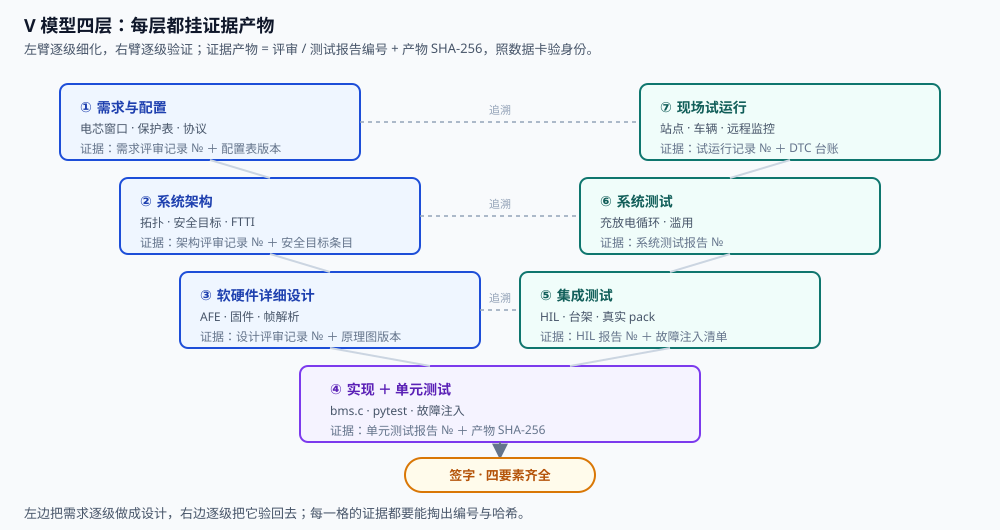
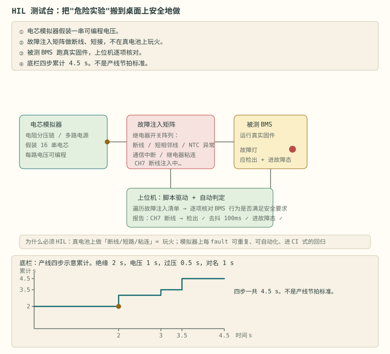
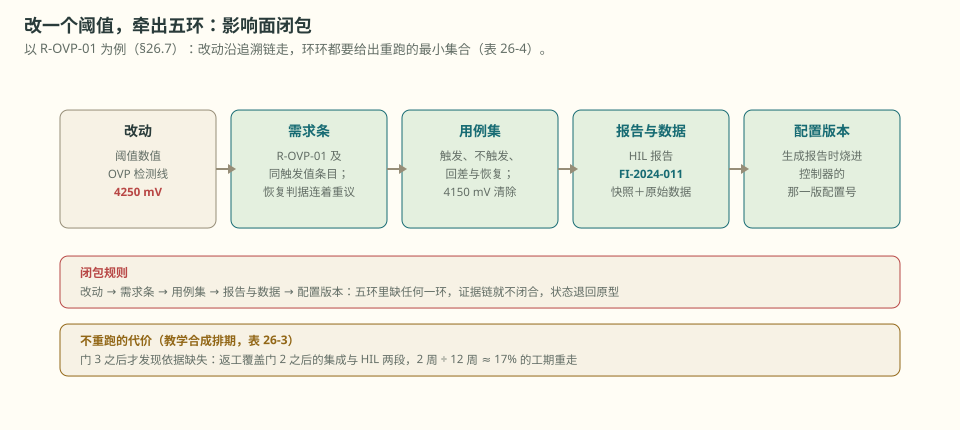

# 第 26 章 从原型到产品：证据链与三道门

::: story 现场
第 9 周，客户审厂（教学合成现场）。auditor 翻到配置表那一页，指着一行问：「过充 4250 mV，这个数谁签的字？」会议室安静了 40 秒。

不是没人算过，是没人能掏出证据：谁、依据哪段原文、哪天、哪版配置。原型到产品，差的不是功能，是这笔账。
:::

<figure>

<figcaption>图 26-1　V 模型四层与每层的证据产物。左边逐级细化，右边逐级验证；每层交编号与哈希，不只交「测过了」。</figcaption>
</figure>

::: chapter-route 阅读路径

- **第一次主线**：读 §26.1–§26.4。把需求、V 模型、测试清单和 12 周三道门连成一条交付路线。
- **第二遍深挖**：读 §26.5–§26.8。处理认证预检、签字、阈值改动影响面和证据哈希。
- **动手验证**：任选一个阈值，列出来源、配置、代码、测试、报告和哈希需要重跑的最小集合。
:::

**先自己判断**　测试报告的哈希没变，能否证明报告引用的原始数据也没有被替换？

## 26.1 需求先于代码

一份可执行的需求至少包含：电芯型号、串并联、容量、电压/温度窗口；使用场景与环境；保护阈值、延时、恢复策略；通信协议；寿命目标与维护方式；法规与认证清单。

每条需求都要能追溯到测试用例。追溯矩阵长这样：

**表 26-1**　需求→测试追溯矩阵长什么样（教学合成示例）

| 需求 ID | 来源条款 | 验证方法 | 证据位置 |
|---|---|---|---|
| R-OVP-01 | 电芯 datasheet 充电上限 4.20 V | 故障注入：单体抬到 4250 mV | HIL 报告 FI-2024-011 ＋ 快照 |
| R-COM-02 | 客户技术协议 §3.2 寄存器映射 | 遍历读写比对 | 报告 TR-COM-03 ＋ wire.bin |
| R-SOC-03 | 系统规格：SOC 误差 ≤ 8% | 标准工况回放对账 | 数据卡 ＋ report.json |

没有这张表，认证阶段会付出成倍代价。

## 26.2 V 模型四层，每层交出证据产物

**表 26-2**　V 模型四层各自验证什么、交什么证据（框架对照，无测量数字）

| 层级 | 验证对象 | 手段 | 证据产物 |
|---|---|---|---|
| 单元 | 采样、均衡、保护函数 | 单元测试、故障注入 | 测试报告编号、覆盖率 |
| 集成 | BMS 软硬件 | HIL、台架、真实 pack | HIL 报告编号、故障注入清单 |
| 系统 | pack ＋ PCS/整车 | 充放电循环、滥用测试 | 系统测试报告编号 |
| 现场 | 站点/车辆 | 试运行、远程监控 | 试运行记录编号、DTC 台账 |

证据产物也要验身份：报告带 SHA-256，数据带数据卡，字段、单位、电流符号、分段用途，照第 21 章的三层身份做。BMS-Z 的 PC 综合实验覆盖了「单元 ＋ 部分集成」：100 拍采样、99 帧遥测、坏帧计数与重同步、短路双断、快照回放。它替代不了硬件台架，但能在写代码阶段拦住大部分逻辑错误。

## 26.3 测试清单九类，每类一句判据

- **精度**：全温区全量程误差在预算内，教学示例线 ±5 mV；
- **保护**：OVP/UVP/OCD/SCD/OT/UT 逐项触发与恢复，回差不丢；
- **故障注入**：报文、波形、日志三对照：注入第 13 帧坏 CRC，三处记录缺一即不过（对账方法见第 20 章）；
- **均衡**：阈值、电流、温升、故障各一条用例；
- **通信**：丢包、乱序、超时、端到端保护逐项过；
- **EMC**：辐射与抗扰报告编号入库；
- **环境**：高低温、湿热、振动后复测精度合格；
- **滥用**：过充、过放、外部短路，全程无热失控；
- **寿命**：循环后 SOC 误差漂移在规格内。

九类里故障注入最依赖台架与 HIL，它的判据是三对照，不是「看起来断了」。

## 26.4 十二周三道门：走到可审厂原型

先声明：12 周走到的是**可审厂原型**，不是量产。三道门卡死节奏：

**表 26-3**　十二周三道门的交付物与验收数字（教学合成排期，门限为示例值）

| 周 | 交付物 | 门与验收数字 |
|---|---|---|
| 1–2 | 需求文档、追溯矩阵 v1 | 需求评审通过，条目可测试 |
| 3–4 | 采样与保护原型 | 门 1：故障注入 12 案全过，编译零警告 |
| 5–6 | SOC/均衡、参数表 | 单元测试全绿，SOC 回放误差 ≤ 8%（示例线） |
| 7–8 | 通信与黑匣子 | 门 2：99/100 帧对账一致，快照可回放 |
| 9–10 | 集成与 HIL | HIL 报告齐，无一级遗留问题 |
| 11–12 | 预测试与评审 | 门 3：追溯矩阵 100% 闭环，签字记录四要素齐 |

门不过，不往后走。审厂那天 auditor 问的每个「谁签的」，都要能在 5 分钟内掏出原件。

<figure class="book-motion" data-animation="hil-testbench.svg" data-mode="static">

<button type="button" data-book-motion v-book-motion aria-pressed="false" hidden>播放动画</button>
<figcaption>图 26-2　HIL 的闭环位置：模型提供工况，真实控制器作出判决，执行反馈回到模型；台架框图为示意。找到被测控制器与模拟器的边界：替换控制逻辑的 Python 模型不是测试同一份固件。故障应注入到哪个接口，才能同时检查输入诊断、判决和输出反馈？</figcaption>
</figure>

<figure>
<figcaption>图 26-3　从原型到产品隔着一道门槛：工作台上的飞线只是能被自己复现，跨过门槛要靠图纸、清单与签字把「能被复现」交给别人。门槛不高，但它只认证据，不认热情。</figcaption>
</figure>

## 26.5 认证预检：条款级对照表

储能侧对着 GB/T 34131《储能用电池管理系统技术条件》，车载侧对着 QC/T 897《电动汽车用电池管理系统技术条件》。认证机构来之前，先自建条款级对照表：

1. 逐条摘出与 BMS 直接相关的条款：采样精度、保护功能、通信、绝缘、环境；
2. 每条款映射到需求 ID、验证方法、证据位置；
3. 缺口列成整改清单，定责任人与日期。

功能安全的流程责任见第 25 章：ISO 26262 / GB/T 34590 的认证结论与产品责任绑在一起，追溯矩阵就是那张责任地图。

::: principle 一句话
**认证要求每个结论有证据，每份证据能追溯到需求和配置版本，并写明签字人。**
:::

## 26.6 签字前的五问

交付前把五问逐条过，每一问对应证据链的一环（现象、测量、模型、判定、动作、记录、签字）：

1. **谁量的？** 测量环节：仪器编号与校准有效期在不在记录里；
2. **量了几次？** 记录环节：单次演示不算，至少三次可复算；
3. **拿什么对照？** 现象与模型环节：对照物是谁，误差多少；
4. **谁签字？** 签字环节：谁、依据哪段原文、哪天、哪版配置，四要素齐不齐；
5. **出错能安全停吗？** 判定与动作环节：任一单点失效都进已知安全状态。

有一题答不上来，项目就还处在原型阶段。

## 26.7 改一个阈值，要重跑哪些东西（影响面闭包）

**改一个阈值，会影响整条追溯链。** 26.1 的追溯矩阵已经列出这条链。以 R-OVP-01 为例（表 26-1：故障注入把单体抬到 4250 mV），动这个阈值一次，至少牵出四层：

1. **需求条**：R-OVP-01 本身，以及所有引用同一触发值的条目，包括恢复判据；
2. **用例集**：故障注入抬到 4250 mV 的触发用例、恢复判据用例、回差用例。4250 mV 触发、4150 mV 清除的 100 mV 回差是第 7 章算过的账；触发值一动，回差通常也要跟着重议；
3. **报告与数据**：HIL 报告 FI-2024-011 加它的快照，连同原始数据文件；
4. **配置版本**：生成这份报告时烧进控制器的配置版本号。

闭包规则压成一条链：**改动 → 需求条 → 用例集 → 报告与数据 → 配置版本**，五环里缺任何一环，证据链就不闭合，状态退回原型。

<figure>

<figcaption>图 26-4　改一个阈值，牵出五环。任一环缺位，证据链退回原型——动手改 4250 mV 之前，你打算先补哪一环？</figcaption>
</figure>

不重跑的代价可以直接用表 26-3 的排期算。门 3（第 11–12 周）之后才发现 4250 mV 这条的阈值依据缺失，返工至少覆盖门 2 之后的集成与 HIL 两段，即表 26-3 的第 9–10 周。算式：2 周 ÷ 12 周 ≈ **17%** 的工期要重走。26.4 要求 5 分钟内拿出原件，前提是四要素（谁、依据哪段原文、哪天、哪版配置）在改动当天补齐，不能拖到审计前补写。

**表 26-4**　改动类型与必须重跑的最小集合（教学合成示例）

| 改动类型 | 必须重跑的最小集合 | 证据四要素落在哪 |
|---|---|---|
| 阈值数值（如 4250 mV） | 该阈值全部用例：触发、不触发、回差与恢复 | 签署人、datasheet 条款、改动日期、新配置版本号 |
| 阈值依据（datasheet 换版） | 引用该来源的需求条与对应用例 | 新版条款与页码、修订日期、比对人、配置基线 |
| 去抖拍数或恢复条件 | 与阈值同源的恢复用例与故障叠加用例 | 四要素全部随新配置版本更新一版 |
| 仅注释与文档 | 不触发重跑，但文档本身要版本化留痕 | 谁、依据、日期、版本四项照记 |

最后一行最容易漏：注释不改行为，但审厂问「这行为什么这么写」时，答案的出处同样要能回链到人和版本。

## 26.8 证据三件套的哈希账：为什么只锁报告锁不住数据

**一份证据由报告、数据和配置共同确定，单件哈希不够。** 只给报告算 SHA-256，锁住的只是报告文本：数据换一批、配置改一位，报告一个字没动，哈希照样通过。

> 先自己判断：一份 HIL 报告的 SHA-256 与当年入库的那一串逐字相同。这能说明报告背后那批数据也没被换过吗？

不能。哈希只覆盖参与计算的字节，报告哈希只证明报告文本没变。把检出能力按「能检出／不能检出」数出来，不做概率假设。表 26-1 里，R-COM-02 挂着报告 TR-COM-03 加 wire.bin，R-OVP-01 的来源条款是 4.20 V。做两次替换实验：

- **把 wire.bin 整体换掉**：报告文本不变，报告哈希不变，只锁报告时检不出；
- **把配置里的 OVP 检测线从 4250 mV 悄悄降到 4240 mV**：报告文本同样不变，哈希照样通过，同样检不出。别把这条线和来源条款的 4.20 V 混为一谈：4.20 V 是电芯 datasheet 的充电上限，4250 mV 是软件过充检测线。这段压差进入电压域核算，要覆盖测量链误差、参数容差与工况留量；采样周期、去抖确认、判决和执行延迟另列 FTTI 时间预算。两本账都要从当前电芯手册、测量链误差和安全目标正向核算，不能由 4.20 V 与 4.25 V 这两个示例值倒推，见第 5、7 与 25 章。

两项替换都该被检出，只锁报告时却是 0/2。换成三元组：**报告哈希 ＋ 数据卡（字段、单位、电流符号、分段用途，照第 21 章的口径）＋ 配置版本**。同样的两次替换各命中 1/1：换过的 wire.bin 过不了数据卡的字段与校验和对账；4250→4240 会让配置版本号前进一版，和需求条、报告记录里写的版本对不上。

**表 26-5**　替换三类证据件时的检出能力（逻辑推演计数，非实验概率）

| 被替换的证据件 | 只锁报告哈希 | 报告＋数据卡＋配置版本 | 靠哪一环检出 |
|---|---|---|---|
| 报告文本被改 | 1/1 | 1/1 | 报告哈希变化 |
| wire.bin 整体替换 | 0/1 | 1/1 | 数据卡字段与校验和 |
| 配置 OVP 线 4250→4240 mV | 0/1 | 1/1 | 配置版本号前进 |

只锁报告的合计检出是 1/3，三件套齐全是 3/3。差出来的两格对应审厂时「报告是真的，背后的数据已被替换」这类问题。第 21 章的三层身份管的是**单件**怎么算身份；这一节补的是**三件拼在一起**才叫一份证据。

::: trap 坑
把「演示通过」当成「验证完成」。演示只覆盖 happy path；交付要求把故障路径一条条走完，并且每条都有编号、有哈希、有人签字。
:::

::: lab 动手
在 BMS-Z 仓库根跑 `python code/firmware/pc_demo.py --out code/firmware/pc-demo-output`（需要 gcc，约 2 秒）。五份产物齐活后，把 report.json 的八项检查填进追溯矩阵的证据位置栏，体验一次证据自己长出来。
:::

## 本讲服务知识点

<!-- kp-backlink:start -->
本章服务 5 个知识点；每条都能回到[核心问题地图](../../docs/核心问题地图.md)的 L1–L5 五级入口。这一节由 `curriculum/concepts.json` 的 `book` 字段生成。

**表 26-6**　本章服务的知识点与其梯子入口

| 知识点 ID | 标题 | 阶段 | 梯子到 | 握证 |
|---|---|---:|---|---|
| [`bringup-ladder-openwire`](../../docs/核心问题地图.md#kp-bringup-ladder-openwire) | 分级上电与开线 | 3 | L5 | 日志 / 照片 |
| [`production-state-machine`](../../docs/核心问题地图.md#kp-production-state-machine) | 量产状态机三铁律 | 6 | L4 | 日志 |
| [`ota-ab-rollback`](../../docs/核心问题地图.md#kp-ota-ab-rollback) | A/B升级与回滚 | 6 | L4 | 日志 |
| [`trace-chain-identity`](../../docs/核心问题地图.md#kp-trace-chain-identity) | 追溯链与错芯 | 6 | L5 | 日志 |
| [`capstone-rubric-evidence`](../../docs/核心问题地图.md#kp-capstone-rubric-evidence) | 毕业项目与量规 | 6 | L5 | 日志 / 照片 |

**分级上电与开线：读数贴在 0.02 V，是电芯真放空了吗？**

上电先查供电与静态电流，再通通信、用电芯模拟器逐串核对采样与保护，前一级没有通过就不往下走。采样线断开后，引脚受内部偏置、诊断电流与电容影响，可能贴低也可能冲高。正文画了贴近零的示例，说明低读数不一定是真过放；缺的是连通与诊断证据，不能只改电压阈值。

**教学算例：沿着这组输入做一遍**

1. 开线示意 τ=0.2 s；从 3.7 V 起，0.2 s 后约 3.7×e⁻¹≈1.36 V。
2. 1.0 s约是5τ，理想衰减项已很小；加上示意偏置后读数约0.04 V，最终接近0.02 V。
3. 这个 0.02 V 与真过放的读数几乎一样；单看电压分不出线断还是电芯空。
4. 所以先跑开线诊断、确认采样线连通，再谈这一串电压能不能用于保护。

**边界与反例**　0.02 V 不能单独证明电芯过放，也不能单独证明线断；要补诊断电流、邻近通道对照或直接量线。

**看图任务**　看悬空引脚的电平怎样沿指数往下贴；注意它最后停的位置和真过放几乎重合。

**对应图解**　[bringup-ladder](../../docs/circuits/assets/bringup-ladder.svg) · [open-wire-detection](../../docs/circuits/assets/open-wire-detection.svg)

**先自己判断**　用电芯模拟器逐串给 3.7 V 核对误差，再分别屏蔽一边验证硬件与软件保护。

完成后再展开标准；先保留自己的计算、判断或运行记录。

核对通过标准

全串误差 <10 mV 有读数；两条路径分别有动作记录；只在隔离限流台架上做，不在真电池上停用保护。

**量产状态机三铁律：状态一多，迁移条件为什么会失控？**

状态一多，迁移条件散落在各状态的周期函数里，行为就取决于调用顺序。三条铁律把控制权收回：迁移集中一处、每个状态写清进入/周期/退出三动作、任意状态可直接进故障态。故障再分提示、限功率、断开三级，休眠与运输模式接在待机之后，低功耗里也不丢安全入口。

**教学算例：沿着这组输入做一遍**

1. 列出初始化→自检→待机→预充→就绪⇄充电/放电的完整边。
2. 给每个状态补进入、周期、退出三动作。
3. 检查任意状态到故障态的直通边，以及三级故障动作。
4. 用code/firmware的test_bms跑迁移，PC通过不替代硬件时序。

**边界与反例**　状态图是教学版图；故障分级与恢复条件要按安全目标重定，PC上的test_bms通过不等于硬件时序已验证。

**看图任务**　盯故障态是否从任意状态可达，迁移是否都汇到同一处判断。

**对应图解**　[state-machine](../../docs/circuits/assets/state-machine.svg)

**先自己判断**　为预充、充电、故障三个状态各写出进入、周期、退出三动作。

完成后再展开标准；先保留自己的计算、判断或运行记录。

核对通过标准

预充进入合 K2、周期查母线爬升与超时、退出合 K1 断 K2；故障进入冻快照、周期查恢复条件、退出按锁存要求。

**A/B升级与回滚：升级写到一半断电，机器为什么还开得起来？**

空中升级 OTA 只是传来新固件，怎样安全换上它还要设计。若直接擦掉正在运行的唯一副本，写到一半断电就可能启动不了。A/B 方案保留旧副本，先把新副本写进备用区，再校验内容与来源，最后更新启动选择记录。引导程序 bootloader 负责选哪份启动；新版本自检失败时回旧区，但这依赖旧副本和选择记录仍然完好。

**教学算例：沿着这组输入做一遍**

1. 画分区：bootloader、A区、B区、参数区各自独立。
2. 新固件写B，整包校验，标记切B，重启自检。
3. 自检失败则标记回A，并记录回滚原因。
4. 参数结构体带版本号、CRC与双备份，更新先写备份区再切标记。

**边界与反例**　回滚依赖旧镜像与标记区仍完好；bootloader被覆盖或标记单份损坏时A/B救不回，需只读保护与备份。

**看图任务**　盯切换是否发生在校验之后；断电落在写B或改标记时，重启应仍进A。

**对应图解**　[s6-ota-ab](../../docs/stages/assets/s6-ota-ab.svg)

**先自己判断**　列出出厂必做的标定项，并说明漏做电流零漂的后果。

完成后再展开标准；先保留自己的计算、判断或运行记录。

核对通过标准

电流零漂、电压增益、NTC 偏移；零漂不标 SOC 出厂即偏几个点并随时间累积。

**追溯链与错芯：总电压及格，能证明这包里的电芯是对的吗？**

总电压正常、通信能通，证明不了每节电芯的身份和档位正确。追溯要能从包序列号一路查回模组、电芯二维码以及分容记录。K 值描述静置时电压掉得多快，也是这份记录的一部分。产线末端测试 EOL 既核对测量，也核对身份；均衡只能调小电量差，不能把容量较小的电芯变成另一档，更不能抹掉贴错标签的事实。

**教学算例：沿着这组输入做一遍**

1. 缓的K值0.010mV/h，72h掉0.72mV；陡的0.080mV/h，72h掉5.76mV。
2. 从包序列号读DID，回查该电芯分容是否在本包档内。
3. 身份对不上就停用该台，不用加大均衡掩盖。

**边界与反例**　0.0239mV/h只属于张赫坤等那条中试线Figure 4，不是通用报废线；没有公开分档表时不写差多少毫伏必须报废。

**看图任务**　盯“这一节先过充、邻居仍低”；加大均衡后压差仍在，就不是均衡不足。

**对应图解**　[cell-trace-chain](../../docs/circuits/assets/cell-trace-chain.svg) · [k-value-rest](../../docs/circuits/assets/k-value-rest.svg)

**先自己判断**　按 0.010 与 0.080 mV/h 算静置 72 h 的压降，并说明图为什么画成直线。

完成后再展开标准；先保留自己的计算、判断或运行记录。

核对通过标准

0.72 mV 与 5.76 mV；假设极化已退完、温度不变；门槛不得从图上抄。

**毕业项目与量规：毕业项目怎么证明自己到了产品级？**

评分表只判断证据到了哪一档，不能替项目定义需求。先写清串数、电芯体系、电流、保护和接口，再给每项安排可重复的检查。故障容错时间 FTTI 是故障发展到必须完成安全动作前的总窗口，诊断、确认和执行都要从里面分时间。优秀项目要能拿出独立保护、首份故障记录和压力测试证据，而不是只交更多页文档。

**教学算例：沿着这组输入做一遍**

1. 以16S LFP、100A持续/200A 10s、OVP/UVP/OCP×2/SCD/OTP/UTP/低温禁充/绝缘写需求。
2. 里程碑1–7逐项挂证据：原理图评审、投板焊接、采样调通、保护实测、SOC恒流<5%、通信、文档。
3. 按六维量规自评并链接证据。
4. 缺双通道独立性或快照复盘的，不得自评优秀。

**边界与反例**　需求模板是教学示例，不是产品规格；量规不能替代安全论证、真实HIL与认证，PC实验也不替代保护实测。

**看图任务**　盯每个档位是否有可点开的证据，别用文档页数或演示通过替代。

**对应图解**　[s6-mislabeled-cell](../../docs/stages/assets/s6-mislabeled-cell.svg)

**先自己判断**　说出量规六个维度，并给出安全保护一维从达标到优秀的递进。

完成后再展开标准；先保留自己的计算、判断或运行记录。

核对通过标准

安全保护、采样与算法、固件、通信、硬件、文档；保护清单全实测→故障注入覆盖开线短接停喂狗→双通道独立性验证加快照复盘。

<!-- kp-backlink:end -->

## 练习

1. 追溯矩阵填空：R-INS-04「绝缘电阻 ≥ 100 Ω/V」，来源条款已填（技术协议 §5.1），补全验证方法与证据位置两格，并写出通过判据。
2. 设计第 8 周阶段门（门 2）的 go/no-go 判据：至少四条量化指标、一条「红线即停」项，并说明证据放在哪。
3. 列出 GB/T 34131 条款级对照表的前 5 行框架：条款号、条款主题、需求 ID、验证方法、证据位置。

## 参考资料

- BMS-Z 阶段 6（精通与毕业项目）：https://github.com/zhuguang-ZFG/BMS-Z/blob/main/docs/stages/stage-6-精通与毕业项目.md
- GB/T 34131《储能用电池管理系统技术条件》
- QC/T 897《电动汽车用电池管理系统技术条件》
