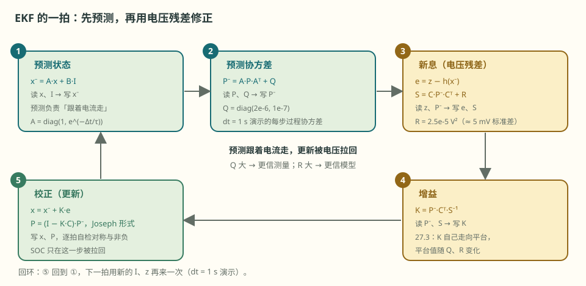
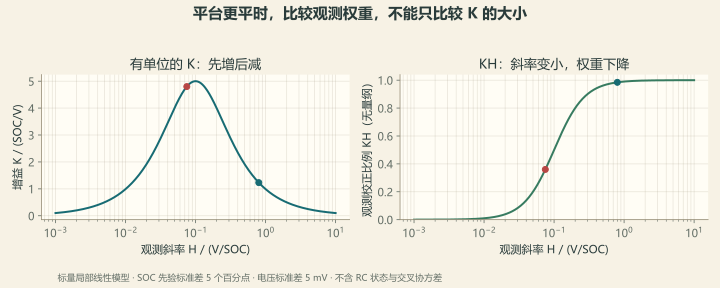

# 第 27 章 EKF 的六个矩阵

::: story 现场
在 BMS-Z 指定合成工况与种子 42 的评估窗口中：纯库仑计 RMSE **10.6183%**，EKF **0.2004%**。评价时先声明窗口是否包含初始化收敛期。

但 BMS-Z 在同一页写了一句更重要的提醒：这个 0.20% 是“最好情形”：EKF 拿到的 R0/R1/C1 与 OCV 曲线和“真值电芯”完全相同，只有容量、初值和零漂是错的。真电池上参数未知还会变，**这个数不能当作真电池精度**。

看懂这句话，比记住 0.20% 更有价值。
:::

第一次读这一章，不必先背矩阵的名字。可以先看 §27.1 的两步：预测时按电流往前推，更新时用电压残差拉回。记住 Q 是每步新添的不确定，R 是仪表噪声，K 是分账比例。再进 §27.2 对号入座看六个矩阵的取值，最后用 §27.4 的 `code/ekf_soc.py` 跑一遍。

## 27.1 两个状态，两句话

EKF 把电芯压缩成两个数：还剩多少电（SOC），以及极化电压此刻拖在哪儿（U_rc）。两个数排成一列，就是它全部的内部状态：

$$
x = \begin{bmatrix} SOC \\ U_{rc} \end{bmatrix}
$$

每一拍分两步。第一步是**预测**：先不看电压，只按电流把状态往前推一步，顺便把“我对自己有多不确定”也推一步。没人来对账，这笔账只会越算越虚；Q 就是每一步新添进去的这份虚：

$$
x^- = A x + B I, \quad P^- = A P A^T + Q
$$

第二步是**更新**：轮到电压开口。z 是这一拍量到的电压，h(x^-) 是模型以为自己该有的电压，两者之差就是第 17 章听诊的那条新息。S 回答“这点差额本来就该有多吵”：把预测的不确定度和仪表噪声 R 加在一起，作为差额的期望尺度；K 是分账比例，决定这份差额按多大比例搬回状态。搬完，不确定度也用同一个 K 收掉一截：

$$
S = C P^- C^T + R, \quad K = P^- C^T S^{-1}
$$

$$
x = x^- + K(z - h(x^-)), \quad P = (I-KC)P^-
$$

剩下三个矩阵，每个都能说成一句人话。A 说“一步之内世界自己怎么变”：SOC 一拍内不动，极化按自己的 τ 衰减。B 说“电流这一拍立了多少功”：给 SOC 充进多少，把极化往 R1·I 那个稳态值推多少。C 说“电压的耳朵有多灵”：对 SOC 的敏感度就是第 10 章那条斜率 dOCV/dSOC，对极化的敏感度是 1，因为极化直接串在端电压里，一比一地被看见：

$$
A = \begin{bmatrix} 1 & 0 \\ 0 & e^{-\Delta t/\tau} \end{bmatrix}, \quad
B = \begin{bmatrix} \frac{\Delta t}{3600 Q_{cap}} \\ R_1(1-e^{-\Delta t/\tau}) \end{bmatrix}
$$

$$
C = \begin{bmatrix} \frac{\mathrm{dOCV}}{\mathrm{dSOC}} & 1 \end{bmatrix}
$$

<figure>

<figcaption>图 27-1　EKF 的一拍：预测把状态推进一步，更新用电压残差把它拉回；Q 与 R 决定更信谁。</figcaption>
</figure>

::: principle 一句话
**预测负责“跟着电流走”，更新负责“被电压拉回”。** Q 与 R 不是玄学，是“你更信谁”的两个旋钮。
:::

## 27.2 BMS-Z 的六个矩阵

它的 `EKFEstimator` 用的是这些值：

**表 27-1**　BMS-Z `EKFEstimator` 的六个矩阵取值（`code/soc/estimators.py` 默认值）

| 矩阵 | 值 | 含义 |
|---|---|---|
| $P_0$ | `diag(1e-2, 1e-4)` | 标准差：SOC 10 个百分点、U_rc 10 mV；不是硬上界 |
| $Q$ | `diag(2e-6, 1e-7)` | 该 dt=1 s 演示每步增加的过程协方差 |
| $R$ | `2.5e-5` V² | 测量噪声，约 5 mV |
| $A$ | `diag(1, exp(-dt/τ))` | 状态转移 |
| $B$ | `[dt/(3600Qcap), R1(1-exp(-dt/τ))]` | 电流输入；Qcap 为容量，不是过程协方差 |
| $C$ | `[dOCV/dSOC, 1]` | 观测敏感度 |

注意 $R$ 的单位：5 mV 是标准差，方差是 $(5\times10^{-3})^2=2.5\times10^{-5}$。若把以伏表示的标准差 `0.005` 直接填进 $R$，方差会被放大 200 倍，相当于约 70.7 mV 的标准差；滤波器会降低对测量的信任。单位与平方都要核对。

区分过程协方差 Q 与电芯容量 Qcap（Ah）。P 的两条对角线单位分别为 SOC²、V²，交叉项为 SOC·V；C 的两项单位也不同。改变采样周期时不能机械沿用每步 Q：随机游走常随 dt 积分，真实模型需从噪声驱动推导。

把这六个数代进去走第一拍，整台滤波器就摊开了。下面每个数都来自 §27.4 那个 demo 的第 0 拍。设定是：`bms-book/code/ekf_soc.py`，dt=1 s，模型 10 Ah、真值 9.5 Ah，初值 0.70 而真值 0.80，电流表还偏 +2 mA。

**预测**：电流表说 −4.998 A，一秒钟搬走 $\frac{1}{3600\times10}\times4.998$ 的电量，SOC 从 0.700000 挪到 0.699861——挪了 0.0139 个百分点。初值错了 10 个百分点，光靠电流积分，这一拍几乎没动它。极化从 0 被推到 −2.240 mV。

**更新**：电压开口了。真电芯量到 3.827365 V，模型以为自己该是 3.742961 V，差 **+84.404 mV**。这就是第 17 章那条新息。C 的第一项此刻是 0.8074 V/SOC（这个工作点上 SOC 每变 1，OCV 变 0.8074 V），于是：

$$
K_0=1.216284\ \mathrm{SOC/V},\qquad K_0\times 84.404\ \mathrm{mV}=+10.27\ \text{个百分点}
$$

SOC 一拍从 0.699861 跳到 0.802520，离真值 0.799854 只差 0.27 个百分点。十个百分点的初值错误，**一拍就还掉了**。

为什么敢这么大步地改？因为 $P_0$ 里写着「我对 SOC 的不确定有 10 个百分点」，而 R 只说仪表噪声 5 mV。滤波器据此算出这点差额本来该有 81.482 mV 的尺度（$\sqrt S$），而实测差额 84.404 mV 正在这个量级上——既然自己承认比仪表虚得多，就该几乎全听电压。这个信任比无量纲，$K_0C_0=0.982$：这一拍把差额的 98% 搬进了状态。搬完它也不虚了，SOC 的标准差当场从 10 个百分点收到 1.34 个。

接着两拍就是另一副样子：

**表 27-2**　前三拍的新息、尺度与采信比例（`code/ekf_soc.py` 第 0–2 拍实算）

| 拍 | 新息 z−h | 自报尺度 √S | $K_0$（SOC/V） | 采信比例 $K_0C_0$ | 这一拍改了 SOC 多少 | SOC 标准差 |
|---|---|---|---|---|---|---|
| 0 | +84.404 mV | 81.482 mV | 1.2163 | 0.982 | +10.27 个百分点 | 10 → 1.342 个百分点 |
| 1 | −0.527 mV | 8.029 mV | 0.9344 | 0.883 | −0.049 个百分点 | 1.342 → 1.122 |
| 2 | +1.531 mV | 6.519 mV | 0.6497 | 0.612 | +0.099 个百分点 | 1.122 → 1.048 |

第 0 拍的新息比后面大两个数量级，因为那时模型真的错；之后新息掉到亚毫伏，是仪表噪声的量级——没什么可争的了。采信比例跟着从 0.982 退到 0.612：滤波器不再言听计从，开始相信自己推的那一步。这就是 §27.3 要说的「增益自己会走到一个平台」，只不过这里是从头三拍看它起步。

### P 为什么必须是矩阵：它会自己学出相关

同一拍里还发生了一件容易被跳过的事。$P_0$ 是 `diag(1e-2, 1e-4)`——对角阵，非对角为 0，意思是「我假定 SOC 猜错和极化猜错这两件事互不相干」。一拍更新之后，非对角项不再是 0：

**表 27-3**　协方差非对角项与相关系数的轨迹（`code/ekf_soc.py` 实算）

| 拍 | $P_{01}$（SOC·V） | 相关系数 ρ | 读法 |
|---|---|---|---|
| 初值 | 0 | 0 | 假定两件事无关 |
| 0 | −1.1503e−4 | **−0.8876** | 一拍之后就学出强负相关 |
| 1 | −9.5524e−5 | −0.9320 | 继续加深 |
| 3 | −8.0889e−5 | −0.9538 | |
| 5 | −7.0522e−5 | **−0.9565** | 最深处 |
| 10 | −5.2472e−5 | −0.9475 | 开始回松 |
| 30 | −1.5353e−5 | −0.8490 | |
| 100 | −2.0973e−6 | −0.4837 | |
| 399 | −1.9517e−6 | −0.4633 | 稳在这附近 |

负号是物理决定的，不是数值噪声：端电压里 OCV(SOC) 和极化是**加在一起**被同一只电压表看到的。如果滤波器把 SOC 猜高了，OCV 那一项就偏高；要让算出来的端电压仍对得上实测值，极化就必须偏低。一高一低，所以是负相关。

注意 ρ 不是一路走向 −1，而是**先深到 −0.954、再回松到 −0.46 左右停住**。前十拍 $P$ 还在从那个虚高的初值急剧收缩。两个状态只能靠同一个电压读数一起往下压，所以几乎绑在一起。收缩到位后，极化自己的衰减（$A$ 里的 $a$）和 $Q$ 每拍添的那点新不确定度把它们重新拆开一些，稳在一个由 $A$、$C$、$Q$、$R$ 决定的平衡点上。看表要连着看趋势，别只截前四行就说「越来越难分」。

这正是 $P$ 不能退化成两个独立数字的原因。假如只存两个方差、丢掉这个 −0.89，滤波器下一拍就会以为「把差额分给 SOC 和分给极化是两笔互不影响的账」，于是重复采信同一份证据。$K$ 的公式里 $P^-C^T$ 那一步要的就是这个非对角项——它负责回答「这份电压差额里，有多少其实该记在极化头上」。

相关系数一路走到 −0.95，容易顺口说成「所以这两个状态不可观测」。这一步要刹住：**它们是两件不同的事。** 同一组参数下，§27.6 的两步可观测矩阵行列式是 $\det\mathcal O=H(a-1)=0.9421\times(0.971991-1)=-0.0264$，并不为零——结构上这两个状态是能分开的。而 ρ=−0.95 说的是另一回事：到目前为止收集到的证据还没把它们分开多少。

一个是「能不能分」，一个是「分到哪一步了」。两者在数值上各有自己的式子，协方差这一侧是

$$
\det P = P_{00}P_{11}\,(1-\rho^2)
$$

所以 |ρ|→1 时 $\det P\to 0$，矩阵趋向奇异、数值条件变差。把这个 $\det P$ 和 $\det\mathcal O$ 混成一个指标，就会得出「相关系数高所以不可观测」这种既不对、又会让人放弃调激励的结论。

> 先自己判断：ρ 一直压在 −0.95 附近，两个状态分不开。换一段更激烈的工况——多几次大电流阶跃——能让它们分得更开吗？

不能。这里还藏着一件反直觉、但顺着式子看一眼就清楚的事：**$P$ 的整条轨迹与电流、电压读数无关。** 回头看那四个更新式，$P^-=APA^T+Q$ 和 $P=(I-KC)P^-$ 里只出现 $A$、$C$、$Q$、$R$；电流 $I$ 只进 $x$ 的那一支，电压 $z$ 只进残差那一项。把本章 demo 的协方差递推单独拎出来跑——不喂电流、不喂测量，只冻结斜率 $H$——同样收到 ρ≈−0.47（$H$=0.8074 时 −0.4657，与整段运行的 −0.4666 对得上）。这就是 demo 的两次电流阶跃（第 1200、1800 拍）为什么在 ρ 上一点痕迹都没留：阶跃前后 ρ 都是 −0.4666，一位小数都没动——阶跃改的是状态，不是不确定度的账。整段跑下来 ρ 也只在 −0.460 到 −0.467 之间微动（第 399 拍 −0.4633、第 2999 拍 −0.4602、末拍 −0.4600），而这点微动来自 SOC 漂移让斜率 $C$ 跟着变，仍然不是电流或电压读数本身带来的。

这件事有两个实际后果。一是 $P$ 与 $K$ 可以离线预先算出来——电池还没接上，增益曲线就已经定了；资源受限的 MCU 据此可以查表而不是每拍求逆。二是**调激励不会改善 $P$**：想让两个状态更容易分开，得动模型结构、采样周期或 $Q$／$R$ 的设定，而不是指望跑一段更激烈的工况。（代价是这个结论建立在「$C$ 随工作点的变化可忽略」上：EKF 的 $C$ 其实跟着 SOC 走，所以真实轨迹只是近似可预先算，不是严格无关。）

把这个比值平方着写下来，就是第 17 章那个 NIS（$e^2/S$）：第 0 拍 **1.073**，第 1 拍 0.0043，第 2 拍 0.0552。第 0 拍的 84 mV 新息配 81 mV 的自报尺度，NIS 落在 1 附近——这是「错得理所应当」。后两拍 NIS 远小于 1，说明 R 相对实际噪声设得偏松：demo 的噪声 RMS 约 3.54 mV，R 却按 5 mV 填。

::: principle 一句话
**新息大不等于滤波器出错，要看它跟自报尺度比。** 第 0 拍差 84 mV 是健康的（自报 81 mV，NIS≈1.07）；若收敛后仍一直差 84 mV、自报尺度却只剩 6 mV（NIS≈200），那才是参数错了——这正是第 17 章在没有真值时唯一能听的那把听诊器。
:::

## 27.3 增益自己会走到一个平台

BMS-Z 的一维示例：

- $R=0.001$：第一步 $K=0.9758$，后来收到 **0.4633**；
- $R=0.020$：平台收到 **0.1318**；
- 把 $Q$ 从 0.0004 提到 0.0016：平台更高：过程更吵，就多听测量。

这些数字是单维线性演示，不是 SOC 的通用增益。真实 SOC 增益具有 SOC/V 单位；“平台越平，K 越小”并不普遍成立。在仅估 SOC 的局部线性模型中：

$$
K=\frac{PH}{H^2P+R},\qquad KH=\frac{H^2P}{H^2P+R}
$$

先分清两个数的身份。K 带着单位（SOC/V），它只是“每伏差额能换多少 SOC”的换算率，不能直接读成“信几分”；把 K 乘回斜率 H 得到 KH，才是无量纲的“这一拍把差额的百分之几真正修进状态”。斜率从陡变平时，一伏能换的 SOC 变多，K 先变大；平过 H≈√(R/P) 那道峰之后，电压的证据太弱，连 K 也往回缩（第 12 章一维式给过这个峰）；KH 则随 H² 一路变小。

固定 P、R 时，H 下降可能先让 K 增大；无量纲的 KH 才随 H² 下降，描述观测校正比例。取 SOC 先验标准差 5 个百分点、测量标准差 5 mV。H 从 0.8 降到 0.075 V/SOC，K 从 **1.2308 增到 4.8000 SOC/V**，KH 却从 **0.9846 降到 0.3600**。两状态 EKF 还含极化和交叉协方差，不能直接套单维数值。

<figure>

<figcaption>图 27-2　固定先验和噪声的局部标量模型：K 的大小与信任程度不是同义词。横轴采用对数刻度；全部数值由本书实验重算。</figcaption>
</figure>

## 27.4 自己跑一遍

`code/ekf_soc.py` 用同一套思路做了个最小实验：

- 真值电芯 9.5 Ah，模型 10 Ah；初值 0.70 vs 真值 0.80；电流偏置 +2 mA；
- 测量噪声为幅值 5 mV 的确定性正弦，RMS 约 3.54 mV；滤波器仍按 5 mV 标准差设置 R，便于复现；
- 评估窗口排除前 **300 s** 收敛期，统计第 300–3599 步（3300 个样本）；结果为纯库仑 RMSE **9.4605%**，EKF **0.1382%**。它不是含启动瞬态的整段精度。

它和 BMS-Z 的 10.6183% / 0.2004% 不完全相同，因为工况与噪声不同；但结论一致：**同样的错误初值、容量误差与零漂，EKF 能把误差压到 1% 以内**，前提是模型参数与 OCV 曲线可信。

## 27.5 数值稳定：协方差不是装饰

简化更新 P=(I−KC)P⁻ 在精确算术下成立，浮点中可能出现不对称或负方差。Joseph 形式保留两个协方差项：

$$
P^+=(I-KC)P^-(I-KC)^T+KRK^T
$$

在合法半正定输入和精确算术下，它保留半正定结构；有限精度仍须检查对称、对角非负和异常数值。本章 demo 采用此形式并逐拍自检。本书的紧凑 Python 实验不处理生产级的异常量程、非均匀采样或传感器失效替代。

## 27.6 哪些状态看不见，滤波就救不了

“看得见”在这里有严格判据，不是凭感觉：把连续两步“电压对各状态有多灵”摞成一个方阵，行列式为零，就说明有状态混在别人的影子里，永远分不出来。冻结工作点的 H 和局部参数时，A=diag(1,a)、C=[H,1] 的两步可观测矩阵如下（工作点变化时需逐步使用对应线性化矩阵）：

$$
\mathcal O=\begin{bmatrix}H&1\\H&a\end{bmatrix},\qquad
\det\mathcal O=H(a-1)
$$

换成直观语言：H=0 时，端电压对 SOC 不再敏感，对应第 10 章的平台区；a=1 时，极化状态不再衰减，它对端电压的影响会与 SOC 变化难以区分。实际系统中，即使矩阵在 H 很小、dt/τ 很小时仍可能满秩，数值条件也会很差。判断可观测性不能只问“行列式是否为零”，还要结合激励、噪声、时间尺度与工作窗口。

将 SOC 裁剪到 0–1 是状态约束；直接裁剪并不自动重算协方差。把容量、R0 或传感器偏置加入状态，也不自动增加信息。需要新的可辨识条件、可信观测与失效策略；第 17 章用新息检查能看到的部分。

::: trap 坑
把 EKF 当成“自动修正一切”。它只能修正它“看得见”的状态；容量、R0、OCV 曲线如果错了，残差会一直偏，滤波器可能收敛到一个错误但自洽的 SOC。
:::

::: lab 动手
在仓库根跑 `python bms-book/code/ekf_soc.py`。先核对指定窗口的 RMSE 与逐拍协方差自检。再看它打印的 `first ticks` 那张表——§27.2 表 27-2、表 27-3 的每一格都在那里，包括第 0 拍的 +84.404 mV 新息和一拍之后的 −0.8876 相关。然后跑 `python bms-book/code/estimator_evidence.py`，核对 K 与 KH 的区别。

想亲手看懂「为什么第 0 拍敢改 10 个百分点」，把 `first_ticks()` 里的 $P_0$ 第一项从 `1e-2` 改成 `1e-4`。这等于让滤波器宣称「我对 SOC 只有 1 个百分点不确定」，而它实际错了 10 个。预期结果：第 0 拍的 $K_0$ 从 1.2163 掉到 **0.4426**、采信比例从 0.982 掉到 **0.357**，SOC 第一拍只走到 0.7372。误差要到第 **56** 拍才收进 1 个百分点，而基线在第 0 拍就到了。**过度自信的代价不是发散，是慢。** 改完记得改回来：表里的数字按 `1e-2` 发布，`bms-book/tests/test_estimator_evidence.py` 会逐格比对，对不上会报红。需要改偏置或 Q 做对照时，保留基线、修改条件和评估窗口，不把调参后的低误差当作独立验证。
:::

## 练习

1. 写出 $A$、$B$、$C$ 的维度，并解释为什么 $C$ 的第二项是 1。
2. $R=2.5e-5$ 对应多少 mV 的标准差？如果实际噪声是 20 mV，$R$ 应该填多少？
3. 为什么容量误差不会像初值误差那样被 EKF 很快修掉？

## 参考资料

- BMS-Z 阶段 4 §4.5：https://github.com/zhuguang-ZFG/BMS-Z/blob/main/docs/stages/stage-4-SOC-SOH算法.md
- BMS-Z `estimators.py`：https://github.com/zhuguang-ZFG/BMS-Z/blob/main/code/soc/estimators.py
- Plett ECE5720 Notes03（本地讲义核对 3–19、3–29、3–39、3–40 页）：http://mocha-java.uccs.edu/ECE5720/ECE5720-Notes03.pdf
- Plett《Battery Management Systems》Vol. II（Artech House, 2016）：等效电路方法与 Kalman 滤波状态估计体系，本章 EKF 六个矩阵的理论出处
