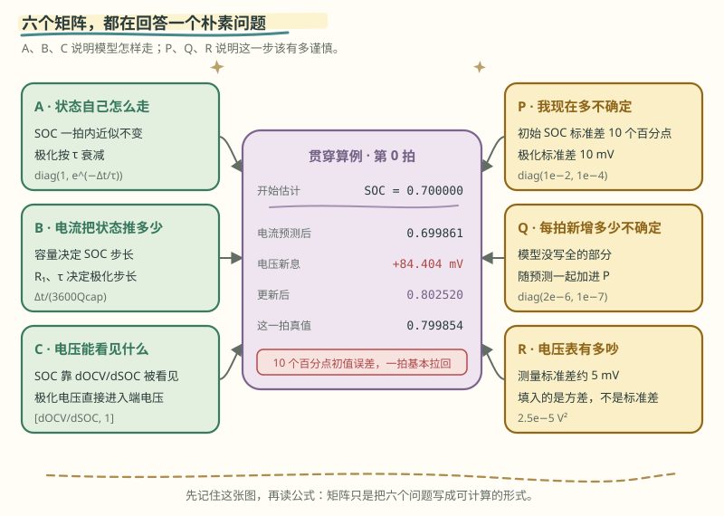
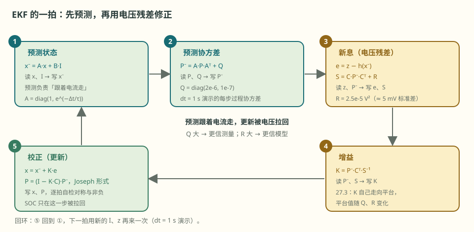
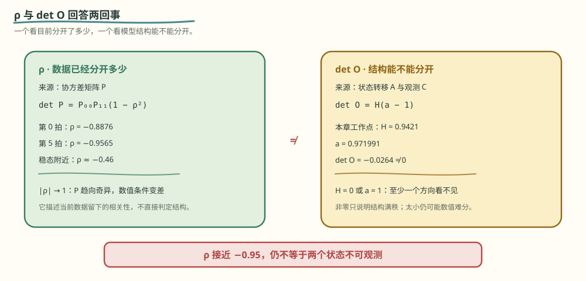
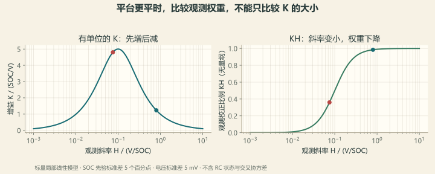
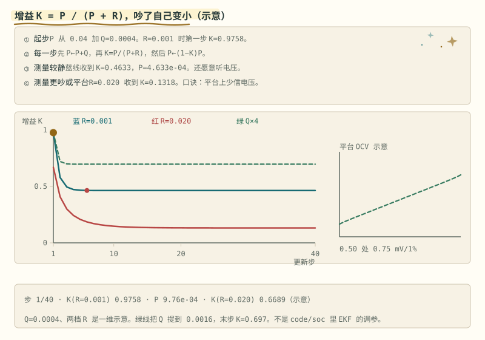

# 第 27 章 EKF 的六个矩阵：电流往前推，电压把它拉回来

::: story 现场
在 BMS-Z 指定合成工况与种子 42 的评估窗口中：纯库仑计 RMSE **10.6183%**，EKF **0.2004%**。评价时先声明窗口是否包含初始化收敛期。

BMS-Z 在同一页注明，0.20% 是最好情形：EKF 拿到的 R0/R1/C1 与 OCV 曲线和“真值电芯”完全相同，只有容量、初值和零漂是错的。真电池的参数未知而且会漂，**这个数不能当作真电池精度**。
:::

::: chapter-route 阅读路径

- **第一次主线**：读 §27.1、§27.3 与 §27.4。先看“预测—对照—修正”，再读实验条件和结果。
- **第二遍深挖**：打开本章进阶页，逐项核对六个矩阵、Joseph 形式、相关性与可观测性。
- **动手验证**：按 §27.4 运行 `code/ekf_soc.py`，保存前 4 拍、稳态窗口和参数失配对照。
:::

**先自己判断**　同一模型和同一电压序列下，把 R 调得更小，滤波器一定会更准确吗？

**教学算例：先看第 0 拍。** 估计器以为 SOC 是 0.70，实际是 0.80。它先按电流把 0.700000 推到 0.699861，再看到 +84.404 mV 的电压差，于是把 SOC 拉到 0.802520；这一拍的真值是 0.799854。先记住这条轨迹，后面的六个矩阵，只是在解释“怎么推、拉多少、敢不敢信”。

<figure class="book-motion" data-animation="27-ekf-six-matrices-flow.svg" data-mode="static">

<button type="button" data-book-motion v-book-motion aria-pressed="false" hidden>播放动画</button>
<figcaption>图 27-1　第 0 拍的 SOC 先被电流从 0.700000 推到 0.699861，再被 +84.404 mV 新息拉到 0.802520。A、B、C 决定模型怎样走，P、Q、R 决定这次修正该有多大。</figcaption>

<strong>先看哪里：</strong>先看左侧 A、B、C 把估计推到 0.699861，再看右侧 P、Q、R 让 +84.404 mV 的新息只把估计改到 0.802520：六个矩阵各自只负责一件事。

<strong>看完追问：</strong>把 R 从 2.5e−5 V² 放大十倍。同一拍的 0.802520 会向 0.699861 靠，还是向 0.700000 靠？

</figure>

## 27.1 两个状态，两句话

EKF 在这个例子里跟踪两个数：剩余电量 SOC，以及内部变化较慢的极化电压 $U_{rc}$。每一拍先按电流预测，再用实测电压核对，差多少就决定改多少。

### 第二遍：把预测与更新写成矩阵

$$
x = \begin{bmatrix} SOC \\ U_{rc} \end{bmatrix}
$$

每一拍分两步。第一步是**预测**：不看电压，只按电流把状态往前推一步，协方差 P 也跟着推一步。没有测量校正时 P 只增不减，Q 是每一步新增的那部分不确定度：

$$
x^- = A x + B I, \quad P^- = A P A^T + Q
$$

第二步是**更新**：z 是这一拍量到的电压，h(x^-) 是模型预测的电压，两者之差就是新息。S 给出新息的期望尺度，把预测不确定度与仪表噪声 R 合在一起；K 决定新息对状态修正的权重，状态与协方差随之更新：

$$
S = C P^- C^T + R, \quad K = P^- C^T S^{-1}
$$

$$
x = x^- + K(z - h(x^-)), \quad P = (I-KC)P^-
$$

剩下三个矩阵描述模型本身。A 是无输入时的状态转移：SOC 一拍内不变，极化按时间常数 τ 衰减。B 是电流的作用：这一拍电流让 SOC 变多少，把极化往稳态值 R1·I 推多少。C 是端电压对各状态的敏感度：对 SOC 是第 10 章的斜率 dOCV/dSOC；对极化是 1，因为极化电压直接串在端电压里：

$$
A = \begin{bmatrix} 1 & 0 \\ 0 & e^{-\Delta t/\tau} \end{bmatrix}, \quad
B = \begin{bmatrix} \frac{\Delta t}{3600 Q_{cap}} \\ R_1(1-e^{-\Delta t/\tau}) \end{bmatrix}
$$

$$
C = \begin{bmatrix} \frac{\mathrm{dOCV}}{\mathrm{dSOC}} & 1 \end{bmatrix}
$$

### 回到主线：一拍怎样走

<figure>

<figcaption>图 27-2　EKF 的一拍：预测把状态推进一步，更新用电压残差把它拉回；Q 与 R 决定更信谁。</figcaption>
</figure>

::: principle 一句话
**预测按电流积分，更新用电压残差校正。** Q 和 R 分别表示过程与测量的不确定度，两者的相对大小决定滤波器更依赖哪一边。
:::

## 27.2 BMS-Z 的六个矩阵

它的 `EKFEstimator` 用的是这些值：

**表 27-1**　BMS-Z `EKFEstimator` 的六个矩阵取值（`code/soc/estimators.py` 默认值）

| 矩阵 | 值 | 含义 |
|---|---|---|
| $P_0$ | `diag(1e-2, 1e-4)` | 标准差：SOC 10 个百分点、U_rc 10 mV；不是硬上界 |
| $Q$ | `diag(2e-6, 1e-7)` | 该 dt=1 s 演示每步增加的过程协方差 |
| $R$ | `2.5e-5` V² | 测量噪声，约 5 mV |
| $A$ | `diag(1, exp(-dt/τ))` | 状态转移 |
| $B$ | `[dt/(3600Qcap), R1(1-exp(-dt/τ))]` | 电流输入；Qcap 为容量，不是过程协方差 |
| $C$ | `[dOCV/dSOC, 1]` | 观测敏感度 |

注意 $R$ 的单位：5 mV 是标准差，方差是 $(5\times10^{-3})^2=2.5\times10^{-5}$。若把以伏表示的标准差 `0.005` 直接填进 $R$，方差会被放大 200 倍，相当于约 70.7 mV 的标准差；滤波器会降低对测量的信任。单位与平方都要核对。

区分过程协方差 Q 与电芯容量 Qcap（Ah）。P 的两条对角线单位分别为 SOC²、V²，交叉项为 SOC·V；C 的两项单位也不同。改变采样周期时不能机械沿用每步 Q：随机游走常随 dt 积分，真实模型需从噪声驱动推导。

### 第 0 拍：为什么敢改 10 个百分点

现在把六个矩阵代入 §27.4 的 demo，手算开头那一拍。设定：`bms-book/code/ekf_soc.py`，dt=1 s，模型容量 10 Ah、真值 9.5 Ah，SOC 初值 0.70、真值 0.80，电流表偏置 +2 mA。

**预测**：电流读数 −4.998 A，一秒放出 $\frac{4.998}{3600\times10}$ 的 SOC，SOC 从 0.700000 降到 0.699861，变化 0.0139 个百分点。至于初值差的 10 个百分点，电流积分这一拍基本没碰。极化从 0 变为 −2.240 mV。

**更新**：实测端电压 3.827365 V，模型预测 3.742961 V，新息为 **+84.404 mV**，即第 17 章用到的那个量。此刻 C 的第一项是 0.8074 V/SOC（该工作点上 SOC 每变 1，OCV 变 0.8074 V），于是：

$$
K_0=1.216284\ \mathrm{SOC/V},\qquad K_0\times 84.404\ \mathrm{mV}=+10.27\ \text{个百分点}
$$

SOC 一拍从 0.699861 跳到 0.802520，与真值 0.799854 相差 0.27 个百分点。10 个百分点的初值误差在第 0 拍就基本消除。

步子这么大，是因为 $P_0$ 给 SOC 的标准差是 10 个百分点，而 R 对应的测量标准差只有 5 mV。按这两项算出的新息尺度 $\sqrt S$ 为 81.482 mV，实测新息 84.404 mV 与之同量级，滤波器因此把这次差额主要归给 SOC 初值。无量纲的校正比例 $K_0C_0=0.982$，即 98% 的电压差额进入了状态修正。更新后 SOC 标准差从 10 个百分点降到 1.34 个百分点。

第 1、2 拍的情况不同：

**表 27-2**　前三拍的新息、尺度与采信比例（`code/ekf_soc.py` 第 0–2 拍实算）

| 拍 | 新息 z−h | 自报尺度 √S | $K_0$（SOC/V） | 采信比例 $K_0C_0$ | 这一拍改了 SOC 多少 | SOC 标准差 |
|---|---|---|---|---|---|---|
| 0 | +84.404 mV | 81.482 mV | 1.2163 | 0.982 | +10.27 个百分点 | 10 → 1.342 个百分点 |
| 1 | −0.527 mV | 8.029 mV | 0.9344 | 0.883 | −0.049 个百分点 | 1.342 → 1.122 |
| 2 | +1.531 mV | 6.519 mV | 0.6497 | 0.612 | +0.099 个百分点 | 1.122 → 1.048 |

第 0 拍的新息比后两拍大一到两个数量级，因为此时初值误差还在；之后新息降到毫伏级，与测量噪声同量级。校正比例随之从 0.982 降到 0.612，预测值的权重开始上升。§27.3 讨论的增益平台，就是这一过程的稳态。

### P 为什么必须是矩阵：更新会产生相关项

同一拍里，协方差的非对角项也变了。$P_0$ 是 `diag(1e-2, 1e-4)`，非对角为 0，表示初始时假定 SOC 误差与极化误差不相关。一拍更新之后，非对角项不再是 0：

**表 27-3**　协方差非对角项与相关系数的轨迹（`code/ekf_soc.py` 实算）

| 拍 | $P_{01}$（SOC·V） | 相关系数 ρ | 读法 |
|---|---|---|---|
| 初值 | 0 | 0 | 假定两件事无关 |
| 0 | −1.1503e−4 | **−0.8876** | 一拍之后就学出强负相关 |
| 1 | −9.5524e−5 | −0.9320 | 继续加深 |
| 3 | −8.0889e−5 | −0.9538 | |
| 5 | −7.0522e−5 | **−0.9565** | 最深处 |
| 10 | −5.2472e−5 | −0.9475 | 开始回松 |
| 30 | −1.5353e−5 | −0.8490 | |
| 100 | −2.0973e−6 | −0.4837 | |
| 399 | −1.9517e−6 | −0.4633 | 稳在这附近 |

负号来自观测方程：OCV(SOC) 与极化电压相加后由同一个电压测量看到。若 SOC 估高，OCV 项偏高；要让预测端电压仍与实测一致，极化项就要偏低，所以两者的误差负相关。

ρ 先在第 5 拍降到 −0.9565，再回升并稳定在 −0.46 附近。前十拍 $P$ 从较大的初值快速收缩，两个状态都只靠同一个电压读数约束，相关性很强。收缩完成后，极化的衰减（$A$ 中的 $a$）和每拍加入的 $Q$ 使相关性减弱，最终稳定在由 $A$、$C$、$Q$、$R$ 决定的值。读表时要看完整趋势，只看前四行会误以为相关性一直在加深。

所以 $P$ 不能只存两个方差。丢掉 −0.89 这个相关项，滤波器在下一拍会把 SOC 和极化的修正当作互不影响，同一份电压证据会被重复使用。$K$ 公式中的 $P^-C^T$ 依靠非对角项决定电压差额在 SOC 与极化之间怎样分配。

强相关不等于不可观测。同一组参数下，§27.6 的两步可观测矩阵行列式为 $\det\mathcal O=H(a-1)=0.9421\times(0.971991-1)=-0.0264$，不为零，结构上两个状态可以区分。ρ=−0.95 描述的是另一件事：当前已有的数据还没有把两者分得很开。

<figure>

<figcaption>图 27-3　ρ 来自协方差 P，看当前数据已经把两个状态分开多少；$\det\mathcal O$ 来自 A 与 C，看模型结构能否区分两个状态。ρ 接近 −1 会让 P 的数值条件变差，但不会自动把可观测性变成零。</figcaption>
</figure>

两个数不要混着读。可观测性回答“能不能区分”，相关系数回答“已经区分到什么程度”。协方差一侧的关系是

$$
\det P = P_{00}P_{11}\,(1-\rho^2)
$$

|ρ|→1 时 $\det P\to 0$，矩阵趋向奇异，数值条件变差。$\det P$ 和 $\det\mathcal O$ 是两个指标，混用会得出“相关系数高所以不可观测”的错误结论。

> 先自己判断：前几拍 ρ 接近 −0.95。换一段更激烈的工况，多加几次大电流阶跃，能让两个状态分得更开吗？

在这个模型里不能。**$P$ 的轨迹与电流、电压读数无关。** 看协方差的两步更新：$P^-=APA^T+Q$ 和 $P=(I-KC)P^-$ 只含 $A$、$C$、$Q$、$R$；电流 $I$ 只进入状态 $x$，电压 $z$ 只进入残差。把 demo 的协方差递推单独运行，不输入电流和测量，只冻结斜率 $H$=0.8074，ρ 收敛到 −0.4657，与整段运行的 −0.4666 一致。demo 在第 1200、1800 拍有两次电流阶跃，阶跃前后 ρ 都是 −0.4666，阶跃只改变了状态。整段运行中 ρ 在 −0.460 到 −0.467 之间小幅变化（第 399 拍 −0.4633、第 2999 拍 −0.4602、末拍 −0.4600），原因是 SOC 变化使斜率 $C$ 改变，与读数本身无关。

由此有两个工程推论。第一，$P$ 与 $K$ 可以离线预先计算，资源受限的 MCU 可以查表，省去每拍求逆。第二，**改激励不会改善 $P$**：要让两个状态更容易区分，需要改模型结构、采样周期或 $Q$／$R$。这个推论成立的前提是 $C$ 随工作点的变化可以忽略；EKF 的 $C$ 实际随 SOC 变化，所以真实轨迹只能近似地预先计算。

新息平方除以 S 就是第 17 章的 NIS（$e^2/S$）：第 0 拍 **1.073**，第 1 拍 0.0043，第 2 拍 0.0552。第 0 拍 84 mV 的新息对应 81 mV 的预测尺度，NIS 接近 1，与滤波器自身的不确定度假设相符。后两拍 NIS 远小于 1，说明 R 相对实际噪声偏大：demo 噪声 RMS 约 3.54 mV，R 按 5 mV 设置。

::: principle 一句话
**新息大不等于滤波器出错，要和 S 给出的尺度一起看。** 第 0 拍差 84 mV 时，自报尺度为 81 mV，NIS≈1.07；若收敛后仍差 84 mV、自报尺度却只剩 6 mV，NIS≈200，才说明模型或测量与假设明显不符。
:::

## 27.3 增益自己会走到一个平台

这个例子里，开头的估计很不确定，电压会把它拉回一大截；往后修正幅度逐渐稳定。$K$ 有单位，不能直接把它读成“相信电压的百分比”。

### 第二遍：用 K 和 KH 区分换算率与采信比例

BMS-Z 的一维示例：

- $R=0.001$：第一步 $K=0.9758$，后来收到 **0.4633**；
- $R=0.020$：平台收到 **0.1318**；
- 把 $Q$ 从 0.0004 提到 0.0016：平台升高，过程噪声越大，测量的权重越高。

这些数字是单维线性演示，不是 SOC 的通用增益。真实 SOC 增益具有 SOC/V 单位；“平台越平，K 越小”并不普遍成立。在仅估 SOC 的局部线性模型中：

$$
K=\frac{PH}{H^2P+R},\qquad KH=\frac{H^2P}{H^2P+R}
$$

先分清两个数的身份。K 带着单位（SOC/V），它只是“每伏差额能换多少 SOC”的换算率，不能直接读成“信几分”；把 K 乘回斜率 H 得到 KH，才是无量纲的“这一拍把差额的百分之几真正修进状态”。斜率从陡变平时，一伏能换的 SOC 变多，K 先变大；平过 H≈√(R/P) 那道峰之后，电压的证据太弱，连 K 也往回缩（第 12 章一维式给过这个峰）；KH 则随 H² 一路变小。

固定 P、R 时，H 下降可能先让 K 增大；无量纲的 KH 才随 H² 下降，描述观测校正比例。取 SOC 先验标准差 5 个百分点、测量标准差 5 mV。H 从 0.8 降到 0.075 V/SOC，K 从 **1.2308 增到 4.8000 SOC/V**，KH 却从 **0.9846 降到 0.3600**。两状态 EKF 还含极化和交叉协方差，不能直接套单维数值。

<figure>

<figcaption>图 27-4　固定先验和噪声的局部标量模型：K 的大小与信任程度不是同义词。横轴采用对数刻度；全部数值由本书实验重算。</figcaption>
</figure>

<figure class="book-motion" data-animation="kalman-gain.svg" data-mode="static">

<button type="button" data-book-motion v-book-motion aria-pressed="false" hidden>播放动画</button>
<figcaption>图 27-5　增益收敛是递推出来的，不是设定出来的：P 递推 40 步，K 从 0.9758 落到 0.4633（蓝，R=0.001）或 0.1318（红，R=0.020）；Q 从 0.0004 提到 0.0016 时平台升到 0.697（绿）。全部数值由本书实验重算。</figcaption>

<strong>先看哪里：</strong>跟住蓝点的第一步 K=0.9758，再看它一路收到 0.4633 的平台；红线平台更低，绿线（Q×4）平台更高。

<strong>看完追问：</strong>若把 R 再放大十倍到 0.200，平台的 K 会比 0.1318 高还是低？KH 会怎样变？

</figure>

## 27.4 自己跑一遍

`code/ekf_soc.py` 用同一套思路做了个最小实验：

- 真值电芯 9.5 Ah，模型 10 Ah；初值 0.70 vs 真值 0.80；电流偏置 +2 mA；
- 测量噪声为幅值 5 mV 的确定性正弦，RMS 约 3.54 mV；滤波器仍按 5 mV 标准差设置 R，便于复现；
- 评估窗口排除前 **300 s** 收敛期，统计第 300–3599 步（3300 个样本）；结果为纯库仑 RMSE **9.4605%**，EKF **0.1382%**。它不是含启动瞬态的整段精度。

它和 BMS-Z 的 10.6183% / 0.2004% 不同，因为工况与噪声不同；结论一致：**同样的错误初值、容量误差与零漂，EKF 能把误差压到 1% 以内**，前提是模型参数与 OCV 曲线可信。

## 27.5 数值稳定：协方差不是装饰

简化更新 P=(I−KC)P⁻ 在精确算术下成立，浮点中可能出现不对称或负方差。Joseph 形式保留两个协方差项：

$$
P^+=(I-KC)P^-(I-KC)^T+KRK^T
$$

在合法半正定输入和精确算术下，它保留半正定结构；有限精度仍须检查对称、对角非负和异常数值。本章 demo 采用此形式并逐拍自检。本书的紧凑 Python 实验不处理生产级的异常量程、非均匀采样或传感器失效替代。

## 27.6 哪些状态看不见，滤波就救不了

可观测性可以用矩阵判断：把连续两步的观测敏感度叠成方阵，行列式为零时，至少有一个状态方向无法从电压序列中区分。冻结工作点的 H 和局部参数时，A=diag(1,a)、C=[H,1] 的两步可观测矩阵如下（工作点变化时需逐步使用对应线性化矩阵）：

$$
\mathcal O=\begin{bmatrix}H&1\\H&a\end{bmatrix},\qquad
\det\mathcal O=H(a-1)
$$

换成直观语言：H=0 时，端电压对 SOC 不再敏感，对应第 10 章的平台区；a=1 时，极化状态不再衰减，它对端电压的影响会与 SOC 变化难以区分。实际系统中，即使矩阵在 H 很小、dt/τ 很小时仍可能满秩，数值条件也会很差。判断可观测性不能只问“行列式是否为零”，还要结合激励、噪声、时间尺度与工作窗口。

将 SOC 裁剪到 0–1 是状态约束；直接裁剪并不自动重算协方差。把容量、R0 或传感器偏置加入状态，也不自动增加信息。需要新的可辨识条件、可信观测与失效策略；哪些部分能用新息检查看到，见第 17 章。

::: trap 坑
以为 EKF 能修正所有误差。它只能修正模型中可观测的状态；容量、R0、OCV 曲线如果错了，残差会一直偏，滤波器可能收敛到一个错误但自洽的 SOC。
:::

::: lab 动手
在仓库根跑 `python bms-book/code/ekf_soc.py`。先核对指定窗口的 RMSE 与逐拍协方差自检。再看它打印的 `first ticks` 那张表：§27.2 表 27-2、表 27-3 的每一格都在那里，包括第 0 拍的 +84.404 mV 新息和一拍之后的 −0.8876 相关。然后跑 `python bms-book/code/estimator_evidence.py`，核对 K 与 KH 的区别。

想亲手看懂“为什么第 0 拍敢改 10 个百分点”，把 `first_ticks()` 里的 $P_0$ 第一项从 `1e-2` 改成 `1e-4`。这等于让滤波器宣称“我对 SOC 只有 1 个百分点不确定”，而它实际错了 10 个。预期结果：第 0 拍的 $K_0$ 从 1.2163 掉到 **0.4426**、采信比例从 0.982 掉到 **0.357**，SOC 第一拍只走到 0.7372。误差要到第 **56** 拍才收进 1 个百分点，而基线在第 0 拍就到了。这个例子里，$P_0$ 设得过小没有导致发散，代价是收敛慢了 56 拍。改完记得改回来：表里的数字按 `1e-2` 发布，`bms-book/tests/test_estimator_evidence.py` 会逐格比对，对不上会报红。需要改偏置或 Q 做对照时，保留基线、修改条件和评估窗口，不把调参后的低误差当作独立验证。
:::

六个矩阵各自管什么，到这里清楚了。还剩一个问题：矩阵里的 R1、τ 从哪来？下一章解剖一条 HPPC 曲线，看 R0、R1、C1 怎样从一次脉冲的跳变、爬升与回弹里读出来。

## 本讲服务知识点

<!-- kp-backlink:start -->
本章服务 1 个知识点；每条都能回到[核心问题地图](../../docs/核心问题地图.md)的 L1–L5 五级入口。这一节由 `curriculum/concepts.json` 的 `book` 字段生成。

**表 27-4**　本章服务的知识点与其梯子入口

| 知识点 ID | 标题 | 阶段 | 梯子到 | 握证 |
|---|---|---:|---|---|
| [`ekf-gain-trust`](../../docs/核心问题地图.md#kp-ekf-gain-trust) | 增益把信任分出去 | 4 | L5 | 仿真输出 |

**增益把信任分出去：残差一直很大，先拧增益还是先查模型？**

卡尔曼增益 K 决定这一步更听模型预测，还是更听新测量。P 表示预测有多不确定，R 表示测量有多不确定；在同一简化观测单位下，K=P/(P+R)。预测越没把握，越需要测量；测量越吵，越不该猛拉状态。电压残差长期偏大时，先查模型和工况，不能只加增益让曲线暂时贴上去。

**教学算例：沿着这组输入做一遍**

1. 示例从 P=0.04 起，每步加入 Q=0.0004；Q 描述模型每走一步新添的不确定性。
2. 取 R=0.001 时，首步 K≈0.9758，递推后约收至 0.4633；换成更大的 R=0.020，稳态信任降至约 0.1318。
3. 仓库种子 42 的已知参数仿真给出纯积分 RMSE 10.6183%、EKF 0.2004%。它证明该合成实验，不证明真实电芯精度。

**边界与反例**　平台区电压对 SOC 不敏感，测量再稳定也未必提供足够 SOC 信息。实际 EKF 用矩阵和观测斜率，不能把标量 K 当通用旋钮。

**看图任务**　看每次预测如何扩大不确定性、测量如何收缩它；比较噪声变大后增益为何变小。

**对应图解**　[kalman-gain](../../docs/circuits/assets/kalman-gain.svg) · [ekf-estimation](../../docs/circuits/assets/ekf-estimation.svg)

**先自己判断**　跑 code/soc/compare.py，读出纯安时与 EKF 的 RMSE，并算 K=P/(P+R) 在 R=0.001 与 0.020 下的首步增益差别。

完成后再展开标准；先保留自己的计算、判断或运行记录。

核对通过标准

10.6183% 与 0.2004%；R 小则 K 接近 1、R 大则 K 明显更小；注明是仿真。

<!-- kp-backlink:end -->

## 练习

1. 写出 $A$、$B$、$C$ 的维度，并解释为什么 $C$ 的第二项是 1。
2. $R=2.5e-5$ 对应多少 mV 的标准差？如果实际噪声是 20 mV，$R$ 应该填多少？
3. 为什么容量误差不会像初值误差那样被 EKF 很快修掉？

## 参考资料

- BMS-Z 阶段 4 §4.5：https://github.com/zhuguang-ZFG/BMS-Z/blob/main/docs/stages/stage-4-SOC-SOH算法.md
- BMS-Z `estimators.py`：https://github.com/zhuguang-ZFG/BMS-Z/blob/main/code/soc/estimators.py
- Plett ECE5720 Notes03（本地讲义核对 3–19、3–29、3–39、3–40 页）：http://mocha-java.uccs.edu/ECE5720/ECE5720-Notes03.pdf
- Plett《Battery Management Systems》Vol. II（Artech House, 2016）：等效电路方法与 Kalman 滤波状态估计体系，本章 EKF 六个矩阵的理论出处
