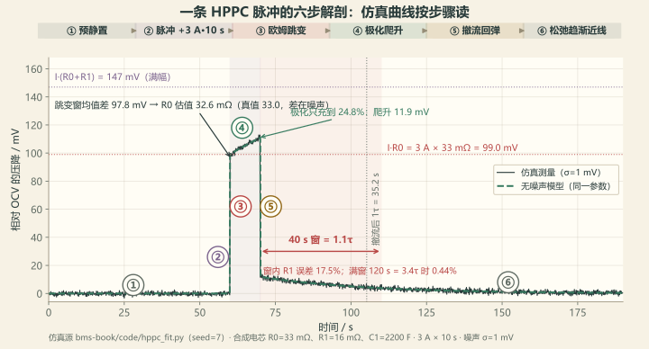
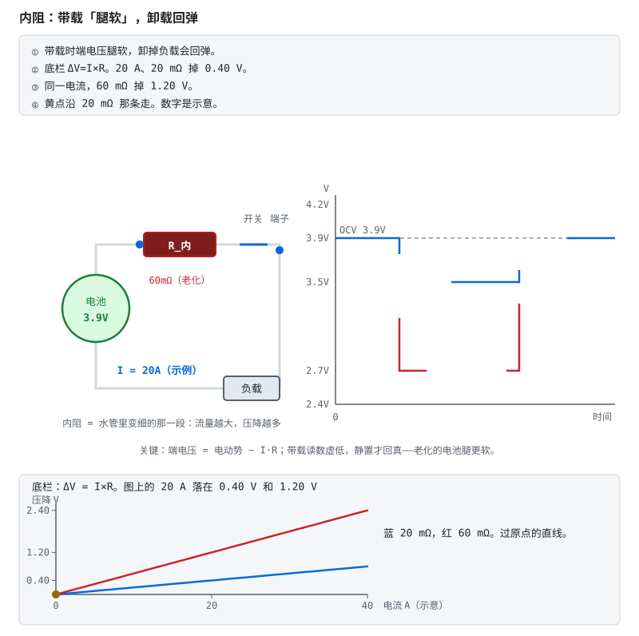

# 第 28 章 一条 HPPC 曲线的解剖

::: story 现场
SOC 0.5 处、3 A 脉冲。BMS-Z 的手算：脉冲前 1 秒与脉冲后 0.3 秒均值差 **97.8 mV**，除以 3 A 得 **32.6 mΩ**；真值 **33.0 mΩ**，差在噪声。它的 120 s 回弹拟合给出 τ=35.5 s（真值 35.2 s）。

但 BMS-Z 把静置窗砍到 40 s，R1 误差从 0.1% 恶化到 **19.3%**；若在这个短窗上再忘掉短脉冲修正、直接拿幅值除电流，误差到 **77%**。这两笔要分开记：短窗毁的是渐近线，漏修正毁的是幅值。本书脚本复现同一趋势：120 s 窗 0.44%，40 s 窗 **17.5%**（见 28.4 表）。

一条脉冲，三种读法，三个答案。HPPC 的难点不是测，是**怎么读**。
:::

这一章只做一件事：把同一条脉冲里的瞬时跳变、极化爬升和长时回弹分开，避免用错窗口。

**本章分三层。**

- **第一次主线**：读 §28.1–§28.3。沿图 28-1 找出 R0、RC 与渐近线，并复算短脉冲修正。
- **第二遍深挖**：读 §28.4–§28.6。比较 40 s／120 s 窗口、DCR 时长口径和 SOC 网格插值。
- **动手验证**：运行拟合脚本，分别报告参数误差、残差和观察窗长度，不只贴一条平滑曲线。

**教学算例**　章首 97.8 mV、32.6 mΩ、17.5% 和 77% 是本章贯穿对照，下面的公式逐项解释这些数字。

<figure>

<figcaption>图 28-1　一条 HPPC 脉冲的六步解剖：预静置、脉冲注入、欧姆跳变、极化爬升、撤流回弹、松弛趋渐近线。曲线由 code/hppc_fit.py 的合成电芯（R0=33 mΩ、R1=16 mΩ、C1=2200 F，seed=7）仿真生成，含噪测量与无噪声模型叠画对照。40 s 窗只够 1.1 个 τ，渐近线还没露头。</figcaption>
</figure>

## 28.1 三段电压

1. **跳变**：电流一加，$I R_0$ 立刻出现；
2. **爬升**：RC 支路按 $1-e^{-t/\tau}$ 慢慢充电；
3. **回弹**：撤流后，极化按 $e^{-t/\tau}$ 排掉，趋向渐近线。

脉冲只有 10 s、τ≈35 s 时，RC 只充到：

$$
1 - e^{-10/35.2} \approx 24.7\%
$$

所以回弹幅值要除以 0.247 才是 $R_1 I$。不做这一步修正，R1 会被低估约 4 倍。

把三段连起来看，这条曲线讲了一个完整的故事：电流来了，欧姆阻力立刻顶回去（跳变）；极化慢慢建立，电压继续爬（爬升）；电流走了，欧姆阻力立刻消失，极化慢慢散掉（回弹）。读曲线的人要随时问一句“现在说话的是谁”：是 R0、是 RC、还是噪声和环境。问不出来的那段，就是最容易被误读的那段。

## 28.2 R0：只看“立刻”

$$
R_0 = \frac{|\Delta U_{\text{instant}}|}{\Delta I}
$$

本书用脉冲前 1 秒与脉冲后 0.3 秒均值减少噪声；该窗相对 τ≈35 s 很短，但仍含少量极化，不是严格瞬时值。窗口须避开电流上升沿和滤波延迟，并报告残余偏差。

> 先自己判断：把静置窗从 120 s 砍到 40 s，R1 误差从 0.1% 烂到 19.3%。同一份数据、同一段代码，R0 要跟着烂多少？

**R0 对静置窗长度免疫**：它只吃跳变。窗口怎么截，R0 都差不多；R1/C1 才住在回弹的形状与终值里。

这一条是 HPPC 读法里最能省事的一点：R0 和后面的拟合几乎是两份独立工作。做 R0 的人只需要盯住两次跳变，用不用 40 s 窗、用不用 120 s 窗，都无所谓；做 R1/C1 的人则被窗口长度死死咬住。所以验收一条辨识流水线时，先查 R0：它便宜、稳定、几乎不受拟合选择影响；R0 都读不稳，后面的数字更没有底气。

<figure class="book-motion" data-animation="internal-resistance.svg" data-mode="static">

<button type="button" data-book-motion v-book-motion aria-pressed="false" hidden>播放动画</button>
<figcaption>图 28-2　内阻引起的带载端电压变化：电流与电阻决定瞬时压差，撤流后欧姆项消失。数值为独立教学示例。用电流变化前后的同步采样看跳变，不把后续拖尾一起塞进瞬时内阻。为什么只看一张带载电压截图无法分清 OCV、R0 与初始极化？</figcaption>
</figure>

## 28.3 τ 与 R1：渐近线也要一起辨识

回弹模型：

$$
U(t) = K + A e^{-t/\tau}
$$

三个未知数里，$K$（渐近线）与 $A$（幅值）会“成对搬家”：只截一段窗，τ 一变，K 和 A 一起变，谁都不肯单独让步。

BMS-Z 的做法（本书 `hppc_fit.py` 同构，只是 τ 网格起点取 3 s，BMS-Z 取 5 s）：

1. 网格搜 τ（步长 0.5 s，上限 120 s）；
2. τ 固定后，$K$、$A$ 变成线性最小二乘；
3. 取残差最小的组合；
4. 用 $1-e^{-t_{\text{pulse}}/\tau}$ 修正脉冲未充满的幅值。

在单指数、局部参数不变的假设下，观察 **3–4 个 τ** 通常更利于辨识渐近线。τ≈35 s 时，120 s 是 3.4 个 τ；40 s 只有 1.1 个 τ。更长窗口仍要检查慢扩散与温漂，不是等够时间就自动得到真值。

“成对搬家”值得多看一眼。固定 τ 去拟合 K 和 A，相当于在每个 τ 假设下解一条直线；τ 不同，那条直线的截距和斜率跟着变，残差曲面沿着一条谷底下沉：谷底里每个点的拟合效果都差不多，参数却各有各的说法。数据要替你收窄答案，只有两条路：延长窗口（让曲率显形），或者加约束（比如已知 K 应是 OCV 查询值）。本书的合成对照里两条路都演示了。

## 28.4 自己跑一遍

`code/hppc_fit.py` 用合成电芯（R0=33 mΩ、R1=16 mΩ、C1=2200 F，噪声 1 mV/5 mA）反推：

**表 28-1**　hppc_fit.py 满窗拟合与真值对照（合成电芯回放值）

| 参数 | 真值 | 估计 | 误差 |
|---|---:|---:|---:|
| R0 | 33.00 mΩ | 32.85 mΩ | 0.47% |
| R1 | 16.00 mΩ | 16.07 mΩ | 0.44% |
| C1 | 2200 F | 2209 F | 0.41% |
| τ | 35.2 s | 35.5 s | 0.9% |

同一份数据只用 40 s 窗，R1 误差 **17.5%**，和 BMS-Z 的 19.3% 同一量级。

这张表有三个读法，对应三种自信程度。R0 一行可以给足信任：0.47% 在 1 mV 噪声下就是噪声本身的量级，说明跳变窗口选得干净。R1、C1 一行要附带说明：0.44% 是在 120 s 窗、充分修正的前提下成立的，把窗砍到 40 s 就恶化一个数量级：同一个拟合器，同一批数据。τ 一行最诚实：35.5 对 35.2，零点几个百分点的差别，但它同时吃窗长和修正系数的脸色。所以交付参数表时，别只交数字，要把“这些数字是在哪个窗口、哪次修正下测的”一起交出去。

::: principle 一句话
**R0 看跳变，τ 看曲率，R1 看经过短脉冲修正的幅值；渐近线由整段数据联合辨识。** 两个远离的点可以辅助看图，不能替代有噪声数据的拟合。
:::

## 28.5 脉冲时长决定 DCR：10 s 与 30 s 不是同一个数

同一颗电芯，10 s 脉冲报一个 DCR，30 s 脉冲报另一个，两个数都能复现，因为它们量的本就不是同一个量。

一阶 RC 模型下，脉冲开始后 $t$ 秒的极化完成度是 $1-e^{-t/\tau}$。取 `code/soc/compare.py` 那台合成电芯的参数：$\tau = R_1 C_1 = 15\ \mathrm{m\Omega} \times 3000\ \mathrm{F} = 45\ \mathrm{s}$。常量见该文件 `R0, R1, C1 = 0.020, 0.015, 3000.0`。两个常见口径各充到：

- 10 s：$1-e^{-10/45} = 1-e^{-0.2222} \approx 0.199$；
- 30 s：$1-e^{-30/45} = 1-e^{-0.6667} \approx 0.487$。

把欧姆项与已建立的极化加起来（$R_0 = 20\ \mathrm{m\Omega}$、$R_1 = 15\ \mathrm{m\Omega}$，同上）：

**表 28-2**　同一颗电芯两种脉冲口径的 DCR 账（compare.py 合成电芯参数算术推演）

| 口径 | 极化完成度 $1-e^{-t/\tau}$ | DCR $= R_0 +$ 完成度 $\times R_1$ |
|---|---:|---:|
| 10 s | 0.199 | $20 + 0.199 \times 15 = 20 + 2.99 \approx 23.0$ mΩ |
| 30 s | 0.487 | $20 + 0.487 \times 15 = 20 + 7.30 \approx 27.3$ mΩ |

比值 $27.3 / 23.0 \approx 1.19$：**30 s 口径比 10 s 口径大出约 19%**。两个数都“对”，混在一起比就全错。DCR 表若不写脉冲时长、电流方向、SOC 与温度，这 19% 迟早被当成老化或批次差异。**报 DCR 必须同时报脉冲时长、电流方向、SOC 与温度；换口径不是同一张表。**

## 28.6 SOC 网格与插值账

HPPC 要在多个 SOC 点各打一组脉冲。点怎么摆，不是画图问题，是一笔误差账。

**网格粗细的账。** 一个 11 点网格（0%、10%、…、100%，共 10 段）在 10 Ah 电芯上每段相隔 1 Ah；脉冲取点偏 ±5% SOC（半段），就是 0.5 Ah。取点误差要换算成 OCV 记账误差，得乘当地斜率（斜率取第 12 章表 12-2 的教学值）：

**表 28-3**　±5% SOC 取点误差在两种斜率下的 OCV 记账误差（第 12 章斜率算术）

| 工作区 | dOCV/dSOC（V/SOC） | 记账误差 = 斜率 × 0.05 |
|---|---:|---:|
| LFP 平台 | 0.075 | $0.075 \times 0.05 = 3.75$ mV |
| 膝段 | 6.8 | $6.8 \times 0.05 = 0.34\ \mathrm{V} = 340$ mV |

同一个 5% 取点误差，平台区只值 3.75 mV，膝段值 340 mV，相差 $6.8 / 0.075 \approx 91$ 倍。**平台可以疏，膝段按允许的 OCV 误差加密。**

**表间插值的账。** 网格建好后，落点之间的值靠双线性插值：温度轴每 10 °C 一个点、SOC 轴每 10% 一个点。间距 $h$ 上做线性插值，误差有标准上界

$$|e| \le \frac{h^2 \max|f''|}{8}$$

（中点处取到）。均匀网格上二阶差分 $\Delta^2 y \approx f'' h^2$，所以可以直接拿 $|\Delta^2 y| / 8$ 当曲率的离散代理；注意量纲：上界是「间距平方 × 曲率」，不是「间距 × 曲率」。二维表要**两条轴分别算再相加**（最坏情况两轴误差同向），不能只算一条。落成动作：用网格相邻三点的二阶差分估出各自上界，相加超过允许的记账误差就缩间距，而不是换插值算法。

**外推必须拒绝。** 插值在两点之间，两边都有数据拉着；外推超出网格，没有任何数据约束，误差随距离发散。查表程序遇到越界请求要钳位到边界并报错，而不是顺手外推一个数：SOC 漂到 105% 的“OCV”不是保守估计，是编造。

网格间距按允许的记账误差反推，不是凭画图方便定的。

::: trap 坑
用“40 s 窗末端均值”当稳态。τ=35.2 s 时，指数还剩约 **32.1%**；残余极化被算进 K，幅值和时间常数随之偏移。偏差方向与大小要按完整拟合过程检查，不能把“还剩三成极化”直接等同于“R1 少三成”。
:::

::: lab 动手
在仓库根跑 `python bms-book/code/hppc_fit.py`，记录 R0/R1/C1 与 40 s 窗误差。实验已用同一份数据截出 40 s 窗；另在交互环境取 20 s 窗调用 `fit_relaxation`，比较 K、τ 与修正后的 R1，保留完整窗自检作为基线。
:::

## 练习

1. τ=35 s、脉冲 10 s，RC 充到多少？如果脉冲改成 30 s，修正系数是多少？
2. 为什么 R0 对静置窗长度不敏感，而 R1 很敏感？
3. 设计一张参数表：3 个温度 × 6 个 SOC × 4 个参数，怎么存进 MCU？插值怎么做？

## 参考资料

- BMS-Z HPPC 五天：https://github.com/zhuguang-ZFG/BMS-Z/blob/main/docs/共学/07-hppc五天.md
- BMS-Z `hppc_demo.py`：https://github.com/zhuguang-ZFG/BMS-Z/blob/main/code/soc/hppc_demo.py
- ECE5710 Notes02 中文导读：https://github.com/zhuguang-ZFG/BMS-Z/blob/main/docs/ece5710-notes02-中文导读.md
- 本书 HPPC 拟合实验：本章全部合成参数、噪声种子与拟合步骤。
