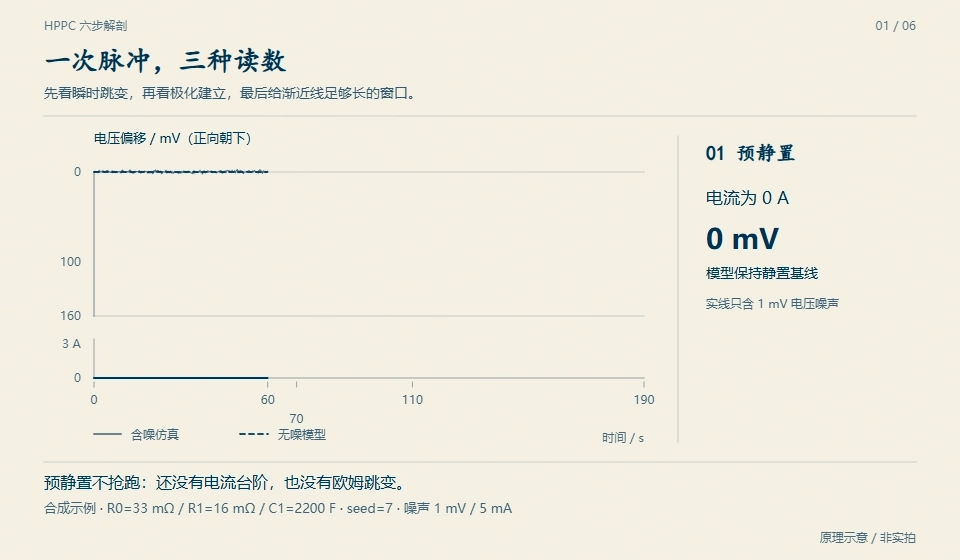
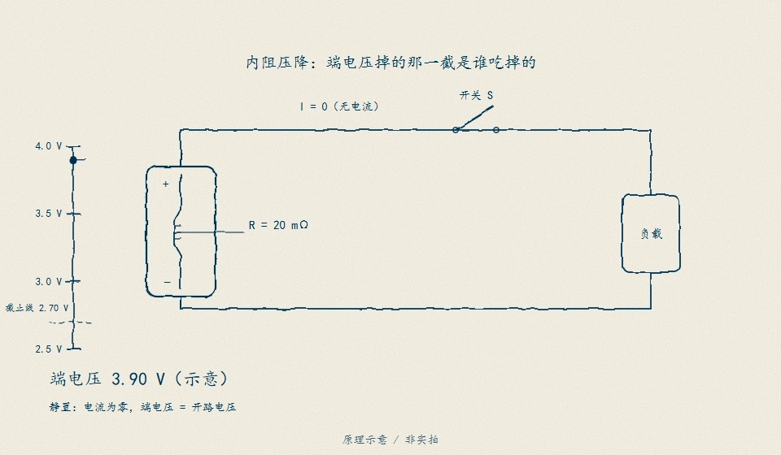
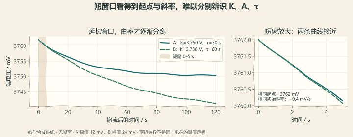
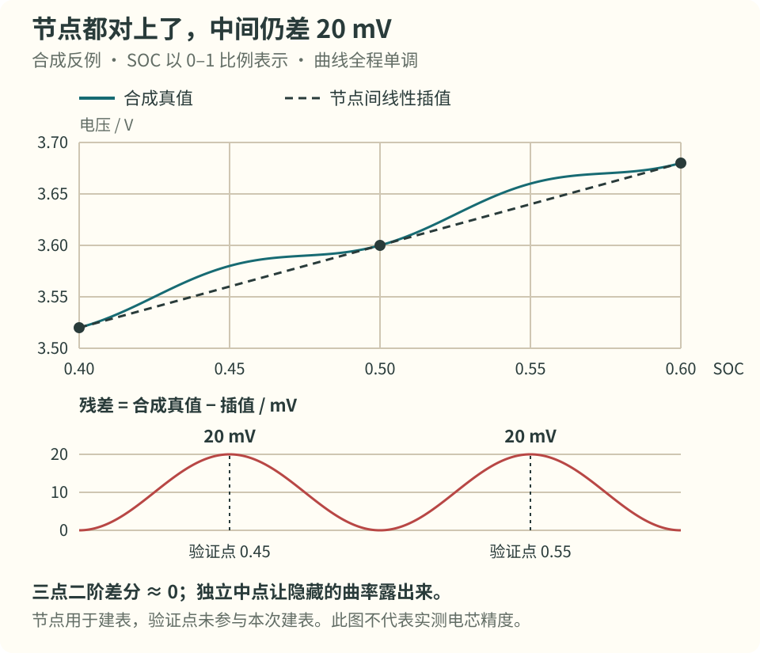
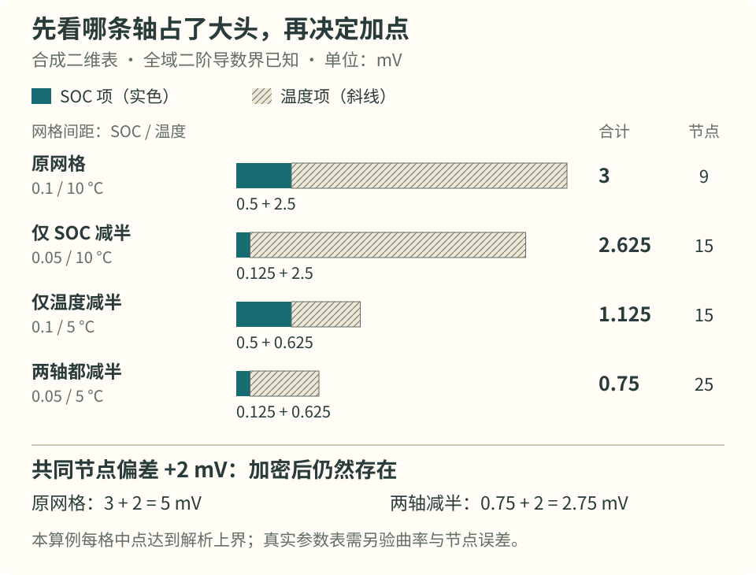
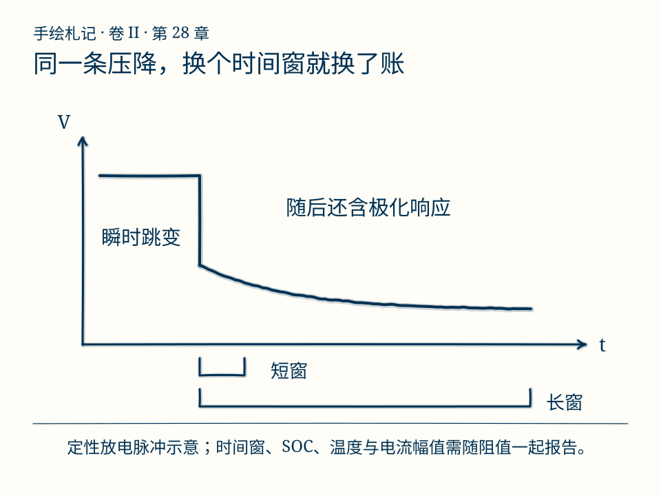

# 第 28 章 一条 HPPC 曲线的解剖

::: story 现场
SOC 0.5 处、3 A 脉冲。BMS-Z 的手算：脉冲前 1 秒与脉冲后 0.3 秒均值差 **97.8 mV**，除以 3 A 得 **32.6 mΩ**；真值 **33.0 mΩ**，差在噪声。它的 120 s 回弹拟合给出 τ=35.5 s（真值 35.2 s）。

但 BMS-Z 把静置窗砍到 40 s，R1 误差从 0.1% 恶化到 **19.3%**；若在这个短窗上再忘掉短脉冲修正、直接拿幅值除电流，误差到 **77%**。这两笔要分开记：短窗毁的是渐近线，漏修正毁的是幅值。本书脚本复现同一趋势：120 s 窗 0.44%，40 s 窗 **17.5%**（见 28.4 节）。

同一条脉冲可以读出三个量。HPPC 的难点不在测量，而在**怎么读**。
:::

这一章只做一件事：把同一条脉冲里的瞬时跳变、极化爬升和长时回弹分开，避免用错窗口。

> **难度**：L2 进阶
> **先修**：第 10 章的端电压模型、第 13 章的 HPPC 参数。
> **学完你应能**：把瞬时跳变、极化爬升、长时回弹分窗量化，并判断一组 HPPC 数据能不能支撑模型参数。

::: chapter-route 阅读路径

- **第一次主线**：读 §28.1–§28.3。沿图 28-1 找出 R0、RC 与渐近线，并复算短脉冲修正。
- **第二遍深挖**：读 §28.4–§28.6。比较 40 s／120 s 窗口、DCR 时长口径和 SOC 网格插值。
- **动手验证**：运行拟合脚本，分别报告参数误差、残差和观察窗长度，不只贴一条平滑曲线。
:::

**教学算例**　章首出现的 97.8 mV、32.6 mΩ、17.5% 和 77% 是贯穿全章的对照数字，下面的公式逐项解释它们的来历。

<figure class="book-motion" data-animation="hppc-pulse.webp" data-mode="static">

<button type="button" data-book-motion v-book-motion aria-pressed="false" hidden>播放动画</button>
<figcaption>图 28-1　一条 HPPC 脉冲的六步解剖：预静置、脉冲注入、欧姆跳变、极化爬升、撤流回弹、松弛趋渐近线。曲线由 code/hppc_fit.py 的合成电芯（R0=33 mΩ、R1=16 mΩ、C1=2200 F，seed=7）仿真生成，含噪测量与无噪声模型叠画对照。40 s 窗只够 1.1 个 τ，渐近线还没露头。</figcaption>
</figure>

## 28.1 三段电压

1. **跳变**：电流一加，$I R_0$ 立刻出现；
2. **爬升**：RC 支路按 $1-e^{-t/\tau}$ 慢慢充电；
3. **回弹**：撤流后，极化按 $e^{-t/\tau}$ 排掉，趋向渐近线。

脉冲只有 10 s、τ≈35 s 时，RC 只充到：

$$
1 - e^{-10/35.2} \approx 24.7\%
$$

所以回弹幅值要除以 0.247 才是 $R_1 I$。不做这一步修正，R1 会被低估约 4 倍。

把三段连起来看，这条曲线讲了一个完整的故事：电流来了，欧姆阻力立刻顶回去（跳变）；极化慢慢建立，电压继续爬（爬升）；电流走了，欧姆阻力立刻消失，极化慢慢散掉（回弹）。读曲线的人要随时问一句“现在说话的是谁”：是 R0、是 RC、还是噪声和环境。问不出来的那段，就是最容易被误读的那段。

## 28.2 R0：只看“立刻”

$$
R_0 = \frac{|\Delta U_{\text{instant}}|}{\Delta I}
$$

本书用脉冲前 1 秒与脉冲后 0.3 秒均值减少噪声；该窗相对 τ≈35 s 很短，但仍含少量极化，不是严格瞬时值。窗口须避开电流上升沿和滤波延迟；报告 R0 时须给出残余偏差。

> 先自己判断：把静置窗从 120 s 砍到 40 s，R1 误差从 0.1% 烂到 19.3%。同一份数据、同一段代码，R0 要跟着烂多少？

**R0 对静置窗长度免疫**：它只吃跳变。窗口怎么截，R0 都差不多；R1/C1 才住在回弹的形状与终值里。

这一条是 HPPC 读法里最能省事的一点：R0 和后面的拟合几乎是两份独立工作。做 R0 的人只需要盯住两次跳变，用不用 40 s 窗、用不用 120 s 窗，都无所谓；做 R1/C1 的人则被窗口长度死死咬住。所以验收一条辨识流水线时，先查 R0：它便宜、稳定、几乎不受拟合选择影响；R0 都读不稳，后面的数字更没有底气。

<figure class="book-motion" data-animation="internal-resistance.webp" data-mode="static">

<button type="button" data-book-motion v-book-motion aria-pressed="false" hidden>播放动画</button>
<figcaption>图 28-2　内阻引起的带载端电压变化：电流与电阻决定瞬时压差，撤流后欧姆项消失。数值为独立教学示例。用电流变化前后的同步采样看跳变，不把后续拖尾一起塞进瞬时内阻。为什么只看一张带载电压截图无法分清 OCV、R0 与初始极化？</figcaption>
</figure>

## 28.3 τ 与 R1：渐近线也要一起辨识

回弹模型：

$$
U(t) = K + A e^{-t/\tau}
$$

三个未知数里，$K$（渐近线）与 $A$（幅值）会“成对搬家”：只截一段窗，τ 一变，K 和 A 一起变，谁都不肯单独让步。

BMS-Z 的做法（本书 `hppc_fit.py` 与之同构，只是 τ 网格起点本书取 3 s，BMS-Z 取 5 s）：

1. 网格搜 τ（步长 0.5 s，上限 120 s）；
2. τ 固定后，$K$、$A$ 变成线性最小二乘；
3. 取残差最小的组合；
4. 用 $1-e^{-t_{\text{pulse}}/\tau}$ 修正脉冲未充满的幅值。

在单指数、局部参数不变的假设下，观察 **3–4 个 τ** 通常更利于辨识渐近线。τ≈35 s 时，120 s 是 3.4 个 τ；40 s 只有 1.1 个 τ。更长窗口仍要检查慢扩散与温漂，不是等够时间就自动得到真值。

短窗里，多组 K、A、τ 可以给出几乎相同的起点和斜率；延长窗口后，曲率才会分开。

<figure>

<figcaption>图 28-3　短窗只看得到相同的 3762 mV 起点与约 −0.4 mV/s 初始斜率，分不清 A 组的 K=3.750 V、τ=30 s 和 B 组的 K=3.738 V、τ=60 s。要收窄答案，要么延长窗口让曲率显形，要么给 K 加约束，例如使用可信的 OCV 查询值。图中为无噪声合成对照。</figcaption>
</figure>

## 28.4 自己跑一遍

`code/hppc_fit.py` 用合成电芯（R0=33 mΩ、R1=16 mΩ、C1=2200 F，噪声 1 mV/5 mA）反推：

**表 28-1**　hppc_fit.py 满窗拟合与真值对照（合成电芯回放值）

| 参数 | 真值 | 估计 | 误差 |
|---|---:|---:|---:|
| R0 | 33.00 mΩ | 32.85 mΩ | 0.47% |
| R1 | 16.00 mΩ | 16.07 mΩ | 0.44% |
| C1 | 2200 F | 2209 F | 0.41% |
| τ | 35.2 s | 35.5 s | 0.9% |

同一份数据只用 40 s 窗，R1 误差 **17.5%**，和 BMS-Z 的 19.3% 同一量级。

这张表有三个读法，对应三种自信程度。R0 一行可以给足信任：0.47% 在 1 mV 噪声下就是噪声本身的量级，说明跳变窗口选得干净。R1、C1 两行要附带说明：0.44% 是在 120 s 窗、充分修正的前提下成立的，把窗砍到 40 s 就恶化一个数量级以上：同一个拟合器，同一批数据。τ 一行最诚实：35.5 对 35.2，零点几个百分点的差别，但它同时吃窗长和修正系数的脸色。所以交付参数表时，别只交数字，要把“这些数字是在哪个窗口、哪次修正下测的”一起交出去。

::: principle 一句话
**R0 看跳变，τ 看曲率，R1 看经过短脉冲修正的幅值；渐近线由整段数据联合辨识。** 取曲线上相距较远的两点可以辅助看图，不能替代有噪声数据的拟合。
:::

还有一道比“参数误差不到 1%”更容易漏掉的题：这组参数有没有预测过未参与拟合的电压？在仓库根运行 `python code/engineering/identification/d11_joint_hppc.py --scipy`，可比较轻量网格与直接复用的 SciPy 求解器。它是另一个合成场景：放电为正、生成 τ=45 s，训练 A/B、验证 C/D 都用 180 s 尾段，不改本章表 28-1 的 40/120 s 基线。

D11 将训练得到的 R1、τ 冻结，用独立给定的 OCV、容量和初始 SOC 算验证脉冲后的渐近值。带噪网格训练约 0.102 mV、验证约 0.104 mV；验证真实 τ 改成 70 s 后，训练成绩不变，验证变成约 0.553 mV。看第13章图 13-3 的三条路径，再追问：**预测中的每一个量，是打开验证电压之前就知道的吗？**

短脉冲修正也在这条证据链里。式中的 τ 必须取本次拟合值 τ̂；即便仿真生成器把真值写在同一个文件，也不能拿它替换。验证尾段若又用于估 K 或调初始 SOC，就要披露这段初始化，并另留后续窗口评分。

## 28.5 脉冲时长决定 DCR：10 s 与 30 s 不是同一个数

同一颗电芯，10 s 脉冲报一个 DCR，30 s 脉冲报另一个，两个数都能复现，因为它们量的本就不是同一个量。

一阶 RC 模型下，脉冲开始后 $t$ 秒的极化完成度是 $1-e^{-t/\tau}$。取 `code/soc/compare.py` 那台合成电芯的参数：$\tau = R_1 C_1 = 15\ \mathrm{m\Omega} \times 3000\ \mathrm{F} = 45\ \mathrm{s}$。常量见该文件 `R0, R1, C1 = 0.020, 0.015, 3000.0`。两个常见口径各充到：

- 10 s：$1-e^{-10/45} = 1-e^{-0.2222} \approx 0.199$；
- 30 s：$1-e^{-30/45} = 1-e^{-0.6667} \approx 0.487$。

把欧姆项与已建立的极化加起来，参数同上：$R_0 = 20\ \mathrm{m\Omega}$、$R_1 = 15\ \mathrm{m\Omega}$。

**表 28-2**　同一颗电芯两种脉冲口径的 DCR 账（compare.py 合成电芯参数算术推演）

| 口径 | 极化完成度 $1-e^{-t/\tau}$ | DCR $= R_0 +$ 完成度 $\times R_1$ |
|---|---:|---:|
| 10 s | 0.199 | $20 + 0.199 \times 15 = 20 + 2.99 \approx 23.0$ mΩ |
| 30 s | 0.487 | $20 + 0.487 \times 15 = 20 + 7.30 \approx 27.3$ mΩ |

比值 $27.3 / 23.0 \approx 1.19$：**30 s 口径比 10 s 口径大出约 19%**。两个数都“对”，混在一起比就全错。DCR 表若不写脉冲时长、电流方向、SOC 与温度，这 19% 迟早被当成老化或批次差异。**报 DCR 必须同时报脉冲时长、电流方向、SOC 与温度；换口径不是同一张表。**

**行业对读**：「脉冲时长决定 DCR」不是本书自造。HPPC 这个名字出自美国 PNGV/FreedomCAR 谱系的电池测试手册：PNGV 手册用 10 s 放电加 10 s 回充脉冲定义功率能力，现行 DOE/INL《Battery Test Manual for Electric Vehicles》（Rev.3，2015）仍沿用这一谱系的混合脉冲程序。同一颗电芯在不同程序、不同窗口下报出的 DCR 本来就该不同；差异不是测量错误，是口径写在各自的测试程序里。读任何一张 DCR 表，先问它按哪份程序、哪个窗口量。

## 28.6 SOC 网格与插值账

三个节点全对，连线也很直，两个节点之间却能差 **20 mV**。先看图 28-4，再问：我们究竟检查了节点，还是检查了整张表？

HPPC 在多个 SOC、温度点上得到参数，查表时再补出中间值。这里有三种不同的误差：查询坐标偏了、节点之间插得不准、节点值本身带偏差。网格加密只能直接减小其中的插值项。

**坐标偏差：先确认自己站在哪里。** 11 点 SOC 网格（0%、10%、…、100%）在 10 Ah 电芯上每段相隔 1 Ah。这不意味着每次查询必然偏半段。SOC 若已准确定位到 0.45，查 0.4 与 0.5 之间的值就是正常插值；只有另外假设定位偏了 0.05，也就是 **5 个百分点 SOC**，才涉及 0.5 Ah 的坐标偏差。

以 OCV 为例，坐标偏差 $\delta z$ 引起的电压变化为

$$
f(z+\delta z)-f(z)=\int_z^{z+\delta z}f'(u)\,du.
$$

若整段都有 $|f'|\le L$，便有 $|\Delta U|\le L|\delta z|$；只知道当前点的导数时，$f'(z)\delta z$ 是局部近似。

**表 28-3**　假设坐标偏差为 0.05，且这段内斜率恒定时的 OCV 变化（斜率取第 12 章教学值）

| 假设斜率 | dOCV/dSOC（V/SOC） | 电压变化 = 斜率 × 0.05 |
|---|---:|---:|
| 平台示例 | 0.075 | 3.75 mV |
| 陡段示例 | 6.8 | 340 mV |

这两个数说明坐标偏差对电压的影响可以相差约 91 倍。它们不直接决定插值精度：**斜率为 6.8 V/SOC 的直线，线性插值仍然完全准确。** 对第 10 章脚本的非线性 OCV，$z=0.05$ 处导数乘 0.05 约为 340 mV，但实际 $f(0.10)-f(0.05)$ 只有 **221.030 mV**，因为导数在途中变了。把局部斜率一路乘过去，会高估这段变化。

**插值误差：节点之间弯了多少。** 对区间 $[a,b]$ 上二阶连续可导的函数，线性插值 $I f$ 在内部点 $x$ 的余项为

$$
f(x)-I f(x)=\frac{f''(\xi)}{2}(x-a)(x-b),\qquad \xi\in(a,b).
$$

已知整个区间的 $|f''|\le M$，记 $h=b-a$，才得到

$$|f(x)-I f(x)|\le\frac{Mh^2}{8}.$$

中点使几何因子 $|(x-a)(x-b)|$ 最大；实际误差还受 $f''(\xi)$ 影响，不能据此认定任意曲线都在中点达到这个上界。作者公开教材 FNC §5.2 解释了分段线性插值的二阶收敛与节点扰动稳定性；这里的 $1/8$ 常数由上面的余项推得。

测得相邻三点后，二阶差分能提示曲率，但它看不到节点之间藏着什么。下面是一条刻意构造的合成曲线，SOC 范围为 $0.4\le z\le0.6$，电压单位 V：

$$
f(z)=3.2+0.8z+0.02\sin^2\!\left(\frac{\pi(z-0.4)}{0.1}\right).
$$

三个建表节点 $z=0.4,0.5,0.6$ 的值分别为 3.52、3.60、3.68 V，二阶差分恰好为零。可是独立中点 0.45、0.55 的真值都比节点连线高 **20 mV**。这也没有靠“电压忽升忽降”作弊：全段导数至少为 $0.8-0.2\pi\approx0.172>0$，曲线始终单调递增。

<figure>

<figcaption>图 28-4　三点二阶差分为零，仍漏掉两个 20 mV 偏差。实线为合成真值，虚线为节点插值，圆点为建表节点；下方单独画残差，避免小误差被电压纵轴压扁。数据来自 code/hppc_grid_evidence.py，不代表实测电芯精度。</figcaption>
</figure>

所以，$|\Delta^2y|/8$ 可以作为局部筛查线索，不能直接充当严格上界。没有可信的全区间导数界时，应另测未参与建表的点，报告这些点上的误差及覆盖范围。若根据验证点去加密了网格，就另留一批最终验证点，不能继续把已用于选点的数据称为留出证据。

**二维预算：先加密哪条轴。** 设一个矩形网格内 $f(z,T)$ 二阶连续可导，两条轴的间距为 $h_z,h_T$，已知整个网格内纯二阶导数的界 $M_{zz},M_{TT}$。先沿一条轴插值，再沿另一条轴插值，有

$$
|f-I_zI_Tf|\le\frac{h_z^2M_{zz}}8+\frac{h_T^2M_{TT}}8.
$$

理由是 $f-I_zI_Tf=(f-I_zf)+I_z(f-I_Tf)$，而域内线性插值是凸组合，不放大节点误差的最大绝对值。这里不需要再加一个混合导数项；$zT$ 这种交叉项本身可以被双线性插值精确重现。

用一个可解析的合成电压表核账，$z\in[0.4,0.6]$、$T\in[15,35]$ °C：

$$
f(z,T)=3.2+0.8z+0.2z^2+10^{-4}(T-25)^2+10^{-3}z(T-25).
$$

它的 $M_{zz}=0.4$ V/SOC²、$M_{TT}=0.0002$ V/°C²。SOC 每 0.1、温度每 10 °C 一个点，预算为 **0.5+2.5=3 mV**。只把 SOC 间距减半，总量降到 2.625 mV；只把温度间距减半，降到 1.125 mV。两种选择都把节点从 9 个增至 15 个，本例沿温度轴加点更划算。两轴都减半则为 0.75 mV、25 个节点。这张二次表在每格中点达到解析上界，脚本逐格用 SciPy 查表核对。

<figure>

<figcaption>图 28-5　同样增加 6 个节点，先加密预算占比大的温度轴，误差降得更多。实色和斜线分别表示 SOC、温度项；下方把节点偏差单列。解析上界和查表误差来自同一个合成实验，数值单位均为 mV。</figcaption>
</figure>

**节点偏差：加点也带不走的误差。** 如果所有节点相对真值的误差都不超过 $\varepsilon$，域内凸权重保证插值结果额外偏差不超过 $\varepsilon$。因此在坐标准确的前提下，总界为“两轴插值界 + 节点误差界”。把上例整张表共同抬高 2 mV，原网格中点误差变成 **5 mV**；两轴减半仍有 **2.75 mV**。加密不会消除共用标定源带来的偏差。

OCV 只是这里的教学对象。对 R0、R1、C1 表，要分别检查各参数的曲率、单位和节点不确定度；不能拿 OCV 的斜率替它们决定间距，也不能只凭“平台”“膝段”的名称决定疏密。

**域外请求：表内证明到这里为止。** 本章查询函数只接受闭合标定域内的坐标，越界直接抛出 `ValueError`，保留原请求供调用方诊断。工程系统若另选边界钳位作为降级策略，需同时交付质量状态和告警策略；返回边界值不构成表外精度证据。外推未必发散，但表内的误差界无法证明它有效。

社区也有一个值得对读的例子：PyBaMM issue #5306 报告插值边界问题，PR #5307 提议显式设置 `extrapolate=True`。维护者指出该参数默认就为 True，作者随后说明未能在修改前复现原故障，PR 最终关闭且未合并。本书核对了讨论和 v24.11.2 源码，未运行完整 DFN 案例。这个记录提醒我们：**更改一个默认参数之前，先拿到能复现的输入和失败位置。**

参数读准、误差拆清，才知道一张表能用到哪里。下一章看帧状态机怎样把这些带窗口、工况和质量状态的数据传出去。

::: trap 坑
用“40 s 窗末端均值”当稳态。τ=35.2 s 时，指数还剩约 **32.1%**；残余极化被算进 K，幅值和时间常数随之偏移。偏差方向与大小要按完整拟合过程检查，不能把“还剩三成极化”直接等同于“R1 少三成”。
:::

::: lab 动手
在仓库根跑 `python bms-book/code/hppc_fit.py`，记录 R0/R1/C1 与 40 s 窗误差。脚本已用同一份数据截出 40 s 窗；另在交互环境取 20 s 窗调用 `fit_relaxation`，比较 K、τ 与修正后的 R1，保留完整窗自检作为基线。
:::

<figure class="reading-sketch">

<figcaption>图 28-6　瞬时欧姆项与慢极化项处于不同时间尺度。用更长的窗口算 ΔV/ΔI，会把更多动态响应带进结果，不能省去测量口径。 原理示意 / 非实拍。</figcaption>
<p class="visual-question"><strong>看图追问：</strong>两份报告的内阻不同，但脉冲长度也不同，能直接判定电芯变差吗？</p>
</figure>

## 28.7 跟做实验：把修正系数、DCR 口径与取点误差三笔账跑一遍

先复算修正系数、DCR 和假设坐标偏差的电压变化，再用网格实验检验插值。存成 `hppc_ledger.py` 跑 `python hppc_ledger.py`：

```python
import math

# 28.1：脉冲没充满 RC——修正系数 1 − e^(−t/τ)，τ 取本章 35.2 s
for pulse in (10, 30):
    print(f"τ=35.2 s、脉冲 {pulse} s：充到 {1 - math.exp(-pulse / 35.2):.3f}")

# 28.5：同一颗电芯两种 DCR 口径（τ = 15 mΩ × 3000 F = 45 s，R0=20 mΩ、R1=15 mΩ）
for pulse in (10, 30):
    frac = 1 - math.exp(-pulse / 45)
    print(f"τ=45 s、脉冲 {pulse} s：完成度 {frac:.3f}，DCR ≈ {20 + frac * 15:.1f} mΩ")

# 28.6：另行假设坐标偏差为 0.05，且偏移区间内斜率恒定
for slope in (0.075, 6.8):
    print(f"斜率 {slope} V/SOC：0.05 × {slope} = {slope * 0.05 * 1000:.2f} mV")

# 28.4 坑：40 s 静置窗末端还剩多少极化
print(f"40 s 窗末端剩余 e^(−40/35.2) = {math.exp(-40 / 35.2):.1%}")
```

再跑拟合本体：`python bms-book/code/hppc_fit.py`，记录 R0/R1/C1 与 40 s 窗误差；另按前面的动手块在交互环境取 20 s 窗调用 `fit_relaxation`，保留完整窗自检作基线。

**成功判据**（全部对上才算跑通）：

- 修正账：脉冲 10 s 只充到 0.247：回弹幅值要除以 0.247 才是 R1I，漏掉修正 R1 低估约 4 倍；30 s 充到约 0.574。
- DCR 账：10 s 口径 ≈23.0 mΩ、30 s 口径 ≈27.3 mΩ，比值 ≈1.19（30 s 大出约 19%）。
- 坐标账：指定恒斜率与 0.05 坐标偏差时得到 3.75／340 mV；这不是由网格间距自动产生的误差。
- 40 s 窗末端还剩约 32.1% 极化，这就是拿末端均值当稳态的偏差来源。
- `hppc_fit.py`：表 28-1 四行误差都在 1% 上下（0.47%/0.44%/0.41%/0.9%）；同一份数据砍到 40 s 窗，R1 误差 17.5%。

接着运行 `python bms-book/code/hppc_grid_evidence.py --out .tmp-hppc-grid`，在终端和 `report.json` 中检查五组结果：

1. `coordinate_vs_grid`：恒陡直线插值误差仅有浮点舍入量级；假设坐标偏差才带来 340 mV。非线性 OCV 的有限变化为 221.030 mV。
2. `hidden_curvature`：三个节点的二阶差分近零，两个未参与建表的中点各差 20 mV，导数下界仍大于零。
3. `axis_refinement`：四种网格为 3、2.625、1.125、0.75 mV，逐格中点查询与解析界一致。
4. `node_error`：原网格共同节点偏差 +2 mV 后，中点总误差为 5 mV。
5. `domain_policy`：SOC=1.05、温度=40 °C 或 SOC=0.39 的三个域外请求均被拒绝。

脚本直接复用 SciPy `RegularGridInterpolator` 的线性方法，设置 `bounds_error=True`。包装接口要求两轴各至少两个严格递增的有限节点，表值形状为 `(n_soc, n_temperature)`，查询为 `(N, 2)`，SOC 在前、温度在后；不自动排序、转置、钳位或外推。改变输入时先检查这些约定，再判断误差来源。

## 28.8 翻车对照：读 HPPC 曲线时最容易踩的坑

**表 28-4**　读 HPPC 曲线时最容易踩的坑

| 症状 | 可能原因 | 排查或对照 |
|---|---|---|
| 40 s 窗末端均值当稳态，K 偏移 | τ=35.2 s 时指数还剩约 32.1%（28.4 坑） | 偏差方向按完整拟合过程检查，不把剩三成当少三成 |
| R1 误差 77% | 忘掉短脉冲修正，直接拿幅值除电流（章首现场） | 幅值先除 1−e^(−t/τ) 再除电流 |
| 10 s 与 30 s 的 DCR 对不上 | 两个口径量的不是同一个量（28.5） | 报 DCR 必须同报脉冲时长、电流方向、SOC 与温度 |
| R0 随静置窗长度漂 | R0 只吃跳变，问题多半在边沿采样（28.2） | 检查电流上升沿与滤波延迟，报告残余偏差 |
| 短窗上怎么调 τ 都贴合 | K 与 A 成对搬家，多组参数同起点同斜率（28.3） | 延窗到 3–4 个 τ，或给 K 加可信 OCV 约束 |
| 把 10% 网格当成 ±5 个百分点定位偏差 | 混淆坐标误差与插值误差（28.6） | 先检查 SOC 坐标，再按各参数曲率与独立测点决定网格 |
| 越界查询顺手外推一个数 | 表内误差界没有覆盖域外请求（28.6） | 本章接口抛错；工程钳位须另带质量状态与降级策略 |
| 差分近零就宣称插值精度有保证 | 三点没有观察到区间内隐藏的曲率（28.6） | 独立验证点核对；严格界需有依据的全区间导数界 |
| 加密后仍有共同偏差 | 节点标定偏差随新节点一起进入表（28.6） | 拆开两轴插值项与节点误差，检查共用标定源 |

## 28.9 跨卷同构点

HPPC 脉冲的读法（瞬时跳变给出 R0、指数尾巴给出 τ）就是卷 I 第 1 章《无源元件的真实面目》里一阶 RC 零输入响应的辨识版：电容电压 V₀·e^(−t/RC) 的初值读内阻、尾巴读时间常数，两卷用的是同一条指数曲线，只是卷 I 用已知 R、C 预测曲线，HPPC 反过来从曲线解 R、C。卷 II 第 11 章 CC-CV 的指数逼近同理；先在一阶电路上把"初值/τ"两读法练熟，再看 HPPC 的四段（欧姆、电荷转移、扩散、慢极化）只是多叠了几个时间常数。

## 本讲服务知识点

<!-- kp-backlink:start -->
本章服务 1 个知识点；每条都能回到[核心问题地图](../../docs/核心问题地图.md)的 L1–L5 五级入口。这一节由 `curriculum/concepts.json` 的 `book` 字段生成。

**表 28-5**　本章服务的知识点与其梯子入口

| 知识点 ID | 标题 | 阶段 | 梯子到 | 握证 |
|---|---|---:|---|---|
| [`param-window-reporting`](../../docs/核心问题地图.md#kp-param-window-reporting) | 参数要带窗口 | 4 | L5 | 仿真输出 / 手算纸 |

**参数要带窗口：同一份脉冲换个窗口就换个答案，报告 R1 时该带什么？**

看到指数慢尾的一小截，很难分清它是‘幅值小、恢复快’，还是‘幅值大、恢复慢’。窗口短时，多组极化参数都可能贴住已见部分；延长观察或换一段工况，才有机会把它们分开。快速跳变主要决定 R0，所以慢尾窗口不足不意味着所有参数都会同样变坏。报告参数要把它从哪段数据来的一起写上。

**教学算例：沿着这组输入做一遍**

1. 同一条 3 A 脉冲，用 120 s 慢尾得到 R1 误差约 0.44%、τ≈35.5 s，参考 τ=35.2 s。
2. 窗口缩到 40 s，R1 误差升到约 17.5%，因为没有充分看见渐近幅值。
3. 若又漏掉短脉冲修正，直接用幅值除电流，误差可到 77%；先分清是窗口不够还是公式口径错。

**边界与反例**　R0 依赖边沿采样质量，也不是绝对免疫。对齐电流电压采样、噪声与脉冲持续时间后，才能把参数差归因于窗口。

**看图任务**　沿同一慢尾先截 40 s 再截 120 s，看两条拟合在已见部分接近、远处渐近线却分开。

**对应图解**　[hppc-pulse](../../bms-book/assets/print/hppc-pulse.webp) · [rc-step-r0-tail](../../docs/circuits/assets/rc-step-r0-tail.svg)

**先自己判断**　合上页面，说出为什么 40 s 窗相对 τ≈35 s 只覆盖约 1.1 个 τ。

完成后再展开标准；先保留自己的计算、判断或运行记录。

<details class="kp-retrieval-check">
<summary>核对通过标准</summary>

算出 40/35.2≈1.14 个 τ，并说明渐近线尚未露出。

</details>

<!-- kp-backlink:end -->

## 练习

1. τ=35 s、脉冲 10 s，RC 充到多少？如果脉冲改成 30 s，修正系数是多少？
2. 为什么 R0 对静置窗长度不敏感，而 R1 很敏感？
3. 设计一张参数表：3 个温度 × 6 个 SOC × 4 个参数，怎么存进 MCU？插值怎么做？
4. 图 28-4 的三个节点二阶差分为零，为什么仍有 20 mV 误差？曲线是否单调？若用两个中点指导加点，还能把它们称作最终留出验证点吗？
5. 图 28-5 原网格两轴预算分别为 0.5、2.5 mV。只允许把一条轴间距减半，应选哪条？如果所有节点共同偏高 2 mV，原网格及两轴都减半后的中点误差各是多少？

## 参考资料

- BMS-Z HPPC 五天：https://github.com/zhuguang-ZFG/BMS-Z/blob/main/docs/共学/07-hppc五天.md
- BMS-Z `hppc_demo.py`：https://github.com/zhuguang-ZFG/BMS-Z/blob/main/code/soc/hppc_demo.py
- ECE5710 Notes02 中文导读：https://github.com/zhuguang-ZFG/BMS-Z/blob/main/docs/ece5710-notes02-中文导读.md
- DOE/INL《Battery Test Manual for Electric Vehicles》Rev.3（INL/EXT-15-34184，2015）。HPPC 混合脉冲程序的一手出处，28.5 行业对读的依据：https://inldigitallibrary.inl.gov/sites/sti/sti/6492291.pdf
- Boyd & Vandenberghe，*Introduction to Applied Linear Algebra*，§13.2 Validation，印刷页 261–264（已读作者公开版）：https://web.stanford.edu/~boyd/vmls/vmls.pdf
- PyBOP 多脉冲参数辨识与独立数据验证（已读源码，未运行完整上游笔记；初始化调整边界见工程篇 D11）：https://github.com/pybop-team/PyBOP/tree/5b615fdac40a91761d224db7f48b887845a32d15/examples/notebooks/battery_parameterisation

- Driscoll & Braun，*Fundamentals of Numerical Computation*，§5.2，分段线性插值的条件数与二阶收敛（CC BY-SA 4.0；本章的 1/8 另由余项推导）：https://github.com/fncbook/fnc/blob/2964eedb1f5098eb69c553a77d2c044615618abc/chapter5/pwlin.md
- SciPy 1.18.1，RegularGridInterpolator（直接复用公开 API；BSD-3-Clause）：https://github.com/scipy/scipy/blob/e4e854eaa8f18d807cd3496028e257e36caa93cc/scipy/interpolate/_rgi.py
- PyBaMM 插值边界讨论与未合并提议（已读原文、评论及版本源码，未运行完整 DFN）：https://github.com/pybamm-team/PyBaMM/issues/5306 · https://github.com/pybamm-team/PyBaMM/pull/5307
