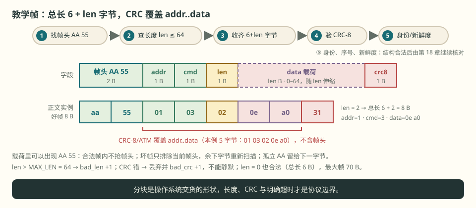
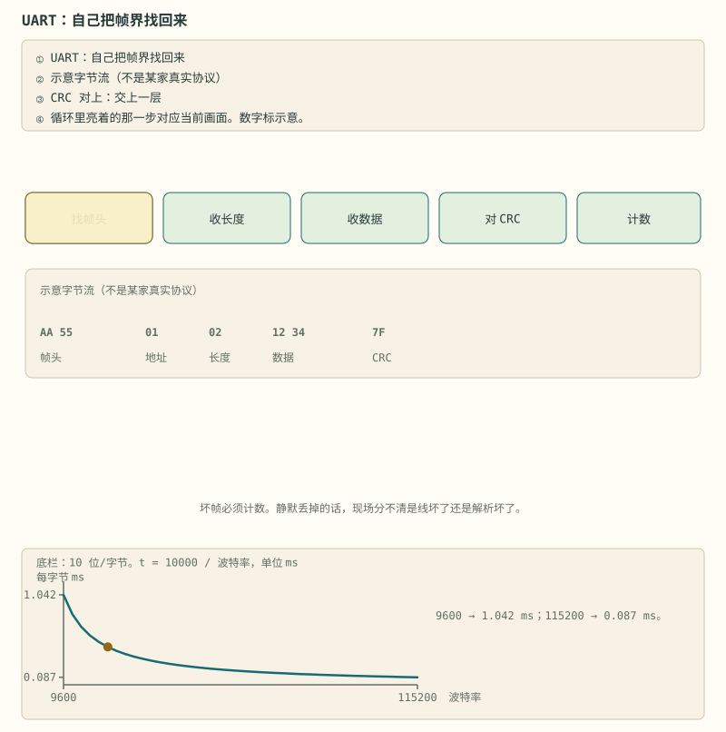

# 第 29 章 帧状态机的八个边界

::: story 现场
100 帧遥测，第 13 帧被异或坏 1 个字节。解析器丢掉它，计数 `bad_crc: 1`，然后靠重同步把后面的 87 帧全部收回——最终 `received_frames: 99`，`resyncs: 4`。

这不是“运气好”。这是设计：**坏帧只排除当前帧头，余下字节重新扫描；孤立帧头留到下一字节。**
:::

<figure>

<figcaption>图 29-1　教学帧格式。CRC 覆盖 addr..data，不含帧头；载荷里可以出现 AA 55，不能抢当前帧的帧头。</figcaption>
</figure>

## 29.1 字节布局

```
AA 55 | addr | cmd | len | data[len] | crc8
```

- `addr`：从机地址；
- `cmd`：命令；
- `len`：数据长度，单字节；
- `crc8`：CRC-8/ATM，覆盖 `addr..data`。

CRC-8/ATM 的实现只有几行：

```python
crc = 0
for byte in data:
    crc ^= byte
    for _ in range(8):
        crc = ((crc << 1) ^ 0x07) & 0xFF if crc & 0x80 else (crc << 1) & 0xFF
```

## 29.2 八个边界

1. **帧头跨分块**：末尾孤立的 `AA` 要留到下一字节；
2. **载荷里有 `AA 55`**：合法帧内的不抢帧头；
3. **长度非法**：`len > MAX_LEN` 只排除当前帧头，重新扫描；
4. **CRC 错**：丢弃并计数，不能静默；
5. **残帧**：只有明确超时/流结束才 `flush()`，不能把每次 `read()` 当超时；
6. **长度 0**：总长是 `6 + len`，仍有帧头、元信息与 CRC；
7. **负下标**：字段解码要显式拒绝负数，Python 的负索引会从尾部回绕；
8. **内嵌好帧**：载荷里即使有一个完整合法帧，也按载荷保留。

::: principle 一句话
**坏帧要计数，重同步要保守，残帧要 flush。** 通信的鲁棒性，藏在这三个动作里。
:::

下面这条轨迹直接喂给本书 `FrameParser`，不是按图想象。好帧的完整字节为 `aa 55 01 03 02 0e a0 31`；CRC `31` 覆盖 `01 03 02 0e a0`。上层把它拆成三次 `read()`，后面再粘一条声明 16 字节载荷却没收完的残帧：

<div class="frame-trace" role="group" aria-labelledby="frame-trace-title">
<div class="frame-trace__head"><p class="frame-trace__eyebrow">BYTE TRACE · 实际执行</p><p class="frame-trace__title" id="frame-trace-title">三次 read，不等于三帧</p><p>每一步都列出新字节、返回后的缓冲与累计计数。只有第 4 步是上层确认的超时边界。</p></div>
<ol class="frame-trace__steps">
<li><span class="frame-trace__index">01</span><div><strong>read #1：垃圾字节后只到半个帧头</strong><code>00 aa</code><p>丢掉 <code>00</code>，保留孤立 <code>aa</code>，等下一次输入判断它是不是帧头。</p><small>buf=<code>aa</code> · ok=0 · resyncs=1 · incomplete=0</small></div></li>
<li><span class="frame-trace__index">02</span><div><strong>read #2：帧头完整，载荷还差 1 字节和 CRC</strong><code>55 01 03 02 0e</code><p><code>len=02</code> 合法，但候选帧还没到总长 8；返回等待，不报残帧。</p><small>buf=<code>aa 55 01 03 02 0e</code> · ok=0 · resyncs=1 · incomplete=0</small></div></li>
<li><span class="frame-trace__index">03</span><div><strong>read #3：好帧闭合，后面又来了半条帧</strong><code>a0 31 aa 55 03 03 10</code><p>先吐出 addr=1、cmd=3、data=<code>0e a0</code>；尾部候选声明 <code>len=16</code>，继续等待。</p><small>buf=<code>aa 55 03 03 10</code> · ok=1 · resyncs=1 · incomplete=0</small></div></li>
<li><span class="frame-trace__index">04</span><div><strong>明确超时后才 <code>flush()</code></strong><code>timeout → flush()</code><p>确认尾部不会再来，残帧计 1；重新扫描剩余字节后缓冲清空。</p><small>buf=空 · ok=1 · resyncs=2 · incomplete=1</small></div></li>
</ol>
</div>

如果每次 `read()` 后都 `flush()`，第 2 步那条本来能在第 3 步闭合的好帧会被提前判残；如果遇到孤立 `aa` 就清空，跨分块帧头永远拼不回来。**分块是操作系统交货的形状，长度、CRC 与明确超时才是协议边界。**

## 29.3 自己跑一遍

`code/frame_parser.py` 构造了一段带垃圾前缀、坏 CRC、残帧的字节流：

```text
有效帧 1 + 垃圾 00 11 22 + 坏 CRC 帧 + 有效帧 2 + 半截帧
```

输出：

```text
frames: [('0x1', '0x3', '0ea00eb4'), ('0x2', '0x5', '0102')]
ok/bad_crc/bad_len/incomplete/resyncs: 2 1 0 1 5
```

两帧好帧都回来了，坏 CRC 计数 1，残帧计数 1，重同步 5 次。逐字节喂入与整段解析结果一致。

<figure class="book-motion" data-animation="uart-byte-machine.svg" data-mode="static">

<button type="button" data-book-motion v-book-motion aria-pressed="false" hidden>播放动画</button>
<figcaption>图 29-2　逐字节状态机：找头、长度、数据、校验和恢复各有退出条件；缓冲分块不决定帧界。</figcaption>
<p class="visual-guide"><strong>先看哪里：</strong>看每个字节只推动哪一步，坏长度与坏 CRC 分别回到哪里；不让载荷里的头字节抢走状态。</p>
<p class="visual-question"><strong>看完追问：</strong>给一个跨两次 read 的合法帧，写出第一次返回时解析器应保留什么。</p>
</figure>

## 29.4 真实协议

教学帧是抽象。真实项目里：

- JK-BMS 的 UART/BLE 帧有固定头、长度、命令、CRC；
- 不同型号/固件的寄存器与缩放可能不同；
- 厂商文档常常缺失，需要抓包 + 已知量对照。

BMS-Z 的阶段 5 把这件事讲得很形象：UART 是商用 BMS 的“方言”，CAN 是车上的“官话”，Modbus 是储能世界的“老干部”——慢，但哪儿都认得它。

解析器只证明字节结构成立，不证明语义可信。真实协议还要继续核对缩放、端序、固件版本、滚动计数器和信号新鲜度：一帧 CRC 正确的“3 秒前 SOC”，结构上完全合法，控制上仍然过期。第 18 章负责端到端数据身份，本章负责把原始字节安全地交上去。

## 29.5 有界缓冲与单调进展

解析器要能在噪声里跑一整夜，先写三条不变量：

1. **候选长度有上界**：`MAX_LEN=64`，完整帧总长为 `2 + 3 + len + 1`，所以最大候选帧是 **70 B**。无帧头的垃圾立即丢弃，只在末尾保留一个可能跨分块的 `aa`；不能让噪声把缓冲拖成无限日志。
2. **循环每轮必须进展**：要么吐出一帧，要么至少丢 1 个已证伪字节，要么因为缺字节返回等待。不存在“条件不变却继续 while”的第四条路，否则坏流量能把 CPU 锁死。
3. **只删除已经证伪的最小前缀**：坏长度或坏 CRC 时只删当前候选帧头的第一个 `aa`，余下字节重新找头。整段候选一起扔，会把坏外层载荷里两条完好的内嵌帧一并吞掉。

发送端也要守同一条 64 B 上限：允许组出 65 B 载荷、再让自己的接收端拒收，是往返契约自相矛盾。字段层同样要显式拒绝负索引；Python 的 `-1` 会静默读成最后一串，不是“越界报错”。

## 29.6 验收矩阵：计数器必须能解释现场

| 注入 | 预期输出与计数 | 绝不能发生 |
|---|---|---|
| `00 ff 13 37` + 好帧 | 好帧照收；`resyncs` 增加 | 垃圾前缀让解析器卡死 |
| 帧头跨两次 read | 第一次保留 `aa`；第二次继续 | 每次 read 后 flush |
| `len=255` 后跟好帧 | `bad_len +1`；后帧恢复 | 按 255 B 一直等，或连后帧一起丢 |
| CRC 错帧载着两条好帧 | `bad_crc +1`；两条内嵌好帧恢复 | 整个坏候选一次清空 |
| 合法载荷内含 `aa 55` | 只输出外层帧 | 载荷抢占当前帧头 |
| 合法长度残帧 + 明确超时 | `incomplete +1`；重新扫描余字节 | 普通分块结束就记残帧 |
| 0 B / 64 B 载荷 | 都能往返；总长分别 6 B / 70 B | 边界差一位或发送端放宽上限 |

`bad_crc`、`bad_len`、`incomplete`、`resyncs` 不是四个“越多越坏”的 KPI：它们分别回答完整性、长度契约、时间边界和重新对齐。验收报告要给原始字节片段、首次异常时间、各计数增量与恢复后的第一条好帧；只给总错误数，无法定位是哪一层坏了。

::: trap 坑
把串口 `read()` 的分块当帧边界。一次 `read` 可能给你半帧，也可能给你三帧；只有超时或显式长度才能定界。
:::

::: lab 动手
先跑 `python bms-book/code/frame_parser.py`，核对 `2 1 0 1 5`；再进入 `code/protocol` 跑 `python -m pytest tests/test_frames.py -q`。挑出“坏长度字节重新参与找头”“坏 CRC 外层藏两条好帧”“明确 flush 后恢复内嵌好帧”三例，逐例写下原始字节、哪个计数器增加、第一条恢复帧是什么。最后把 `flush()` 错放到每次 read 后，观察哪条跨分块用例先失败，再恢复原实现。
:::

## 练习

1. 按本章四步轨迹回答：read #3 返回后缓冲、`ok/resyncs/incomplete` 各是什么？明确超时并 `flush()` 后又变成什么？
2. `MAX_LEN=64` 时最大完整帧多少字节？为什么坏 CRC 时只删一个已证伪字节，而不是一次清空整条候选？
3. 设计 CRC + 滚动计数器 + 接收超时的端到端保护，写清“坏帧不推进哪个状态”“何时判数据过期”以及日志必须留下哪些证据。

## 参考资料

- BMS-Z 阶段 5：https://github.com/zhuguang-ZFG/BMS-Z/blob/main/docs/stages/stage-5-通信与集成.md
- BMS-Z `frames.py`：https://github.com/zhuguang-ZFG/BMS-Z/blob/main/code/protocol/frames.py
- esphome-jk-bms：https://github.com/syssi/esphome-jk-bms
