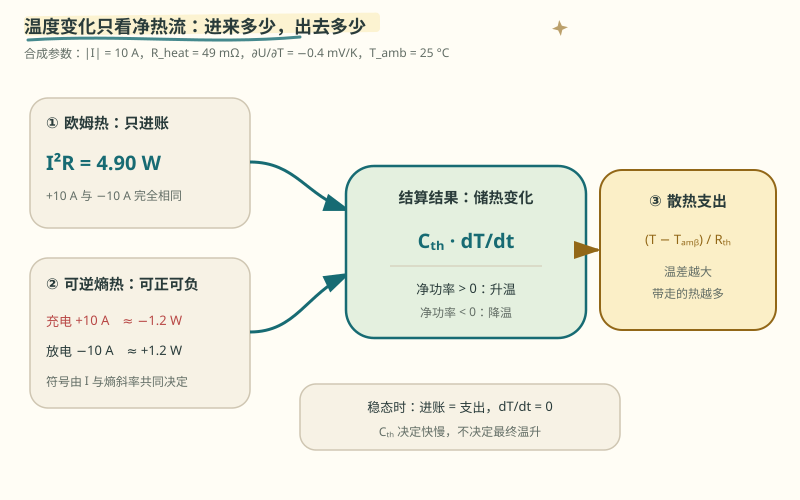
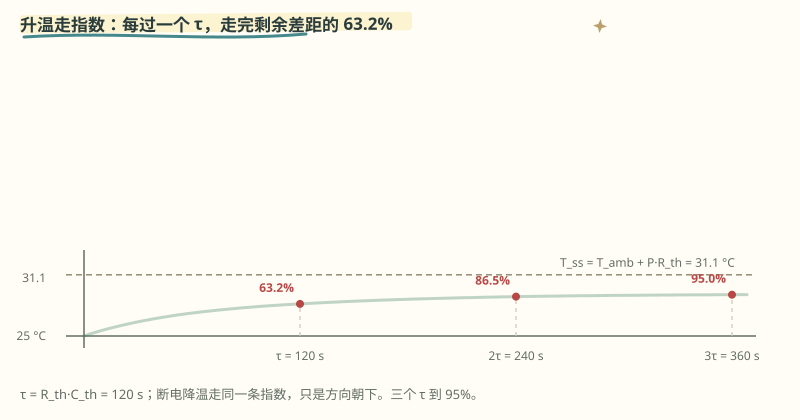
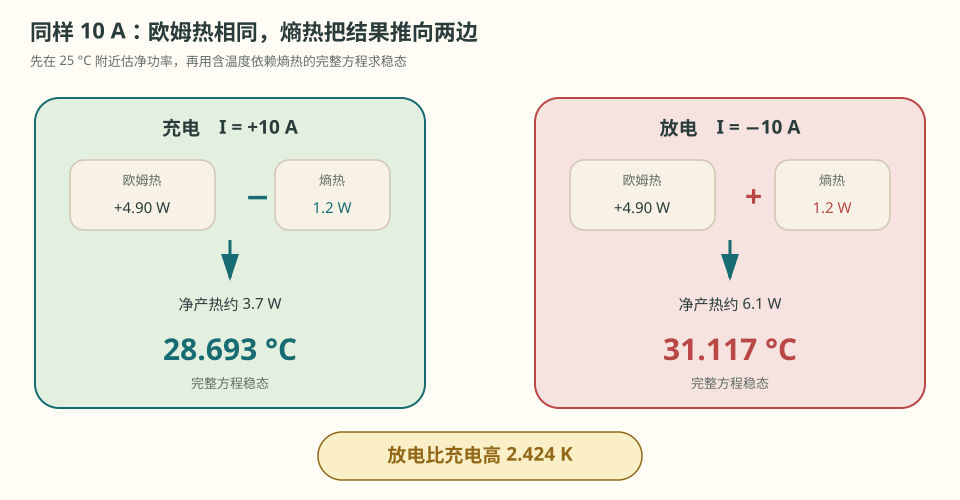

# 第 30 章 热的一阶账本

::: story 现场
两颗同样的合成电芯，一颗充 10 A，一颗放 10 A。四十分钟后，充电那颗 28.693 °C，放电那颗 31.117 °C。差出的 2.424 K 不是测量误差，是物理：有一笔热，充电时倒着走。
:::

温度变化慢，但积累与冷却都要时间。本章用一阶集总模型分别计算产热、散热、稳态温升和响应速度。

::: chapter-route 阅读路径

- **第一次主线**：读 §30.1–§30.3。分开稳态温升、时间常数、欧姆热与可逆熵热。
- **第二遍深挖**：读 §30.4–§30.6。处理周期生热、模型边界和 NTC 测点滞后。
- **动手验证**：用相同 10 A 分别充电、放电，复算 28.693 °C、31.117 °C 与 2.424 K 差值。
:::

**教学算例**　章首两颗合成电芯是全章贯穿对照，下面的方程解释同幅值电流为何得到不同温度。

## 30.1 集总：一格温度，两笔热

把电芯压成一个温度点，热账有三行：欧姆热只进账，熵热可进可出，散热把热量带走。

$$
C_{th}\,\dot T = I^2 R_{heat} + T_{\mathrm K}\,\frac{\partial U}{\partial T}\,I - \frac{T - T_{amb}}{R_{th}}
$$

参数全是合成教学值（与 BMS-Z 的 `thermal_demo.py` 同族）：R_th=1.0 K/W、C_th=120 J/K、R_heat=49 mΩ、∂U/∂T=−0.4 mV/K、T_amb=25 °C。

等号左边是储热功率。右边依次为焦耳热、可逆熵热和散热项：$I^2 R_{heat}$ 与电流方向无关，$T_{\mathrm K}(\partial U/\partial T)I$ 随电流方向改变符号。熵热项中的绝对温度 $T_{\mathrm K}$ 用开尔文；温差与温度变化率可用 K 或 °C 表示。

<figure class="book-motion" data-animation="thermal-ledger-flow.svg" data-mode="static">

<button type="button" data-book-motion v-book-motion aria-pressed="false" hidden>播放动画</button>
<figcaption>图 30-1　不要先盯温度，先把功率结清：欧姆热恒为正，熵热看电流方向，散热看电芯与环境的温差。三项相加后的净热流，才进入 $C_{th}\dot T$。</figcaption>

<strong>先看哪里：</strong>先看蓝色 4.90 W 这条恒定进账，再看红色 −1.2 W（充电）与 +1.2 W（放电）随电流方向换号，最后看散热支出随温差变大；稳态 31.1 °C 时收支相抵。

<strong>看完追问：</strong>若电流改为 5 A，三笔热分别变成多少？稳态温度大约落在多少？

</figure>

稳态是最容易手算的一笔账：产热 = 散热，得

$$
T_{ss} = T_{amb} + P \cdot R_{th}
$$

放电 10 A 时，纯欧姆热 $I^2R$ = 4.90 W，因此 $25 + 4.9 \times 1 = $ **29.9 °C**。全模型的稳态温度为 **31.117 °C**，多出的 **1.217 K** 来自下一节讨论的可逆熵热。

注意稳态式里没有 $C_{th}$。在产热和环境温度固定时，$R_{th}$ 决定最终温升；$C_{th}$ 只影响接近稳态的速度。要降低稳态温度，必须减少产热或改善散热。

## 30.2 热惯性与时间常数 τ

净生热固定时，一阶热模型的解是指数：

$$
T(t) = T_{ss} + (T_0 - T_{ss})\,e^{-t/\tau}, \quad \tau = R_{th} C_{th} = 120\ \text{s}
$$

若净生热固定，每过一个 τ，走完**剩余差距的 63.2%**；三个 τ 走完初始差距约 95%。熵热随绝对温度变化时，有效时间常数会略变，120 s 是 $R_{th}C_{th}$ 给出的基础尺度。

<figure class="book-motion" data-animation="thermal-tau-clock.svg" data-mode="static">

<button type="button" data-book-motion v-book-motion aria-pressed="false" hidden>播放动画</button>
<figcaption>图 30-2　固定净生热时，一阶模型按 τ=120 s 接近稳态；断电冷却也按这条基础时间尺度衰减。图中为合成参数。</figcaption>

<strong>先看哪里：</strong>跟住曲线上前行的游点：过 120 s 停在 63.2%，过 240 s 停在 86.5%，360 s 到 95.0% 后基本贴住渐近线；断电降温走同一条指数，只是方向朝下。

<strong>看完追问：</strong>从 25 °C 充到 29.9 °C 需要约几个 τ？断电后从 31.1 °C 降回 26 °C 又需要约几个 τ？

</figure>

> 先自己判断：电芯放了 10 A 已经热到 31 °C。现在直接断电——它凉下去会比当初热上去更快吗？

BMS-Z 在升温侧和降温侧各量了一次：升温一个基础 τ 走 63.2%，断电后再一个 τ 降低 63.4%。后者与 63.2% 的差异来自 1 s 欧拉步；前者还受随温度变化的熵热影响。对这组参数，两者接近，但不能把“同一个 τ”推广到温度依赖显著的工况。

几十秒的脉冲相对 120 s 的 τ 只是“开了个头”，温度计几乎看不见。**保护判据要靠电压与电流，不能等温度到线。**

$\tau=R_{th}C_{th}$ 与电路 RC 同形：热容越大，同样产热下升温越慢；热阻越大，热量越难散出。升温慢不代表允许温度更高。核心、表面和 NTC 又位于热链的不同节点，读数天然带延迟；§30.6 再算这笔测点账。

::: trap 坑
拿稳态温度当瞬时温度做判据，或反过来拿几秒钟的温升外推“还能撑多久”。温升按 τ 估算未来值；等热敏电阻到线，极化早就撞墙了。
:::

## 30.3 欧姆热不分方向，熵热随方向变化

$P_{ohm} = I^2 R_{heat}$ 只取决于电流平方，因此 ±10 A 都产生 4.90 W。可逆熵热则随电流方向改变符号：

$$
P_{rev} = T_{\mathrm K}\,\frac{\partial U}{\partial T}\,I
$$

本书口径充电为正：I=+10 A 配负熵斜率，$P_{rev} \approx -1.2$ W，**充电吸热**；I=−10 A，$P_{rev} \approx +1.2$ W，**放电补火**。在 25 °C 附近，两笔可逆热相差约 2.4 W；稳态时熵热又随温度变化，精确求解得到 2.424 K 的温差：

**表 30-1**　同幅值充放电稳态温度差（`thermal_lump.py` 仿真值，R_th=1 K/W）

| 工况 | 稳态温度 |
|---|---|
| 充电 +10 A | 28.693 °C |
| 放电 −10 A | 31.117 °C |
| 差 | **+2.424 K** |

<figure>

<figcaption>图 30-3　同样是 10 A，欧姆热相同，熵热方向相反。25 °C 附近可先估成 3.7 W 对 6.1 W；再用含温度依赖熵热的方程求稳态，得到 28.693 °C 与 31.117 °C。</figcaption>
</figure>

只算 $I^2R$ 会得到对称温度，解释不了表中的 2.424 K。Bernardi 能量平衡还包括可逆熵热、混合热和副反应热；本章把极化热并入 $I^2R_{heat}$，忽略混合热，并把正常工况的副反应热设为零。一旦副反应显著，这个一阶教学模型便不再适合判断风险。

## 30.4 正弦生热的低通

电流是正弦时，$I^2 \propto \sin^2$ 展开成“直流一半 + 2ω 纹波”：**生热纹波在电流频率的两倍**。温度对这个纹波是一个一阶低通：

$$
|\Delta T| = \frac{P_a R_{th}}{\sqrt{1 + (\omega' \tau)^2}}, \qquad
\angle \Delta T = -\arctan(\omega' \tau), \qquad \omega' = 2\omega
$$

BMS-Z 的对照（8 A、周期 600 s、关掉熵项让生热纯正弦）：2ωτ≈2.5，温幅仿真 0.5818 K vs 解析 0.5797 K，滞后 68.4° vs 68.3°，均值 26.568 °C 两边一致。热惯性压低高频温度纹波，却不会消掉平均产热；当电流变化慢到接近 1/τ，温度峰谷才逐渐显出来。

::: lab 动手
跑本书的 `python bms-book/code/thermal_lump.py`：四个实验、八条自检全过。然后做两个改动：①把 `R_TH` 从 1.0 改成 0.5 K/W，模拟散热改善。基础时间常数减半；固定生热时稳态温升减半，含温度依赖熵热时要重新求解。②把电流幅值翻倍，纯欧姆生热会变成四倍。
:::

## 30.5 哪些情况不能只用一阶模型

- 一格温度、常数参数：真实电芯有温度梯度、参数随温度与 SOC 变；
- 熵斜率取了中 SOC 段常数：真实的 dU/dT 随 SOC 走，且不同化学体系符号都不同；
- 没有相变与液体冷却的“开关”行为；
- 仿真步长 1 s：τ=120 s 下误差可忽略，换成 1 s 级 τ 的系统就要换方法。

这套模型用于估计趋势、辨识参数和检查测温链，不能替代第 7、8、14 章的保护时间、失效覆盖与 SOP 判定。冷却回路通常由整车层闭环控制，BMS 提供温度与允许功率；一阶热账只负责说明这些温度怎样由产热、热容、热阻和环境形成。

## 30.6 一颗 NTC 看见的是测点，不是整颗电芯

集总模型把电芯压成一个温度，真实电芯至少有核心、壳体、导热垫、冷板和环境几层热阻。NTC 常贴在壳体或模组间隙；它读到的是自己的局部温度，并带着胶层与封装的时间常数。核心先热、表面后热，读数平滑并不等于内部没有热点。

做一笔极端但好懂的教学账：核心温度从 25 °C 突然进入等效 45 °C 平台，表面测点按 30 s 一阶常数追随。10 s 后读数为 25 + 20·(1−e^(−10/30)) ≈ **30.7 °C**；此时核心与测点相差约 **14.3 K**。这个“瞬间跳核心”不是现实热过程，而是用来隔离传感器滞后；真实核心也会爬升，但短脉冲和局部接触热仍能让核心领先。

**表 30-2**　热链上三个位置各自能回答的问题

| 位置 | 最擅长回答 | 容易漏掉什么 | 验收办法 |
|---|---|---|---|
| 核心等效温度 | 内部反应与热点风险 | 不能直接布传感器 | 用热模型、嵌入式参考样件或保守界间接验证 |
| 壳体/NTC | 表面温度与冷却接触 | 核心领先、贴合差、局部热点 | 改变贴点、胶层和风向，比较时间常数与偏差 |
| 冷却液入口/出口 | 冷却系统带走多少热 | 单颗电芯异常会被整流量平均 | 与单体温点、流量和热功率账联合判断 |

<figure>

<figcaption>图 30-4　一颗 NTC 只报告自己的测点。左侧把核心、热阻和表面测点串成热链；右侧用教学阶跃单独展示传感器滞后：10 s 时核心等效温度为 45 °C，NTC 只读到 30.7 °C，相差 14.3 K。先看两条曲线何时分开，再追问：若此时只设“NTC 超温”一条保护，系统会晚看到什么？</figcaption>
</figure>

所以热保护不能只写“任一 NTC > 60 °C”。还要有升温速率、测点合理性、传感器开短路、相邻温差和基于功率/模型的预测界。若模型预测核心已接近边界而表面还很凉，系统应该先降额并诊断传感器站位，不能等表面追上来再动作。反过来，某一颗 NTC 独自冲高，也先排除脱落后贴到发热器件、线束开路替代值和冷板接触差。

## 本讲服务知识点

<!-- kp-backlink:start -->
本章服务 2 个知识点；每条都能回到[核心问题地图](../../docs/核心问题地图.md)的 L1–L5 五级入口。这一节由 `curriculum/concepts.json` 的 `book` 字段生成。

**表 30-3**　本章服务的知识点与其梯子入口

| 知识点 ID | 标题 | 阶段 | 梯子到 | 握证 |
|---|---|---:|---|---|
| [`dtdt-early-warning`](../../docs/核心问题地图.md#kp-dtdt-early-warning) | 温升速率先抬头 | 1 | L3 | 手算纸 |
| [`ntc-placement-temp-window`](../../docs/核心问题地图.md#kp-ntc-placement-temp-window) | NTC位置与温度窗 | 2 | L3 | 手算纸 |

**温升速率先抬头：等到「温度高」再报警来得及吗？**

温度值告诉我们已经多热，温升速率告诉我们正在多快变热。两节电芯眼下都没到绝对温度线，其中一节却可能升得明显更快。先比较每秒升高多少，再结合邻近通道、负载和传感器状态，可以更早发现异常候选。速率变化是线索，不是仅凭一条斜线就给热失控定罪。

**沿着这组输入做一遍**

1. 两条示意线都从 25 °C 出发：慢线每秒升 0.05 °C，10 s 后为 25.5 °C。
2. 快线每秒升 1 °C，同样 10 s 后为 35 °C，斜率是前者的 20 倍。
3. 即使两条线都没到绝对门限，速率已经提供额外区别；接下来应核对测量和工况，而非等到更热才看。

**边界与反例**　日晒、风扇变化或探头脱落也可能改变斜率。线性示意不是热失控预测模型，告警必须处理噪声、采样间隔与传感器故障。

**看图任务**　先比较斜率再比较高度；把同一段时间的横轴对齐，才不会把取样间隔差异当成升温更快。

**对应图解**　[thermal-runaway](../../docs/circuits/handraw/exports/thermal-runaway.webp)

**NTC位置与温度窗：同一颗 NTC 贴电芯和贴 MOS 旁，读的是同一个温度吗？**

NTC（负温度系数热敏电阻）越热阻值越小，和固定电阻分压后送进 ADC（模数转换器）。它测的是自己那颗小珠的温度，不是整颗电芯的平均温度。保护用两条线和一段确认时间：高温越过锁定线并持续够久才禁充，回到更低的恢复线才松开；低温侧同理。贴电芯和贴 MOS 旁，测的是两个热源。

**沿着这组输入做一遍**

1. 示意温度 T=30+32·sin(2πt/12)，最高 62 °C、最低 −2 °C，先看出它确实会越过两条窗线。
2. 高于 55 °C 要连续 0.8 s 才禁充，约在 2.51 s 锁上；回到 45 °C 以下约 5.07 s 才松开。
3. 低温侧低于 0 °C 连续 0.8 s，约 9.12 s 禁充；升过 8 °C 约 10.56 s 恢复。
4. 同一颗 NTC 若贴在 MOS 旁，读到的是板温，不能用它替代电芯温度去判充电窗口。

**边界与反例**　NTC 有热阻和热容，读数滞后于电芯内部；贴在表面只能证明表面到了某温度，内部热点仍需另行评估。

**看图任务**　看黄点在高线之上停多久才锁定，再看到低线之下才松开；中间那段就是回差。

**对应图解**　[temp-window-protect](../../docs/circuits/assets/temp-window-protect.svg)

<!-- kp-backlink:end -->

## 练习

1. 电流从 10 A 加到 20 A，纯欧姆温升是几倍？
2. 把 C_TH 减半：稳态变吗？τ 变吗？
3. 量正弦相位时为什么要关掉熵项？

## 参考资料

- BMS-Z 共学：热五天：https://github.com/zhuguang-ZFG/BMS-Z/blob/main/docs/共学/06-热五天.md
- BMS-Z `thermal_demo.py`：https://github.com/zhuguang-ZFG/BMS-Z/blob/main/code/soc/thermal_demo.py
- ECE5710 Notes07（四项生热、集总模型、正弦生热的低通）
- Bernardi, Pawlikowski & Newman《A General Energy Balance for Battery Systems》（Journal of The Electrochemical Society, 132(1), 1985）：电池产热能量平衡的经典论文，本章一阶热账本四项生热的理论源头
