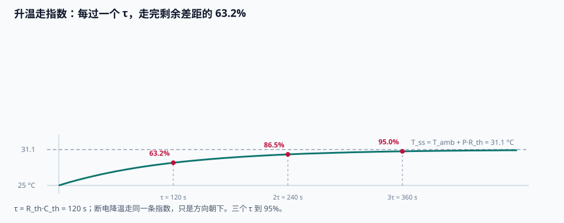
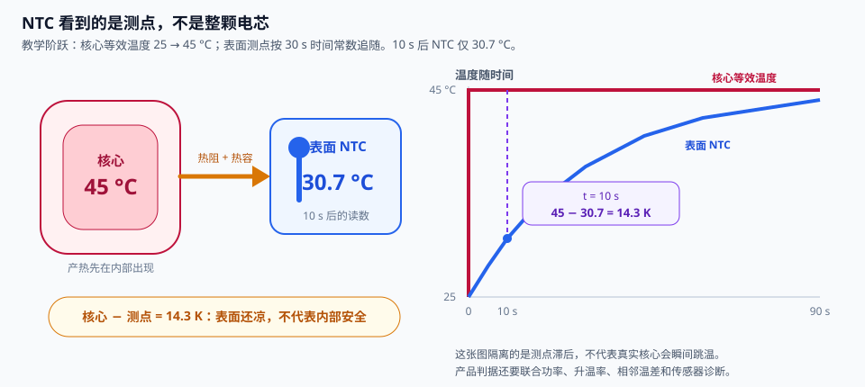

# 第 30 章 热的一阶账本

::: story 现场
两颗同样的合成电芯，一颗充 10 A，一颗放 10 A。四十分钟后，充电那颗 28.693 °C，放电那颗 31.117 °C。差出的 2.424 K 不是测量误差，是物理：有一笔热，充电时倒着走。
:::

温度变化慢，但积累与冷却都要时间。本章用一阶集总模型分别计算产热、散热、稳态温升和响应速度。

::: chapter-route 阅读路径

- **第一次主线**：读 §30.1–§30.3。分开稳态温升、时间常数、欧姆热与可逆熵热。
- **第二遍深挖**：读 §30.4–§30.6。处理周期生热、模型边界和 NTC 测点滞后。
- **动手验证**：用相同 10 A 分别充电、放电，复算 28.693 °C、31.117 °C 与 2.424 K 差值。
:::

**教学算例**　章首两颗合成电芯是全章贯穿对照，下面的方程解释同幅值电流为何得到不同温度。

## 30.1 集总：一格温度，两笔热

把电芯压成一个温度点，热账只有两笔收入、一笔支出：

$$
C_{th}\,\dot T = I^2 R_{heat} + T\,\frac{\partial U}{\partial T}\,I - \frac{T - T_{amb}}{R_{th}}
$$

参数全是合成教学值（与 BMS-Z 的 `thermal_demo.py` 同族）：R_th=1.0 K/W、C_th=120 J/K、R_heat=49 mΩ、∂U/∂T=−0.4 mV/K、T_amb=25 °C。

等号左边是温度变化率。右边依次为焦耳热、可逆熵热和散热项：$I^2 R_{heat}$ 与电流方向无关，$T\,(\partial U/\partial T)\,I$ 随电流方向改变符号，散热则随电芯与环境温差增大。

稳态是最容易手算的一笔账：产热 = 散热，得

$$
T_{ss} = T_{amb} + P \cdot R_{th}
$$

放电 10 A 时，纯欧姆热 $I^2R$ = 4.90 W，因此 $25 + 4.9 \times 1 = $ **29.9 °C**。全模型的稳态温度为 **31.117 °C**，多出的 **1.217 K** 来自下一节讨论的可逆熵热。

::: principle 一句话
在产热 $P$ 和环境温度固定时，$R_{th}$ 决定稳态温升，$C_{th}$ 不进入稳态式。降低稳态温度要改散热路径，继续等待只会更接近原来的稳态。
:::

## 30.2 升温降温，同一个 τ

一阶线性系统的解是指数：

$$
T(t) = T_{ss} + (T_0 - T_{ss})\,e^{-t/\tau}, \quad \tau = R_{th} C_{th} = 120\ \text{s}
$$

每过一个 τ，走完**剩余差距的 63.2%**；三个 τ 到 95%。

<figure>

<figcaption>图 30-1　升温与降温共用同一条指数（本书合成电芯，10 A 放电，τ=120 s）。</figcaption>
</figure>

> 先自己判断：电芯放了 10 A 已经热到 31 °C。现在直接断电——它凉下去会比当初热上去更快吗？

BMS-Z 在升温侧和降温侧各量了一次：升温一个 τ 走 63.2%，断电后再一个 τ 又掉 63.4%（它用 1 s 欧拉步，那 0.2 个百分点是积分步长的零头，不是物理）。**断电不会凉得更快**：两条路共用同一个 τ。

这也是脉冲工况的盲区：几十秒的脉冲相对 120 s 的 τ 只是“开了个头”，温度计几乎看不见。**保护判据要靠电压与电流，不能等温度到线。**

$\tau=R_{th}C_{th}$ 与电路 RC 同形：热容越大，同样产热下升温越慢；热阻越大，热量越难散出。升温慢不代表允许温度更高。核心、表面和 NTC 又位于热链的不同节点，读数天然带延迟；§30.6 再算这笔测点账。

::: trap 坑
拿稳态温度当瞬时温度做判据，或反过来拿几秒钟的温升外推“还能撑多久”。温升按 τ 估算未来值；等热敏电阻到线，极化早就撞墙了。
:::

## 30.3 欧姆热不分方向，熵热随方向变化

$P_{ohm} = I^2 R_{heat}$ 只取决于电流平方，因此 ±10 A 都产生 4.90 W。可逆熵热则随电流方向改变符号：

$$
P_{rev} = T\,\frac{\partial U}{\partial T}\,I
$$

本书口径充电为正：I=+10 A 配负熵斜率，$P_{rev} \approx -1.2$ W，**充电吸热**；I=−10 A，$P_{rev} \approx +1.2$ W，**放电补火**。两笔差 2.4 W，乘 R_th=1 K/W，正好是稳态差：

**表 30-1**　同幅值充放电稳态温度差（`thermal_lump.py` 仿真值，R_th=1 K/W）

| 工况 | 稳态温度 |
|---|---|
| 充电 +10 A | 28.693 °C |
| 放电 −10 A | 31.117 °C |
| 差 | **+2.424 K** |

只算 $I^2R$ 会得到对称温度，解释不了表中的 2.424 K。Bernardi 能量平衡还包括可逆熵热、混合热和副反应热；本章把极化热并入 $I^2R_{heat}$，忽略混合热，并把正常工况的副反应热设为零。一旦副反应显著，这个一阶教学模型便不再适合判断风险。

## 30.4 正弦生热的低通

电流是正弦时，$I^2 \propto \sin^2$ 展开成“直流一半 + 2ω 纹波”：**生热纹波在电流频率的两倍**。温度对这个纹波是一个一阶低通：

$$
|\Delta T| = \frac{P_a R_{th}}{\sqrt{1 + (\omega' \tau)^2}}, \qquad
\angle \Delta T = -\arctan(\omega' \tau), \qquad \omega' = 2\omega
$$

BMS-Z 的对照（8 A、周期 600 s、关掉熵项让生热纯正弦）：2ωτ≈2.5，温幅仿真 0.5818 K vs 解析 0.5797 K，滞后 68.4° vs 68.3°，均值 26.568 °C 两边一致。热惯性压低高频温度纹波，却不会消掉平均产热；当电流变化慢到接近 1/τ，温度峰谷才逐渐显出来。

::: lab 动手
跑本书的 `python bms-book/code/thermal_lump.py`：四个实验、八条自检全过。然后做两个改动：①把 `R_TH` 从 1.0 改成 0.5（等于从自然对流换到风冷），看稳态温升减半、τ 也减半；②把电流幅值翻倍，看纯欧姆温升翻几倍（答案是四倍，欧姆热按电流平方增长）。
:::

## 30.5 这套账的边界

- 一格温度、常数参数：真实电芯有温度梯度、参数随温度与 SOC 变；
- 熵斜率取了中 SOC 段常数：真实的 dU/dT 随 SOC 走，且不同化学体系符号都不同；
- 没有相变与液体冷却的“开关”行为；
- 仿真步长 1 s：τ=120 s 下误差可忽略，换成 1 s 级 τ 的系统就要换方法。

这套模型用于估计趋势、辨识参数和检查测温链，不能替代第 7、8、14 章的保护时间、失效覆盖与 SOP 判定。冷却回路通常由整车层闭环控制，BMS 提供温度与允许功率；一阶热账只负责说明这些温度怎样由产热、热容、热阻和环境形成。

## 30.6 一颗 NTC 看见的是测点，不是整颗电芯

集总模型把电芯压成一个温度，真实电芯至少有核心、壳体、导热垫、冷板和环境几层热阻。NTC 常贴在壳体或模组间隙；它读到的是自己的局部温度，并带着胶层与封装的时间常数。核心先热、表面后热，读数平滑并不等于内部没有热点。

做一笔极端但好懂的教学账：核心温度从 25 °C 突然进入等效 45 °C 平台，表面测点按 30 s 一阶常数追随。10 s 后读数为 25 + 20·(1−e^(−10/30)) ≈ **30.7 °C**；此时核心与测点相差约 **14.3 K**。这个“瞬间跳核心”不是现实热过程，而是用来隔离传感器滞后；真实核心也会爬升，但短脉冲和局部接触热仍能让核心领先。

**表 30-2**　热链上三个位置各自能回答的问题

| 位置 | 最擅长回答 | 容易漏掉什么 | 验收办法 |
|---|---|---|---|
| 核心等效温度 | 内部反应与热点风险 | 不能直接布传感器 | 用热模型、嵌入式参考样件或保守界间接验证 |
| 壳体/NTC | 表面温度与冷却接触 | 核心领先、贴合差、局部热点 | 改变贴点、胶层和风向，比较时间常数与偏差 |
| 冷却液入口/出口 | 冷却系统带走多少热 | 单颗电芯异常会被整流量平均 | 与单体温点、流量和热功率账联合判断 |

<figure>

<figcaption>图 30-2　一颗 NTC 只报告自己的测点。左侧把核心、热阻和表面测点串成热链；右侧用教学阶跃单独展示传感器滞后：10 s 时核心等效温度为 45 °C，NTC 只读到 30.7 °C，相差 14.3 K。先看两条曲线何时分开，再追问：若此时只设“NTC 超温”一条保护，系统会晚看到什么？</figcaption>
</figure>

所以热保护不能只写“任一 NTC > 60 °C”。还要有升温速率、测点合理性、传感器开短路、相邻温差和基于功率/模型的预测界。若模型预测核心已接近边界而表面还很凉，系统应该先降额并诊断传感器站位，不能等表面追上来再动作。反过来，某一颗 NTC 独自冲高，也先排除脱落后贴到发热器件、线束开路替代值和冷板接触差。

## 练习

1. 电流从 10 A 加到 20 A，纯欧姆温升是几倍？
2. 把 C_TH 减半：稳态变吗？τ 变吗？
3. 量正弦相位时为什么要关掉熵项？

## 参考资料

- BMS-Z 共学：热五天：https://github.com/zhuguang-ZFG/BMS-Z/blob/main/docs/共学/06-热五天.md
- BMS-Z `thermal_demo.py`：https://github.com/zhuguang-ZFG/BMS-Z/blob/main/code/soc/thermal_demo.py
- ECE5710 Notes07（四项生热、集总模型、正弦生热的低通）
- Bernardi, Pawlikowski & Newman《A General Energy Balance for Battery Systems》（Journal of The Electrochemical Society, 132(1), 1985）：电池产热能量平衡的经典论文，本章一阶热账本四项生热的理论源头
