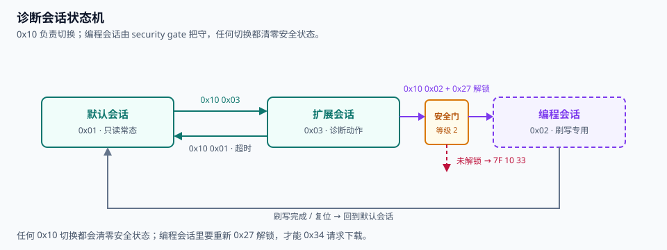
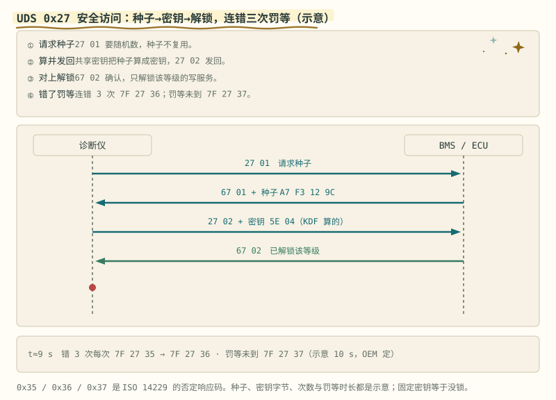
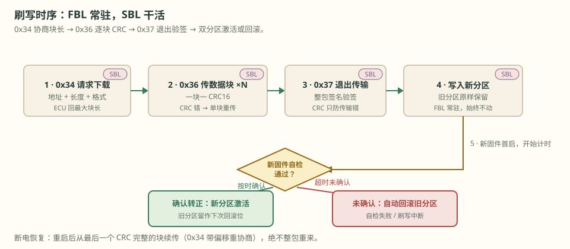

# 第 31 章 UDS 诊断与刷写

::: story 现场
车辆跛行回家，维修店连上诊断仪，30 秒读出“3 个月前第 7 串一次过压未遂”，发生那一刻的电压、温度、电流原样摆在屏幕上。车主没报过故障，仪表也没亮过灯：BMS 每天都在给故障写日记，而日记的格式是全行业统一的。这个格式就是 UDS（Unified Diagnostic Services，ISO 14229-1）。第 19 章 19.6 的上锁清单里它只有一句带过，这一章把它展开成完整的证据链。
:::

第一次读这一章，先沿图 31-1 看会话与解锁谁先谁后，再用表 31-1 读懂 ECU 为什么拒绝请求。刷写不要只背 0x34/0x36/0x37：图 31-3 看传输，§31.7 看断电后究竟信旧分区、新分区还是哪一个完整块。

## 31.1 为什么需要诊断协议

raw CAN 读数有四个绕不开的局限：

- **无统一语义**：DBC 只定义“哪个字节是什么数”，不定义“怎么读历史故障、怎么刷固件”。各家私有命令各写各的，换一家诊断仪就要重写一遍。
- **无安全访问**：第 19 章说过 CAN 没有源地址认证，插上总线就能读写；写参数、刷固件必须先问清“你是谁”。
- **无故障存储格式**：raw CAN 只传当下，而维修要的是“发生时的现场”。
- **无刷写流程**：固件升级要分块、校验、断电恢复、回滚，裸总线一个字节的承诺都给不了。

UDS 在 CAN（或 DoIP 以太网）之上统一了四件事：**读数据、存故障、例行操作、刷写**。一句话：raw CAN 是方言，UDS 是官话。

## 31.2 诊断会话与安全访问

ECU 平时泡在默认会话（0x01）里，只答只读问题；要动真格切扩展会话（0x03）；刷写必须进编程会话（0x02）。会话由 0x10 切换，切换即清零安全状态。

进编程会话要过 0x27 安全访问：诊断仪发“请求种子”，ECU 回一个随机数 seed；诊断仪按约定算法算出钥匙 key 发回，对上才解锁。暴力账自己算：seed 16 bit 共 65536 种可能，ECU 每条应答压到 10 ms（教学合成值），穷举只要 65536 × 10 ms ≈ 11 分钟。所以量产 ECU 叠三件套：**应答延时 + 错误计数 + 错满锁死**（demo 里是错 3 次锁 10 s）。算法本身可以公开，机密藏在密钥里；用固定钥匙等于没锁，第 19 章的清单已经警告过。

<figure>

<figcaption>图 31-1　默认 → 扩展自由切换；进编程会话必须持等级 2 解锁，未解锁的请求吃 7F 10 33，任何切换都清零安全状态。</figcaption>
</figure>

::: principle 一句话
**锁的价值不在算法在流程：延时拖慢穷举，计数让攻击露头，锁死给维修窗上闸。**
:::

## 31.3 读写数据与例程控制

- **0x22 读 DID**：DID（Data Identifier）是数据的门牌号。例：16 串单体电压打成一包，DID 0xF100，32 B 数据，CAN 经典帧 8 B 装不下，走 CAN FD 或多帧分段（接第 19 章）。
- **0x2E 写 DID**：例：写均衡阈值标定。安全阈值（OVP/UVP 这类，第 7 章）**不许在线改**：标定写入要走离线审批与双人复核，留痕方式见第 20 章的数据链。
- **0x31 例程控制**：例：触发一次绝缘检测，ECU 跑完例程回结果。例行操作是“临时起意的动作”，不进数据链。

负响应统一格式 7F + 服务号 + NRC，常用五个：

**表 31-1**　UDS 常用否定响应码与含义（UDS 标准 NRC 摘录）

| NRC | 含义 |
|---|---|
| 0x13 | 长度错或格式非法 |
| 0x31 | 请求超出范围或执行超时 |
| 0x33 | 未解锁、安全条件不满足 |
| 0x35 | 钥匙错 |
| 0x36 | 错误次数超限，立即锁死 |
| 0x37 | 锁死延时未到 |
| 0x7F | 当前会话不支持该服务 |

<figure class="book-motion" data-animation="uds-sec-access.svg" data-mode="static">

<button type="button" data-book-motion v-book-motion aria-pressed="false" hidden>播放动画</button>
<figcaption>图 31-2　UDS 安全访问的请求响应：seed、key、权限与失败处理关联；示意握手不代表真实产品的密码学强度。先看会话，再看解锁等级和允许服务；一次解锁不能自动授权所有写操作。错误 key 与未解锁写请求各应返回什么类型的拒绝，日志应保留什么？</figcaption>
</figure>

## 31.4 DTC 与快照

DTC（Diagnostic Trouble Code）按 ISO 15031-6 三字节编码：首字母 P/B/C/U（动力/车身/底盘/网络）+ 4 位十六进制 + 第三字节故障类型（FTB）。以 P0A9F 为例：首字节 0x0A 的高 2 位 00 是 P，低 4 位 0 与次字节 0x9F 拼出编号 0A9F；维修仪上常显示成 “P0A9F-17”，末尾就是 FTB。

状态位要分清：**testFailed**（本周期刚测到，可能是瞬时）、**pending**（连续几周期都失败，嫌疑上升）、**confirmed**（计数器攒够，正式立案，才允许点亮 MIL）。只有 confirmed 能驱动报警：这和第 7 章的去抖是同一个哲学，噪声不能驱动动作。

快照（Freeze Frame）把故障发生那一刻的现场冻结：各串电压、温度、电流、故障计数器。没有快照的 DTC 只是标题，有了快照才是案情记录：这就是第 8 章故障快照机制的标准化形态，也是第 20 章数据链的“案发版”。BMS-Z 的 code/firmware/pc-demo-output/events.json 就是一个迷你版：每次保护动作记一行，时间、故障位、读数全在。

## 31.5 刷写

刷写分两阶段：**FBL**（出厂引导，常驻，怎么刷都动不了它）与 **SBL**（刷写引导，由 FBL 临时载入内存，干完即弃，下次刷写重新下载；SBL 自己也是被刷对象，不能用旧 SBL 刷新镜像）。

<figure>

<figcaption>图 31-3　0x34 请求下载（带地址与长度）→ 0x36 逐块传输，每块带 CRC → 0x37 退出 → 整包签名验签 → 双分区二选一。</figcaption>
</figure>

骨架三条：

1. **0x34 请求下载**：诊断仪报地址、长度、数据格式；ECU 回它能接受的最大块长：块长是协商出来的，不是拍脑袋。
2. **0x36 传数据块**：一块一 CRC，错了单块重传，不整包重来；传完 0x37 退出，再对整包做**签名验签**：CRC 只防传输错，签名才防伪造镜像。
3. **双分区与回滚**：新镜像写进新分区，旧分区原样保留。新固件首次启动要在时限内“确认转正”；没确认（自检失败、刷写中断电）→ 自动回退旧分区。中断恢复 = 重启后从最后一个 CRC 完整的块续传（0x34 带偏移重新协商），绝不整包重来：整包重来等于把“断电”从可恢复事件升级成事故。

## 31.6 边界

- **诊断是签字仪式，不是安全回路**：0x27 解得开刷写口，解不开安全目标。第 7 章的三层保护在诊断会话里一条都不能松：诊断口被攻破的最坏情况，也必须兜在硬件保护之内。
- **读阈值可以，写阈值要双人**：诊断会话能读安全阈值，是审计的需要；写要离线审批、双人复核、全程留痕（第 20 章的数据链就是留痕模板）。
- **扩展会话不延长 FTTI**：故障容忍时间间隔是功能安全的承诺，跟你在哪个会话里无关。诊断仪长守扩展会话，也不能让保护慢一拍：会话是门锁，不是时钟。

## 31.7 断电恢复判决表：传完、可信、启用是三件事

刷写最容易把三本账混成一本：某块 CRC 正确，只证明这块传输完整；整包签名通过，才证明镜像来自被信任的发布者且内容未被替换；启动确认成功，才证明新镜像在目标硬件上完成最小自检。三道门必须分别留状态，不能用一个 `flash_ok = 1` 代替。

**表 31-2**　刷写在不同断点后的可信内容与恢复动作

| 断点 | 已经能信什么 | 仍不能信什么 | 重启后的动作 |
|---|---|---|---|
| 0x34 已接受，第一块未完整 | 下载范围与会话参数 | 新镜像的任何数据块 | 继续运行旧分区；重新协商下载 |
| 第 5 块 CRC 已提交，第 6 块传一半 | 前 5 块完整，且提交记录可原子恢复 | 第 6 块及之后；整包真实性 | 从第 6 块重传，不改活动分区 |
| 0x37 已结束，整包签名失败 | 传输长度可能完整 | 镜像真实性与可启动性 | 擦除候选或标坏，保留旧分区 |
| 签名通过，首次启动未确认 | 候选镜像真实且完整 | 它能在本机稳定运行 | 试启动；超时、看门狗复位或自检失败即回滚 |
| 首次启动确认成功 | 新镜像真实、完整并通过约定自检 | 长期现场可靠性 | 原子切换为活动分区，保留版本与回滚记录 |

“提交记录可原子恢复”意味着元数据不能写到一半留下似真似假的块号。常见做法是双份元数据加版本/CRC，或先写数据、校验完成后再用一次原子标记提交；重启只承认最后一条完整提交。活动分区指针同样最后才切换。否则电源在写指针中间掉下去，双分区也会一起失去方向。

恢复日志要能回答五件事：目标版本、已提交到哪一块、整包签名结果、试启动次数、最终活动分区。诊断仪可以重发请求，ECU 不能靠“客户端应该记得”维持安全状态；断电恢复所需的最小事实必须留在 ECU 自己的非易失区。

::: trap 坑
把诊断当测试后门：调试期“临时”放开 0x27 延时不改回来、SBL 留在量产镜像里、解锁等级和写服务没对上号：每一个都是把维修窗做成永久天窗。
:::

::: lab 动手
跑 `python code/uds_demo.py`：一个 dict 服务表的迷你 ECU 加迷你诊断仪。盯住四段：0x27 先错一次再对（7F 27 35 之后才是 67 02）；等级 1 解锁请求编程会话吃 7F 10 33，等级 2 才进得去（解锁按等级隔离）；扩展会话读固件版本 DID 吃 7F 22 33；连错 3 次钥匙看 7F 27 36 与 10 s 锁死。然后换 seed 手算 key，和练习 ① 对账。
:::

## 练习

1. demo 的算法是 key = ((seed<<3)|0x5A) & 0xFFFF ^ 0xA5A5。seed = 0x1234 时 key 是多少？写出每一步的中间值。
2. 三字节 DTC 十六进制 0x0A9F00、0x4A9F00、0xC0042A，分别拆出 P/B/C/U 与编号；第三字节是 FTB，指出它存在即可。
3. 10 个块的刷写分别在“第 5 块刚传完”和“第 6 块传到一半”时断电。重启后各从哪一块恢复？0x37 没发出去，ECU 该信哪个分区？写出恢复流程。

## 参考资料

- ISO 14229-1:2020 Road vehicles — Unified diagnostic services
- ISO 15031-6 Diagnostic trouble code definitions
- BMS-Z 阶段 5：https://github.com/zhuguang-ZFG/BMS-Z/blob/main/docs/stages/stage-5-通信与集成.md
- BMS-Z 阶段 6：https://github.com/zhuguang-ZFG/BMS-Z/blob/main/docs/stages/stage-6-精通与毕业项目.md
