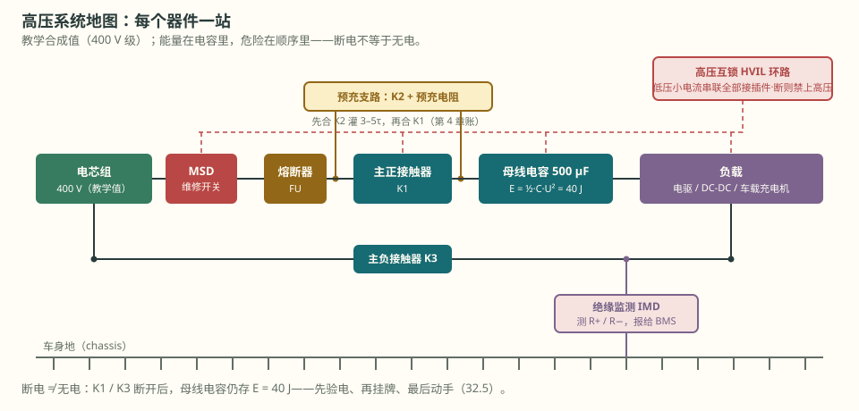
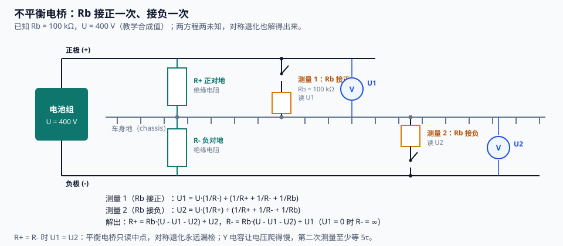
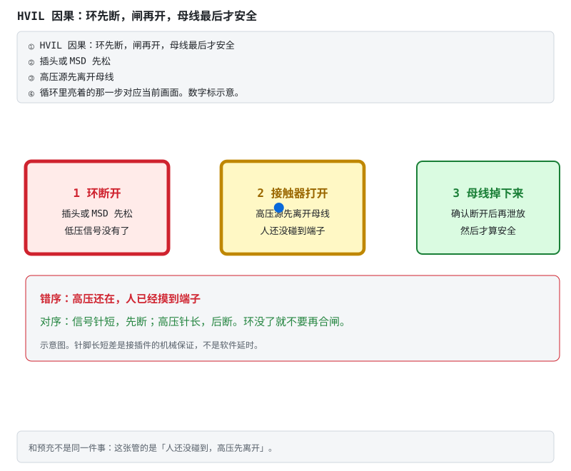
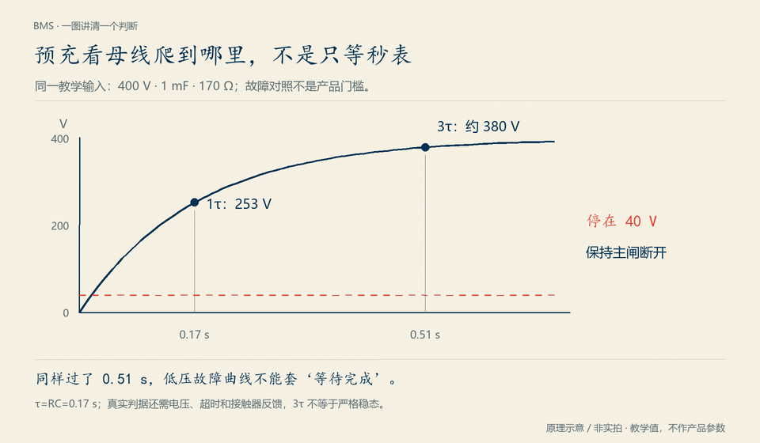

# 第 32 章 高压安全与绝缘检测

::: story 现场
维修工拔了维修开关（MSD），等了 20 分钟，手碰母线还是被电了一下：pack 确实断电了，但电还留在母线电容里。这笔账很硬：400 V、1 mF，E = ½·C·U² = 80 J（教学合成值，与第 8 章同一组参数），够在工具上烧出一个洞，也够致命。

高压安全的第一课：**断电 ≠ 无电**。安全不是一次动作，是一套顺序。
:::

<aside class="reading-bet" aria-label="开读押注">

开读押注 · 接触器断了，能碰了吗

400 V 电池包已与母线断开，母线电容仍可能存着 80 J。维修放行最少还缺哪一步？

<ol><li>再等一个固定的 20 分钟</li><li>听见接触器弹开声</li><li>主动放电，并测得母线电压真的降到安全范围</li></ol>
</aside>

::: chapter-route 阅读路径

- **第一次主线**：读 §32.1–§32.4。先认全高压回路、IMD、HVIL、预充和母线电容，并算清 80 J 残余能量。
- **第二遍深挖**：读 §32.5–§32.7。处理主动放电、上下电时序、IMD／BMS 分工与测量窗口。
- **动手验证**：画出下电后的命令、接触器反馈、母线电压和放电计时，只有测得安全电压才能放行。
:::

## 32.1 高压系统地图：每个器件一站

先把 400 V 级系统的功率回路画全（图 32-1）。正极一路：电芯组 → 熔断器 → 维修开关 MSD → 主正接触器 K1 → 母线电容 → 负载（电驱 / DC-DC / 车载充电机）。负极侧再串一只主负接触器 K3。K1 两端并联预充支路（预充接触器 K2 + 预充电阻）。三个哨兵各占一位：

- MSD 是物理断点，维修时人手插入的唯一合法开口；
- IMD 绝缘监测跨在高压母线与车身地之间，专管 R+ / R−；
- HVIL 互锁环路穿过每一个高压接插件，专管“插头插没插好”。

这张图是第 4 章功率回路、第 7 章合闸顺序的放大版：蓄水池比喻、先预充再合主闸，在高压车上一条都不能省。

<figure>

<figcaption>图 32-1　高压系统地图（教学合成值）。每个器件一站：诊断时先问“哪一站没履职”，再问“为什么”。</figcaption>
</figure>

## 32.2 绝缘检测：对地电阻是看不见的护栏

<figure>

<figcaption>图 32-4　绝缘检测在等一滴漏电流：支架把高压包托离底盘，裂缝一旦渗出漏电流，感应环在旁路捉到它。对地电阻是平时看不见的护栏，退化时才暴露。定性示意。</figcaption>
</figure>

高压母线对车身地各隔着一只绝缘电阻：正极 R+、负极 R−。它们平时有几百千欧到几兆欧，退化成几十千欧就意味着某处爬电、进水或异物。离线可以用兆欧表摇，在线就得靠电桥法。把两只已知桥电阻同时接上（平衡电桥），只能读出中点偏移：**R+ 与 R− 对称下降时中点纹丝不动**，漏检。

不平衡桥把已知电阻 Rb 分两次接。第一次接正极与地之间，测 U1 = U·(1/R−) ÷ (1/R+ + 1/R− + 1/Rb)；第二次接负极与地之间，测 U2 = U·(1/R+) ÷ (1/R+ + 1/R− + 1/Rb)。两方程两未知，直接解出：

R+ = Rb·(U − U1 − U2) ÷ U2 　　R− = Rb·(U − U1 − U2) ÷ U1

对称与否都解得出来（图 32-2），代价是测两次、等两回。车上有对地 Y 电容，电压爬得慢：τ ≈ C_y·(Rb 并 (R+ + R−))，第二次测量至少等 5τ 再采样，否则解算值还在漂移。demo 里这笔账约 0.5 s，真实 pack 的 Y 电容更大，等几秒是常态。

阈值按 GB/T 18384 的教学口径 100 Ω/V 取（以现行有效版本原文为准）：400 V 系统故障门限 40 kΩ，800 V 系统 80 kΩ。工程上常把报警区放在 2 倍门限（80 kΩ / 160 kΩ）：进警告区记趋势、限功率；破门限锁存故障、禁止上高压（分级动作见 32.6）。

<figure>

<figcaption>图 32-2　不平衡电桥：Rb 接正测 U1、接负测 U2，解出 R+ 与 R−。R+ = R− 时 U1 = U2，单次测量分不出，方程组才解得出。</figcaption>
</figure>

::: trap 坑
把报警当故障、把故障当报警，都会吃掉安全余量。绝缘是**慢病**：阈值以下逐级降级、记趋势；破门限必须锁存并禁止上高压，等维修确认：颠簸不能把故障“颠没了”（第 25 章的 DTC 五要素在这里照样适用）。
:::

## 32.3 高压互锁 HVIL：一串小电流看守所有接插件

HVIL 是低压小电流环路，串联所有高压接插件里的短接片：插头插到位，环路通；任何一个插头松脱，环路断。BMS 监的是电流大小或 PWM 回波：环流消失、或回波的占空比/相位对不上，就禁止上高压；行驶中收到中断，先 Gradual 下电：降功率、亮故障灯、留几秒让车靠边，而不是瞬间切断牵引。

断点定位靠分段：环路按接插件分段引出抽头，量各段的通断或 PWM 相位，由异常区段定位断点。维修手册写“断 HVIL 后等 5 分钟再动母线”，等的正是 32.5 的放电时间。

::: principle 一句话
HVIL 不直接切断高压，它撤销的是**上高压的许可**。插头未插好时，状态机不得闭合主接触器。
:::

## 32.4 预充与浪涌账：没有预充的合闸是短路

空母线电容直接接入电池包，浪涌受实际回路阻抗限制。只计电阻的教学估算I = U ÷ R_loop = 400 V ÷ 50 mΩ≈8000 A，尚未包含寄生电感与电源动态；它说明存在烧蚀或熔焊触点的风险，不能当作真实峰值测量。粘连诊断还要按第8章核对独立反馈与残压路径。

理想恒压源、空电容且无并联负载时，预充电压为u_C=U(1−e^(−t/RC))。到90%需约2.303τ，到95%需约2.996τ；3τ不是90%与95%的共同精确时间。电压达到设计条件后，还要验证采样新鲜有效、上升轨迹、保护/时序、独立反馈和器件接通能力；完整许可成立才合K1，确认其动作后再断K2，不能保证“无火花”。

400 V、1 mF、170 Ω的教学账：τ=0.17 s，初始电流约2.35 A、功率约941 W，到95%约0.509 s；源供152 J＝电阻耗79.8 J＋电容储72.2 J。理想稳态源供160 J，电阻耗与电容储各80 J。95%时仍差20 V；接通浪涌及重复启动的热约束须另核对。

超时未到设计条件须中止并禁止合K1，但支路拒动/开路、负载、参数或测量问题都可能造成升压不足。预充前或下电后仍有电，还可能是残压、回灌、预充支路未断或卡值；结合辅助触点、电流、外部能源及独立电压测点判断，不能从一个母线读数确定粘连。

<figure class="book-motion" data-animation="hvil-break-order.svg" data-mode="static">

<button type="button" data-book-motion v-book-motion aria-pressed="false" hidden>播放动画</button>
<figcaption>图 32-3　高压互锁断开的时序边界：接口状态变化先触发本地安全处理，再检查能量路径反馈；示意不替代现场操作规程。分清互锁信号、卸载请求、接触器动作与母线能量消散，它们不在同一瞬间发生。为何只看到 HVIL 断开，不能直接认定高压已消失？</figcaption>
</figure>

## 32.5 主动放电与上下电时序

接触器全断，母线电容里仍可能留着80 J（开头的教学条件）。主动放电的目标和时限须依据适用标准、工况与系统安全需求；不能从本章的60 V示例直接推出某产品要求。第8章复算了两档理想RC账，均非实测：

- **被动放电**：47 kΩ 常接，τ = 47 s，降到 60 V 要约 89 s，平时够用，碰撞后不够快；
- **主动放电**：200 Ω 投入，τ = 0.2 s，约 0.38 s 到位，此时电容里还剩约 1.8 J。

正常下电的教学顺序是卸流、断开并确认能源隔离、按拓扑投入放电、核对母线与记录；紧急分断须另按安全需求及器件能力设计。预充电阻在合闸前限流，放电电阻在隔离后泄放，不能互换用途。若仍有外部能源，电阻承受的就不只是电容储能。

::: trap 坑
断电不等于隔离已确认，某个测点低于60 V也不构成通用作业许可。现场按适用规程由具备条件的人员完成隔离、锁定、验电与记录；本章教学计算不替代操作规程或实物验证。
:::

## 32.6 IMD 与 BMS 的分工：测量归 IMD，判决归 BMS

绝缘监测 IMD 只干一件事：测。它把测量结果以 PWM 占空比或报文周期发出来，不参与策略。判定、记录、动作全归 BMS：

- **判定**：低于门限置绝缘 DTC（触发、去抖、等级、恢复、锁存五要素，第 25 章）；
- **记录**：绝缘值进趋势曲线，慢病看斜率不看单点；
- **动作**：禁止充电、禁止上高压；充电握手前先验绝缘：绝缘不过，第 11 章那张充电地图再宽也是零。

::: lab 动手
跑 `python bms-book/code/insulation_bridge.py`（stdlib，零依赖）。三个案例：正常（R+ = 500 kΩ）、临界故障（R+ = 40 kΩ）、对称退化（R+ = R− = 100 kΩ）。对照输出里平衡桥与不平衡桥两列（对称退化被前者漏检、被后者解出），再改 Rb 或阈值重跑，看判定怎么动。
:::

## 32.7 测量窗口账：切换、等待、判定各付多久

电桥法的两个方程是稳态方程，只对“爬完了”的读数成立。所以每次诊断都是一笔时间账，三段各付各的：桥臂切换付开关稳定的时间，接入 Rb 之后付 Y 电容爬升的时间，越限之后付去抖的时间。按本章参数（U = 400 V、Rb = 100 kΩ、C_Y = 1 µF；健康包取 32.6 动手的 case A：R+ = 500 kΩ、R− = ∞）把五步列全：

**表 32-1**　绝缘测量窗口五步时间账（case A 参数，demo 可复算）

| 步骤 | 动作 | 时间预算 | 数字出处与列式 |
|---|---|---|---|
| ① | Rb 投入正极，等开关/触点稳定 | 10 ms | 教学合成值（继电器/模拟开关动作量级），只进周期总账、不进判据 |
| ② | 稳定等待后采样 U1 | 0.50 s | τ = C_Y·(Rb∥(R+ + R−))：R− = ∞ 时并联值即 Rb 本身，τ = 1 µF × 100 kΩ = 100 ms，等 5τ = 0.50 s |
| ③ | Rb 换接负极 | 10 ms | 教学合成值，同① |
| ④ | 稳定等待后采样 U2 | 0.50 s | 按②封顶预留；病包反而更短：case C 的 R+ = R− = 100 kΩ，Req = Rb∥200 kΩ = 200/3 kΩ ≈ 66.7 kΩ，τ = 66.7 ms，5τ = 0.33 s |
| ⑤ | 解算 + 去抖判定 | 判定窗 ≈ 3.1 s | 闭式解算本身 ≈ 0；去抖 3 拍（第 25 章 DTC 口径），每轮 10 + 500 + 10 + 500 = 1020 ms，3 拍 = 3.06 s ≈ 3.1 s |

②④两行的 0.50 s 与 0.33 s 就是 demo 逐行打印的 `wait >= 5*tau`。跑 `python bms-book/code/insulation_bridge.py` 能看到：case A 行 0.50 s、case C 行 0.33 s。全表唯一的教学合成值是两次切换的 10 ms。

> 先自己判断：同一套电桥、同一只 Rb，一个绝缘好得发亮的包和一个已经退化到 100 kΩ 的病包，哪个要等得更久才能采样？

这份账有三个读法。

**其一，最坏等待属于最健康的包**：R+、R− 越高，R+ + R− 越接近断路，Req 就越逼近 Rb。Req 越大 τ 越长，所以病包反而等得短。等待预算因此按 Rb·C_Y 封顶预留，本例每次 0.5 s；不为病包加班，也不能砍健康包的等待。

**其二，等待不能缩短**：不到 5τ 就采样，解算值还在漂移。同一个包两轮测量会给出两个结果，锁存下来的可能是测量误差，不是绝缘故障。

**其三，判定窗按串行时间计算**：一个诊断周期等于一整轮两步测量，约 1.02 s。绝缘诊断达不到第 25 章 100 ms 的教学时间预算，也不需要达到——绝缘劣化是慢过程，靠趋势与锁存处理（32.6 的分工不变）。

真实 pack 的 Y 电容更大，用同一行算术可以外推一组教学合成值。C_Y = 10 µF 时 τ = 1 s，每段等待 5 s，一轮 = 10 + 5000 + 10 + 5000 = 10.02 s，判定窗 3 拍约 30 s。注意两次切换的 10 ms 不跟着 C_Y 放大，所以不是 3.1 s 直接乘 10。32.2 说的“等几秒是常态”，账就在这里。

最后留一句痕：每轮把 U1、U2 与采样时刻一起落日志。判定窗里的每个解算值都能从原始读数复算，这是 32.6「记录归 BMS」的时间戳版本。

## 本讲服务知识点

<!-- kp-backlink:start -->
本章服务 4 个知识点；每条都能回到[核心问题地图](../../docs/核心问题地图.md)的 L1–L5 五级入口。这一节由 `curriculum/concepts.json` 的 `book` 字段生成。

**表 32-2**　本章服务的知识点与其梯子入口

| 知识点 ID | 标题 | 阶段 | 梯子到 | 握证 |
|---|---|---:|---|---|
| [`precharge-evidence`](../../docs/核心问题地图.md#kp-precharge-evidence) | 预充证据 | 6 | L5 | 日志 / 仿真输出 |
| [`hv-three-tier-hvil`](../../docs/核心问题地图.md#kp-hv-three-tier-hvil) | 三级架构与互锁 | 6 | L4 | 日志 |
| [`bus-live-shape-diagnosis`](../../docs/核心问题地图.md#kp-bus-live-shape-diagnosis) | 母线仍有电四形状 | 6 | L5 | 手算纸 |
| [`imd-two-equations`](../../docs/核心问题地图.md#kp-imd-two-equations) | 绝缘两次投切 | 6 | L4 | 手算纸 |

**预充证据：高压接触器为什么不能直接一把合上？**

母线电容初始电压低于包压时，直接接通会由回路阻抗和压差决定浪涌。预充先让包压经K2串电阻给电容充电，理想无负载电路按τ=RC趋近包压。压差变小只满足一项接通条件，实际还要核对接触器限值、有效测量、路径反馈和保护状态；母线已有电可能是残压、回灌、粘连或测量错误。

**教学算例：沿着这组输入做一遍**

1. 从0 V起、恒压400 V、170 Ω和1 mF的理想无负载模型：τ=0.17 s，I0≈2.35 A，初始电阻功率约941 W。
2. t90=−τln(0.1)≈0.39144 s，t95=−τln(0.05)≈0.50927 s；3τ=0.51 s约380.09 V，接近但不等于精确95%时刻。
3. 到95%时源供152 J、电阻耗79.8 J、电容增加72.2 J；理想稳态分别160/80/80 J。电阻查脉冲能量、功率、重复热、工作电压和降额，不能只看80 J。
4. 380 V仍比400 V低20 V，是否可接通还取决于回路阻抗、器件限制及有效反馈。超时或升压异常先禁止本例主闸许可并调查；单个母线读数不能确定粘连根因。

**边界与反例**　这些高压数字只用于教学计算。公式假定恒压源、无额外负载、初始母线为0 V；初始残压、负载或回灌需改模型。脚本只判断简化电压条件，不输出真实合闸许可。

**看图任务**　沿母线爬升曲线看合主闸之前的电压和压差；3τ仍有小尾巴，不等于已经严格稳态。

**对应图解**　[precharge-sequence-curve](../../docs/circuits/handraw/exports/precharge-sequence-curve.webp) · [precharge](../../docs/circuits/assets/precharge.svg)

<figure>

<figcaption>图 32-4　预充证据。原理示意 / 非实拍；数字沿用本节教学条件，不作产品参数。</figcaption>
</figure>

**先自己判断**　用示例电容/电阻复算初始电流、t90/t95和到95%时的源供/电阻耗/电容增能。

完成后再展开标准；先保留自己的计算、判断或运行记录。

核对通过标准

约2.35 A、0.39144/0.50927 s、152/79.8/72.2 J；说明参数假设及电压条件不等于合闸许可。

**三级架构与互锁：几百串的包，为什么不能当成一块大保护板？**

电芯很多时，先让采集从板 CMU 在附近量小组电压，再交给主控 BMU 汇总；配电盒 BDU 负责接触器等功率通路。通信经隔离接口传递，各处地电位不直接相连。高压互锁 HVIL 是穿过高压插头的一条低压检查回路：拔插时信号针先断，高压针后分离，让系统先收到撤电提示。机械顺序、软件响应和实际掉压三件事都要验证。

**教学算例：沿着这组输入做一遍**

1. 环在0ms断开，约15ms下开闸令，约30ms母线开始掉。
2. 若去抖取500ms，人已能碰到端子；去抖必须远短于拔插头的时间。
3. 核对从板串数12–18、isoSPI变压器耦合，不把板间通信当普通排线。

**边界与反例**　0/15/30/500ms是示意时序，不是示波器截图；针脚长短差是机械第一道，软件延时补不了装反的接插件。

**看图任务**　盯信号是否先过变压器、接触器是否晚于环断开，别把机械顺序与软件去抖看成同一拍。

**对应图解**　[isospi-daisy](../../docs/circuits/assets/isospi-daisy.svg) · [hvil-break-order](../../docs/circuits/assets/hvil-break-order.svg)

**先自己判断**　按示意写出环断、开闸、母线下降的时间顺序，并说明去抖该落在哪个量级。

完成后再展开标准；先保留自己的计算、判断或运行记录。

核对通过标准

0 ms 环断、约 15 ms 开闸、约 30 ms 母线开始掉；去抖远短于拔插头时间，取几十毫秒；注明示意。

**母线仍有电四形状：断开指令发完，母线还有电，是粘连吗？**

下电后母线还量得到电压，可能只是电容正在正常放电，也可能是触点粘连、泄放路径太弱或采样读数卡住。先看随时间怎么变：指数下降、贴顶不降、同类曲线偏慢，分别支持不同候选。只有一拍读数时，信息不足以选根因。还要核对放电回路、时间常数和独立测量，才能确认安全状态。

**教学算例：沿着这组输入做一遍**

1. τ=10µF×100kΩ≈1.0s。
2. 0.1s时u=400×e^(−0.1)≈362V，仍在正常衰减区。
3. 5s时u≈2.7V，接近泄放完；若0.1s就判粘连，等于把362V当异常。
4. 投入主动放电后仍不降，隔离状态不能算确认。

**边界与反例**　400V、10µF、100kΩ取自书稿教学示例；主动放电、负载与表笔带宽都会改形状，单点读数不能确认隔离。

**看图任务**　盯曲线是指数下滑还是贴顶；同族但偏慢要看时间常数，不要只比末值。

**对应图解**　[bus-live-shapes](../../docs/circuits/handraw/exports/bus-live-shapes.webp)

**先自己判断**　按 10 µF、100 kΩ、400 V 算 τ 与 0.1 s、5 s 的母线电压。

完成后再展开标准；先保留自己的计算、判断或运行记录。

核对通过标准

τ≈1.0 s；约 362 V 与约 2.7 V；注明取自书稿教学示例。

**绝缘两次投切：一次测量能同时解出正负对地两个绝缘电阻吗？**

要知道正极与负极各自对机壳漏不漏电，有两个未知电阻，只量一次分压不够。电桥法把已知电阻分别接到两侧，读两次机壳电压，才凑齐两个方程。另一种方波注入法用微小测试电压测响应；换向刚发生时，电容也在充放电，所以要避开尖峰，等到平台再判断稳态漏电。

**教学算例：沿着这组输入做一遍**

1. ±20V串500kΩ，绝缘10MΩ时稳态I≈20/(0.5+10)MΩ≈1.9µA。
2. 绝缘降到100kΩ时I≈20/(0.5+0.1)MΩ≈33µA。
3. 定位看机壳对负极电压比：100V/400V=0.25，漏点约在离负极四分之一处。
4. 采样窗放在投切后3–5τ的平台，不在翻转沿。

**边界与反例**　1.9µA与33µA是口算示意，不是监测仪实测；方程假设单点失效，多点同时下降或只有Y电容时中点也停中间。

**看图任务**　盯方波翻转沿的红点应被跳过；平台段电流随绝缘变差而变大才是漏电。

**对应图解**　[imd-bridge](../../docs/circuits/assets/imd-bridge.svg) · [imd-square-inject](../../docs/circuits/assets/imd-square-inject.svg) · [iso-fault-locate](../../docs/circuits/assets/iso-fault-locate.svg)

**先自己判断**　按 ±20 V 串 500 kΩ 算 10 MΩ 与 100 kΩ 下的稳态电流；再由机壳对负极 100 V、包压 400 V 估故障位置。

完成后再展开标准；先保留自己的计算、判断或运行记录。

核对通过标准

约 1.9 µA 与 33 µA；α=0.25 即离负极四分之一处；注明前提是漏电阻远小于采样电阻。

<!-- kp-backlink:end -->

## 练习

1. 按 100 Ω/V 的口径：400 V 与 800 V 系统各自的故障门限是多少？若报警区取 2 倍门限，两个报警门限各是多少？
2. 某 400 V 系统，Rb = 100 kΩ：第一次接正极测得 U1 = 25.0 V，第二次接负极测得 U2 = 100.0 V。列出两个方程，解出 R+ 与 R−，并按 40 kΩ 门限判定。
3. 对地 Y 电容 C_y = 1 µF，Rb = 100 kΩ，正负对地绝缘电阻各约 500 kΩ：估算 τ 与第二次测量至少要等的时间（≥ 5τ）。

## 参考资料

- GB/T 18384《电动汽车安全要求》：绝缘电阻与主动放电要求以现行有效版本原文为准，本章阈值为教学引用。
- BMS-Z 阶段 6（精通与毕业项目）：https://github.com/zhuguang-ZFG/BMS-Z/blob/main/docs/stages/stage-6-精通与毕业项目.md
- BMS-Z 电路详解 ①（MOS、DW01、预充）：https://github.com/zhuguang-ZFG/BMS-Z/blob/main/docs/circuits/01-功率回路-MOS保护与预充.md
