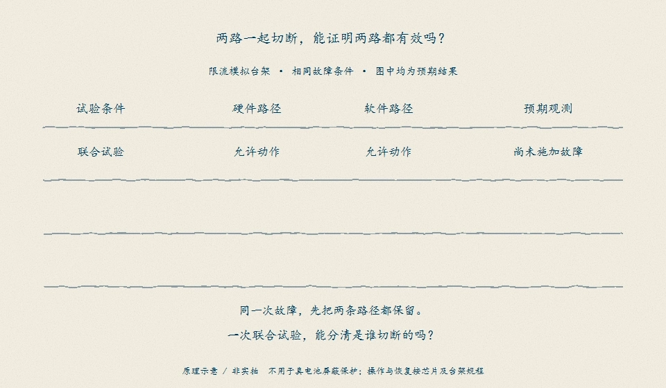
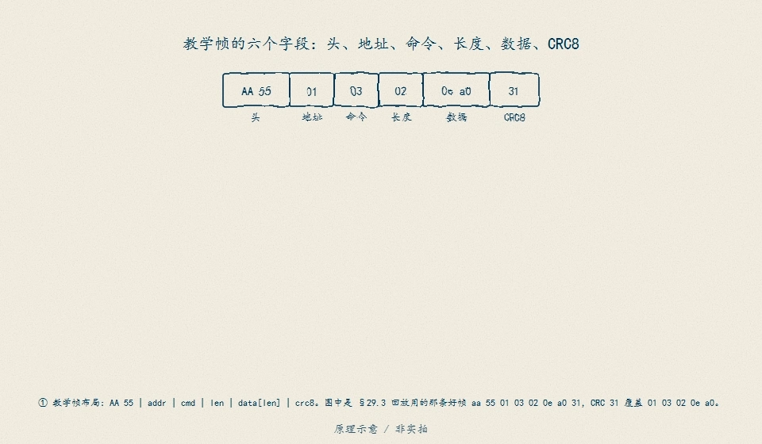

# C2　电芯模型与估计综合检查（草案，P4.4 交付）

C2 是 P7 综合迁移考核在模型与算法主线的**可执行草案**。它把 D11（HPPC 参数辨识）、D12（SOC 基线与校准）、D13（EKF 完整一轮）、D14（可观测性与无真值诊断）、D15（SOH 与老化）、D16（热模型与测点）、D17（SOP 与多约束）、D18（充电控制与许可）缝成一张检查表：每一项给出输入、判据与失败时的去向。本草案的数值全部来自已冻结的教学锚点；它不证明：数值为教学锚点（SRC01/SRC04/SRC07 与 OS01–OS03 未闭合），结构可迁移、判据需重签。

## 0. 使用规则

1. 按行执行，不许跳行；每行的"通过判据"必须写进验收记录。
2. 任何一行失败：先回到对应 D 单元修源头，不许在 C2 里打补丁放宽判据。
3. 数值来源列冻结；改数值必须回写对应单元并重跑本表。

## 1. 数据划分层（来源 D11/B05/D15）

| # | 检查项 | 通过判据 | 失败去向 |
|---|---|---|---|
| 1.1 | 拟合/留出按电芯与工况双重划分 | 留出电芯/工况不参与任何拟合与标定；D11 LOO 逐折留一 | 回 D11.4 重划 |
| 1.2 | 标定与留出不得共享温度点 | D15 泄漏标志 `shared_temperature_between_split=false`；共享即判泄漏，反事实不算验证 | 回 D15.4 |
| 1.3 | 数据身份登记 | 来源、许可、单位、测点身份逐项登记（B05）；DATA01 谱系重跑不命名独立真值 | 回 B05/D11 |

## 2. 基线层（来源 D12/D13）

| # | 检查项 | 通过判据 | 失败去向 |
|---|---|---|---|
| 2.1 | 先跑库仑计基线再上滤波器 | 三误差形状可复跑：偏置 50 mA→2.5 pp/h 线性漂移；初值 10 pp 恒定跟随；容量错 5%→增益误差 | 回 D12.2 |
| 2.2 | 校正须过静置门 | 连续 5 拍（300 s）静置且有观测；不足则 `corrected=false` 记原因，不允许无条件校正 | 回 D12.3 |
| 2.3 | 残差三口径不得互替 | 声明不确定度先验上限 / 后验电压残差（≈0 仅诊断）/ 独立真值评分分列；后验拟合残差当精度即失败 | 回 D12.3 |

## 3. HPPC 参数层（来源 D11）

| # | 检查项 | 通过判据 | 失败去向 |
|---|---|---|---|
| 3.1 | 联合辨识 + 激励充分性 | 无噪基准 τ 命中 45 s 网格、R1/C1 相对误差 ≤1e−6；平坦区/弱激励段明确报不可辨识 | 回 D11.2 |
| 3.2 | 留出验证独立 | 独立 30 s 脉冲全轨迹 RMSE ≤1e−8 V（无噪口径）；带噪报区间与多种子敏感性，不只报单点 | 回 D11.4 |
| 3.3 | 参数不确定度传递到下游 | 辨识出的不确定度进入 D17 收缩口径（见 4.4）；不允许名义参数直接当承诺 | 回 D17.1 |

## 4. SOC 与不确定性层（来源 D13/D14/D17）

| # | 检查项 | 通过判据 | 失败去向 |
|---|---|---|---|
| 4.1 | 手算一轮对拍 | 预测步 FPFᵀ+Q 与更新步增益由 P/H/R 决定，逐点对拍一致 | 回 D13.1/D13.2 |
| 4.2 | 协方差诚实性 | 平坦区反例在案：z-only 末误差 10.5451 pp、自报 P^½ 0.7966 pp——自报不确定度不得当作精度证据 | 回 D14.3 |
| 4.3 | 可观测性秩检查 | 单斜率静置永远辨不出偏置（rank 1）；跨拐点 HPPC rank 2（det 16.5888） | 回 D14.2 |
| 4.4 | SOP 按参数不确定度收缩 | 逐档 nominal vs uncertain 收缩量与主导参数在案；收缩对不确定度单调；名义值直接对外即失败 | 回 D17.1 |

## 5. 失配与无真值层（来源 D13/D14）

| # | 检查项 | 通过判据 | 失败去向 |
|---|---|---|---|
| 5.1 | 新息白化检验 | 模型匹配工况 whitening 通过；失配对比（容量标高/偏置/OCV 表错）EKF vs 纯库仑计分列 | 回 D13.5 |
| 5.2 | 无真值诊断三判据 | 新息自洽、漂移方向一致、双模型可分离性（平坦区 separable=false 必须敢说） | 回 D14.3 |
| 5.3 | 坏观测门限 | 新息超门限拒绝并沿用预测；好帧不误拒 | 回 D13.3 |

「不用自身估计当真值」有一个操作性的图解：保留一路、切断另一路，在相同故障下分别核对。

<figure>

<figcaption>图 C2-F1　独立验证矩阵：两路一起切断成功，不能证明两路各自都能切断——必须分别保留一路、在相同故障条件下核对另一路。这正是拒收条件一「拿自己的估计当真值」在工程上的对偶：任何单层自证都不算数。原理示意 / 非实拍。</figcaption>
</figure>

## 6. 功率与充电层（来源 D15/D16/D17/D18）

| # | 检查项 | 通过判据 | 失败去向 |
|---|---|---|---|
| 6.1 | 热契约先于 SOP | 沉默带反例在案：10 A 恒流芯超 8.45 K、三测点零触发；壳温阈值不得当芯温保护 | 回 D16.2 |
| 6.2 | SOP 窗口锚定 | 单快照反例在案：+38.44%（10 s）/+91.26%（600 s）/+479.03%（低 SOC 长窗）；逐窗给主导约束与余量；端点-only 漏报帧数在案 | 回 D17.3 |
| 6.3 | 充电许可链 | `I_permit = min(充电器, 温度地图, SOP 窗口限)` + 析锂否决（T<10 °C ∧ z≥0.80）；教学模型不生成电芯许可 | 回 D18.2 |
| 6.4 | 假满充防线 | 净电流口径（i_net = i_charger − i_aux）；截止三元 + SOC/能量交叉核对；上游限流 taper 假满反例在案 | 回 D18.3 |
| 6.5 | 老化联动 | SOH 三族同刻差 5.25 pp 在案；EOL 循环 931.68/629.08/435.38（25/35/45 °C）；45 °C 留出失败原样保留 | 回 D15.2/D15.4 |

## 7. 拒收条件（SPEC 第 250 行，命中即拒收）

| 拒收项 | 判据 |
|---|---|
| 用自身估计做真值 | 任何以估计器输出当真值评分的报告即拒收 |
| 只报告训练误差 | 无留出电芯/工况结果的报告即拒收 |
| 标定/留出共享温度点 | 共享即泄漏，反事实不算验证 |
| 未知偏置/容量变化未列入留出工况 | 留出工况必须覆盖未知偏置与容量变化 |
| 教学参数当器件许可 | 教学锚点直接对外承诺即拒收 |

五条拒收共同的底子是一幅手绘分界：结构检查全过，不等于语义可信。

<figure>

<figcaption>图 C2-F2　结构合法≠可信：三道结构检查只看字节本身，看不出这一帧是什么时候采的、按什么刻度解释。检查表逐层过门只是入场券——命中本层任何一条拒收项，前面各层全绿也一并拒收。原理示意 / 非实拍。</figcaption>
</figure>

## 8. 本草案的边界

- 数值全部为教学锚点；真实项目替换为实测/手册值后，本表结构不变、判据需重签。
- C2 不覆盖通信与固件（D19–D23）、系统与研究支线（D24–D28、R01–R04）——那是 C3/C4 的边界。
- P7 正式交付 = 本表 + 一份留出电芯/留出工况的新任务 + 独立复核记录。
