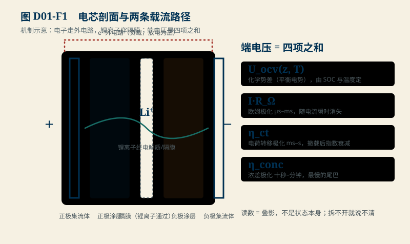
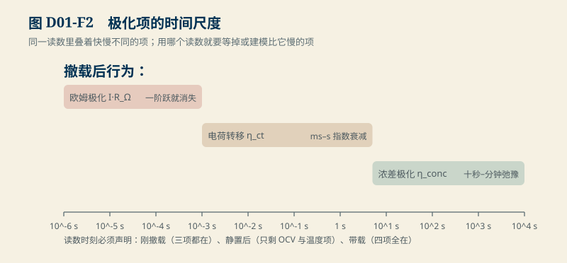

# D01　电芯内部与端子证据：一颗读数里叠着几种物理

:::: story 现场
同一颗电芯的巡检表上，两次记录都是 3.28 V。第一次判“SOC 约 55%，正常”；三个月后同压判“ SOC 约 90%，老化了”——两次判断用了同一张 OCV 表，只有一个是对的。端电压是内部状态的**叠影**，不是状态本身；这一单元把叠影拆开，并给出一个严格反例：三个内部状态完全不同的工况，可以在同一负载下读出完全相同的电压。
::::

<aside class="reading-bet" aria-label="开读押注">
<p class="reading-bet__eyebrow">开读押注 · 一个电压读数能定 SOC 吗</p>
<p>同一负载下读到 3.28 V。三个候选：能定到 ±5 pp；只能定到一个宽区间；必须结合温度与历史才能说话。</p>
<ol><li>能，OCV 表反查即可</li><li>只能给宽区间</li><li>单读数不够</li></ol>
</aside>

:::: chapter-route 阅读路径
- **第一次主线**：D1.1–D1.3。端电压的四项构成、各自的时间尺度、以及它们怎样叠成一个读数。
- **第二遍深挖**：D1.4。三态同压反例：3.28 V 同时是三个状态的脸。
- **动手验证**：D1.5。跑合成演示，改参数制造你自己的"同压不同态"。
::::

**它不证明**：全单元的 OCV 曲线与三个状态都是教学合成值（SRC01 电芯手册未闭合）；化学体系窗口是公开常识级教学值，不是任何具体料号的许可；真实电芯的 OCV 迟滞、熵热系数与温度标定待 D16 与 SRC04。

## D1.1 端电压的四项构成

工程侧的端电压写成四项之和（放电为正）：

$$
V = U_{\text{ocv}}(z, T) - I\,R_\Omega - \eta_{\text{ct}} - \eta_{\text{conc}}
$$

| 项 | 物理来源 | 典型时间尺度 | 撤载后行为 |
|---|---|---|---|
| $U_{\text{ocv}}(z,T)$ | 化学势差（平衡电势） | 由 SOC 与温度决定 | 撤载后缓慢弛豫到它 |
| $I R_\Omega$ | 欧姆极化：集流体、电解液、隔膜 | µs–ms 级瞬时 | 随电流立即消失 |
| $\eta_{\text{ct}}$ | 电荷转移极化：界面反应动力学 | ms–s | 指数衰减，时间常数秒级 |
| $\eta_{\text{conc}}$ | 浓差极化：固相/液相扩散梯度 | 十秒–分钟 | 最慢的一条尾巴 |

<figure>

<figcaption>图 D01-F1　电芯剖面与两条载流路径。机制示意，非任何料号结构；读数是四项的叠影。</figcaption>
</figure>


读数里的信息分配由时间尺度决定：刚撤载的电压带着三种极化；静置足够久只剩 OCV 与温度项；带载读数四项全在。不同时间尺度混杂在一个数里，是"一个电压说不清状态"的物理根因。

## D1.2 极化的时间尺度图

<figure>

<figcaption>图 D01-F2　极化项的时间尺度。欧姆 µs–ms、电荷转移 ms–s、浓差十秒–分钟；用哪个读数就要等掉或建模比它慢的项。</figcaption>
</figure>

图 D01-F2 把四项画在同一对数时间轴上：欧姆（µs–ms）一阶跃就消失；电荷转移（ms–s）决定 S2 拟合窗里看得见的尾巴；浓差（十秒–分钟）决定"静置多久才算静置"。读图要点：**用哪个读数，就要么等掉比它慢的项，要么把它们建模进去**——S2 只拟合撤流尾段，就是在等欧姆与电荷转移项退场。

## D1.3 化学体系的窗口不能共用

不同化学体系的平衡电势平台、截止电压与温度窗口不同，**任何限值表都必须连同化学体系一起引用**：

| 化学体系 | 标称电压（教学常识值） | 典型单体窗口 | 备注 |
|---|---|---|---|
| LFP（磷酸铁锂） | 3.2 V | 2.5–3.65 V | 平台平坦，OCV 反查 SOC 病态（D14 展开） |
| NMC（三元锂） | 3.6–3.7 V | 2.5–4.2 V | 上限随具体配方与厂商不同 |
| LTO（钛酸锂） | 2.3–2.4 V | 1.8–2.85 V | 低压平台，耐低温但能量密度低 |

上表是公开常识级教学值（SRC01 待补：具体料号手册的修订版、页节与温度条件）。把 NMC 的 4.2 V 上限写到 LFP 包上，保护逻辑会在错误的位置动作；把 LFP 的 3.65 V 写到 NMC 包上，等于放弃了容量。

## D1.4 三态同压：一个严格反例

`D01-same-terminal-voltage`（合成演示，SRC01 未闭合时的教学基准）安排三个内部状态在同一 2.0 A 负载下读出**完全相同的 3.28 V**：

| 状态 | z（SOC） | 内阻 | 附加极化 | OCV 项 | 端电压 |
|---|---|---|---|---|---|
| A 常温带载 | 0.55 | 20 mΩ | 0 mV | 3.32 V | **3.28 V** |
| B 老化带载 | 0.90 | 45 mΩ | 30 mV | 3.40 V | **3.28 V** |
| C 低温带载 | 0.20 | 30 mΩ | 0 mV | 3.34 V（低温抬升） | **3.28 V** |

算术：A = 3.32 − 2.0×0.020 = 3.28；B = 3.40 − 2.0×0.045 − 0.030 = 3.28；C = (3.25 + 0.090) − 2.0×0.030 = 3.28。**SOC 跨度 70 pp，读数一位不差。**

解除混淆需要的不是更准的表，而是**新信息**：温度（区分 C）、静置后的 OCV（区分 A 与 B 的一部分）、或一段带载历史（用内阻项区分 A 与 B）。这与 S2 的偏置反例同构：观测重合时，必须加测新量，不能加猜。

## D1.5 动手验证

```text
python code/engineering/cell_evidence/d01_cell_evidence.py
python code/engineering/cell_evidence/d01_cell_evidence.py --out <新目录>
python -m pytest code/engineering/cell_evidence -q
```

迁移任务（没有标准答案，判据写在报告里）：

1. 换一条 OCV 折线（仍保持单调），重新设计三个同压状态；报告 SOC 跨度是变大了还是变小，并解释。
2. 把负载电流加倍：三个状态还同压吗？哪一项最先破坏重合？
3. 若只允许加一个传感器（温度或电流），你加哪个才能让 3.28 V 在三个状态里可区分？给出理由与仍存在的歧义。

## D1.6 与 S2/D03 的接口

S2 的 $U(z)$ 就是本单元的 $U_{\text{ocv}}(z, T)$ 在恒温下的切片；S2 的"未知偏置混淆 SOC"是"同压不同态"在估计层的影子。D03 把"化学体系窗口"转成量化需求；D16 用温度模型补上本单元搁置的 $T$ 依赖。真实 OCV 表与温度系数登记在 SRC01/SRC04，闭合前一切数值保持教学身份。

## D1.7 本单元已冻结的数字

| 锚点 | 值 | 出处 |
|---|---|---|
| 共享端电压（2.0 A） | 3.28 V | `d01_cell_evidence.py` |
| 三态 OCV 项 | 3.32 / 3.40 / 3.34 V | 同上 |
| 三态内阻 | 20 / 45 / 30 mΩ | 同上 |
| 极化附加项（B） | 30 mV | 同上 |
| 三态 SOC | 0.55 / 0.90 / 0.20（跨度 70 pp） | 同上 |
| 化学体系窗口 | LFP 2.5–3.65 V；NMC 2.5–4.2 V；LTO 1.8–2.85 V | 教学常识值，SRC01 待补 |

## D1.8 装配边界

- 进入 D04 前先修 B01（功率方向）与本单元；S2 样章可并行。
- 图 D01-F1 为机制示意图，不标注任何料号结构；剖面只表达"电子走外电路、锂离子走电解质"的职责分工。
- 真实电芯数据的接入路径登记在 SRC01；本单元报告模板与 B05 数据身份五字段一致。
