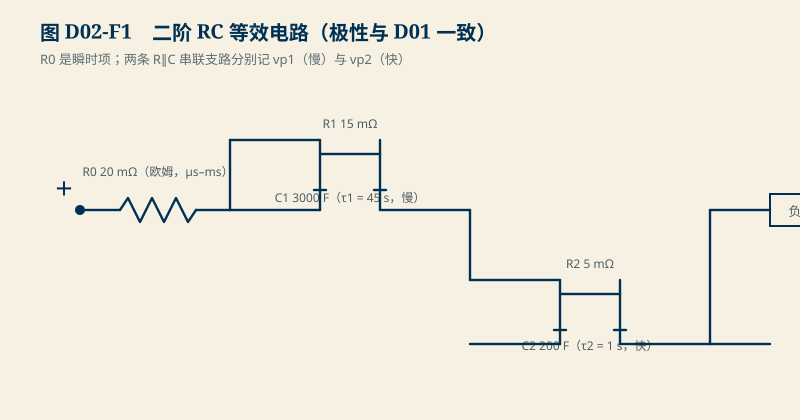
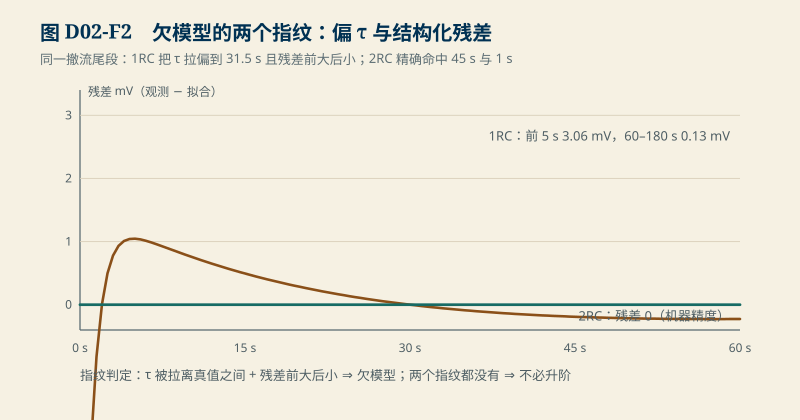

# D02　动态等效模型：从 RC 方程到精确离散，再到“该建几阶”

:::: story 现场
S2 用一阶 RC 把一条脉冲曲线讲透了。现在来一颗“同样的”电芯，拟合却总在头 5 秒留下一道弯不下去的残差——换更长的窗、更密的网格都没用。问题不在拟合，在模型：这颗电芯的极化有两条时间常数，一阶模型天生少一条支路。把模型从一阶加到二阶，残差消失了；但二阶不是免费的——多出来的参数要吃数据。这一单元把三件事讲清：精确离散怎么来、迟滞怎样骗过 OCV 反查、以及阶数与数据量怎么取舍。
::::

<aside class="reading-bet" aria-label="开读押注">
<p class="reading-bet__eyebrow">开读押注 · 残差弯不下去，该换什么</p>
<p>撤流尾段拟合后，前 5 秒残差 3.06 mV，60 秒后只有 0.13 mV。该换更密的 τ 网格、更长的拟合窗，还是换模型结构？</p>
<ol><li>更密的 τ 网格</li><li>更长的拟合窗</li><li>换模型结构（加支路）</li></ol>
</aside>

:::: chapter-route 阅读路径
- **第一次主线**：D2.1–D2.3。零阶保持与精确离散、多时间尺度 2RC、欠模型的两个指纹。
- **第二遍深挖**：D2.4。迟滞反查：同一电压两个 OCV，SOC 反错 1.25 pp。
- **动手验证**：D2.5。跑 2RC 真值拟合，制造你自己的欠模型现场。
::::

**它不证明**：全部数值为合成教学基准（场景 `D02-model-order` / `D02-hysteresis-inversion`），真值由程序设定；真实电芯的模型阶数认定必须靠留出数据与独立工况（D11），本单元的结论“欠模型有两个指纹”不受合成身份影响，但“这颗电芯是 2RC”这个判断不能从合成演示外推。

## D2.1 零阶保持与精确离散

S2 给出过一阶 RC 的精确递推；这里把假设的名字说清楚。离散式

$$
x_{k+1}=a\,x_k+R(1-a)\,I[k],\qquad a=e^{-\Delta t/\tau}
$$

成立的前提是**零阶保持（ZOH）**：$I[k]$ 在整区间 $[t_k,t_{k+1})$ 内恒定。数字控制器天然满足——DAC/寄存器在一个节拍里不变；但物理电流在节拍内是会动的，ZOH 是“把节拍内变化忽略”的近似，其误差与 $\Delta t$ 内的电流斜率成正比。采样越慢，ZOH 越粗糙；这决定了 S1 扫描周期与 S2 拟合窗的耦合，而不是一句“dt 取小点”能糊弄过去的。

## D2.2 多时间尺度：2RC 与第二状态

一阶 RC 的极化只有一个时间常数 $\tau=RC$。真实电芯常见快慢两支：电荷转移（秒级）与扩散（十秒–分钟级）。<figure>

<figcaption>图 D02-F1　二阶 RC 等效电路。R0 是瞬时项；vp1（慢）与 vp2（快）各是一条 R∥C 串联二端网络，极性与 D01 一致。</figcaption>
</figure>

二阶模型给极化再并联一条 $R_2C_2$ 支路：

$$
v_{p,1}[k+1]=a_1 v_{p,1}[k]+R_1(1-a_1)I[k],\qquad
v_{p,2}[k+1]=a_2 v_{p,2}[k]+R_2(1-a_2)I[k]
$$

$$
V[k]=U(z)-I R_0-v_{p,1}[k]-v_{p,2}[k]
$$

本单元冻结真值（`D02-model-order`）：Q = 2 Ah、$R_0$ = 20 mΩ、$R_1$ = 15 mΩ ∥ $C_1$ = 3000 F（$\tau_1$ = 45 s，S2 的主极点）、$R_2$ = 5 mΩ ∥ $C_2$ = 200 F（$\tau_2$ = 1 s，S2 没有的快支路）。工况：静置 60 s → 2 A 放电 10 s → 静置 180 s，$\Delta t$ = 0.5 s，$z_0$ = 0.60。脉冲期间的电量账与 S2 一致：10 s × 2 A / (3600 × 2 Ah) = 0.277778 pp；欧姆跳变 2 A × 20 mΩ = **40 mV**。

## D2.3 欠模型的两个指纹

用 S2 的同一套拟合合同（只拟合撤流尾段、$\tau$ 网格搜索、K/A 线性最小二乘）分别配一阶与二阶：

| 拟合 | 命中的 τ | 全尾段 RMS | 前 5 s 窗 RMS | 60–180 s 窗 RMS |
|---|---|---|---|---|
| 1RC | **31.5 s**（真值 45 s 与 1 s 的折中） | 0.5831 mV | **3.0565 mV** | 0.1317 mV |
| 2RC | **45.0 s 与 1.0 s**（精确命中） | 0（机器精度） | 0 | 0 |

<figure>

<figcaption>图 D02-F2　欠模型的两个指纹。1RC 把 τ 拉偏到 31.5 s 且残差前大后小（前 5 s 3.06 mV vs 60–180 s 0.13 mV）；2RC 精确命中 45 s 与 1 s。</figcaption>
</figure>

欠模型留下两个指纹，缺一个都不该升级模型：

1. **参数偏移**：拟合的 τ 被拉离两个真值之间（31.5 s），不是任何一条真实支路——“拟合出来的时间常数”不等于“物理时间常数”。
2. **结构化残差**：残差不是均匀的白噪声，而是前大后小（3.06 mV vs 0.13 mV，20 倍以上）——快支路在头几秒还没退完，一阶形状装不下它。

反过来，两个指纹都不出现时不该加阶：多出来的参数只会拟合噪声（S2 的短窗病态换了一个面孔）。**升阶的判据是残差结构，不是拟合图好不好看**。

## D2.4 迟滞：同一电压，两个 OCV

OCV 不止随 SOC 变，还随**来路**变：从充电方向到达 z = 0.50 的平衡电势，比从放电方向到达的高。教学冻结值：z = 0.50 处充放两支相差 **10 mV**——充电支 OCV = **3.605 V**，放电支 OCV = **3.595 V**。

反查的人会怎样？拿着 3.600 V 当 OCV 反查，若真实来路是放电支，偏差 5 mV；若整套迟滞宽 10 mV 都被忽略，误差按斜率换算：10 mV ÷ 0.8 V/SOC = **1.25 pp**。平台越平（LFP 的 0.08 斜率情形）放大 10 倍——这正是 D01“同压不同态”与 S2“偏置混淆”在模型层的第三个版本。**解法是显式的迟滞状态**（记录当前在哪条支、何时跨支），不是更密的 OCV 表。

## D2.5 动手验证

```text
python code/engineering/cell_model/d02_cell_model.py
python code/engineering/cell_model/d02_cell_model.py --out <新目录>
python -m pytest code/engineering/cell_model -q
```

迁移任务：

1. 把快支路时间常数从 1 s 改成 0.2 s（仍短于采样区间一半），重跑拟合：1RC 的前 5 s 残差变大还是变小？为什么？
2. 只保留前 30 s 的撤流数据，重跑 2RC 网格：τ 还能命中 45 s 与 1 s 吗？用答案解释“阶数要吃数据”。
3. 设计一个判别流程：给出“什么时候该从 1RC 升到 2RC”的可执行判据（输入：两段窗的残差、τ 的稳定性；输出：升/不升及理由）。

## D2.6 与 S2/D11 的接口

S2 的 `S2-pulse-identification` 是本单元删掉快支路后的特例；D11（HPPC 与参数辨识）把这里的网格搜索换成联合估计，并把“参数命中边界要报告”的规则接进来。迟滞状态在 D12（SOC 基线）与 D14（可观测性）里继续追：迟滞宽度本身也是可辨识性的一部分。

## D2.7 本单元已冻结的数字

| 锚点 | 值 | 出处 |
|---|---|---|
| 2RC 真值 | Q 2 Ah；R₀ 20 mΩ；15 mΩ∥3000 F（τ 45 s）；5 mΩ∥200 F（τ 1 s） | `d02_cell_model.py` |
| 工况 | 静置 60 s → 2 A × 10 s → 静置 180 s；dt 0.5 s；z₀ 0.60 | 同上 |
| 欧姆跳变 | 40 mV | 同上 |
| 1RC 拟合 | τ = 31.5 s；全段 RMS 0.5831 mV；前 5 s 3.0565 mV；60–180 s 0.1317 mV | 同上 |
| 2RC 拟合 | τ = 45.0 s 与 1.0 s 精确命中；RMS = 0 | 同上 |
| 迟滞反查 | z = 0.50 充放两支 3.605/3.595 V（宽 10 mV）；斜率 0.8 → 反错 1.25 pp | 同上 |

## D2.8 装配边界

- 先修 D01（端电压四项归属）与 B02（指数解与离散）；S2 样章可并行。
- 图 D02-F1 为 2RC 等效电路机制图，极性与 D01 一致；图 D02-F2 为 1RC/2RC 残差对照，数据从同一模块生成。
- 模型阶数的真实认定走 D11 的留出合同；本单元的网格拟合只证明“欠模型有指纹”，不证明任何真实电芯的阶数。
