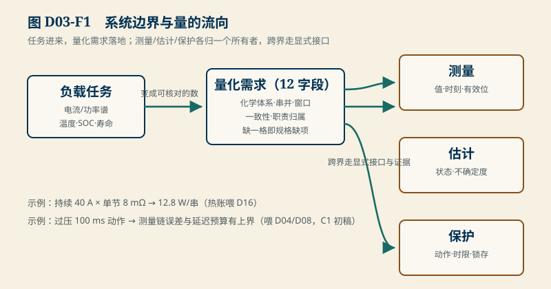
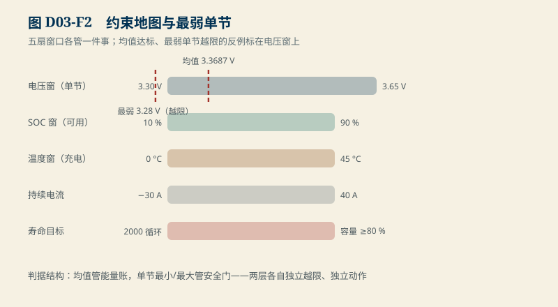

# D03　参数、规格与任务定义：把“这台 BMS 要干什么”写成可核对的数

:::: story 现场
评审会上有人念需求：“保护板要安全、要准、要快。”三个“要”没有一个能测试。追问“多准”，回答是“越准越好”；追问“多快”，回答是“越快越安全”。这一天结束的时候，团队真正写下来的只有一句“16 串磷酸铁锂，电动车用”。而“电动车用”里藏着几十条没有写出来的约束：电流谱、温度窗、寿命目标、一致性要求——缺一条，后面的设计就没有判据。
::::

<aside class="reading-bet" aria-label="开读押注">
<p class="reading-bet__eyebrow">开读押注 · 整包电压达标，系统就安全了吗</p>
<p>16 串 LFP 包，巡检均值 3.3687 V，单节下限 3.30 V。均值看起来离下限还很远。需要担心吗？</p>
<ol><li>不需要，均值 3.3687 &gt; 3.30</li><li>要看单节分布</li><li>只看最低一节</li></ol>
</aside>

:::: chapter-route 阅读路径
- **第一次主线**：D3.1–D3.3。从负载任务到量化需求；测量/估计/保护职责怎样分开。
- **第二遍深挖**：D3.4。最弱单节反例：均值 3.3687 V 的包里藏着 3.28 V。
- **动手验证**：D3.5。用规格缺项检查表审一份草稿需求，写自己的预算初稿。
::::

**它不证明**：本单元的需求模板与检查表是结构工具，不提供任何具体产品的合格结论；最弱单节分布是合成教学数据（`D03-weakest-cell`，非实测包）；化学体系限值沿用 D01 的教学常识窗口，料号级数值待 SRC01。

## D3.1 从任务到量化需求

需求不是形容词，是**带条件的数**。把“电动车用”拆开，要回答五个问题，每个的答案都必须写成可核对的量：

| 问题 | 量化后的样子 | 缺了它会怎样 |
|---|---|---|
| 什么化学体系、几串几并 | LFP，16s1p（示例） | 电压窗口、限值全部悬空（D01） |
| 电流/功率谱 | 持续 40 A、峰值 120 A（30 s）、回馈 30 A | 保护阈值、均衡电流、热设计没有输入 |
| 温度窗口 | 充电 0–45 °C，放电 −20–60 °C | 析锂与功率降额无从谈起（D16/D18） |
| SOC 窗口与寿命目标 | 可用 10–90 %，8 年 / 2000 循环容量 ≥ 80 % | 日历老化模型与 SOH 口径无锚（D15） |
| 一致性要求 | 单节电压窗 3.30–3.65 V，压差告警 150 mV | “最弱单节”没有定义，均衡无判据 |

`code/engineering/requirements/d03_requirements.py` 的 `REQUIRED_SPEC_FIELDS` 把这张表固化为 12 个字段：化学体系、串并数、电压窗口、SOC 窗口、温度窗口、电流/功率谱、寿命目标、一致性要求，以及测量/估计/保护三项职责。字段为空或占位即规格缺项——审需求的第一个动作就是把这 12 格填满。

## D3.2 测量、估计、保护：三个职责，三个所有者

同一颗 BMS 里混着三种性质不同的工作，混着写是大部分需求文档的病根：

- **测量**给出每个量的值、时刻与有效位——S1 的误差界与采样时刻是它的合同；
- **估计**给出不可测状态的估计与不确定度——S2 的参数与 SOC 区间报告是它的合同；
- **保护**给出越限时的动作与时限——S3/S8 的确认、锁存与许可门是它的合同。

<figure>

<figcaption>图 D03-F1　系统边界与量的流向。任务进来、量化需求落地；三职责各归一个所有者，跨界走显式接口与证据。</figcaption>
</figure>

规则只有一条：**同一职责只归一个所有者；跨界必须走显式接口与证据**。“算法算出 SOC 所以算法负责保护”是常见越界：估计可以给保护供数，但动作的门、时限与锁存是保护的职责，不能被估计的置信度悄悄替换。

## D3.3 预算初稿：需求一落地就要算的第一笔账

量化需求落下的当天就能算第一笔账。以持续 40 A、16s LFP（示例）为例：单节平均热功率粗算 $I^2R$，若单节内阻 8 mΩ，则 $40^2 × 0.008 = 12.8$ W——持续 40 A 时整包 16 串约 205 W 的量级，热设计（D16）从这一天起就有输入了。保护反应窗口（S1/S8）同理：需求写明“过压 100 ms 内动作”，测量链的误差预算与滤波延迟从这一天起就有上界。**需求的价值不在被写下，而在它让别的设计有了可算的约束**；C1 综合预算的初稿就从这里长出来。

## D3.4 最弱单节反例：均值 3.3687 V 的包里藏着 3.28 V

`D03-weakest-cell`（合成教学分布）给 16 串巡检电压：15 串在 3.36–3.40 V，第 16 串 3.28 V。

- 整包均值 **3.3687 V**，距 3.30 V 下限还有 68.7 mV 的余量——均值口径下“一切正常”；
- 最弱单节 **3.28 V**，已越限 20 mV；最弱与最强相差 **120 mV**；
- 用均值做判据的包保护，会在第 16 串已经越限时报“正常”。

<figure>

<figcaption>图 D03-F2　约束地图与最弱单节。五扇窗口各管一件事；均值 3.3687 V 与最弱 3.28 V 同时标在电压窗上。</figcaption>
</figure>

算术：$\\bar V = \\frac{1}{16}\\sum V_i = 3.3687$ V；最弱 $V_{min} = 3.28$ V < 3.30 V。均值是 16 个数的平均，越限只需要其中一个——**平均天然稀释极端值**。正确的判据结构是双层的：均值看能量账，单节最小/最大看安全门；两层各自独立越限、独立动作。这个反例同时是 E04“同平均值但最弱单节不同”的种子：整包平均一致时，单节状态可能完全不同。

## D3.5 动手验证

```text
python code/engineering/requirements/d03_requirements.py
python code/engineering/requirements/d03_requirements.py --out <新目录>
python -m pytest code/engineering/requirements -q
```

迁移任务：

1. 把 D3.1 的五个问题用到你自己的（真实或设想的）项目上，填满 12 字段；用 `missing_spec_fields` 自查缺项，缺的字段写“待数据源”而不是编一个数。
2. 设计一个比 D3.4 更隐蔽的反例：让均值、压差都达标，而最弱单节越限（提示：考虑压差告警阈值与下限的关系）。
3. 写一段持续电流的需求，算出第一笔热账与保护窗口账；写明这两个数分别喂给 D16 与 D08 的哪个输入。

## D3.6 与 D01/D16/D24 的接口

D01 的化学体系窗口是 D3.1 第一行的来源；D16 把温度窗口变成热模型与测点约束；D24 把这里的 12 字段扩展成系统架构的需求分解。真实料号的限值（SRC01）与热/充电实证（SRC04）闭合前，本单元的所有数值保持教学身份。

## D3.7 本单元已冻结的数字

| 锚点 | 值 | 出处 |
|---|---|---|
| 合成包均值 | 3.3687 V | `d03_requirements.py` |
| 最弱单节 | 3.28 V（越限 3.30 V） | 同上 |
| 最弱-最强压差 | 120 mV | 同上 |
| 12 个必备字段 | `REQUIRED_SPEC_FIELDS` | 同上 |
| 示例热账 | 40 A、8 mΩ → 12.8 W/串 | D3.3 手算 |

## D3.8 装配边界

- 先修 B01（功率与能量方向）与 D01（化学体系窗口）；本单元在 D04 之前交付。
- 图 D03-F1 的边界框只表达职责分工，不代表任何具体产品的架构选型。
- 需求模板升级（如新增字段）必须回写 `REQUIRED_SPEC_FIELDS` 与本文 D3.1，两处是同一份维护源。
