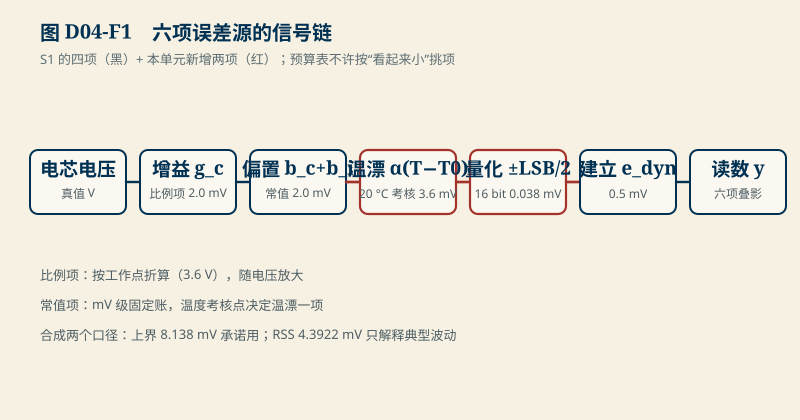
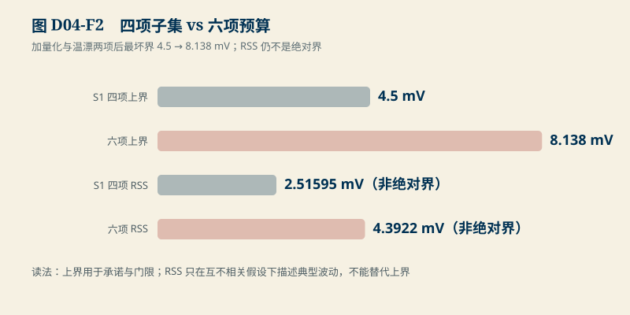

# D04　测量与误差传播：六项预算与“为什么单点校准不够”

:::: story 现场
S1 的样章把四项误差合成到了 4.5 mV。投板前复查，硬件同事又补了两项：ADC 的量化台阶，和数据手册上的温漂系数。重新加总后，最坏界从 4.5 mV 涨到 8.138 mV——原先按 4.5 mV 签的精度承诺失效了。更要命的是校准方案：产线只做一个电压点的校准，评审问“另一个温度、另一个电压点还剩多少误差”，没有人能当场回答。这一单元把六项预算补全，并用算术回答那个问题。
::::

<aside class="reading-bet" aria-label="开读押注">
<p class="reading-bet__eyebrow">开读押注 · 16 位 ADC，量化还轮得到它吗</p>
<p>5 V 量程、16 位、放大倍数 1：量化台阶 76.3 µV。和 4.5 mV 的四项预算比，量化项（±LSB/2 ≈ 0.038 mV）该进预算表吗？</p>
<ol><li>太小，忽略</li><li>进表但无关紧要</li><li>进表——预算表不许挑项</li></ol>
</aside>

:::: chapter-route 阅读路径
- **第一次主线**：D4.1–D4.3。六项误差源、量化与温漂的两笔新账、合成口径（上界 vs RSS）。
- **第二遍深挖**：D4.4。单点与两点校准：修得掉什么、修不掉什么。
- **动手验证**：D4.5。重算六项预算，设计你自己的校准点。
::::

**它不证明**：预算表的数值是教学参数（与 S1 冻结锚点一致的四项 + 教学量化/温漂）；真实器件的量化方式（截断/舍入）、温漂系数与增益温漂耦合必须从具体料号手册取得（SRC02）；RSS 合成在任何情况下都不是绝对界。

**先修核对与目标**：先完成 B01 的单位/参考点短任务与 B03 的上界/标准差辨别题。开始前给一条电压采样链标出参考点、量程及每项误差的单位；答不清先回桥梁。本单元结束应交出一份预算、分离的标定/验证 CSV 和误差报告，能说明“拟合点归零”为什么不等于其他电压与温度都合格。

## D4.1 六项误差源

S1 的测量链有四项：增益 $g_c$、固定偏置 $b_c$、通道偏置 $b_i$、动态建立残差 $e_{\text{dyn}}$。完整预算再加两项：

- **量化**：ADC 把连续电压分到离散台阶，舍入型量化的误差均匀分布于 $\pm \mathrm{LSB}/2$；
- **温漂**：增益与偏置都随温度走，数据手册给的是 ppm/°C 或 µV/°C 的条件系数。

六项的适用口径不同

<figure>

<figcaption>图 D04-F1　六项误差源的信号链。S1 的四项（黑）+ 本单元的温漂与量化（红）；每一有界系统项都进表。</figcaption>
</figure>

：增益项是**比例项**（随被测电压放大），其余是**常值项**（mV 级固定账）。混合合成时比例项要按工作点折算——这是预算表最常见的口径错误。

## D4.2 两笔新账

**量化**：5 V 量程、16 位、放大倍数 1 时，$\mathrm{LSB} = 5/2^{16} = $ **76.294 µV**；舍入量化的单边界是 LSB/2，即 **0.038 mV**。和 4.5 mV 的四项预算比它确实小——但预算表不许按“看起来小”挑项：*每一*有界的系统项都进表，量级由算术排序，不由评审的直觉排序。

**温漂**：以 50 ppm/°C（教学值）、工作点 3.6 V、考核温差 20 °C（25→45 °C）计：$3.6 \times 50\times10^{-6} \times 20 = $ **3.6 mV**。它一进表就超过固定偏置与通道偏置之和——如果只在校准温度（25 °C）验收，45 °C 的现场会白拿 3.6 mV 的额外误差。

## D4.3 六项合成：上界与 RSS

六项预算表（比例项已按 3.6 V 工作点折算）：

| 项 | 符号 | 界（mV） | 口径 |
|---|---|---|---|
| 增益误差 | $g_c$ | 2.0 | 比例 |
| 固定偏置 | $b_c$ | 1.2 | 常值 |
| 通道偏置 | $b_i$ | 0.8 | 常值 |
| 温漂 | $\alpha(T-T_0)$ | 3.6 | 常值（20 °C 考核点） |
| 量化 | $\pm\mathrm{LSB}/2$ | 0.038 | 常值 |
| 动态建立 | $e_{\text{dyn}}$ | 0.5 | 常值 |

最坏上界：同向叠加

<figure>

<figcaption>图 D04-F2　四项子集 vs 六项预算。最坏上界 4.5 → 8.138 mV；RSS 两个口径都标注“非绝对界”。</figcaption>
</figure>

 $2.0+1.2+0.8+3.6+0.038+0.5 = $ **8.138 mV**；互不相关假设下的 RSS 是 **4.3922 mV**。两个口径的分工不变：上界用于承诺与保护门限，RSS 只用于理解典型波动。S1 的四项子集保持不变：4.5 mV 上界 / 2.51595 mV RSS——新增两项的账单独可见，旧锚点不被悄悄改写。

## D4.4 单点校准与两点校准

单点校准在 $V_{cal}$ 处测得偏置并减掉：它修掉的是**一个点上的固定偏置**。S1 算过这笔账（单点校准 $y=1.002V+0.012$ V 后，3.0 V 残差 −1.4 mV、4.2 V 残差 +1.0 mV）。两点校准把增益也拉进来：过 (3.0, 2.9986) 与 (4.2, 4.2010) 解

$$
g=\frac{4.2-3.0}{4.2010-2.9986},\qquad b=3.0-g\times2.9986
$$

两个校准点上残差精确归零；**点之间的内插残差由非线性决定，点之外的外推残差没有任何保证**。校准方案要交代校准点的温度与电压、未参与拟合的验证点、修正前后误差，以及未覆盖区域的边界。25 °C 之外的温漂不会因一次仿射校正自动消失，D4.2 的 3.6 mV 教学账仍需单独核查。验证样本的最大误差是观察结果，不是新的最坏保证，不能替换 D4.3 的上界。

## D4.5 动手验证

从仓库根目录运行，输出目录须使用本次新建的目录，不覆盖旧证据：

```text
python code/engineering/measurement/d04_error_budget.py --out .tmp-d04-reference
python code/engineering/measurement/d04_error_budget.py --calibration .tmp-d04-reference/calibration.csv --validation .tmp-d04-reference/validation.csv --out .tmp-d04-replay
python -m pytest code/engineering/measurement/test_d04_error_budget.py -q
```

原 `D04-six-term-budget` 的六项预算保持不变；新增 `D04-calibration-holdout` 专门检查标定后的留出点。后者使用 S1 的原始仿射读数并额外注入温漂与非线性，**不是六项预算的完整传感器仿真，更不是实测数据**。生成式为：

$$
y=1.002V+0.012+50\times10^{-6}V(T-25)+0.001(V-3.0)(V-4.2)
$$

这里 $V,y$ 用 V，$T$ 用 °C，末项系数为 0.001 V⁻¹；默认不模拟量化、随机噪声或建立过程。参考电压是人工设定的合成输入，不是校正器自己的输出。标定只用 25 °C 的 3.0/4.2 V 两点，原始读数为 3.018/4.2204 V；得到 $g=0.998003992$、$b=-0.011976048$ V 后冻结，不再用验证点改系数。验证使用 5/25/45 °C 与 2.8/3.3/3.6/3.9/4.3 V 的组合；其中 2.8/4.3 V 在标定电压区间外，CSV 会标为外推。

**预期观察**：拟合点残差仅余浮点舍入，不代表验证通过。以下 1 mV 是本实验展示取舍的示例验收值，不是器件规格或通用量产门限。

| 验证温度 | 修正前 MAE / 最大绝对误差（mV） | 修正后 MAE / 最大绝对误差（mV） | 按示例 1 mV 判定 |
|---|---:|---:|---|
| 5 °C | 15.4820 / 16.4300 | 3.6707 / 4.1617 | 不通过：低温留出仍有低报 |
| 25 °C | 19.0620 / 20.7300 | 0.2615 / 0.3593 | 这些留出点通过，不保证未测区域 |
| 45 °C | 22.6420 / 25.0300 | 3.4750 / 4.4212 | 不通过：高温漂移仍在 |

全体验证点的有符号平均误差为 −0.0978 mV，但 MAE 为 2.4691 mV、最大绝对误差为 4.4212 mV；正负相抵不能拿来放行。`validation_passed=false` 正是这个反例的预期结果，命令退出 0 只表示报告生成成功。

**测试与定位**：

- 标定与验证的 `sample_id` 必须唯一且互不重叠；把标定行复制进验证集应报错，不能拿拟合残差代替验证误差。非有限的电压/温度数据也不得进入指标。
- CSV 重放应复现每个验证点与前后指标；换成用户 CSV 时只标“来源未核实”，不能自动升级为实测证据。CSV 必需列为 `sample_id,reference_v,measured_v,temperature_c`，参考值须来自另行声明的来源。
- 若原预算变化，先查量纲和工作点；若拟合点不再归零，查参考/读数列及系数方向；若仅不同温度的验证失败，保留失败，查温漂模型，不把验证点并回标定集，也不为变绿抬门限。

迁移任务：

1. PGA 增益改为 4，复算输入折合量化界，并检查输入范围；放大不是把 16 串包压缩进 5 V，分压链须另算。
2. 若手册给的是偏置温漂 30 µV/°C 而非增益 ppm，重写温漂账，比较量程/温度下的误差。
3. 保持标定 CSV 不动，复制验证 CSV 到新文件，只修改一个验证点的 `measured_v` 后重放；解释该组最大误差为何变化而 $g,b$ 不变。需要三点校准时另分验证集，不能将原验证点悄悄改作拟合点。

## D4.6 与 S1/D05 的接口

S1 是本章的四项子集与反应窗口故事；D05（AFE 与动态采样）把动态建立残差 $e_{\text{dyn}}$ 从“预算表里的一行”展开成 MUX 切换与 RC 建立的物理过程。预算表本身是 C1 的种子：D03 的职责分解 + 本章的数值口径，合成综合预算的第一版。

**交付与下游使用**：`--out` 生成 `calibration.csv`（只含拟合输入）、`validation.csv`（含留出输入、修正值、误差与内插/外推标志）、`report.json`（保留原预算，另含系数、温度分组、MAE/最大误差及失败判定）。随包另附来源、参考仪器/仿真版本、单位、工况与未验证项说明；没有硬件数据就写“合成”。D05 接收动态建立误差与采样条件，C1 接收预算和标定验证报告，不能只交两个零残差。

本例留出点出现最大低报 4.1617 mV，保护预算不能因拟合点归零就把测量裕量记为 0；生产阈值仍需完整误差上界。对后续 OCV 辅助估计，若另用 0.08 V/SOC 的教学局部斜率，4.4212 mV 对应约 5.5264 pp 的反演敏感性；这只是电压误差传播，不是已验证的 SOC 精度。

## D4.7 本单元已冻结的数字

| 锚点 | 值 | 出处 |
|---|---|---|
| LSB（5 V/16 bit/×1） | 76.294 µV；量化界 ±0.038 mV | `d04_error_budget.py` |
| 温漂（50 ppm/°C、20 °C、3.6 V） | 3.6 mV | 同上 |
| 六项最坏上界 / RSS | 8.138 mV / 4.3922 mV | 同上 |
| S1 四项子集 | 4.5 mV / 2.51595 mV（不被改写） | 同上 + S1 锚点 |
| 两点校准 | 过 (3.0, 2.9986)/(4.2, 4.2010) 残差归零 | 同上 + S1 §4 |
| 标定留出反例 | 25 °C 最大残差 0.3593 mV；5/45 °C 为 4.1617/4.4212 mV；示例 1 mV 下整体不通过 | `D04-calibration-holdout`，见 D4.5 的生成式与留出工况 |

## D4.8 装配边界

- 先修 B01（极性与功率方向）与 B03（上界/σ/协方差）；S1 样章可并行。
- 图 D04-F1 为六项误差源信号链机制图；图 D04-F2 为预算表对照，数字从同一模块生成。
- 真实器件口径（截断还是舍入、ppm 还是 µV/°C、增益温漂是否耦合）闭合于 SRC02；闭合前预算表保持教学身份。
