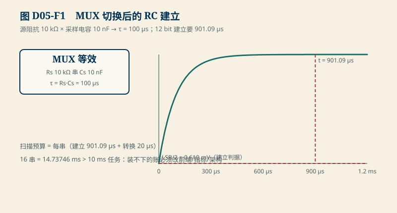
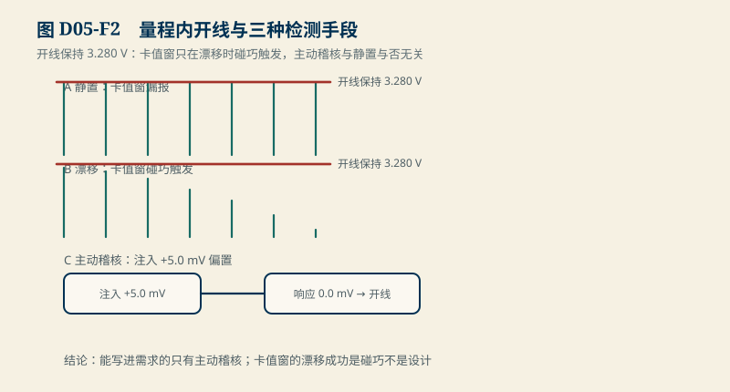

# D05　AFE 与动态采样：建立时间、扫描冲突与量程内的开线

:::: story 现场
16 串采样链联调，三项测试全绿：单通道精度达标、扫描周期达标、开线检测“正常”。现场跑了一个月，运维报“某一串的读数像粘住了”。复查发现：那一路 sense 线虚接——而它的读数是 3.280 V，稳稳地在量程内，开线检测从没报过警。三项测试为什么全漏了：单通道测试没等过建立时间（工程改了源阻抗）；扫描周期按“转换时间”算，没算建立时间；开线检测假设“开线会读出越限或零”。这一单元把这三个漏洞各补一课。
::::

<aside class="reading-bet" aria-label="开读押注">
<p class="reading-bet__eyebrow">开读押注 · 开线检测靠什么</p>
<p>sense 线虚接后读数卡在 3.280 V（量程内）。哪种检测保证抓得住？</p>
<ol><li>越限检查（0 V 或满量程）</li><li>±2 mV 卡值窗口</li><li>对该通道注入已知偏置看响应</li></ol>
</aside>

:::: chapter-route 阅读路径
- **第一次主线**：D5.1–D5.2。MUX 源阻抗与采样电容决定建立时间；建立时间一进扫描预算，16 串就和 10 ms 任务撞车。
- **第二遍深挖**：D5.3。量程内开线：数值、卡值窗、包均值都会失手，主动稽核不会。
- **动手验证**：D5.4。改源阻抗/位数/串数，重算三道账。
::::

**它不证明**：输入级教学值（源阻抗 10 kΩ、采样电容 10 nF、12 bit、5 V 量程）是合成参数；真实 AFE 的建立行为、开线诊断寄存器语义与均衡窗口约束必须从具体料号手册取得（SRC02）；均衡开启时的有效采样窗口属于 E05 家族，本单元只给接口不给结论。

## D5.1 建立时间从哪来

MUX 切到某一串后，采样保持电容 $C_s$ 要经过源阻抗 $R_s$ 充电到该串电压。一阶模型下

$$
\tau = R_s C_s,\qquad |e(t)|=\Delta V\,e^{-t/\tau}
$$

教学值：$R_s$ = 10 kΩ、$C_s$ = 10 nF → **τ = 100 µs**。ADC 是舍入型 12 bit、5 V 量程：LSB = 5/4096 = **1.2207 mV**，建立要求残差 ≤ LSB/2 = 0.610 mV。5 V 阶跃压到 0.610 mV：

$$
t \ge \tau\ln\frac{5}{0.000610} = 100\,\mu s \times 9.0109 = \textbf{901.09 µs}
$$

<figure>

<figcaption>图 D05-F1　MUX 切换后的 RC 建立。τ = 100 µs；12 bit 建立要 901.09 µs，16 串扫描 14.73746 ms 超 10 ms 任务。</figcaption>
</figure>

单通道精度测试为什么漏了它：工程把前端源阻抗从 1 kΩ 改成了 10 kΩ（滤波防混叠），τ 从 10 µs 涨到 100 µs，但测试脚本只等固定 50 µs 就读——每次读数都带着没建立完的残差，且残差随电压幅度变，看起来像“非线性”。

## D5.2 建立时间一进扫描预算，周期就撞车

扫描预算是**每串建立时间 + 转换时间**之和，不是转换时间一项。教学账：建立 901.09 µs + 转换 20 µs = 921.09 µs/串，16 串 = **14.73746 ms**，超出 10 ms 任务 **4.73746 ms**。

这与 S1 的 `S1-scan-settling`（20 µs/串、共 10.26337 ms）是同一个冲突的两次现身：S1 里建立被忽略，这里建立被算进去——两次都装不下，说明 10 ms 任务的约束是硬的，出路只有三条：降源阻抗（改前端）、降位数/放宽建立判据（改指标）、分批扫描（改架构）。选哪条由 D03 的需求定，不由测试便利定。

## D5.3 量程内的开线

`D05-open-wire-in-range`（合成演示）把开线通道的行为 frozen 住：虚接后保持上次有效值 **3.280 V**——量程内、非零、看起来完全正常。三种检测手段的对照：

| 手段 | 静置（电芯恒定） | 漂移（电芯缓慢下滑） |
|---|---|---|
| 数值越限检查（0 V / 满量程） | 漏报 | 漏报 |
| ±2 mV 卡值窗 | **漏报**（差值恒 0） | 触发（漂移把差值拉大） |
| 对包均值 plausibility | 漏报（均值也恒定） | 可能触发 |
| 主动稽核：注入 +5.0 mV 看响应 | **触发**（响应 0.0 mV） | **触发**（响应 0.0 mV） |

<figure>

<figcaption>图 D05-F2　量程内开线与三种检测手段。卡值窗只在漂移时碰巧触发；主动稽核注入 +5.0 mV 看响应，与静置与否无关。</figcaption>
</figure>

卡值窗在漂移场景的“成功”是碰巧——漂移救了它，不是设计救了它。能写进需求文档的只有主动稽核：周期性对每串注入已知小偏置（或切换已知基准），有响应才算通路活着。这与 P0.4 修正后的断言一致：**质量无效不等于电压为零，量程内的常值也可以是无效数据**。

## D5.4 动手验证

```text
python code/engineering/measurement/d05_mux_settling.py
python code/engineering/measurement/d05_mux_settling.py --out <新目录>
python -m pytest code/engineering/measurement -q
```

迁移任务：

1. 把源阻抗降到 2 kΩ：重算建立时间与 16 串扫描，10 ms 任务装下了吗？代价是什么（前端的滤波能力）？
2. 位数升到 16 bit：建立时间变多少？位数每 +1，建立时间约 +τ·ln2——验证这个缩放律。
3. 设计开线稽核的节奏：16 串每轮稽核一遍，注入 5 mV 保持 1 ms，占空比对扫描预算的影响是多少？

## D5.5 与 S1/D06 的接口

S1 的 `S1-scan-settling` 与滤波延迟预算在这里拿到物理来源；D06（PCB 与回流）解释源阻抗为什么会变成 10 kΩ——前端 RC 滤波与防混叠的取舍就发生在布局里。均衡窗口（E05）与 AFE 诊断寄存器的真实语义（SRC02）闭合前，本节数值保持教学身份。

## D5.6 本单元已冻结的数字

| 锚点 | 值 | 出处 |
|---|---|---|
| 输入级 τ | 100 µs（10 kΩ × 10 nF） | `d05_mux_settling.py` |
| LSB（12 bit/5 V） | 1.2207 mV；建立要求 ≤ 0.610 mV | 同上 |
| 单通道建立时间 | 901.09 µs（ln 8192 ≈ 9.0109 × τ） | 同上 |
| 16 串扫描 | 14.73746 ms，超 10 ms 任务 4.73746 ms | 同上 |
| 开线保持值 | 3.280 V（量程内）；卡值窗 ±2 mV；稽核 +5.0 mV / 响应 0.0 mV | 同上 |

## D5.7 装配边界

- 先修 D04（六项预算）与 B02/B04（指数解与时钟）；S1 样章可并行。
- 图 D05-F1 为输入级等效与建立时序机制图；图 D05-F2 为开线检测对照，数字从同一模块生成。
- 真实 AFE 的建立曲线（电荷注入、寄生电容耦合）与开线诊断寄存器语义待 SRC02；稽核注入的教学值不代表任何器件能力。
