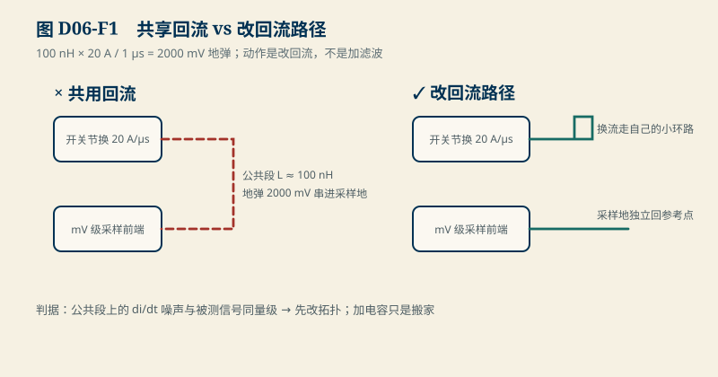
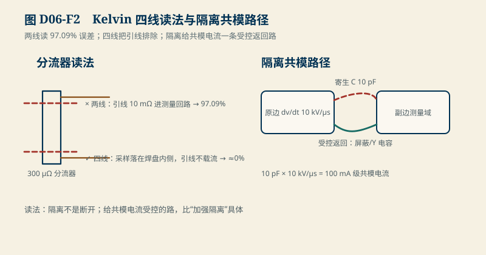

# D06　PCB、回流与 EMC：共享阻抗、Kelvin 接法与隔离的取舍

:::: story 现场
电流采样不准：额定点偏差 97%。排查发现不是放大器的问题——是布线的问题：分流器用两根 10 mΩ 的引线读数，而分流器本身只有 300 µΩ。引线电阻是分流器的 33 倍，97% 的误差里 3% 才是分流器的贡献。同一周，另一个项目的 MCU 反复复位，最后定位到开关节换环路的 100 nH 寄生电感：20 A / µs 的换流在公共地上砸出 2 V 的地弹。这一单元把这三个一阶账算清，并立一条纪律：模拟估算可以指导布局，永远不能冒充 EMC 测试。
::::

<aside class="reading-bet" aria-label="开读押注">
<p class="reading-bet__eyebrow">开读押注 · 2 V 地弹怎么办</p>
<p>开关节换回路 100 nH，20 A/µs 换流，地在 1 µs 里弹 2 V。第一动作是什么？</p>
<ol><li>加去耦电容吸收</li><li>缩短/对调回流路径，减小环路电感</li><li>换更低噪声的开关管</li></ol>
</aside>

:::: chapter-route 阅读路径
- **第一次主线**：D6.1–D6.3。地弹、Kelvin、容性注入三笔一阶账。
- **第二遍深挖**：D6.4。证据级别：布局规则的依据是什么、什么能代替 EMC 测试（不能）。
- **动手验证**：D6.5。改参数，重算三笔账并解释工程动作。
::::

**它不证明**：三个估算是一阶教学模型（电感/电阻/电容都是标量教学值）；差模/共模滤波器的器件选型、屏蔽与接地结构的完整 EMC 结论只能靠标准测试（如 GB/T 17626 系列）在合规实验室做出；本单元的价值是让你在画板之前知道哪里必须花钱，以及带着问题去预测试。

## D6.1 共享阻抗与地弹

共用一段回流导体，两个电流就互相看得见。开关回路 di/dt 在寄生电感上产生的电压：

$$
V_{bounce} = L_{loop}\frac{di}{dt}
$$

教学账：100 nH × 20 A / 1 µs = **2000 mV**

<figure>

<figcaption>图 D06-F1　共享回流 vs 改回流路径。100 nH × 20 A / 1 µs = 2000 mV；动作是改拓扑不是加滤波。</figcaption>
</figure>

。这笔账的读法：当地弹与被测信号（mV 级采样、V 级逻辑）同量级时，**先改回流路径**——缩短环路、让大电流回路不经过敏感地。加电容“吸收”是把噪声换到电源轨上继续传播；换开关管不改 di/dt 的物理。

## D6.2 Kelvin 接法：把引线排除在测量回路外

分流器读数的回路若包含引线电阻 $R_{lead}$，测量的是 $R_{shunt}+R_{lead}$。教学账：10 mΩ 引线 + 300 µΩ 分流器 → 误差 $10/10.3 = $ **97.09%**，额定点 100 A × 10 mΩ = **1000 mV** 的假信号。<figure>

<figcaption>图 D06-F2　Kelvin 四线读法与隔离共模路径。两线 97.09% 误差；隔离给共模电流一条受控返回路。</figcaption>
</figure>

四线（Kelvin）读法让电流走一对粗线、采样走一对不载流的细线——采样点直接落在分流器焊盘内侧，引线电阻不进测量回路。0.3 mΩ 级分流器的存在前提就是 Kelvin；两线读法下，分流器越准，误差反而越接近 100%。

## D6.3 隔离不是断开：共模电流的受控路径

隔离两侧的寄生电容 $C$ 在共模 dv/dt 下注入电流 $i = C\,dv/dt$。教学账：10 pF × 10 kV/µs = **100 mA** 级共模电流——它不会“被隔离挡住”，只会找一条阻抗最低的路走（测量线、复位线、外壳）。隔离设计的正确读法：**给共模电流一条受控的返回路**（屏蔽层 360° 搭接、RC 泄放、Y 电容的位置），比“加强隔离”这四个字具体得多。

## D6.4 证据级别：模拟、预测试与认证测试

| 手段 | 能证明什么 | 不能证明什么 |
|---|---|---|
| 一阶估算（本章） | 哪个环节可能超标、量纲与量级 | 任何“通过/不通过”结论 |
| 板级近场扫描/传导预测试 | 源头定位、整改方向、趋势对比 | 合规认证 |
| 标准 EMC 测试（合规实验室） | 限值符合性 | 产品功能正确性 |

纪律只有一条：**估算和预测试用来发现问题，认证测试用来关闭问题**。把“预测试没超标”写成“EMC 通过”，等于把 S1 的 RSS 当成绝对界——同一类错误，换了一个学科。

## D6.5 动手验证

```text
python code/engineering/measurement/d06_return_path.py
python code/engineering/measurement/d06_return_path.py --out <新目录>
python -m pytest code/engineering/measurement -q
```

迁移任务：

1. 把换流时间从 1 µs 改成 100 ns（更快的开关管）：地弹变几倍？这解释了为什么“更快”不等于“更好”。
2. 分流器改 1 mΩ、引线保持 10 mΩ：两线误差变多少？Kelvin 的收益是变大了还是变小了？
3. 若寄生电容只能压到 10 pF，把 dv/dt 目标定到多少才能让注入电流 ≤ 10 mA？这个 dv/dt 目标反过来约束了什么设计选择？

## D6.6 与 D05/D07 的接口

D05 的 10 kΩ 源阻抗来自前端 RC 滤波——滤波电阻与源阻抗的取舍就发生在 D06 的布局里；D07（MOS 与功率路径）的开关节换回路是地弹账的电流来源。EMC 合规结论与滤波器件选型待 SRC02/SRC03 与标准测试；本单元的三个教学值不代表任何板卡的实测。

## D6.7 本单元已冻结的数字

| 锚点 | 值 | 出处 |
|---|---|---|
| 地弹 | 100 nH × 20 A / 1 µs = 2000 mV | `d06_return_path.py` |
| Kelvin 两线误差 | 10 mΩ / (300 µΩ + 10 mΩ) = 97.09%；额定点 1000 mV | 同上 |
| 容性注入 | 10 pF × 10 kV/µs = 100 mA 级 | 同上 |

## D6.8 装配边界

- 先修 D05（采样链前端）与 B01/B02；本单元在 D07 之前交付。
- 图 D06-F1 为回流路径对照机制图；图 D06-F2 为 Kelvin 与隔离耦合示意。
- 一阶估算的假设（L、R、C 教学值）必须与真实板卡参数（SRC02/SRC03）分开登记；EMC 结论只认标准测试。
