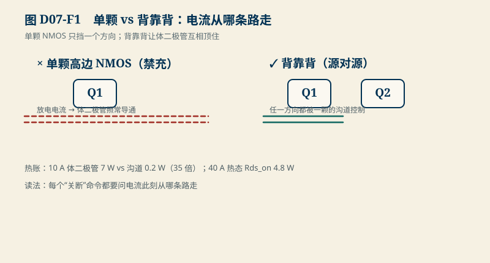
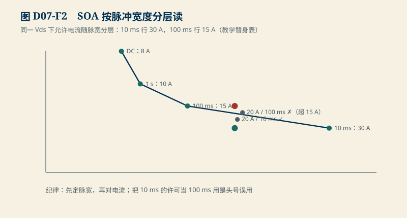

# D07　MOS 与功率路径：背靠背、SOA 与栅极驱动

:::: story 现场
设想一次“禁充”功能评审：工程师说，高边 NMOS 关断后充电进不来；评审员追问，反向放电是否仍可经过体二极管？单向阻断不能当成双向切断。再看一个分断算例：10 µH 电感在 20 A 下储能 2 mJ，教学单次雪崩额定取 5 mJ。两者相除得到 2.5，却不能据此判断重复分断寿命，更不能把 5 mJ 当成逐次扣减的总额度。本单元分开检查方向、热和能量。
::::

<aside class="reading-bet" aria-label="开读押注">
<p class="reading-bet__eyebrow">开读押注 · 10 A 走体二极管还是走沟道</p>
<p>同一颗 MOS：10 A 从体二极管过是 7 W，从导通沟道过是 0.2 W。热设计按哪个算？</p>
<ol><li>按 0.2 W，沟道是正常路径</li><li>按 7 W，体二极管随时可能接管</li><li>看控制逻辑到底关断了哪一侧</li></ol>
</aside>

:::: chapter-route 阅读路径
- **第一次主线**：D7.1–D7.3。背靠背拓扑、两笔热账、SOA 按脉冲宽度读。
- **第二遍深挖**：D7.4。分断能量 ½LI² 与驱动故障三种模式。
- **动手验证**：D7.5。改电流/电感/脉宽，重读 SOA。
::::

**它不证明**：Rds_on、体二极管压降、SOA 表与雪崩额定都是教学值；真实器件的 SOA、雪崩能力与温度降额依赖具体料号、脉宽、电流、起始结温、重复工况及散热边界，必须逐条读取器件资料（SRC03）。本章的 SOA 表是合成替身，只演示读表方法，不是任何选型或寿命结论。

## D7.1 背靠背：体二极管决定了单颗不够用

NMOS的体二极管从源极指向漏极；栅极关断只关闭沟道，不能阻止正向偏置的体二极管导电。因此单颗高边NMOS不能完成双向阻断。本例用两颗源极对源极的背靠背NMOS，使两个体二极管反向串接，再分别审查禁充与禁放状态。

<figure>

<figcaption>图 D07-F1　单颗 vs 背靠背。体二极管决定了单颗不够用；10 A 下两笔热账差 35 倍。</figcaption>
</figure>


这也让“断开”有了真实的价格：关断状态下若电流被迫从某颗的体二极管走，导通损耗按二极管压降算，不按 Rds_on 算。

## D7.2 两笔热账

- **体二极管导通**：$P = V_F \times I$，教学值 $V_F$ = 0.7 V。10 A → **7 W**。
- **沟道导通**：$P = I^2 R_{ds(on)}$，教学值 $R_{ds(on)}$ = 2 mΩ。10 A → **0.2 W**；**两者差 35 倍**。
- **温度系数**：Rds_on 从 25 °C 到 125 °C 约 ×1.5（教学值）。40 A 常温 3.2 W → 热态 **4.8 W**——热设计必须按最高工作温度算，不按 25 °C 数据手册首页算。

读法：同步整流（让沟道替代二极管导通）和快关断（别在二极管状态停留）是同一笔账的两面；BMS 的预充与主回路时序里，每个“关断”命令都要问一句：电流此刻从哪条路走？

## D7.3 SOA 按脉冲宽度读

安全操作区（SOA）是 $V_{ds}$–$I$ 平面上**按脉冲宽度分层的边界**。教学替身表（60 V 处）：

| 脉冲宽度 | 允许电流 |
|---|---|
| DC | 8 A |
| 1 s | 10 A |
| 100 ms | 15 A |
| 10 ms | 30 A |

<figure>

<figcaption>图 D07-F2　SOA 按脉冲宽度分层读。先定脉宽再对电流；20 A 在 10 ms ✓、100 ms ✗。</figcaption>
</figure>

三个读表练习：20 A @ 60 V **10 ms 内** ✓；同一工作点放到 **100 ms 外** ✗（超 15 A）；8 A 持续 ✓（恰在 DC 行）。读法纪律：先定脉冲宽度，再对电流；把 10 ms 的许可当成 100 ms 的许可，是 SOA 误用的头号模式。

## D7.4 分断能量与驱动故障

**分断感性负载**：回路电感储能 $E=\tfrac12LI^2$。教学账：10 µH、20 A → **2 mJ**；与教学单次额定 **5 mJ** 的算术比值为 **2.5×**。这只是储能与示例额定的比较，不证明单次工况已合格，也不提供重复次数或寿命保证。真实 MOS 的雪崩耗散应由 $\int V_{ds}(t)I(t)\,dt$ 核对；若电源在雪崩期间继续供能，不能只计初始电感储能。

读厂家资料时，至少分开核对下面五项，不能用“每次分断扣一份能量”代替：

| 核对项 | 必须保留的条件与边界 |
|---|---|
| 单次额定 | $E_{AS}$ 对应规定的测试电路、初始电流、起始结温与电感/脉宽；先确认其额定方法和脚注，不能把一个 mJ 数通用于所有工况。 |
| 重复脉冲热 | 按脉冲形状、重复频率/间隔、占空比和散热边界检查热响应，并计入导通、开关等其他损耗；脉冲之间未充分冷却时，下一次从更高结温起步。 |
| 起始结温 | 用事件发生前的结温，不以环境温度或首页的 25 °C 自动代替；按该料号的温度曲线与结温限制降额，单次曲线不是重复工作许可。 |
| 雪崩电流 | 核对单次 $I_{AS}$、厂家给出的重复雪崩电流/脉宽范围及电流波形；能量相同但电流、脉宽不同，温升和失效风险也可能不同。 |
| 重复可靠性 | 热核算满足限值不等于寿命已证。是否允许重复雪崩、参数漂移及可靠性条件须有该技术/料号的厂家依据；没有重复额定或资格证据时，不从单次 $E_{AS}$ 外推可用次数。 |

上述读法依据两份已读取正文的官方应用说明：Infineon [《Power MOSFET avalanche design guidelines》AN_2304_PL18_2305_004059，V1.1，2023-07-24，§3.2–3.3、§4.2.1–4.2.2、§5–6](https://www.infineon.com/assets/row/public/documents/24/42/infineon-power-mosfet-avalanche-design-guidelines-applicationnotes-en.pdf)区分单次与重复脉冲的电流、起始结温和热条件；[《Some key facts about avalanche》AN_201611_PL11_002，V1.0，2017-01-09，§4.1–4.4](https://www.infineon.com/assets/row/public/documents/24/42/infineon-applicationnote-some-key-facts-about-avalanche-applicationnotes-en.pdf)说明其讨论的 OptiMOS 工业/标准系列在重复雪崩下可能发生热载流子累积与参数漂移。两份说明覆盖的产品技术与额定方法不同，不能把其中一类器件的重复能力推广给全部 MOS。它们只补通用审查边界，**没有补齐本例具体料号的 SRC03**。

**驱动故障三种模式**（合成教学集）：

1. **栅极悬空**：驱动器未供电时 dv/dt 经 Miller 电容误导通，半桥直通。护栏：栅极下拉电阻 + 上电时序先驱动后功率。
2. **驱动电阻过大**：为压 EMI 盲目加大 Rg，开关变慢，损耗与 SOA 内时间同时变差。护栏：Rg 按损耗与振铃两笔账联合选。
3. **负压关断缺失**：桥臂串扰抬升 Vgs。护栏：按串扰幅值决定是否需要负压关断。

共同点：栅极不是逻辑输出，是模拟节点——它有自己的 RC、噪声域与上电时序。

## D7.5 动手验证

```text
python code/engineering/measurement/d07_mos_path.py
python code/engineering/measurement/d07_mos_path.py --out <新目录>
python -m pytest code/engineering/measurement -q
```

迁移任务：

1. 电流升到 60 A：体二极管与沟道的损耗差变多少倍？（先算再跑）
2. 把回路电感从 10 µH 降到 2 µH：雪崩能量变多少？这说明布局（D06）为什么是能量预算的一部分？
3. 若 SOA 表 100 ms 行允许 15 A，而你的工况是 18 A / 100 ms：列出三条可行出路（降 Vds、缩脉宽、加吸收），各给一阶依据。

## D7.6 与 D03/D08 的接口

D03 的电流/功率谱是本章的输入工况；D08 的动作次数与动作间隔用于描述重复应力，不能直接换成“剩余雪崩寿命”；规划中的 D23（预充与高压）将把功率路径放进系统通断时序。器件级结论仍待 SRC03：具体料号及修订、SOA 与温度曲线、单次/重复雪崩额定和可靠性条件闭合前，本章全部数值保持教学身份。

## D7.7 本单元已冻结的数字

| 锚点 | 值 | 出处 |
|---|---|---|
| 体二极管 vs 沟道 @10 A | 7 W vs 0.2 W（35 倍） | `d07_mos_path.py` |
| Rds_on 温度系数 | 25→125 °C ×1.5；40 A：3.2 → 4.8 W | 同上 |
| SOA 替身表 | DC 8 A / 1 s 10 A / 100 ms 15 A / 10 ms 30 A @60 V | 同上 |
| 分断能量 | ½ × 10 µH × 20² = 2 mJ（额定 5 mJ） | 同上 |
| 驱动故障 | 栅极悬空 / Rg 过大 / 负压缺失 三模式 | 同上 |

## D7.8 装配边界

- 先修 D03（功率路径需求）与 B01/B02；本单元在 D08 之前交付。
- 图 D07-F1 为各状态电流路径机制图；图 D07-F2 为 SOA 分层读图。
- 合成 SOA 表在 SRC03 闭合后必须替换为真实料号曲面并重新审查；替换动作本身要回写本节与预算表。
