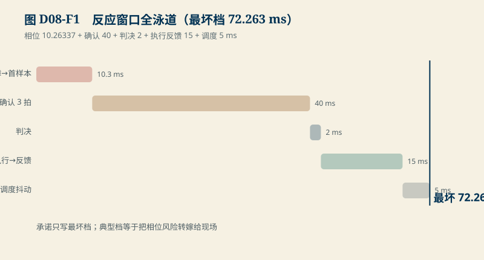
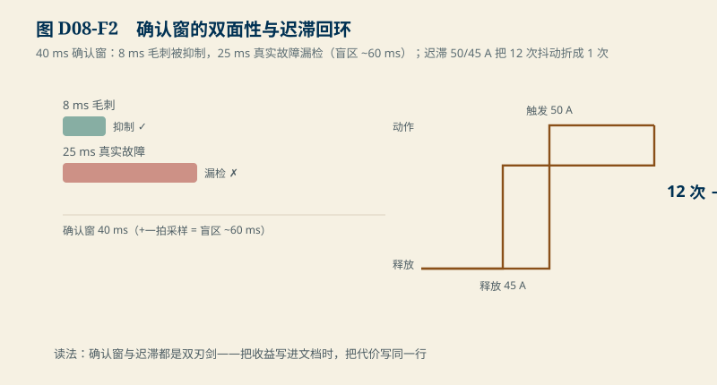

# D08　保护与时间预算：反应窗口、盲区、迟滞与反馈超时

:::: story 现场
保护算法的评审问了一个简单问题：从故障真正发生，到驱动真的落下、反馈真的回来，最坏多久？会议室里没人能给出一个数——每个人只对自己那一段负责：扫描的说 10 ms，滤波的说 40 ms，驱动的说 15 ms。把它们加起来就是答案吗？也不完全是：故障可能恰好落在一个扫描周期的任何相位上。这一单元把“加起来”的口径、以及三个常被单独讨论却彼此牵连的取舍（确认窗的双面性、迟滞、反馈超时）一次讲清。
::::

<aside class="reading-bet" aria-label="开读押注">
<p class="reading-bet__eyebrow">开读押注 · 确认窗越长越安全吗</p>
<p>连续 3 拍确认、每拍 20 ms：8 ms 的电源毛刺被抑制。把确认窗拉长到 5 拍，抗干扰更好——代价是什么？</p>
<ol><li>反应更慢</li><li>更短的故障也可能漏检</li><li>两者都是</li></ol>
</aside>

:::: chapter-route 阅读路径
- **第一次主线**：D8.1–D8.2。反应窗口的相位相加口径；确认窗的盲区另一面。
- **第二遍深挖**：D8.3。迟滞把一串抖动折成一次锁存；反馈超时本身是故障。
- **动手验证**：D8.4。改相位/窗长/阈值，重算窗口与盲区。
::::

**它不证明**：窗口数字继承 S1 冻结锚点（16 串扫描 10.26337 ms、确认 (N−1)Δt、判决 2 ms、执行到反馈 15 ms），新增调度抖动 5 ms 为教学值；真实实现的 WCET、调度策略与反馈来源证明力必须从固件测量与具体触点规格取得（OS07/SRC02/SRC03）。

## D8.1 反应窗口：相位相加口径

从物理故障到有效反馈的总时延（S1 口径 + 调度项）：

$$
T = \underbrace{T_{phase}}_{\text{故障到下一拍样本}} + \underbrace{(N-1)\Delta t}_{\text{确认}} + T_{decide} + T_{actuate\to feedback} + T_{sched}
$$

- $T_{phase} \in [0, T_{scan}]$：故障相对扫描的相位，最坏一整个扫描周期 **10.26337 ms**（S1 冻结）；
- 确认：N = 3、Δt = 20 ms → **40 ms**；
- 判决 2 ms、执行到反馈 15 ms（S1 冻结）；
- 调度抖动上界 5 ms（教学值）。

<figure>

<figcaption>图 D08-F1　反应窗口全泳道。相位 10.263 + 确认 40 + 判决 2 + 执行反馈 15 + 调度 5 ms；承诺只写最坏档。</figcaption>
</figure>

三档窗口：**最好 62.0 ms**（故障恰在采样前）、典型 67.0 ms、**最坏 72.263 ms**。承诺写哪个？只能写最坏档；写典型档等于把相位风险转嫁给现场。

## D8.2 确认窗的盲区另一面

`D08-reaction-window` 的对照：确认窗 40 ms，盲区（从故障落入到判定成立的最短存活时间）约 **60 ms**（覆盖 3 个采样点）。

- 8 ms 电源毛刺：**被抑制** ✓——确认窗的本职；
- 25 ms 真实过流：**同样漏检** ✗——盲区的代价。

同一个窗同时做这两件事

<figure>

<figcaption>图 D08-F2　确认窗的双面性与迟滞回环。8 ms 毛刺抑制、25 ms 真实故障漏检；迟滞把 12 次抖动折成 1 次。</figcaption>
</figure>

，无法只取其一带一。要抓 25 ms 的故障，只能缩短确认窗（N 减小或 Δt 减小），抗毛齿能力随之下降——这是设计取舍，不是调参失误。**评审时把确认窗当成纯收益，是这一类设计的标准错误。**

## D8.3 迟滞与反馈超时

**迟滞**：阈值 50 A 触发、45 A 才释放。合成演示（噪声 ±2 A、40 拍）里，无迟滞时阈值附近的噪声造成 **12 次**重复动作；加迟滞带后变成 **1 次**锁存。没有迟滞带的保护在边界噪声下会反复动作——每次都吃一次执行器寿命（D07 的雪崩次数预算）。

**反馈超时**：命令发出后，反馈必须在窗口内回来。教学口径：窗口 20 ms；12 ms 回来 ✓、25 ms 回来 ✗、永远没有 ✗——**超时按故障锁存，因为“命令”只证明你请求了动作，不证明动作发生了**（OS07 精髓：反馈来源决定它能证明什么；SPS 电流、辅助触点、主回路电流各证明不同对象，超时意味着连约定的证明都没到）。

## D8.4 动手验证

```text
python code/engineering/measurement/d08_protection_timing.py
python code/engineering/measurement/d08_protection_timing.py --out <新目录>
python -m pytest code/engineering/measurement -q
```

迁移任务：

1. 把扫描周期从 10.26337 ms 改成 5 ms（加倍预算换更快扫描）：最坏窗口降多少？谁买单（AFE 建立时间，回 D05）？
2. 设计一个对称确认窗（N=2 但要求故障在确认期内持续单调恶化）：用 D8.2 的盲区账论证它是否比固定 N=3 更优。
3. 若反馈窗口收紧到 10 ms：12 ms 的正常反馈变成故障——列出三条出路（更快的触点、SPS 电流前置、窗口分级），并说明各自改动了什么证明力。

## D8.5 与 S1/D20 的接口

S1 的 77/117/157 ms 教学窗口是本节的一个子集（其物理链起止冻结于 `S1-physical-chain` 后重算）；D20（实时固件）给调度抖动 5 ms 一个实测来源；B04 的清旗/复位/重新许可三分在这里的锁存语义上落地。真实 WCET 与触点时间上界闭合于 SRC03/SRC02 前，窗口数字保持教学身份。

## D8.6 本单元已冻结的数字

| 锚点 | 值 | 出处 |
|---|---|---|
| 反应窗口 | 62.0 / 67.0 / **72.263 ms**（最坏可承诺档） | `d08_protection_timing.py` |
| 确认窗与盲区 | 40 ms / ~60 ms | 同上 |
| 毛刺 vs 真实故障 | 8 ms 抑制；25 ms 漏检 | 同上 |
| 迟滞 | 无：12 次动作；50/45 A 带：1 次 | 同上 |
| 反馈窗口 | 20 ms；12 ✓ / 25 ✗ / 无 ✗ | 同上 |

## D8.7 装配边界

- 先修 D05/D07 与 B04；本单元在 D09 之前交付。
- 图 D08-F1 为反应窗口全泳道时序；图 D08-F2 为确认窗双面性与迟滞回环。
- `S1-physical-chain` 冻结起止时刻后，本节最坏窗口须按同一口径重算并回写。
