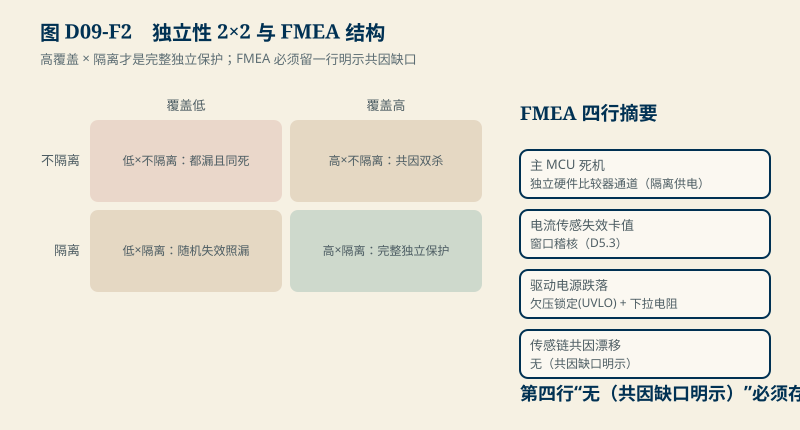
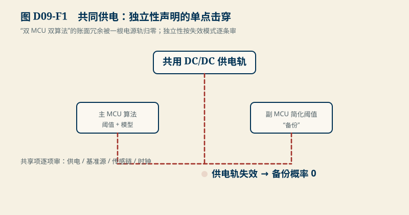

# D09　独立保护与失效：共因失效、潜伏故障与 FMEA 小案例

:::: story 现场
安全评审通过了一项“双保护”设计：主 MCU 跑算法，副 MCU 跑简化阈值，互为备份。评审员只问了一个问题：两路 MCU 的供电是哪来的？——是同一路 DC/DC。供电轨一失效，两颗芯片一起死，备份概率瞬间归零。“双保护”的账面冗余，被一根电源轨单点击穿。这一单元把独立性该怎么审、潜伏故障的账怎么算、FMEA 该怎么写一次讲清。
::::

<aside class="reading-bet" aria-label="开读押注">
<p class="reading-bet__eyebrow">开读押注 · 双 MCU 等于独立保护吗</p>
<p>主副两颗 MCU、两套算法。下列哪项失效能同时杀掉两路？</p>
<ol><li>主 MCU 软件跑飞</li><li>供电轨欠压</li><li>某一颗 MCU 的时钟失效</li></ol>
</aside>

:::: chapter-route 阅读路径
- **第一次主线**：D9.1–D9.2。潜伏故障的 λ×T/2 账；独立性的 2×2 矩阵。
- **第二遍深挖**：D9.3。共同供电双杀反例与 FMEA 小案例（含明示的共因缺口）。
- **动手验证**：D9.4。审一份“双保护”声明，找出全部共享项。
::::

**它不证明**：失效率与诊断间隔是教学值；真实 FMEDA 用现场失效数据与标准方法（如 IEC 61508 的失效率拆分）；FMEA 小案例的结构可迁移，数值不可迁移。

## D9.1 潜伏故障：诊断间隔就是暴露窗口

一个失效的保护通道如果没人发现，它的失效就是潜伏的。一阶近似下潜伏暴露 ∝ 失效率 × 诊断间隔的一半（故障在间隔内均匀到达）：

$$
E_{latent} \approx \lambda \times \frac{T_{diag}}{2}
$$

教学账：λ = 10⁻⁶/h、诊断间隔 1 h → **5×10⁻⁷**；同一失效率若 100 h 才体检一次 → **1×10⁻⁴**。诊断间隔从 100 h 压到 1 h，潜伏暴露降 **200 倍**——这条曲线解释了为什么安全标准盯的是诊断间隔与诊断覆盖率，而不是“用了几颗芯片”。

## D9.2 独立性 2×2：覆盖 × 共因隔离

“独立保护”买到什么，由两个维度决定，缺一不可：

| 诊断覆盖 ↓ / 共因隔离 → | 不隔离 | 隔离 |
|---|---|---|
| 低 | 几乎没有：双通道都漏诊且一起死 | 只防共因——随机失效照漏 |
| 高 | 只防随机失效——**共因失效双杀** | 随机与共因都覆盖：这才是“独立保护”的完整含义 |

<figure>

<figcaption>图 D09-F2　独立性 2×2 与 FMEA 结构。高覆盖 × 隔离才是完整独立保护；FMEA 必须留一行明示缺口。</figcaption>
</figure>

评审口诀：先问“哪种失效模式能同时杀掉两路”，再问“每路对每种模式的诊断覆盖率”。两个答案都齐，独立性声明才成立。

## D9.3 共同供电双杀与 FMEA 小案例

<figure>

<figcaption>图 D09-F1　共同供电：独立性声明的单点击穿。供电 / 基准源 / 传感链 / 时钟逐项审。</figcaption>
</figure>

共同供电反例（合成教学集）：声明“双 MCU 双算法互为备份”，共享项 = {供电、基准源、传感链、时钟}；供电轨失效 → 两路同时离线，**备份概率为 0**。修法：独立供电 + 独立基准；传感链若实在共用，把覆盖缺口写进残余风险，不许藏。

FMEA 小案例（四行，教学值）：

| 失效模式 | 后果 | 现有控制 | 诊断间隔 | 动作 |
|---|---|---|---|---|
| 主 MCU 死机 | 保护全停 | 独立硬件比较器通道（隔离供电） | 0（连续） | 看门狗复位 + 硬件通道直断 |
| 电流传感失效卡值 | 过流不动作 | 窗口稽核（D5.3） | 1 h | 稽核失败锁存并降级 |
| 驱动电源跌落 | 栅极悬空误导通 | UVLO + 下拉电阻 | 0 | UVLO 期间禁止功率级 |
| 传感链共因漂移 | 双通道同向错 | **无（共因缺口明示）** | 24 h | 换独立基准；闭合前写入残余风险 |

注意第四行：FMEA 里出现“控制 = 无”不是丢脸，是把残余风险摆上台面。**全绿的 FMEA 才是危险品**——它意味着有缺口被藏起来了。

## D9.4 动手验证

```text
python code/engineering/measurement/d09_independence.py
python code/engineering/measurement/d09_independence.py --out <新目录>
python -m pytest code/engineering/measurement -q
```

迁移任务：

1. 把诊断间隔从 1 h 改成 10 min：潜伏暴露变多少？若稽核动作要占 3% 的 CPU，这笔交易做不做？
2. 审一份真实的“双保护”宣传页：列出全部共享项，判断它落在 2×2 的哪一格。
3. 给第四行“传感链共因漂移”设计一个可执行的诊断手段，并重写它的诊断间隔与残余风险声明。

## D9.5 与 D08/D25 的接口

D08 的反馈超时与锁存在这里给出“为什么要这么严”的概率账；D25（安全论证与 V&V）把 FMEA 结构接进完整的安全案例（hazard → 需求 → 验证）。失效率数值待真实数据源；结构与方法不受教学值影响。

## D9.6 本单元已冻结的数字

| 锚点 | 值 | 出处 |
|---|---|---|
| 潜伏暴露（诊断 1 h） | 5×10⁻⁷/h（λ=10⁻⁶/h） | `d09_independence.py` |
| 潜伏暴露（100 h 体检） | 1×10⁻⁴/h；200 倍差距 | 同上 |
| 2×2 矩阵 | 高覆盖+隔离 = 完整独立保护 | 同上 |
| FMEA 四行 | 含一行明示共因缺口 | 同上 |

## D9.7 装配边界

- 先修 D08（时间预算与锁存语义）；本单元在 D25 之前交付。
- 图 D09-F1 为故障树与隔离边界；图 D09-F2 为 2×2 矩阵与 FMEA 结构。
- 失效率、诊断覆盖率的真实数值闭合于现场数据与标准方法；FMEA 表格式可复制，数值必须重取。
