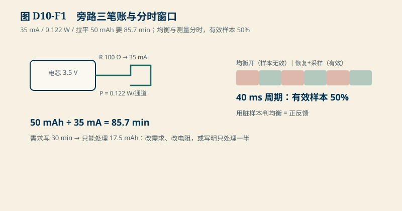
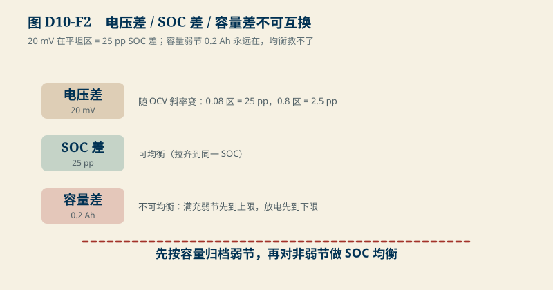

# D10　均衡与测量协调：旁路三笔账与“三种差”不可互换

:::: story 现场
均衡策略评审，硬件给的方案是 100 Ω 旁路电阻。评审问三个问题：均衡电流多少？——“算过，35 mA”。热多少？——“每个 0.12 W，不大”。一个 50 mAh 的 SOC 差多久能拉平？——会议室安静了：35 mA 要 85.7 分钟，而需求文档里写的是“停车均衡 30 min”。更麻烦的是第三个问题：压差最大的那节，到底是 SOC 高、还是容量低？电压表回答不了——而在 LFP 平坦区，20 mV 压差可以是 25 pp 的 SOC 差，也可以什么都不是。这一单元把旁路的三笔账和三种“差”的区分一次算清。
::::

<aside class="reading-bet" aria-label="开读押注">
<p class="reading-bet__eyebrow">开读押注 · 压差最大的节该先均衡吗</p>
<p>16 串里第 7 串电压最高（高 20 mV）。直接按“压差最大优先”均衡，可能错在哪？</p>
<ol><li>不会错，压差就是 SOC 差</li><li>平坦区压差不代表 SOC 差</li><li>它可能是容量弱的节，均衡救不了</li></ol>
</aside>

:::: chapter-route 阅读路径
- **第一次主线**：D10.1–D10.2。旁路电流/热/时间三笔账；均衡与测量分时。
- **第二遍深挖**：D10.3。电压差、SOC 差、容量差是三笔账。
- **动手验证**：D10.4。改电阻/容量/窗口，重算三笔账。
::::

**它不证明**：旁路电阻、电压点、恢复窗口是教学值；真实旁路电流受 AFE 引脚能力与热设计约束，均衡启停策略与有效样本语义从具体料号取得（SRC02/SRC04）；主动均衡（能量搬移）的拓扑取舍本章只给判据不给设计。

## D10.1 旁路三笔账

100 Ω 旁路、均衡点 3.5 V（教学值）：

| 账 | 算式 | 值 |
|---|---|---|
| 电流 | V / R = 3.5 / 100 | **35 mA** |
| 热 | V² / R = 3.5² / 100 | **0.122 W/通道** |
| 拉平 50 mAh | ΔAh / I = 0.05 / 0.035 | **85.7 min** |

<figure>

<figcaption>图 D10-F1　旁路三笔账与分时窗口。35 mA / 0.122 W / 85.7 min；有效样本 50%，用脏样本判均衡是正反馈。</figcaption>
</figure>


第三笔账是设计对账：需求写“30 min 均衡窗口”，35 mA 就只能处理 17.5 mAh 的差——要么需求改、要么电阻改、要么接受“30 min 只处理一半”。三笔账都必须在方案评审的同一页上出现；只报电流不报时间，等于只报预算不报工期。

## D10.2 均衡与测量分时：宁可慢不可脏

旁路开启时，旁路电流叠在测量链上——采样读数带着均衡电流的扰动。纪律是分时：均衡开启 → 等待恢复窗口 → 采样判据（E05 家族：有效样本标记）。教学窗口：恢复 20 ms + 有效采样 20 ms = 40 ms 周期，**有效样本占比 50%**。规则：均衡开启窗口内的样本标记无效，只用恢复后的样本做判据。用脏样本做均衡判据，等于用被均衡动作本身污染的读数决定均衡何时停——正反馈。

## D10.3 三种差不可互换

- **电压差 ≠ SOC 差**：随 OCV 斜率变。LFP 平坦区（0.08 V/SOC）里 20 mV = **25 pp** SOC 差；同 20 mV 放到 0.8 斜率区只有 2.5 pp。跨区间拿压差当 SOC 差，是把不同尺子上的读数相加。
<figure>

<figcaption>图 D10-F2　三种差不可互换。先按容量归档弱节，再对非弱节做 SOC 均衡。</figcaption>
</figure>

- **SOC 差 ≠ 容量差**：均衡只把电压/SOC 拉齐。容量弱节（1.8 Ah vs 2.0 Ah）的 0.2 Ah 差**永远在**——满充时弱节先到电压上限，放电时先到下限。它的表现恰恰是“压差/SOC 差反复出现”，越均衡越暴露。
- 判据结构：先按容量归档（哪节是弱项，走 D03 的一致性要求），再对非弱项做 SOC 均衡；把弱项塞进均衡循环，是把不可逆问题塞进一个只解决可逆问题的机构。

## D10.4 动手验证

```text
python code/engineering/measurement/d10_balance.py
python code/engineering/measurement/d10_balance.py --out <新目录>
python -m pytest code/engineering/measurement -q
```

迁移任务：

1. 电阻从 100 Ω 降到 47 Ω：三笔账各变多少？30 min 窗口现在能处理多少 mAh？
2. 若 AFE 规定均衡期间必须关断采样（恢复窗口 0），有效样本占比变多少？这改变了 D8 的哪个预算输入？
3. 设计弱节识别流程：只用巡检电压与充放历史，区分“SOC 高的节”和“容量弱的节”，给出你的判据与误判代价。

## D10.5 与 D03/D18 的接口

D03 的一致性要求与负载谱决定均衡窗口与电流预算；D18（充电控制）决定均衡能否借充电窗口完成（CC 段末尾电压最高，旁路效率最高）。主动均衡拓扑与双向 DC/DC 取舍待后续批次；本章的被动旁路是后续对比的基线。

## D10.6 本单元已冻结的数字

| 锚点 | 值 | 出处 |
|---|---|---|
| 旁路电流 / 热 | 35 mA / 0.122 W（3.5 V，100 Ω） | `d10_balance.py` |
| 拉平 50 mAh | 85.7 min | 同上 |
| 平坦区压差换算 | 20 mV ÷ 0.08 V/SOC = 25 pp | 同上 |
| 有效样本占比 | 50%（20 ms 恢复 + 20 ms 采样） | 同上 |

## D10.7 装配边界

- 先修 D02/D05/D07；本单元在 D18 之前交付。
- 图 D10-F1 为旁路分流与热路径机制图；图 D10-F2 为三种差的对照与弱节判据流程。
- 旁路电阻的功率与温升、均衡引脚能力、恢复窗口的真实语义闭合于 SRC02/SRC04；教学值不用于选型。
