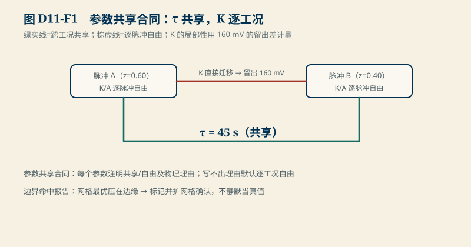
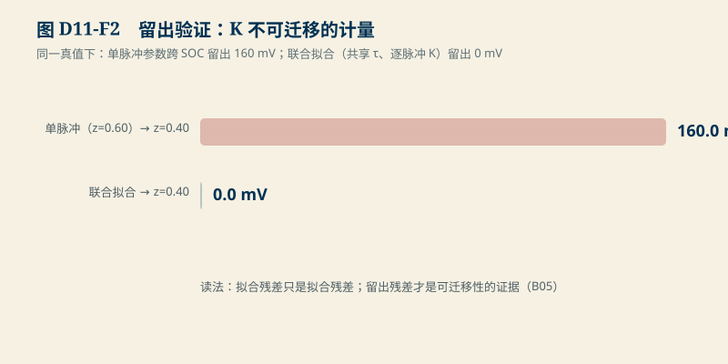

# D11　HPPC 与参数辨识：联合拟合、留出验证与参数共享合同

:::: story 现场
同一颗电芯的两条 HPPC 脉冲（z=0.60 与 z=0.40）分别拟合，两条曲线都拟合得极好。把 z=0.60 拟合出的参数拿到 z=0.40 验证——残差 160 mV，比噪声大三个量级。问题不在拟合质量：单脉冲拟合出的 K 是这个脉冲的局部渐近电压（局部 OCV），跨 SOC 根本不该迁移。把两条脉冲的 τ 锁在一起联合拟合

<figure>

<figcaption>图 D11-F1　参数共享合同。τ 共享、K 逐工况自由；K 直接迁移 → 留出 160 mV。</figcaption>
</figure>

、K 逐脉冲放开，留出残差归零。这一单元把“哪些参数可共享、哪些不可”写成辨识合同。
::::

<aside class="reading-bet" aria-label="开读押注">
<p class="reading-bet__eyebrow">开读押注 · 两条脉冲拟合得很好，参数能共用吗</p>
<p>两条脉冲各自拟合 RMS 都极低。z=0.60 的参数直接用于 z=0.40 工况预测，会怎样？</p>
<ol><li>没问题，RMS 低说明参数准</li><li>K 会带 160 mV 的 OCV 差</li><li>τ 和 K 都不能共用</li></ol>
</aside>

:::: chapter-route 阅读路径
- **第一次主线**：D11.1–D11.2。多脉冲激励与联合拟合；参数共享合同（τ 共享、K 逐脉冲）。
- **第二遍深挖**：D11.3。留出验证与边界命中报告。
- **动手验证**：D11.4。改脉冲数/窗口/网格，重写共享合同。
::::

**它不证明**：真值沿用 S2 主场景（Q 2 Ah、R0 20 mΩ、R1 15 mΩ∥3000 F、τ 45 s、OCV 斜率 0.8）；联合拟合在这里是无噪合成上的方法演示；真实 HPPC 的多脉冲激励设计、初值处理与优化停止条件按 OS02 的 `simulator → cost → problem → optimiser` 结构走，带噪示例与多种子敏感性按 S2 的合同报告。

## D11.1 单脉冲拟合的隐藏假设

S2 的拟合合同是“一段撤流尾段 → K + A·e^(−t/τ)”。它隐含两个假设：K 是这段数据的真实渐近值；τ 在这段窗口内可辨识。无噪合成上这两个假设都成立——所以单脉冲拟合的 τ 精确命中 45 s、K = 3.6778 V（z=0.60 处的 OCV：3.6 + 0.8×0.1）。但 K 的身份是“该脉冲 SOC 点的局部 OCV”，它随 SOC 变化（斜率 0.8 V/SOC）。把 K 当常数跨工况用，等于把尺子上的一个刻度当成整个量程。

## D11.2 联合拟合与参数共享合同

`D11-joint-hppc` 的做法：两个脉冲共享一个 τ（物理时间常数不随 SOC 变），K/A 逐脉冲自由（局部渐近值与激励幅度随工况变）。网格搜索共享 τ、每脉冲内层解 K/A 的正规方程：

| 方案 | τ | z=0.40 留出 RMSE |
|---|---|---|
| 单脉冲（z=0.60 短窗） | 45.0 s ✓ | **160.0 mV** |
| 联合拟合（共享 τ、逐脉冲 K/A） | 45.0 s ✓ | **0.0 mV** |

160 mV 恰是两脉冲的 OCV 差（0.8 V/SOC × 0.20 SOC = 0.16 V）——不是误差，是 K 不可迁移的直接计量。**参数共享合同**的写法因此是固定的：每个参数一行，注明“共享/逐工况自由”及物理理由。τ、R0、Q 通常是共享量；K（渐近 OCV）、A（与脉冲幅度成比例）是逐工况量。写不出共享理由的参数，默认逐工况自由。

## D11.3 留出验证与边界命中

<figure>

<figcaption>图 D11-F2　留出验证。单脉冲参数跨 SOC 留出 160 mV；联合拟合留出 0 mV。</figcaption>
</figure>


- **留出**：联合拟合的参数在**未参与拟合的工况**上验证（这里是跨 SOC 点；真实场景跨温度/倍率/电芯）。留出残差才是参数的可迁移性证据；拟合残差只是拟合残差（B05 的合同在此生效）。
- **边界命中**：网格搜索若把最优点压在网格边缘，报告必须标记（`boundary_hit`）。含义不是“错了”，是“真实最优可能在网格外”——扩网格再确认。单点求值不算搜索，不标。参数命中边界仍被静默当最优真值报告，是 S2 合同明令禁止的。

## D11.4 动手验证

```text
python code/engineering/identification/d11_joint_hppc.py
python code/engineering/identification/d11_joint_hppc.py --out <新目录>
python -m pytest code/engineering/identification -q
```

迁移任务：

1. 增加第三个脉冲（z=0.20）：共享 τ 的合同还成立吗？K 的自由度变几？
2. 把真值换成 D02 的 2RC：共享合同要改哪些行？（提示：τ₁/τ₂ 共享，A₁/A₂ 逐工况？）
3. 设计激励审计：给“这条数据能不能辨识 R1”一个可执行判据（提示：激励幅度 × 窗口曲率，回 S2.6 的短窗算例）。

## D11.5 与 S2/D13 的接口

S2 的单脉冲合同是本章的基线；D13（EKF）把这里的参数当成已知量，把状态估计接上；真实数据接入时按 OS02 结构把网格搜索换成联合优化，并保留 S2 的多种子敏感性合同。E02 家族的本实例登记为 E02c。

## D11.6 本单元已冻结的数字

| 锚点 | 值 | 出处 |
|---|---|---|
| 联合拟合 | τ = 45.0 s，R1 = 15 mΩ（误差 0） | `d11_joint_hppc.py` |
| K 不可迁移 | 留出 RMSE 160.0 mV = ΔOCV 0.16 V | 同上 |
| 联合拟合留出 | 0.0 mV | 同上 |
| 边界命中 | 搜索最优在网格边缘 → 标记扩网格；单点求值不标 | 同上 |

## D11.7 装配边界

- 先修 D02（模型阶数与欠模型指纹）与 B03/B05（最小二乘与留出纪律）；S2 样章可并行。
- 图 D11-F1 为多脉冲激励与参数共享合同示意；图 D11-F2 为留出验证对照。
- 带噪辨识的区间报告与多种子敏感性沿用 S2 合同；本章无噪演示只证明共享合同的结构。
