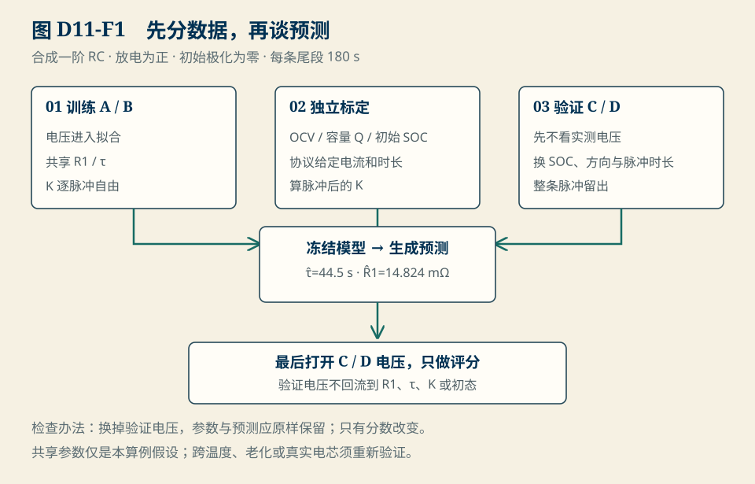
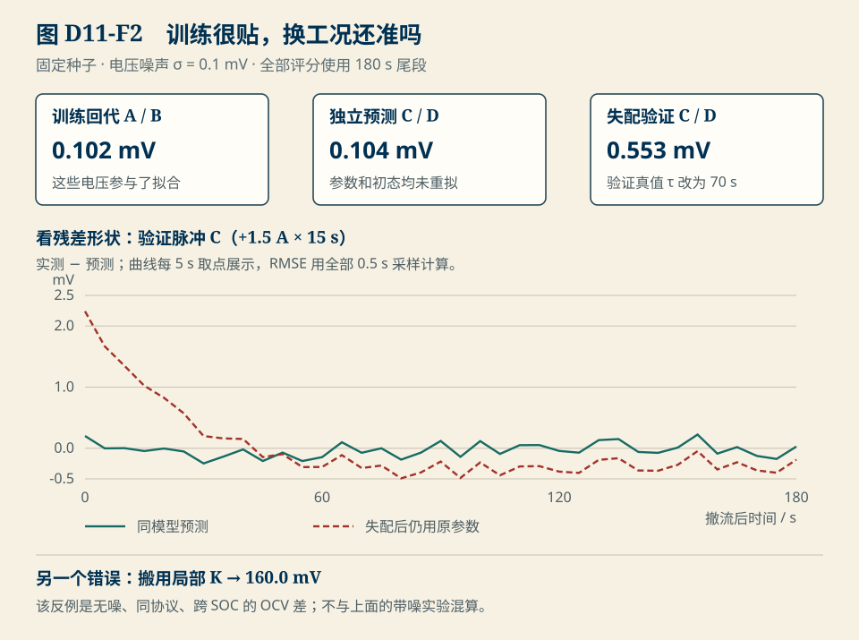

# D11　HPPC 与参数辨识：0 mV 为什么也可能骗过你

:::: story 现场
报告摆着两个醒目的数字：单脉冲跨 SOC 预测误差 160 mV，联合拟合“留出误差”0 mV。看起来胜负已分。

验收者只问了一句：“这条留出的曲线，拟合时见过吗？”往回查，z=0.40 的电压早已参与联合拟合，连它的渐近值 K 也是从这条曲线求的。0 mV 是把答案代回原题的成绩。

我们从这里重做实验：先封存两条完整脉冲，只用另外两条训练。参数冻结后才打开封存数据。这一次，报告必须经得住“换一条没见过的曲线”的检验。
::::

<aside class="reading-bet" aria-label="开读押注">
<p class="reading-bet__eyebrow">开读押注 · 验证前，谁碰过答案</p>
<p>R1 和 τ 已冻结，但预测前又用验证尾段估了一次 K。这还能算整条尾段的独立预测吗？</p>
<ol><li>能，主要参数没有变</li><li>不能，验证电压参与了预测形成</li><li>只要最后误差足够小就能</li></ol>
</aside>

:::: chapter-route 阅读路径
- **第一次主线**：D11.1–D11.2。分清训练、独立标定与验证，再写出共享参数的条件。
- **第二遍深挖**：D11.3。对照训练回代、独立预测和模型失配，检查求解边界。
- **动手验证**：D11.4。换掉验证电压，确认参数与预测没有跟着变。
::::

**实验身份**：本章是 S2 一阶 RC 模型的合成教学扩展，电流以放电为正，脉冲前极化为零。生成参数 R1=15 mΩ、C1=3000 F、τ=45 s；OCV 映射 U(z)=3.6+0.8(z−0.5) V、容量 Q=2 Ah 和初始 SOC 由独立标定输入给定。在这个算例中标定恰好准确；真实试验还须计入它们的误差。撤流尾段的电流为零，不能据此声称辨识了 R0 或容量。OS02 的真实数据流程是后续入口，不是本章已经复现的结果。

## D11.1 先把三类数据分开

训练电压可以进入拟合；独立标定提供 OCV、容量和初始 SOC；验证电压最后才用于评分。**“独立”指没有参与形成被评价的预测，不是另存了一个文件。** 同一条尾段随机分出几行，仍可能共享噪声、初态和处理过程；本例按完整脉冲分组。

<figure>

<figcaption>图 D11-F1　三条数据路径。图中的 τ̂=44.5 s、R̂1=14.824 mΩ 来自固定带噪训练集。验证电压不用于重估 K、幅值或初态。</figcaption>
</figure>

下面四条协议在运行前固定。每条撤流后观察 180 s，采样间隔 0.5 s；带噪实验的电压噪声为独立高斯噪声，σ=0.1 mV。

| 角色 / ID | 初始 SOC | 电流 | 脉冲时长 | 噪声种子 |
|---|---:|---:|---:|---:|
| 训练 A | 0.60 | +2 A | 10 s | 11 |
| 训练 B | 0.40 | −1.5 A | 20 s | 17 |
| 验证 C | 0.50 | +1.5 A | 15 s | 23 |
| 验证 D | 0.70 | −1 A | 25 s | 29 |

先看一个很容易漏掉的小数。A 脉冲放走 2×10/3600 Ah，脉冲后 SOC 是 0.597222，所以尾段渐近值 K=3.677778 V。**3.68 V 是脉冲前的 OCV**，不能直接充当脉冲后的 K。

## D11.2 联合拟合：什么共享，为什么

撤流后时间记作 t。在零初始极化、恒流脉冲和局部参数不变的假设下：

$$
V_j(t)=K_j-I_jR_1(1-e^{-t_{p,j}/\tau})e^{-t/\tau}.
$$

本例联合训练 A、B，共享 R1 与 τ，每条训练脉冲有自己的 K。不同电流和时长已经写进幅值公式，**A 不再是随意放开的另一个参数**。固定 τ 后，对各脉冲的电压和指数项分别去均值，合并求一个 R1，再回算各 K；网格外层寻找训练平方误差最小的 τ。

| 量 | 本章怎么处理 | 条件与边界 |
|---|---|---|
| R1、τ | A/B 共享，预测 C/D 时冻结 | 同一合成模型的假设；真实电芯可能随 SOC、温度、老化改变 |
| 训练 K | 逐脉冲拟合 | 是脉冲后局部 OCV，不能原样跨 SOC 搬用 |
| 验证 K | 独立 OCV/Q/初态标定计算 | 不用验证尾段重新拟合 |
| 幅值 A | 由电流、时长、R1、τ计算 | 初始极化不为零时必须加状态项 |
| R0、Q | 本尾段不辨识 | R0 要看电流边沿；Q 要有独立容量依据 |

若从单脉冲的 K+A·exp(−t/τ) 换算参数，必须使用**当前拟合得到的 τ̂**：

$$
\widehat R_1=\frac{-\widehat A}{I(1-e^{-t_p/\widehat\tau})},\qquad
\widehat C_1=\frac{\widehat\tau}{\widehat R_1}.
$$

把仿真真值 45 s 填进修正系数，会让算法偷看答案。测试特意改用 τ=62 s、R1=23 mΩ，再用错误的 30 s 网格检查换算：结果可以偏，但不能暗中换回真值修正。

旧报告里的 160 mV 仍有教学价值。取两条**相同 2 A×10 s 协议、无噪**的脉冲，只把初始 SOC 从 0.60 换成 0.40，原样搬用 K 会留下 0.8×0.20=0.16 V 的偏差。这是“局部 K 搬错地方”的独立反例，不是上面 A/B/C/D 带噪场景里单脉冲与联合拟合的比赛。

## D11.3 冻结后打开验证数据

现在只给预测器训练得到的 R1、τ，独立标定以及 C/D 的协议。它先生成完整尾段；评分器随后读入验证电压，计算 RMSE。

| 读到哪些电压 | 训练 RMSE | C/D 独立预测 RMSE | 能说明什么 |
|---|---:|---:|---|
| 无噪自检：A/B 拟合，C/D 验证 | <0.000001 mV | <0.000001 mV | 同模型公式与实现一致 |
| 带噪：A/B 拟合，C/D 验证 | 0.101542 mV | 0.104042 mV | 固定合成协议下的独立预测表现 |
| 只将验证真实 τ 改为 70 s | 0.101542 mV | 0.552790 mV | 训练仍贴合，冻结模型已不适配 |
| SciPy 同目标核对 | 0.101477 mV | 0.102369 mV | 连续求解与网格基线相近，不证明参数唯一 |

<figure>

<figcaption>图 D11-F2　上方三张卡按数据角色分别评分；下方是验证 C 的带符号残差。两组验证使用相同噪声种子，失配组只改变生成模型的 τ，训练参数不重拟合。图中数值由实验报告生成。文件名保留旧入口，实验已改为整脉冲留出，不是逐折重拟的 leave-one-out。</figcaption>
</figure>

这次最值得注意的不是最后一列有多小，而是第三行：**训练成绩一个字没变，验证已经变差。** 它告诉我们共享参数有适用条件。这里人为改变 τ 只为演示失配，不代表真实电芯某种老化过程；单次固定种子也不能给出概率保证。

网格搜索区间为 1–120 s、步长 0.5 s，R1 限在 1–100 mΩ。最优点压到任一边界时必须报告 `boundary_hit`，检查激励、范围和模型；τ 单点求值不算搜索，不据此标网格边界。空数据、时间错序、重复 ID、零激励或非物理阻值被拒绝。`--scipy` 直接调用 `scipy.optimize.least_squares`，使用同一训练集、同一平方误差和边界；连续解 τ≈44.732726 s 与网格 44.5 s 不必逐位相等。求解器的 `success` 仅表示满足停止条件。

若根据 C/D 的评分反复选模型，C/D 就变成开发验证集；最终评估要再留一组未参与选择的数据。也不能在预测前用 C/D 电压调初始 SOC，却仍声称全程盲预测。

## D11.4 动手验证

在仓库根目录运行：

```text
python code/engineering/identification/d11_joint_hppc.py --out .tmp-d11
python code/engineering/identification/d11_joint_hppc.py --scipy --out .tmp-d11-scipy
python -m pytest code/engineering/identification/test_d11_joint_hppc.py code/engineering/identification/test_d11d12_figures.py -q
```

默认脚本仅用标准库。可选核对先安装 `bms-book/requirements.txt`；报告 `schema_version=2`，分别读取 `noiseless`、`noisy`、`mismatch`，旧的 `leave_one_out_rmse_mv` 字段已移除。

1. 把验证电压整体加 50 mV，再评分。预先保存的 R1、τ 和预测曲线必须完全不变，只有误差变化。测试 `test_validation_voltage_changes_scores_not_fit_or_prediction` 可直接运行。
2. 把验证 ID 改成训练 A。预测器应在评分前拒绝；不能只靠作者记得哪些数据用过。
3. 把生成 τ 改成 62 s，确认幅值修正使用拟合 τ；再限制网格到 30 s，观察参数偏差和边界标志一起出现。
4. 给独立 OCV 标定加 10 mV，预测整条尾段应平移 10 mV。用这一步解释为什么独立预测仍依赖标定质量。

<details>
<summary>回看开读押注</summary>
答案是 2。验证尾段参与估 K 后，预测已使用这段电压。若确实要用一段数据初始化，就提前划定初始化窗口，只评价后续未参与初始化的部分，并明确这种任务的边界。
</details>

## D11.5 与 S2/D13 的接口及来源

S2 继续负责单脉冲、窗口与多种子敏感性；本章负责数据角色与跨协议预测；D13 把已经验证适用域的参数交给 EKF。E02 家族的本实例仍登记为 E02c，报告版本与含义已迁移。

- PyBOP 的多脉冲辨识与验证笔记，固定提交 `5b615fdac40a91761d224db7f48b887845a32d15`（BSD-3-Clause）。已阅读 [多脉冲辨识](https://github.com/pybop-team/PyBOP/blob/5b615fdac40a91761d224db7f48b887845a32d15/examples/notebooks/battery_parameterisation/ecm_multipulse_identification.ipynb)和[独立数据验证](https://github.com/pybop-team/PyBOP/blob/5b615fdac40a91761d224db7f48b887845a32d15/examples/notebooks/battery_parameterisation/lgm50_pulse_validation.ipynb)。后者复用 `result.best_inputs`，也显式调整验证初始 SOC 为 `0.8−0.0075`；引用时必须披露。本章借鉴流程，没有执行完整上游实测笔记。
- SciPy `least_squares`（BSD-3-Clause），[核对源码](https://github.com/scipy/scipy/blob/e4e854eaa8f18d807cd3496028e257e36caa93cc/scipy/optimize/_lsq/least_squares.py)。本章直接调用公开 API；参数缩放、约束和残差均在脚本中可见。
- Boyd & Vandenberghe，*Introduction to Applied Linear Algebra*，[作者公开教材](https://web.stanford.edu/~boyd/vmls/vmls.pdf)，§13.2 Validation，印刷页 261–264：训练误差、未见数据和验证边界。本文按完整脉冲分组，不照搬逐行随机拆分。

## D11.6 本单元已冻结的数字

| 锚点 | 值 | 出处 |
|---|---|---|
| 无噪自检 | τ=45 s，R1=15 mΩ，C1=3000 F | `report.noiseless.fit` |
| 带噪网格 | τ=44.5 s，R1=14.823814 mΩ，C1=3001.926509 F | `report.noisy.fit` |
| 局部 K 搬用反例 | 160.0 mV，K_A=3.677778 V、K_B=3.517778 V | `report.local_k_counterexample` |
| 带噪独立预测 | C：0.103532 mV；D：0.104550 mV | `report.noisy.validation` |
| 验证 τ=70 s 失配 | 合并 RMSE=0.552790 mV，训练参数保持不变 | `report.mismatch` |
| 边界命中 | 搜索端点及阻值界限均报告；τ单点求值不标网格边界 | `test_boundary_hit_is_reported_not_silent` |

合并 RMSE 对两条等长尾段的全部采样等权计算，不是两个 RMSE 的算术平均。图只稀疏绘出每 5 s 的点，评分仍使用全部 0.5 s 采样。

## D11.7 装配边界

- 先修 D02（模型阶数与欠模型指纹）、D04（标定）与 B03/B05（最小二乘与验证纪律）；S2 可并行。
- 图 D11-F1 讲数据如何进入模型；图 D11-F2 讲训练与独立预测为什么要分开看。主书第13/28章提供同一实验的入门入口。
- 固定种子合成实验验证算法语义，不构成真实电芯精度、共享参数普遍性或上游实测结果复现的证据。
