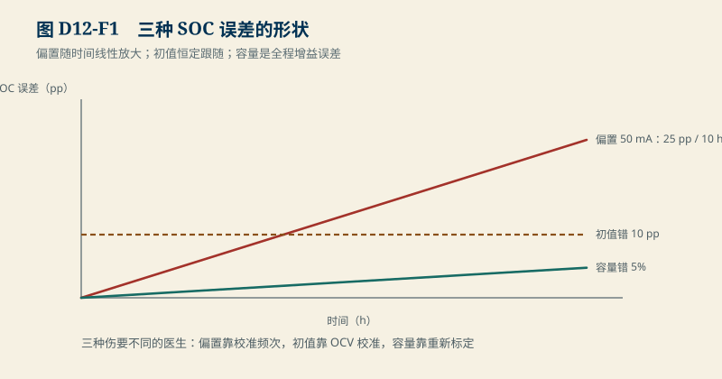
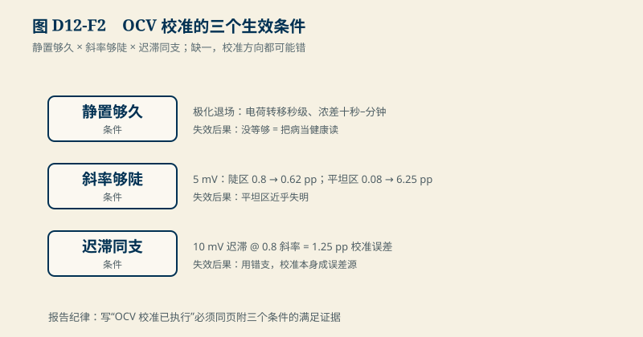

# D12　SOC 基线与校准：库仑计账与三个误差源的分工

:::: story 现场
SOC 显示与现场对不上：停车一夜掉了 8%，可电池明明没接负载。排查结论让新人意外：不是算法错了，是计账错了——电流传感器 50 mA 的偏置，一小时就把 SOC 推走 2.5 pp，十小时就是 25 pp 的漂移。库仑计账是 SOC 的骨架，而骨架怕三种伤：偏置（随时间线性放大）、初值（恒定的起点偏移）、容量（全程的增益误差）。这一单元把三种伤各自的形状画出来，并给 OCV 校准定清条件——什么时候它能救命，什么时候它根本不能。
::::

<aside class="reading-bet" aria-label="开读押注">
<p class="reading-bet__eyebrow">开读押注 · 哪个误差最可怕</p>
<p>三个候选：电流传感器 50 mA 偏置；SOC 初值错 10 pp；容量标错 5%。哪个最难自愈？</p>
<ol><li>偏置——会一直漂</li><li>初值——恒定跟着走</li><li>容量——比例性地错</li></ol>
</aside>

:::: chapter-route 阅读路径
- **第一次主线**：D12.1–D12.2。库仑计账与三笔误差各自的数学形状。
- **第二遍深挖**：D12.3。OCV 校准的三个生效条件：静置够久、斜率够陡、迟滞同支。
- **动手验证**：D12.4。改偏置/容量/斜率，重画三种伤。
::::

**它不证明**：误差数值是教学链（Q = 2 Ah、偏置 50 mA、容量误差 5%）；真实 OCV 表、迟滞宽度与静置时间常数按 D01/D02 的口径从实测取得（SRC01）；本章回答“误差怎么传”，不回答“这颗电芯的 SOC 准不准”。

## D12.1 库仑计账

$$
z[k+1]=z[k]-\frac{I[k]\,\Delta t}{3600\,Q}
$$

骨架就这么一行，全部深度都在“输入的四个量各自会错成什么样”。3600 是 A·s 与 Ah 的换算（B01 的三笔量纲账）；Q 用 Ah、I 用 A、t 用 s，量纲错一位就是 3600 倍的事故。

## D12.2 三种误差的形状

<figure>

<figcaption>图 D12-F1　三种 SOC 误差的形状。偏置线性放大、初值恒定跟随、容量是增益误差。</figcaption>
</figure>


`D12-soc-baseline` 的冻结教学链（Q = 2 Ah）：

| 误差源 | 数学形状 | 教学账 | 自愈性 |
|---|---|---|---|
| 电流偏置 b | 随时间线性漂移：b·t/(3600Q) | 50 mA → **2.5 pp/h**，10 h → 25 pp | 永不自愈，只有校准能修 |
| 初值 z₀ 误差 | 恒定偏移，全程跟随 | 10 pp 起点错，永远是 10 pp（无校准时） | OCV 校准可一次性修掉大部分 |
| 容量 Q 误差 | Δz 的增益误差 | 标高 5% → 全程 Δz 偏小 4.76 pp/100 pp | 校准可修，但修的是“刻度”不是“这一次” |

读法：偏置是“漏水的水表”——走得越久错得越多；初值是“抄错的起点”——不改永远在那；容量是“刻错刻度的尺子”——每一段量程都按错的刻度读。三种伤要不同的医生。

## D12.3 OCV 校准的三个生效条件

<figure>

<figcaption>图 D12-F2　OCV 校准的三个生效条件。静置够久 × 斜率够陡 × 迟滞同支。</figcaption>
</figure>


OCV 校准用一次充分静置后的电压反查 SOC，修掉累积误差。它能生效有硬条件：

1. **静置够久**：端电压回到 OCV 需要极化退场（D01 的时间尺度：电荷转移秒级、浓差十秒–分钟）。没等够就用带极化的电压当 OCV，等于把病当健康读。
2. **斜率够陡**：同样的电压观测误差，斜率决定它换算成多少 SOC 残差：5 mV 在 0.8 V/SOC 的陡区只残 **0.62 pp**，在 0.08 的 LFP 平坦区残 **6.25 pp**（10 倍）。平坦区的 OCV 校准近乎失明——这正是 LFP 体系更依赖其他信息（增量容量、模型滤波）的原因。
3. **迟滞同支**：校准必须知道电芯此刻在哪条 OCV 支上（D2.4）。用错支，10 mV 的迟滞宽度在 0.8 斜率区直接折算 **1.25 pp** 的校准误差——校准动作本身成了新的误差源。

三个条件缺一，校准不是“误差大点”，是“方向都可能错”。报告里写“OCV 校准已执行”必须同页附三个条件的满足证据。

## D12.4 动手验证

```text
python code/engineering/identification/d12_soc_baseline.py
python code/engineering/identification/d12_soc_baseline.py --out <新目录>
python code/engineering/identification/d12_soc_baseline.py --profile <工况.csv> --out <新目录>
python -m pytest code/engineering/identification -q
```

工况回放（`D12-profile-replay`）：`--out` 除 report.json 外落盘 `profile.csv`（46 拍合成工况）与 `soc_series.csv`（真值/库仑计/校正后三条轨迹）；`--profile` 回放你的 CSV（`t_s,current_a,v_meas,true_soc_pp` 四列；`v_meas` 为独立电压观测列，负载拍留空——带载端电压不能当 OCV 用；缺列、非有限、时间回退、真值越界一律 exit 2 拒绝）。**观测与参考分离**：估计器只读 `v_meas`，评分只读 `true_soc_pp`——只改真值列重放，估计轨迹必须逐点不动（有回归测试钉住）。真值列必须来自独立来源——用同一积分器重算的真值不能验证估计器自己。

内置工况：80% 静置 10 min → 2 A 放电 25 min（ΔSOC 41.67 pp）→ 静置 10 min，表计误差（±5 mV）与迟滞失配在生成时烘进 `v_meas`。估计器 Q̂=2.1 Ah（标高 5%）、电流含 50 mA 偏置（静置段也在）、初值偏高 10 pp。库仑计末端误差 **10.20 pp**。校正须过**静置门**：段内连续 5 拍（300 s）静置且有观测才允许校正，不足则该窗 `corrected=false` 并给出拒校正原因（有回归测试）。W1 调校窗在 t=240 s 过门（陡峭区 0.8 斜率）：校正前误差 **9.84 pp**，校正后 **0.625 pp**；增益只在 W1 从 {0.5, 1.0} 候选中调校（自由拟合会把表计误差吸进增益）。W2 留出验证窗（平坦区 0.08 斜率）用冻结增益：校正前轨迹已被 W1 拉回到 **1.18 pp**，小于该窗残差 **6.25 pp**，校正反而把误差扩大到 6.25 pp（`harmful=true`、`reliable=false`）。**先估残差再决定校不校正**：校正只在 |校正前误差| > 窗残差时改善。

**残差三口径，不得互相替代**：`residual_pp` 是声明的观测不确定度（5 mV）经斜率传播的验收上限（先验）；`posterior_v_residual_mv` 是全校正后电压观测与模型 OCV 的剩余差——同一线性 OCV 分段内恒约为 0，只用于发现分段不一致，**不能**拿来宣称精度；`error_before/after_pp` 是对独立参考真值的评分。合成数据，真实 OCV 表与迟滞宽度闭合于 SRC01 前保持教学身份。

迁移任务：

1. 偏置改 20 mA、容量改 100 Ah（储能柜）：漂移速度变多少？为什么大容量系统对偏置更敏感？
2. 若 OCV 斜率在目标 SOC 区间只有 0.05：设计一个不依赖 OCV 反查的校准路径（提示：小倍率充放的增量特征）。
3. 给“静置够久”一个可执行判据：用 D02 的 τ 算出等待时间，并说明温度降低时它怎么变。
4. 把 `profile.csv` 的 W2 窗真值改到 55%（仍在平坦区），重放 `--profile`：W2 的 error_before/harmful 怎么变？为什么调校增益不动？

## D12.5 与 S2/D13 的接口

S2 的“不把尾样本当 OCV”在本章升级为完整校准合同；D13（EKF）把库仑计账当预测步、OCV 校准当更新步，Q/R 的整定证据就来自本章的三个误差形状。B05 的数据身份纪律继续生效：校准点的来源与工况必须登记。

## D12.6 本单元已冻结的数字

| 锚点 | 值 | 出处 |
|---|---|---|
| 偏置漂移 | 50 mA → 2.5 pp/h（Q = 2 Ah） | `d12_soc_baseline.py` |
| 容量增益误差 | 标高 5% → 4.76 pp/100 pp | 同上 |
| OCV 校准残差 | 5 mV：陡区 0.62 pp / 平坦区 6.25 pp | 同上 |
| 迟滞失配 | 10 mV @ 0.8 斜率 → 1.25 pp | 同上 |
| 工况回放库仑计末误差 | 10.20 pp（Q̂ 标高 5% + 50 mA 偏置 + 初值 10 pp） | `D12-profile-replay` |
| 静置门 | 连续 5 拍（300 s）静置且有观测才允许校正，不足拒校正 | 同上 |
| 调校/验证残差 | W1 陡区 t=240 s：9.84→0.625 pp；W2 平坦区 1.18→6.25 pp（harmful） | 同上 |
| 残差口径 | residual=5 mV/斜率先验上限；posterior≈0 只作分段诊断；误差对独立真值评分 | 同上 |
| 回放规模 | 46 拍四列（v_meas 负载拍为空）；调校只在 W1，W2 留出 | 同上 |

## D12.7 装配边界

- 先修 D02/D04 与 B05；S2 样章可并行。
- 图 D12-F1 为三笔误差形状；图 D12-F2 为 OCV 校准三条件。
- 真实 OCV 表与迟滞宽度闭合于 SRC01 前，校准残差按教学值引用；LFP 平坦区的替代校准路径在 D14（可观测性）继续。
