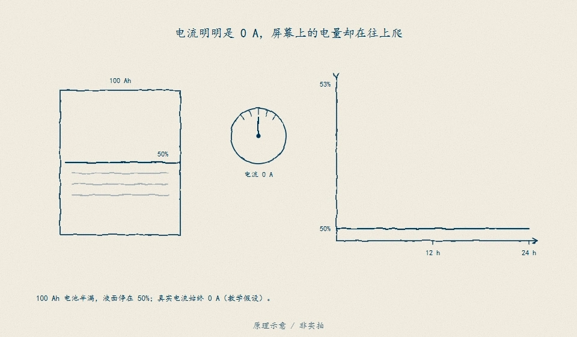
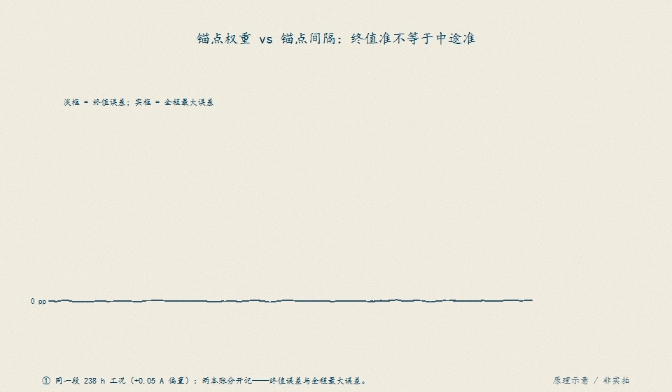

# D13　EKF 的完整一轮

:::: story 现场
屏上的 SOC 在静置十分钟后突然跳了 9 个百分点，工程师第一反应是"滤波器参数没调好"。拆开看却是另一回事：预测步按库仑计账把 SOC 往下推，更新步拿 OCV 把它往上拉，两个半步都按公式算，增益也不含任何手调数字——真正决定这一跳的是"预测有多不信自己、测量有多可信"的比值。这一章把一轮 EKF 拆成可以手算的 12 个数字，再用新息序列检查滤波器有没有自欺，最后给出一个滤波器救不了的反例：平坦区里 OCV 表偏 10 mV，估计被稳稳地拉到错的线上，而新息看起来一切正常。
::::

<aside class="reading-bet" aria-label="开读押注">
<p class="reading-bet__eyebrow">开读押注 · 谁在决定这一跳</p>
<p>同一个 4 mV 电压残差，在 0.8 V/SOC 的陡区与 0.08 的平坦区，SOC 修正量差多少？</p>
<ol><li>一样——都是 4 mV 除以同一个增益</li><li>陡区 0.5 pp，平坦区 5 pp</li><li>平坦区根本不该校正</li></ol>
</aside>

:::: chapter-route 阅读路径
- **第一次主线**：D13.1–D13.2。预测步（库仑计账 + 协方差怎么长）与更新步（增益从哪里来）。
- **第二遍深挖**：D13.3.2。新息白化：滤波器说自己有多准，和它实际有多准，是两件事。
- **动手验证**：D13.4。手算一轮、跑回放、注入坏观测、改 OCV 表看它怎么被拉走。
::::

**它不证明**：本章工况与数字全部是合成教学链（2 Ah 电芯、D12 分段 OCV 表、确定性表计噪声），不代表器件实测、实车标定或真人验收；真实 OCV 表、迟滞宽度与静置时间常数在 SRC01 闭合前只能按教学值引用。固件 `BmsInputs` 快照只有 `cell_mv/current_ma/temp_c10/charger_present`，没有时间戳与观测质量字段——新息门限需要的"这拍观测何时取得、是否可信"语义不在本单元内，属待验边界。Q/R 也不是可以照抄到产品里的参数：它们是模型与激励的账，D14 才讨论可观测性与无真值诊断。

## D13.1 预测步：D12 的库仑计账，加上协方差怎么长

状态取二维：SOC $z$ 与电流传感偏置 $b$。预测步就是 D12 的库仑计账，只是把偏置当成状态、把不确定度一起推：

$$
z^- = z + \frac{(b-I_{\text{meas}})\,\Delta t}{3600\,\hat Q},\qquad b^- = b
$$

$$
F=\begin{bmatrix}1 & \dfrac{\Delta t}{3600\hat Q}\\[4pt] 0 & 1\end{bmatrix},\qquad
P^- = F\,P\,F^{\mathsf T} + Q,\quad Q=\operatorname{diag}(q_z,q_b)
$$

三件事值得盯住：

1. **偏置在预测步里是"待估的账"**：`I_meas - b` 才是滤波器认为真正流过电芯的电流。D12 里偏置是一个藏在估计器里的 50 mA 常数；到了 EKF，它变成状态，初始不确定度 $P_{bb}$ 明写在协方差里。
2. **$F$ 的非对角元把偏置不确定度漏进 SOC**：$\Delta t/(3600\hat Q)$ 乘上 $P_{bb}$ 进入 $P_{zz}$。没有这一项，滤波器会假装"偏置错了也不影响 SOC"，更新步就永远学不到偏置。
3. **过程噪声按拍加**：$q_z$、$q_b$ 是"这一拍模型允许自己错多少"的声明，不是调参旋钮。加得越大，$P^-$ 越大，更新步越信观测；加到离谱，滤波器会开始追表计噪声，还会让新息门限失明（D13.3.4 的反例）。

回放工况的预测参数与 D12 对齐：$\hat Q=2.1$ Ah（真值 2.0，+5% 容量标高）、初值 70%（真值 80%，偏 10 pp）、电流观测含 50 mA 偏置；负载拍不产生 OCV 观测，滤波器在放电段只能预测——这是 D12"带载端电压不是 OCV"合同的直接后果。

手绘示意补上「偏置为什么要升格为状态」的直觉：积分不会发现"秤没归零"。

<figure>

<figcaption>图 D13-F1　电流零偏下的库仑计账：真实电流 0 A、传感器多报 +0.1 A，24 h 后账本虚增 2.4 Ah。积分本身不会发现"秤没归零"，所以 D13.1 把偏置 $b$ 升为状态、把它的不确定度明写进 $P$。原理示意 / 非实拍。</figcaption>
</figure>

## D13.2 更新步：增益由 P、H、R 决定，不是拍脑袋

拿到一帧静置电压观测 $y$（D12 的四列工况里 `v_meas` 非空），更新步是四行公式：

$$
\nu = y - h(z^-),\qquad h(z)=\mathrm{OCV}(z)
$$

$$
S = H\,P^- H^{\mathsf T} + R,\qquad H=\left[\frac{\partial\,\mathrm{OCV}}{\partial z},\,0\right]=[\text{slope},\,0]
$$

$$
K = P^- H^{\mathsf T} S^{-1},\qquad z^+ = z^- + K\nu,\qquad P^+ = (I-KH)P^-
$$

增益不是"调出来的系数"，而是两个方差的比值：$K = P^-H^{\mathsf T}/(H P^- H^{\mathsf T}+R)$。它自动做三件事：

- **初值错得多**（$P^-$ 大）→ $K$ 大，一次拉回大半；
- **表计噪声大**（$R$ 大）→ $K$ 小，只信一点点；
- **OCV 斜率平**（$H$ 小）→ 同样 1 V 的观测只对应很小的 $H P H$，$K$ 相对 $R$ 变小，但换算成 SOC 的修正量 $K\nu$ 仍按 $1/\text{slope}$ 放大。

最后一条是 LFP 平坦区的全部危险所在：D12 已经算过，5 mV 在 0.8 V/SOC 陡区值 0.62 pp，在 0.08 平坦区值 6.25 pp。EKF 没有取消这条换算，它只是把"该信多少"写成公式。本章的两个斜率沿用 D12 的教学表：60% 以上 0.8 V/SOC，以下 0.08 V/SOC，在 60% 处连续。

**门限**是更新步的可选保险：先算归一化新息 $\nu/\sqrt S$，超过 3 就拒绝这一拍观测，状态停在预测值。拒绝的是"这一拍”，不是"这个滤波器"——连续拒绝说明模型或表出了问题，不能靠调门限解决。

## D13.3 手算一轮、新息白化与两个反例

### D13.3.1 手算一轮与实现逐点对拍

取一组整数：$z=0.50$、$b=0$、$P_{zz}=0.0025$（$\sigma_z=0.05$）、$P_{bb}=0.0001$（$\sigma_b=0.01$ A）、$q_z=q_b=10^{-8}$、$R=(2\,\text{mV})^2$、$\hat Q=2$ Ah、$\Delta t=0.5$ s。电流 2 A、偏置 0，预测一步后真值仍按 0.50 走，但电压观测带 +4 mV 的偏差（教学用：模拟"真值 0.50、表读数多 4 mV"）。

手算路径与代码路径是同一组公式的两种展开（标量展开 vs 矩阵函数），12 个检查点全部对齐（最大差 0，见 `one_round_hand()["max_abs_diff"]`）：

| 检查点 | 手算 | 代码 |
|---|---|---|
| $z^-$ | 0.499861111111 | 0.499861111111 |
| $P_{zz}^-$ | 0.00250001 | 0.00250001 |
| $P_{zb}^-$ | 6.944e-9 | 6.944e-9 |
| $P_{bb}^-$ | 0.00010001 | 0.00010001 |
| 预测电压（偏差形式） | 0.399888888889 V | 0.399889 |
| 新息 $\nu$ | 0.004111111111 V（4.1111 mV） | 4.1111 mV |
| $S$ | 0.0016040064 V² | 0.0016040064 |
| $K_z$ | 1.246882805456 SOC/V | 1.2469 |
| $K_b$ | 3.463549e-6 A/V | 3.463549e-6 |
| $z^+$ | 0.504987184867 | 0.504987 |
| $P_{zz}^+$ | 6.234414e-6 | 6.234414e-6 |
| $P_{bb}^+$ | 0.00010001 | 0.00010001 |

读法：4 mV 新息经 $K_z=1.2469$ 变成 0.5126 pp 的 SOC 修正；$P_{zz}$ 从 0.0025 塌到 6.23e-6（一次观测就把初值不确定度砍掉两个数量级），$P_{bb}$ 几乎不动——这组几何下偏置不可观，正是 D14 的入口。更新后 $P$ 仍正定（$P_{zz}P_{bb}-P_{zb}^2>0$），协方差守卫通过。

### D13.3.2 新息序列与白化检验

把每拍新息除以滤波器自己报的标准差，得到归一化新息 $\nu_k/\sqrt{S_k}$。如果模型、$Q$、$R$ 都自洽，它应当像标准正态：均值近 0、方差近 1、$\sum(\nu_k/\sqrt{S_k})^2$ 落在 $\chi^2_n$ 的 95% 区间内。这就是 NIS/白化检验。

模型一致的对照跑（真容量、零偏置、$R$ 与表计噪声一致、初值误差与 $P_0$ 一致）给出：

| 指标 | 值 | 判读 |
|---|---|---|
| 更新帧数 $n$ | 21 | 静置段全部可更新 |
| 归一化新息均值 | 0.1044 | 近 0 |
| 归一化新息标准差 | 0.9219 | 近 1 |
| NIS 和 | 17.2286 | 95% 区间 [10.2675, 35.481]，通过 |
| NIS 均值 | 0.8204 | 未系统性高估/低估不确定度 |
| 一阶自相关 | 0.3533 | $n=21$ 下不显著 |

**纪律**：白化通过只说明"滤波器报的不确定度和它自己看到的新息一致"，不说明模型对。滤波器完全可以把模型误差吸收进状态，然后交出一串又白又安静的新息——D13.3.4 的反例就是 141 个白新息配 14 pp 的稳定偏差。看书里任何"残差已白化"的说法，都要同时问：偏差对谁评分？

### D13.3.3 失配对比：EKF vs 纯库仑计

同一份 32 拍工况（11 拍静置 + 11 拍 2 A 放电 + 10 拍静置，真值 80%→61.67%），只改估计器的假设，不动数据：

| 估计器 | 末误差 pp | 平均绝对误差 pp | 最大绝对误差 pp |
|---|---|---|---|
| 纯库仑计（$\hat Q=2.1$、初值 70%） | -10.3571 | 10.1786 | 10.3968 |
| EKF 标称（同参数 + OCV 更新） | 0.2598 | 0.4790 | 1.2001 |
| EKF 容量修正（$\hat Q=2.0$） | 0.3230 | 0.2897 | 0.8207 |
| EKF 偏置冻结（$P_{bb}=q_b=0$） | 0.2579 | 0.4360 | 0.9501 |
| EKF OCV 表 +10 mV | -0.9904 | 0.7924 | 1.5925 |

三笔账分开读：容量标高让放电段的 $\Delta z$ 少算，EKF 在静置段把它拉回来（平均绝对误差 0.4790→0.2897）；偏置冻结与标称几乎同分（0.4360 vs 0.4790），因为 10 分钟静置窗里偏置本来就不收敛——这只说明"这组激励下偏置状态没挣到钱"，不说明偏置无害；OCV 表偏 10 mV 在 0.8 斜率区只值 1.25 pp，末误差 -0.99 pp，看着不吓人——把同样的表搬到平坦区，就是 D13.3.4。

### D13.3.4 边界反例：平坦区 + 错误 $\hat Q$，EKF 也救不了

工况改成 55% 起步、1 A 放电 20 分钟（终点 38.3%，全程 0.08 V/SOC 平坦区），估计器带两个错：$\hat Q=3.0$ Ah（真值 2.0，+50%）与 OCV 表整体 +10 mV；无传感偏置，噪声与 $Q$ 保持标称，好让"纯库仑计"只背容量这一笔错。

| 指标 | 纯库仑计 | EKF |
|---|---|---|
| 末误差 pp | 4.5556 | **-13.7047** |
| 平均绝对误差 pp | 4.0014 | **10.7127** |
| 最大绝对误差 pp | 4.5556 | **17.4514** |
| 更新次数 / 拒绝次数 | — | 141 / 0 |
| 首次更新位移 | — | **10.4964 pp** |
| 新息白化 | — | NIS 和 150.46 ∈ [110.02, 175.77]，均值 1.0671，白 |

过程是这样的：静置段第一帧，5 mV 表计噪声叠上 10 mV 表偏移，归一化新息只有 -1.24（远在 3σ 门限内），EKF 却按平坦区的 $1/0.08$ 换算，一次性把估计从 54% 拉到 43.5%——单拍位移 10.5 pp，而真值是 55%。此后每来一帧静置观测，滤波器朝"它相信的那条 OCV 线"再走一步，最终停在真值下方约 14 pp 处。此时估计与它自己的 OCV 表完全自洽：新息只剩表计噪声，NIS 均值 1.067，门限一次也没响。

这就是"新息白 ≠ 模型对"：滤波器把表偏移吸收进 SOC，把偏差藏进了"估计正确"的那一侧；它没有能力区分"SOC 错了 12.5 pp"和"OCV 表高了 10 mV"。平坦区 10 mV 值 12.5 pp 的换算（D12 已给出）在这里不是精度问题，是方向问题。门限、白化、$P$ 正定这三个自检全部通过，结论仍然是错的——能抓住它的只有独立真值或第二套观测（D14/D15）。

## D13.4 动手验证

```text
python code/engineering/identification/d13_ekf.py
python code/engineering/identification/d13_ekf.py --out <新目录>
python code/engineering/identification/d13_ekf.py --profile <工况.csv> --out <新目录>
python -m pytest code/engineering/identification/test_d13_ekf.py -q --basetemp=.tmp-pytest-d13
```

`--out` 落盘三个工件：`report.json`（手算单轮、回放、失配、白化、边界反例）、`profile.csv`（32 拍四列合成工况）、`ekf_series.csv`（`t_s,true_soc_pp,coulomb_soc_pp,ekf_soc_pp,innovation_mv,rejected`）。`--profile` 回放你自己的 CSV：`t_s,current_a,v_meas,true_soc_pp` 四列；缺列、非有限、时间回退、真值越界、空表一律 exit 2 拒绝。

**观测与参考分离**：估计器只读 `current_a` 与 `v_meas`，评分只读 `true_soc_pp`；把真值列整体改写，估计轨迹必须逐点不动（有回归测试钉住）。**D13 的列语义与 D12 有一处不同**：D13 的 `current_a` 是传感器读数（已含 50 mA 偏置，因为偏置是待估状态），D12 的同一列是物理电流、偏置由估计器内部加。跨章直接换 CSV 会多算/少算一次偏置——换算规则写在 D13.5。

内置工况参数：60 s 一拍，0–600 s 静置、660–1260 s 以 2 A 放电（真值每拍 -1.6667 pp，终点 61.67%，仍在陡区）、1320–1860 s 静置；$\hat Q=2.1$ Ah、初值 70%、电流观测含 50 mA 偏置、表计噪声 5 mV（12 项均匀和近似高斯，确定性种子，可复现）。库仑计末误差 -10.36 pp，EKF 末误差 0.26 pp、最大 1.20 pp；21 次更新、0 次拒绝；偏置状态末值 0.00044 A（没收敛，D14 再谈）。

迁移任务：

1. 把 $R$ 改成 $(20\,\text{mV})^2$ 重跑回放：初值修正变慢多少？为什么新息标准差会变？
2. 把门限收紧到 2σ，再注入 +15 mV 坏观测：哪一帧被拒？连续拒绝时估计会退回纯库仑计吗？
3. 把内置工况的放电段改到 45% 终点（平坦区）重放：EKF 末误差与白化指标怎么变？先预测再看数。
4. 给 D13.3.4 的 10 mV 表偏移配一个"表偏移自检"方案：只用新息序列，能否在不知道真值时发现它？说明为什么单靠 $\nu/\sqrt S$ 做不到。

## D13.5 与 S2/D12 的接口

S2 的单脉冲 1RC 与 D11 的联合辨识给出"电压=OCV-欧姆-极化"的分解；D13 的测量模型只取 OCV 一支，负载拍不产生观测（带载端电压不是 OCV，D12 的静置门合同）。D14 接着回答两个 D13 故意留下的问题：偏置在什么激励下可观（本章 10 分钟静置里 $P_{bb}$ 不动），以及没有真值时用什么残差诊断。D15 的 SOH 会把容量 $\hat Q$ 从"已知的错值"变成"待估的老化量"。

与 D12 的接口有三条硬约定：

1. **容量与偏置命名**：`Q̂` 是估计容量（D12 的 +5% 标高等价），`b` 是电流传感偏置；D13 把 `b` 升为状态，D12 把它当常数。
2. **OCV 表**：同一分段函数（0.8/0.08 V/SOC，60% 处连续），同一迟滞前提（本章合成工况不建模迟滞；真实表须按 D2.4 同支原则）。
3. **CSV 语义**：D13 的 `current_a` 是表读数（含偏置）；把 D13 的 CSV 喂给 D12 回放前必须减去 50 mA，把 D12 的 CSV 喂给 D13 前必须加上 50 mA。四列名字相同、语义不同，文件头不携带这个信息——这是接口边界，不是可以忽略的细节。

固件边界同样成立：`BmsInputs` 没有时间戳，EKF 的"这一拍观测是哪一刻的"无法从固件快照判断；本单元的回放假设四列 CSV 的时间戳可信，产品实现需要把观测时间与质量另立字段，属待验。

校准策略有一幅手绘对照（handraw 首批导出的独立算例，数值为其自带教学值，非本单元冻结数字）：锚点权重决定终值能否校准干净，锚点间隔决定中途最大误差。

<figure>

<figcaption>图 D13-F2　锚点权重 vs 锚点间隔：终值准不等于中途准。终值误差随校正权重收敛（6.15 → 0.00 pp），中途最大误差却由锚点间隔决定（9.06 → 5.07 pp）；偏置在静置时也按时间攒——校正频率是接口策略的一部分，不能为多校正跳过静置与可信度判据。独立算例，数值为 handraw 导出自带教学值，非本单元冻结数字。原理示意 / 非实拍。</figcaption>
</figure>

## D13.6 本单元已冻结的数字

| 锚点 | 值 | 出处 |
|---|---|---|
| 手算单轮 | 新息 4.1111 mV，$K_z$=1.2469 SOC/V，$\Delta z$=0.5126 pp，$P_{zz}^+$=6.2344e-6 | `one_round_hand()` |
| 手算/代码对拍 | 12 个检查点最大差 0 | 同上 |
| 白化对照（模型一致） | $n$=21，NIS=17.2286 ∈ [10.2675, 35.481]，均值 0.8204，std 0.9219 | `whitening_run()` |
| 回放规模 | 32 拍四列（11 静置 + 11 放电 + 10 静置），21 次更新 | `D13-ekf-replay` |
| 回放库仑计 | 末误差 -10.3571 pp，最大 10.3968 pp | 同上 |
| 回放 EKF | 末误差 0.2598 pp，最大 1.2001 pp，0 拒绝 | 同上 |
| 失配：容量修正 | 平均绝对误差 0.2897 pp（标称 0.4790） | `mismatch_comparison()` |
| 失配：偏置冻结 | 末误差 0.2579 pp，平均 0.4360 pp | 同上 |
| 失配：OCV 表 +10 mV（陡区） | 末误差 -0.9904 pp（10 mV/0.8=1.25 pp） | 同上 |
| 门限拒绝坏观测 | +50 mV → 归一化新息 7.32 > 3σ 被拒；无门限当拍拉走 3.77 pp | `run_ekf()` 测试 |
| 平坦区边界反例 | 库仑计 4.5556 pp vs EKF -13.7047 pp（平均 10.7127，最大 17.4514） | `flat_region_counterexample()` |
| 反例的首次更新 | 单拍位移 10.4964 pp，0 拒绝 | 同上 |
| 反例的新息 | NIS=150.46 ∈ [110.02, 175.77]，均值 1.0671，白 | 同上 |
| 平坦区换算 | 10 mV / 0.08 V/SOC = 12.5 pp | D12 斜率约定 |

数字口径：所有值为 `report.json` 实跑输出；合成工况、确定性噪声，不认定为器件实测或真人验收；`error_*` 只对 `true_soc_pp` 独立真值评分，`innovation_*` 只读观测列。新息白化只证明滤波器自洽，不证明模型正确（D13.3.4）。

## D13.7 装配边界

- 先修 D11/D12/B03：D12 的容量/偏置/OCV 三分工与静置门，D11 的 1RC 极化（本章只取 OCV 一支），B03 的量纲约定（$P$ 的对角元单位不同，不比较原始行列式）。
- 本单元不画新图；章节以公式、手算表与回放工件承载证据。若后续补图，须沿用 `make_*_figures.py` 既有模式并配生成测试。
- 合成数据边界：工况由 `generate_profile` 生成，表计噪声为确定性 Irwin-Hall 近似；OCV 表、迟滞、静置时间常数在 SRC01 闭合前按教学值引用。
- 固件边界：`BmsInputs` 无时间戳/质量字段，观测新鲜度与门限所需的时间语义不在本单元内，待验。
- 实验与主张登记：本单元的 `D13-ekf-round` / `D13-ekf-replay` 场景、回归文件与章节指纹已登记，登记处于操作者审阅状态，审阅前不作为已验收依据。
- 门限、白化、$P$ 正定是自检，不是正确性证明；任何"EKF 已收敛"的结论必须附带对独立真值或第二套观测的评分。
