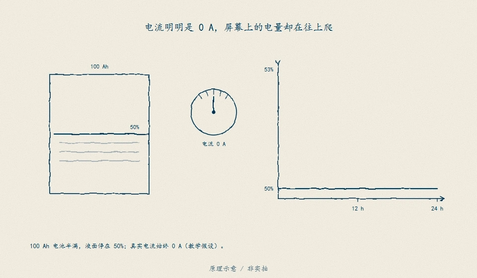
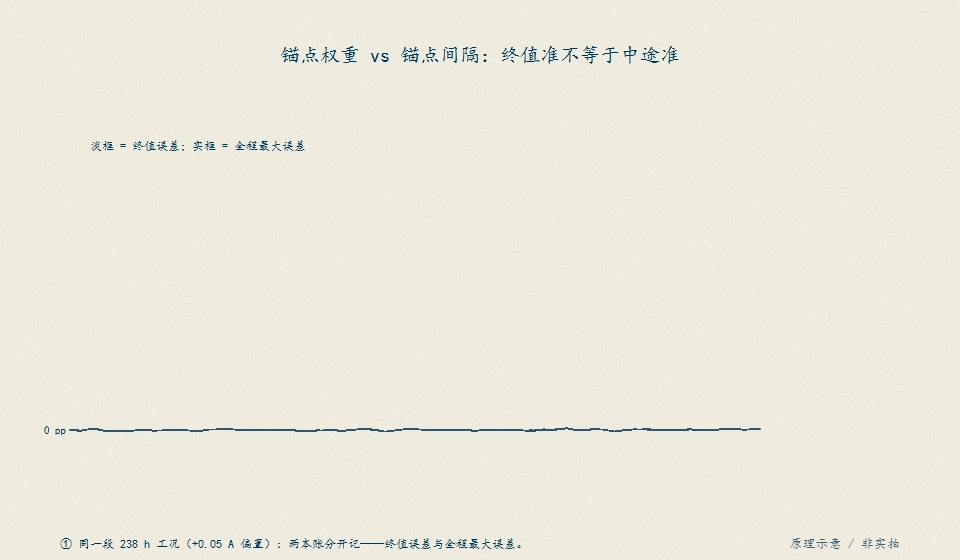
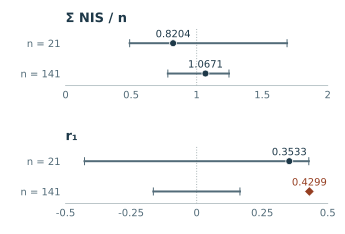

# D13　EKF 的完整一轮

:::: story 现场
电芯还在静置，电量估计却从 54% 跳到了 43.5%。在本章的合成回放里，这一跳只用了一次电压观测。读数比模型预报低了约 12 mV，滤波器为什么据此扣掉十多个百分点？先算一遍电压差怎么换算成 SOC，到 D13.3.4 再回来看这一帧。
::::

<aside class="reading-bet" aria-label="开读押注">
<p class="reading-bet__eyebrow">开读押注 · 谁在决定这一跳</p>
<p>同一个 4 mV 电压残差，OCV 斜率从 0.8 V/SOC 降到 0.08 V/SOC，EKF 的 SOC 修正量一定会变成十倍吗？</p>
<ol><li>一定，直接用残差除以斜率</li><li>要看预测的 SOC 方差和电压观测方差</li><li>两个工况的修正量一定相同</li></ol>
</aside>

:::: chapter-route 阅读路径
- **第一次主线**：读 D13.1–D13.2，算出 4 mV 在两个斜率下各能修正多少 SOC。
- **第二遍深挖**：读 D13.3.1–D13.3.4，把手算结果与代码对照，再用图 D13-F3 比较两段新息。
- **动手验证**：在 D13.4 回放同一份工况，给一帧电压加上偏差，检查程序接受了哪几帧。
::::

回放使用 2 Ah 的合成电芯、D12 的分段 OCV 表和可重复生成的表计噪声。文中的 pp 指 SOC 百分点，例如从 54% 降到 43.5%，变化量是 −10.5 pp。真实电芯需要静置多久、电压噪声有多大，都还有待验证。

## D13.1 预测步：D12 的库仑计账，加上协方差怎么长

电流表读到的 $I_{\text{meas}}$ 包含偏置 $b$，积分时要先扣掉它。D12 把偏置设为常数，这里连同 SOC $z$ 一起估计。放电电流取正，$\hat Q$ 是估计容量（Ah）。

$$
z^- = z + \frac{(b-I_{\text{meas}})\,\Delta t}{3600\,\hat Q},\qquad b^- = b
$$

$$
F=\begin{bmatrix}1 & \dfrac{\Delta t}{3600\hat Q}\\[4pt] 0 & 1\end{bmatrix},\qquad
P^- = F\,P\,F^{\mathsf T} + Q,\quad Q=\operatorname{diag}(q_z,q_b)
$$

偏置估得有多准，记在方差 $P_{bb}$ 里。令 $a=\Delta t/(3600\hat Q)$，把矩阵乘法的第一项展开就能看出它怎样影响 SOC。

$$
P_{zz}^-=P_{zz}+2aP_{zb}+a^2P_{bb}+q_z
$$

偏置方差给这一拍 SOC 方差增加 $a^2P_{bb}$，还给交叉协方差增加 $aP_{bb}$。下次静置测电压时，正是这项关联让滤波器也能修正偏置。$q_z$、$q_b$ 是每拍加入的过程噪声方差。提高 $q_z$ 会增大预测电压的标准差，同样的电压差就更容易通过门限。

标称回放故意从三个有误差的条件起步。估计容量取 2.1 Ah，比真值高 5%。SOC 从 70% 起算，比真值低 10 pp。电流表多读 50 mA。放电时测到的端电压含欧姆压降和极化，这段工况只按电流预测，等到静置再用 OCV 校正。

<figure>

<figcaption>图 D13-F1　静置也会积出电量误差。图中把 0.1 A 误计为充电，24 h 就多记了 2.4 Ah。回放采用放电为正的约定，同样大小的偏置要按回放的电流方向代入。</figcaption>
</figure>

## D13.2 更新步：增益由 P、H、R 决定，不是拍脑袋

静置时，工况表的 `v_meas` 列给出电压 $y$。用它减去预测电压，得到这一帧的新息 $\nu$。

$$
\nu = y - h(z^-),\qquad h(z)=\mathrm{OCV}(z)
$$

$$
S = H\,P^- H^{\mathsf T} + R,\qquad H=\left[\frac{\partial\,\mathrm{OCV}}{\partial z},\,0\right]=[\text{slope},\,0]
$$

$$
K = P^- H^{\mathsf T} S^{-1},\qquad x^+ = x^- + K\nu,\qquad P^+ = (I-KH)P^-
$$

状态向量是 $x=[z,b]^{\mathsf T}$。令 $s$ 表示当前 OCV 斜率，SOC 的修正量就是 $\Delta z=K_z\nu$，其中 $K_z=P^-_{zz}s/(s^2P^-_{zz}+R)$。分母里两项的单位都是 V²，一项来自预测 SOC 的不确定度，另一项来自表计。前一项远大于后一项时，修正量才接近直接反查 OCV 得到的 $\nu/s$。

把同一个 4 mV 新息分别代入两个工况。固定 $P^-_{zz}=0.0025$、表计标准差 5 mV，在 D12 的两个教学斜率 0.8 和 0.08 V/SOC 下，直接反查分别得到 0.5 和 5 pp，EKF 这一步实际修正约 **0.49 和 1.95 pp**。继续把斜率降到零，保持 $R>0$，这帧电压对 SOC 的增益也降到零。

启用门限时，若 $|\nu|/\sqrt S>3$，滤波器跳过本次更新，保留预测状态和预测协方差。连续越界时，可以沿时间戳回查电压采样、模型和噪声假设。

如果把校正权重固定下来，还可以单独看出两次静置校正相隔多久的影响。图 D13-F2 用另一组七天数据做这个对照。

<figure>

<figcaption>图 D13-F2　基准组有 4 次静置校正，权重为 0.3，末次误差和全程最大误差分别为 6.15 和 9.06 pp。只把权重调到 1.0，末次误差归零。只把校正次数从 4 增至 10，全程最大误差降到 5.07 pp。三组都须满足静置校正条件。</figcaption>
</figure>

## D13.3 手算一轮、新息白化与两个反例

### D13.3.1 手算一轮与实现逐点对拍

从 $z=0.50$、$b=0$ 开始，给 2 Ah 的电芯施加 2 A 放电电流，预测 0.5 s。为单独看清电压更新，手算时把观测设为 50% SOC 对应的电压再加 4 mV。初始方差取 $P_{zz}=0.0025$（$\sigma_z=0.05$）、$P_{bb}=0.0001$（$\sigma_b=0.01$ A），每拍 $q_z=q_b=10^{-8}$，表计方差 $R=(2\,\text{mV})^2$。

下表按计算顺序列出 12 个检查点。手算用标量展开，代码用矩阵更新。按未截位的数比较，两者最大差为零，见 `one_round_hand()["max_abs_diff"]`。

| 检查点 | 手算 | 代码 |
|:---|---:|---:|
| $z^-$ | 0.499861111111 | 0.499861111111 |
| $P_{zz}^-$ | 0.00250001 | 0.00250001 |
| $P_{zb}^-$ | 6.944e-9 | 6.944e-9 |
| $P_{bb}^-$ | 0.00010001 | 0.00010001 |
| 新息 $\nu$ | 0.004111111111 V（4.1111 mV） | 4.1111 mV |
| $S$ | 0.0016040064 V² | 0.0016040064 |
| $K_z$ | 1.246882805456 SOC/V | 1.2469 |
| $K_b$ | 3.463549e-6 A/V | 3.463549e-6 |
| $z^+$ | 0.504987184867 | 0.504987 |
| $P_{zz}^+$ | 6.234414e-6 | 6.234414e-6 |
| $P_{zb}^+$ | 1.7e-11 | 1.7e-11 |
| $P_{bb}^+$ | 0.00010001 | 0.00010001 |

表计多读的 4 mV 加上预测电压下降的 0.1111 mV，合成 4.1111 mV 的新息。乘以 $K_z=1.2469$ 得到 0.5126 pp 的 SOC 修正。这一拍把 $P_{zz}$ 从 0.0025 降到约 $6.23\times10^{-6}$，对 $P_{bb}$ 的影响很小。更新后的对称矩阵 $P$ 首个对角元和行列式均为正。

报告的 `bad_qr` 用同一斜率再做一次静置对照。将 $R$ 设为 $10^{-12}$ V²，每拍都输入对应 60% SOC 的无噪声电压。估计从 50% 起步，第一拍就到约 60%。20 拍后，SOC 方差约为 $1.56\times10^{-12}$（SOC 分数的平方），电流偏置标准差仍约 10 mA。读报告时分别看 `p_zz_after_r0` 和 `p_bb_after_r0`。这两个量的单位不同，旧字段 `p_trace_after_r0` 仅供兼容。

### D13.3.2 新息序列与白化检验

每次有电压观测，先把新息除以预测标准差，记作 $u_k=\nu_k/\sqrt{S_k}$。保留门限判定前的值，被拒的观测也计入统计。跳过没有电压观测的负载拍，因此这里的“一阶”指相邻两次电压观测，两次之间可能隔着放电段。

单次观测的归一化新息平方（NIS）就是 $u_k^2$。若这 $n$ 个新息归一化后独立且服从标准正态分布，平方和 $\sum u_k^2$ 服从 $\chi^2_n$。程序用 Wilson–Hilferty 近似给出平方和的双侧 95% 参考区间。

把观测顺序打乱，平方和与均值都保持原值，相邻两次观测之间的关系却变了。程序还检查归一化新息均值是否在 $\pm 2/\sqrt n$ 内，以及一阶自相关是否在白噪声假设下的大样本参考带 $\pm 1.96/\sqrt n$ 内。报告中的 `white` 表示这三项均通过。单个滞后的筛查无法验证所有滞后，三项合用也没有联合 95% 覆盖率。

对照回放使用真实容量和零电流偏置，$R$ 按表计标准差 5 mV 设定，初始 SOC 偏差的大小等于给定的先验标准差。这是一次固定的合成回放，区间的统计含义来自上面的分布假设。

| 指标 | 值 | 判读 |
|---|---|---|
| 有电压观测的帧数 $n$ | 21 | 静置段都有观测 |
| 归一化新息均值 | 0.1044 | 近 0 |
| 归一化新息标准差 | 0.9219 | 近 1 |
| NIS 总和 | 17.2286 | 95% 区间 [10.2675, 35.481]，通过 |
| NIS 均值 | 0.8204 | 本窗平方和除以 21 |
| 一阶自相关 | 0.3533 | 在本窗近似参考带 ±0.4277 内 |

在这 21 次观测中，三项检查都通过。要知道 SOC 估准了多少，仍须另找参照。D13.3.4 的工况可以同时核对两件事：新息有没有连续偏向同一侧，估计的 SOC 距离合成真值有多远。

### D13.3.3 失配对比：EKF vs 纯库仑计

同一份 32 拍工况（11 拍静置 + 11 拍 2 A 放电 + 10 拍静置，真值 80%→61.67%），只改估计器的假设，不动数据：

| 估计器 | 末误差 pp | 平均绝对误差 pp | 最大绝对误差 pp |
|:---|---:|---:|---:|
| 纯库仑计（$\hat Q=2.1$、初值 70%） | -10.3571 | 10.1786 | 10.3968 |
| EKF 标称（同参数 + OCV 更新） | 0.2598 | 0.4790 | 1.2001 |
| EKF 容量修正（$\hat Q=2.0$） | 0.3230 | 0.2897 | 0.8207 |
| EKF 偏置冻结（$P_{bb}=q_b=0$） | 0.2579 | 0.4360 | 0.9501 |
| EKF OCV 表 +10 mV | -0.9904 | 0.7924 | 1.5925 |

把容量从 2.1 Ah 改回 2.0 Ah，同样的放电电流会算出更大的 SOC 降幅，平均绝对误差从 0.4790 降到 0.2897 pp。冻结电流偏置后，平均绝对误差为 0.4360 pp，与标称值很接近。这段静置只有 10 分钟，对偏置的估计仍离真值很远。

再看最后一行。OCV 表偏高 10 mV，在斜率 0.8 V/SOC 的陡区相当于 1.25 pp，本次末误差约 −0.99 pp。把同样的表偏移带进平坦区，误差会有多大？

### D13.3.4 边界反例：平坦区 + 错误 $\hat Q$，EKF 也救不了

这次从 55% SOC 起步，以 1 A 放电 20 分钟，到达 38.3%。整个过程都在斜率为 0.08 V/SOC 的平坦区。两种估计器都把 2.0 Ah 的容量高估为 3.0 Ah。EKF 还用了一张整体偏高 10 mV 的 OCV 表。电流偏置为零，噪声与 $Q$ 沿用标称设置。

| SOC 误差（pp） | 纯库仑计 | EKF |
|:---|---:|---:|
| 末次误差 | +4.5556 | −13.7047 |
| 平均绝对误差 | 4.0014 | 10.7127 |
| 最大绝对误差 | 4.5556 | 17.4514 |

第一帧预测把 SOC 放在 54%，合成真值是 55%。合成电压观测比模型预报低 11.677 mV，预测标准差为 9.434 mV，归一化新息约为 −1.24，落在 ±3 的门限内。滤波器接受这次观测，把 SOC 拉到 43.5%。整段回放中，141 次观测全部被接受，NIS 均值为 1.0671，末次 SOC 估计比合成真值低 13.7047 pp。

<figure>

<figcaption>图 D13-F3　上图看归一化新息的平方均值，下图看相邻两次观测的一阶自相关。横线给出各自的参考区间。每幅图上行是 21 次观测的对照组，下行是 141 次观测的平坦区回放。只有右下的菱形落在线外。</figcaption>
</figure>

平坦区这 141 次观测的 NIS 总和为 150.46，在参考区间 [110.02, 175.77] 内。一阶自相关却达到 0.4299，超过本窗上界 0.1651。这一帧的新息高于均值时，下一次观测的新息也倾向于偏高。要分清容量误差与表偏移各占多少，还需要独立电量参考或另一种观测。仅凭一个静置电压，表偏高 10 mV 与 SOC 低估 12.5 pp 在这段平坦区恰好可以抵消。

## D13.4 动手验证

```text
python code/engineering/identification/d13_ekf.py
python code/engineering/identification/d13_ekf.py --out <新目录>
python code/engineering/identification/d13_ekf.py --profile <工况.csv> --out <新目录>
python -m pytest code/engineering/identification/test_d13_ekf.py -q --basetemp=.tmp-pytest-d13
```

加上 `--out` 后，先打开 `profile.csv`。内置工况每 60 s 记一行。0–600 s 静置，660–1260 s 的各行记录 2 A 放电，真值每拍下降 1.6667 pp，末次放电时为 61.67%。1320–1860 s 恢复静置。模拟表计用 12 个均匀随机数之和近似高斯噪声，标准差为 5 mV，固定种子便于复跑。

再看 `ekf_series.csv` 的六列 `t_s,true_soc_pp,coulomb_soc_pp,ekf_soc_pp,innovation_mv,rejected`。对照静置段会数出 21 次更新、0 次拒绝。最后在 `report.json` 查看手算、失配和新息统计。标称回放的库仑计末误差为 −10.36 pp，EKF 末误差为 0.26 pp，最大绝对误差为 1.20 pp。偏置估计最后只有 0.00044 A，离传感器的 0.05 A 还很远。

`--profile` 可读自己的四列 CSV，列名依次为 `t_s,current_a,v_meas,true_soc_pp`。估计器按时间戳推进，用电流预测，再依据静置电压校正。真值列专供评分，单独改写它时，回归测试会逐拍核对估计轨迹。缺列、非有限数、时间倒退、真值越界或空表都会使程序以状态码 2 退出。借用 D12 的 CSV 时，先按下一节换算电流。

用同一份回放试四种改动。

1. 把 $R$ 改成 $(20\,\text{mV})^2$ 重跑回放：初值修正变慢多少？为什么新息标准差会变？
2. 把门限收紧到 2σ，再注入 +15 mV 坏观测：哪一帧被拒？连续拒绝时估计会退回纯库仑计吗？
3. 把内置工况的放电段改到 45% 终点（平坦区）重放：EKF 末误差与白化指标怎么变？先预测再看数。
4. 只看 D13.3.4 的新息序列，哪一项首先提示要查模型？如果想把 SOC 偏差归因到那 10 mV 的表偏移，还需要补哪种独立观测？

## D13.5 与 S2/D12 的接口

S2 和 D11 把端电压分解为 OCV、欧姆压降和极化三部分。D13 只在静置时用 OCV 校正。D12 和 D13 共用分段 OCV 表，两段在 60% SOC 处连续，低段斜率为 0.08 V/SOC，高段为 0.8 V/SOC。合成表忽略迟滞，使用真实电芯数据时应按 D2.4 选择同一充放电分支。

最容易混淆的是 `current_a`。D12 的这一列存物理电流，估计器内部另加偏置。D13 存传感器读数，把偏置 $b$ 作为状态来估。两份 CSV 的表头相同，交换标称工况时要自己换算。

| 回放方向 | 写入目标文件的 `current_a` |
|:---|:---|
| D12 → D13 | 物理电流加 0.05 A |
| D13 → D12 | 表计读数减 0.05 A |

这 0.05 A 是标称回放里设定的偏置。D14 讨论怎样的激励有助于估计偏置，以及缺少真值时怎样检查残差。D15 再把这里给定的容量 $\hat Q$ 当作随老化变化的待估量。

## D13.6 本单元已冻结的数字

复跑后，用下表找到要核对的那一组。手算的 12 个中间值在 D13.3.1，各估计器的逐项误差在 D13.3.3 和 D13.3.4。

| 实验入口 | 可核对的读数 |
|:---|:---|
| `one_round_hand()` | 新息 4.1111 mV，SOC 修正 0.5126 pp，12 项手算与代码最大差为零 |
| `whitening_run()` | 21 次观测的 NIS 总和为 17.2286，归一化新息标准差为 0.9219 |
| `D13-ekf-replay` | 32 拍中更新 21 次。库仑计和 EKF 的末误差分别为 −10.3571 和 +0.2598 pp |
| `mismatch_comparison()` | 只修正容量时，EKF 平均绝对误差为 0.2897 pp |
| `run_ekf()` 门限测试 | 注入 +50 mV 后，归一化新息为 7.32，超过门限 3。关闭门限时当拍移动 3.77 pp |
| `flat_region_counterexample()` | 首次更新移动 10.4964 pp，全程拒绝 0 次，末误差 −13.7047 pp |

本章按合成工况复算。`error_*` 对照单独生成的 `true_soc_pp` 评分，`innovation_*` 使用电压观测与模型预测。D13.3.4 的误差方向和大小来自前者。

推导可对读 Gregory L. Plett 的 *Battery Management Systems, Volume II: Equivalent-Circuit Methods*（Artech House, 2015，ISBN 978-1-63081-027-6）。印刷页 94 用时间相关性区分白噪声与相关过程，页 104–105、119 说明新息如何经增益修正状态。代码可对读 FilterPy 的增益与更新，以及 statsmodels 在白噪声假设下计算单滞后误差带的位置。[FilterPy EKF](https://github.com/rlabbe/filterpy/blob/5df4e095fac07684a05c495bd72d3424f7c68c9c/filterpy/kalman/EKF.py#L316-L325) · [statsmodels acf](https://github.com/statsmodels/statsmodels/blob/1107ea567121b80f90562d6c72085eed7e882113/statsmodels/tsa/stattools.py#L706-L714)

## D13.7 装配边界

读公式前可回查 D11 的 1RC 极化、D12 的容量和偏置约定，以及 B03 的量纲说明。$P$ 的两个对角元单位不同，比较行列式时要留意状态单位是否相同。

本章工况由 `generate_profile` 合成。核对 SOC 收敛程度，需要独立真值或另一套观测。SRC01 中真实电芯的 OCV 表、迟滞宽度和静置时间常数仍待核实。目前的数值供教学复算，器件实测、实车标定与真人验收仍待完成。

回放假设 CSV 的时间戳可信。固件快照 `BmsInputs` 只有 `cell_mv/current_ma/temp_c10/charger_present`，缺少采样时间与质量标志。产品端还需要记录这两项，才能判断静置观测是否可用。

`D13-ekf-round` 与 `D13-ekf-replay` 的场景、回归文件和章节指纹已登记，等待操作者审阅。安装 Matplotlib 后，可运行 `python code/engineering/identification/make_d13_figures.py`，直接从报告重建图 D13-F3。
