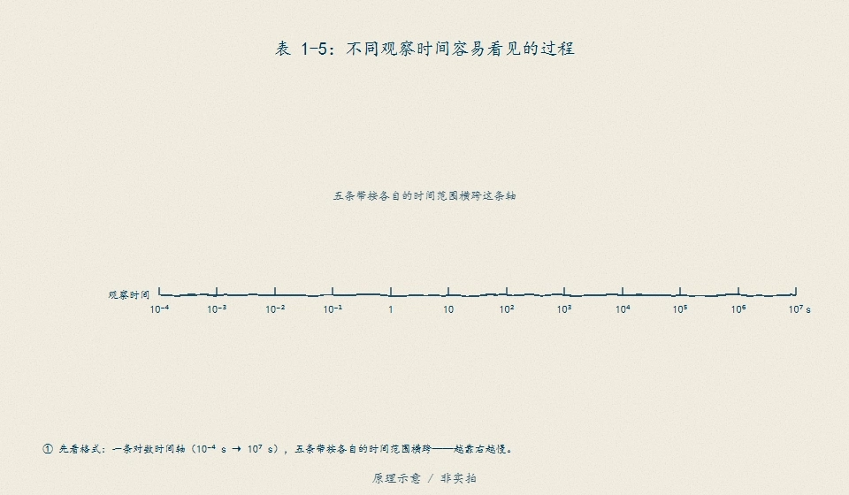
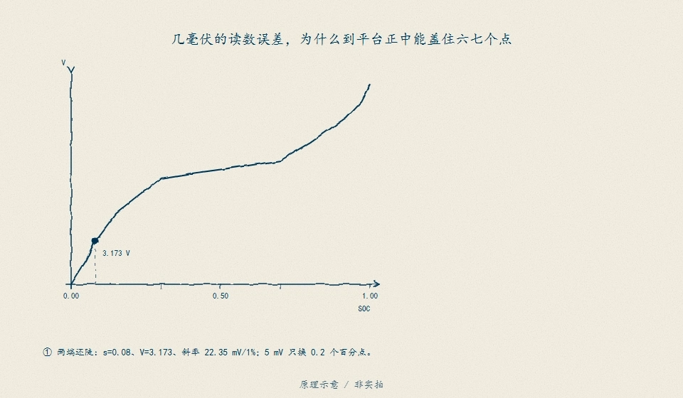

# D14　可观测性与无真值诊断

:::: story 现场
同一颗电芯、同一套代码，两个静置夜晚给出两个结论。平坦区那一夜，滤波器从 40% 出发，屏幕上的 SOC 一路爬到 50.5%，协方差却从 5 pp 缩到 0.80 pp——它越来越自信。换到陡区，同一算法只爬到 71.1%，误差 1.08 pp。算法没换、噪声没换、偏置也没换；变的是 OCV 斜率，以及数据里到底有没有能把 SOC 和电压偏置分开的“秩”。这一单元回答三个问题：一条曲线能给出多少信息；什么时候连信息量都救不了不可辨识；没有 SOC 真值时，哪些自洽性判据能报警、哪些只会陪滤波器一起自信。
::::

<aside class="reading-bet" aria-label="开读押注">
<p class="reading-bet__eyebrow">开读押注 · 小新息能不能证明 SOC 对</p>
<p>平坦区静置 60 拍，滤波器的新息归一化平方（NIS）均值 1.0087，看起来完全自洽。此时 SOC 误差可能是多少？</p>
<ol><li>接近 0——新息自洽就说明模型对</li><li>约 1 pp——和平坦区斜率同量级</li><li>约 10 pp——偏置被写进了 SOC，协方差并不知道</li></ol>
</aside>

:::: chapter-route 阅读路径
- **第一次主线**：D14.1–D14.2。Fisher 信息给精度排序，FIM 的秩给可辨识性排序。
- **第二遍深挖**：D14.3。平坦区“自信地错”与跨拐点恢复的反例对；新息、电荷平衡、双模型三种无真值判据各自能说什么。
- **动手验证**：D14.4。改偏置/斜率/静置拍数与脉冲路径，重跑同一算法；再改真值列证明估计轨迹不动。
::::

**它不证明**：本章全部数字来自合成教学链（Q = 2 Ah、σ = 5 mV、偏置 8 mV、确定性噪声种子 20261110），不是器件实测、不是 HIL、不是真人验收；真实 OCV 表、迟滞宽度与测量链在 SRC01 闭合前，本章不能给出任何真实电芯的 SOC 准确度。固件 `BmsInputs`（`code/firmware/bms.h`）只有 `cell_mv/current_ma/temp_c10/charger_present`，没有时间戳与测量质量字段，因此本章的新鲜度/质量诊断只到模型层，不能直接接进现有固件接口——这条边界待验。本章的“恢复”只指同一算法在更陡斜率下把误差压小，不代表偏置已被辨识；本章的“双模型互证”只产生分歧证据，不产生 SOC 真值。

## D14.1 从一条曲线到信息量

S2 已经给出局部反演式：电压误差 $b$ 除以 OCV 斜率 $g$ 得到 SOC 误差。D14 把它写成估计理论的语言。对单拍观测

$$
v = g\,z + b + n,\qquad n\sim\mathcal N(0,\sigma^2),
$$

固定 $b$ 时，$z$ 的 Fisher 信息与 Cramér–Rao 下界（CRLB）是

$$
J_z=\frac{g^2}{\sigma^2},\qquad
\operatorname{std}(\hat z)\ge\frac{\sigma}{g}.
$$

把 $z$ 换成百分点 $p=100z$，$g$ 换成 mV/pp，同一式子变成 $J_p=g_{\mathrm{mV/pp}}^2/\sigma^2$、$\operatorname{std}(\hat p)\ge\sigma/g_{\mathrm{mV/pp}}$。本单元冻结值 $\sigma=5$ mV：

| 工作区 | $g$（V/SOC） | $g$（mV/pp） | 单拍信息 $J_p$ | 单拍 CRLB |
|---|---:|---:|---:|---:|
| 陡区（≥60 pp） | 0.8 | 8.0 | 2.56 pp⁻² | **0.625 pp** |
| 平坦区（<60 pp） | 0.08 | 0.8 | 0.0256 pp⁻² | **6.25 pp** |

同样的 5 mV 观测误差，在平坦区折算出的 SOC 标准差是陡区的 10 倍，信息量差 100 倍。$N$ 拍独立静置观测把 CRLB 再除以 $\sqrt N$：60 拍时陡区 0.0807 pp、平坦区 0.8069 pp。**CRLB 是无偏估计器在给定模型下的下界，不是某个滤波器的实际误差**；本单元后面会看到，带未建模偏置的 z-only 滤波器是有偏的，它的实际误差可以远高于自己的协方差，也高于 CRLB。

**读法**：先问斜率，再问拍数。斜率决定“同样的电压误差值多少 pp”，拍数只按 $\sqrt N$ 改善；两者都不能把未知偏置变成已知。

同一条「信息量取决于观察窗」的道理，手绘时间轴给了另一副面孔：窗不同，量到的就不是同一个内阻。

<figure>

<figcaption>图 D14-F2　两道观察窗量出不同的"内阻"：窗越短，看见的越只是快速压降；窗越长，极化与扩散越混进来。曲线本身不携带信息量——信息量由模型、窗口与误差口径共同决定，与 D14.1 的 CRLB 读法互为表里。原理示意 / 非实拍。</figcaption>
</figure>

## D14.2 精度之外：秩

D12 的校准条件把偏置当成“表计误差”，默认它可以通过校准消掉；D14 问一个更硬的问题：如果偏置是未知常数 $b$，观测模型是 $v=U(z)+b$，那么 $(z,b)$ 能不能同时定出来？在局部线性 OCV 下，把状态写成 $\theta=[z_0,b]$，静置观测的灵敏度行是

$$
s_i=\begin{bmatrix}\partial v_i/\partial z_0 & \partial v_i/\partial b\end{bmatrix}
=\begin{bmatrix}g(z_i) & 1\end{bmatrix},
\qquad
\mathcal I=\frac{1}{\sigma^2}\sum_i s_i^{\mathsf T}s_i.
$$

**单一斜率**时所有 $s_i$ 只差一个倍数，$\operatorname{rank}\mathcal I=1$、$\det\mathcal I=0$：沿 $[1,-g]^{\mathsf T}$ 方向同时改 $z$ 和 $b$，电压完全不变。斜率从 0.08 换到 0.8 只改变信息量，不改变秩——**陡区也不能单独分离 z 与 b**。只有工作点跨过 OCV 拐点、灵敏度比 $g(z_i)/1$ 发生变化，两列才不再共线，$\operatorname{rank}\mathcal I=2$，$(z,b)$ 才同时可辨识。

`D14-observability` 的四个观测方案（FIM 只用静置观测；脉冲只负责搬工作点，脉冲本身的 R0/R1 辨识属于 D11）：

| 方案 | 观测 | 斜率集 | 秩 | $\det\mathcal I$ | $z$ 的 CRLB | $b$ 的 CRLB | 判读 |
|---|---|---:|---:|---:|---:|---:|---|
| `rest_flat` | 40 pp × 60 拍 | 0.8 mV/pp | 1 | ≈0（4.4e-16） | 不可辨识 | 不可辨识 | 平坦单点：精度差，秩也不够 |
| `rest_steep` | 70 pp × 60 拍 | 8.0 mV/pp | 1 | 0 | 不可辨识 | 不可辨识 | 陡区单点：精度好 100 倍，秩仍 1 |
| `pulse_flat` | 45 pp × 10 + 40 pp × 10 | 0.8 mV/pp | 1 | ≈0（1.1e-16） | 不可辨识 | 不可辨识 | 平坦区内 5 pp 脉冲：**脉冲≠可观测** |
| `hppc_knee` | 80/70/40 pp 各 10 拍 | 8.0 与 0.8 mV/pp | **2** | **16.5888** | **0.2690 pp** | **1.7612 mV** | 跨拐点：$(z,b)$ 同时可辨识 |

`hppc_knee` 的归一化行列式 0.2687，条件数 165.13；这两个数只描述本设计矩阵的几何，不是 SOC 精度。$z$ 与 $b$ 的 CRLB 0.2690 pp / 1.7612 mV 是“模型正确、噪声 5 mV、30 拍静置”的下界，真实滤波器还要受初值、过程噪声与模型误差影响。

**读法**：`pulse_flat` 是最容易被误读的一行。脉冲确实改变了 SOC，但如果两段静置都落在同一线性段，灵敏度比没变，FIM 仍然秩 1——**有激励不等于有可观测性**。设计 HPPC 时，除了“有没有脉冲”，还要问“脉冲把工作点搬过了哪条斜率边界”。

## D14.3 核心：平坦区的自信错误与跨拐点恢复

本单元的主反例只用一个标量卡尔曼滤波器，状态只有 SOC，模型里没有偏置：

$$
\hat z^-=\hat z-\frac{I\,\Delta t}{3600Q}\times100,\qquad
P^-=P+Q_z,
$$

$$
S=g^2P^-+\sigma^2,\qquad
K=\frac{P^-g}{S},\qquad
\hat z=\hat z^-+K\,(v_{\mathrm{meas}}-U(\hat z^-)),\qquad
P=(1-Kg)P^-.
$$

初值 $\hat z_0=$ 真值、$P_0=25$ pp²（std 5 pp），测量噪声 5 mV，真值上叠加 8 mV 未知偏置。平坦区 40 pp 与陡区 70 pp 只换工作点，滤波器代码、初值、噪声序列完全相同。

| 同一算法、同一偏置 | 平坦区 40 pp | 陡区 70 pp |
|---|---:|---:|
| 末误差 | **10.5451 pp** | **1.0815 pp** |
| 滤波自报 $P^{1/2}$ | **0.7966 pp** | **0.0808 pp** |
| 误差 / 自报标准差 | 13.24 | 13.39 |
| 新息 NIS 均值 | 1.0087 | 0.9333 |
| NIS 末 5 拍均值 | 0.5356 | 0.5441 |
| 累计修正量 | **10.5451 pp** | 1.0815 pp |
| 同号修正占比 | 0.55 | 0.5333 |
| 最大/平均绝对误差 | 11.8414 / 10.5658 pp | 1.4972 / 1.1580 pp |
| `confident_wrong` | **true** | false |
| 静置段电荷平衡失配 | **true** | false |

**反例 A（自信地错）**：平坦区里 8 mV 偏置被滤波器解释成 $8/0.8=10$ pp 的 SOC。协方差从 5 pp 收缩到 0.80 pp——它确实在“学习”，但学的是“把偏置写进 SOC”。误差/自报标准差 13.24，`confident_wrong=true`；**协方差收缩与误差扩大同时发生**。末 5 拍 NIS 均值 0.5356，甚至小于 1，说明滤波器认为自己的新息比预期还小；NIS 均值 1.0087 更没有报警。**拟合图≠独立验证**：新息自洽只说明滤波器按自己的模型消化了观测，电压拟合好不等于 $z$ 对；同一段残差不能当独立验证，独立验证必须来自未参与拟合的激励或独立参考。

**反例 B（同一算法恢复）**：陡区把同一偏置折算成 $8/8=1$ pp。误差从 10.5451 pp 降到 1.0815 pp，恢复比 **9.7504×**；协方差也收缩到 0.0808 pp。但残余 1.0815 pp 仍是同一个不可辨识的偏置，不是“辨识成功”。`confident_wrong=false` 只是因为 1.0815 pp 低于 2 pp 的绝对门槛，误差/自报标准差仍有 13.39——**滤波器在两种工作区都过度自信，只是陡区的偏置后果小 10 倍**。

**无真值判据一：静置段电荷平衡。** 静置时电流为 0，库仑账不应该动；滤波器却累计修正了 10.5451 pp。这个判据只读电流与滤波器轨迹，不需要 SOC 真值，平坦区报警、陡区不报警（1.0815 pp < 2 pp 容差）。它的前提是初值已由独立链路给出；初值未知时，先扣掉初始收敛段再判。**同号修正占比 0.55 在噪声下只作辅助**，不能单独当证据。

**无真值判据二：双模型互证。** 在同一数据上并行跑两个模型：z-only 与 $[z,b]$ 两状态 EKF。平坦单斜率 60 拍上，两个模型都能把 8 mV 吸收进不同的 $z/b$ 组合：

| 平坦单斜率（60 拍） | z-only | $[z,b]$ 模型 |
|---|---:|---:|
| 末 $z$ 估计 | 50.5451 pp | 44.1798 pp |
| 末 $z$ 误差 | 10.5451 pp | 4.1798 pp |
| 末 $b$ 估计 / 误差 | — | 5.2248 mV / −2.7752 mV |
| 末 $b$ 标准差 | — | 3.1479 mV |

两模型的 $z$ 估计差 6.3653 pp，$b$ 仍在 3.15 mV 的不确定度里；`separable=false`。**电压拟合不能判定哪一组 $z$ 是真的**——这正是秩 1 的含义，而不是“双模型一致所以可信”。

跨拐点 30 拍静置（80/70/40 pp 各 10 拍，中间用 2 A 脉冲搬工作点）后，斜率比变化，$(z,b)$ 秩 2：

| 跨拐点（30 拍静置） | z-only | $[z,b]$ 模型 |
|---|---:|---:|
| 末 $z$ 估计 / 误差 | 41.2356 pp / 1.2356 pp | **40.3203 pp / 0.3203 pp** |
| 末 $b$ 估计 / 误差 | — | **7.0130 mV / −0.9870 mV** |
| 末 $P_z^{1/2}$ / $P_b^{1/2}$ | 0.1395 pp | 0.2576 pp / 1.6596 mV |
| 末 5 拍留出新息 RSS | **669.1671 mV²** | **278.5534 mV²** |
| 末 5 拍留出新息 RMS | **8.1803 mV** | **5.2778 mV** |
| `separable` | — | **true** |

留出段是最后 5 拍静置；两模型都在前 25 拍上看过数据，但最后一拍更新前的“一步预测”没有用到该拍观测，因此可以比较。$[z,b]$ 模型的 RSS 低 58.4%，$b$ 误差 −0.9870 mV，$z$ 误差 0.3203 pp。**双模型互证只能给分歧/一致性证据，不能给真值**：如果两模型都错在同一条不可观测方向上，它们的“一致”同样是同义反复。

**无真值判据三：参数漂移方向。** 平坦区 $b$ 估计 **+5.2248 mV**，跨拐点 **+7.0130 mV**，两个工况同号；这支持“存在常数电压偏置”的假设，但不证明幅值正确（平坦区 $P_b^{1/2}=3.1479$ mV，幅值仍在不确定度内）。若两个工况的 $b$ 估计反号，更可能是 OCV 表/温度模型的分段误差，而不是常数偏置；若 $b$ 随 SOC 单调漂移，才需要怀疑容量/增益误差。方向判据只能定向，不能定量；它也不是老化证据——几何、连接与测点变化可以制造同方向的漂移。

**几何变化≠老化**：本章的 $z$ 偏差、$b$ 漂移、斜率变化都来自观测条件与模型失配，不是寿命证据。电芯几何、连接电阻、测点位置变化可以制造同方向的“参数漂移”；把这种漂移称作老化，需要独立的容量/阻抗/寿命数据（OS03、D15 的口径）。D14 不输出 SOH、健康度或寿命结论。

平坦区"自信的错误"有一幅手绘对照：平台区电压几乎不随 SOC 动，单看电压会把自己骗过去。

<figure>

<figcaption>图 D14-F1　平台区为何不信电压：OCV 曲线在平台段斜率近零，电压读数对 SOC 几乎无信息——这正是 D14.3"平坦区自信错误"的几何来源，与跨拐点恢复信息量互为对照。原理示意 / 非实拍。</figcaption>
</figure>

## D14.4 动手验证

```text
python code/engineering/identification/d14_observability.py
python code/engineering/identification/d14_observability.py --out <新目录>
python code/engineering/identification/d14_observability.py --profile <观测.csv> --z0 <pp> --out <新目录>
python -m pytest code/engineering/identification/test_d14_observability.py -q --basetemp=.tmp-pytest-d14
```

不带 `--profile` 时跑内置 `D14-observability` 冻结链；`--out` 落盘：

| 文件 | 内容 |
|---|---|
| `report.json` | 全部冻结数字、`identity`、FIM 表、反例与双模型摘要 |
| `fisher_profiles.csv` | 四个观测方案的秩、行列式、CRLB、条件数 |
| `counterexample_flat_trace.csv` / `counterexample_steep_trace.csv` | 平坦/陡区 z-only 逐拍轨迹（$z$、$P^{1/2}$、误差、新息、NIS、修正量） |
| `multipoint_profile.csv` | 80/70/40 pp 多段静置 + 2 A 脉冲的 54 拍合成工况 |
| `dual_model_bias_trace.csv` | $[z,b]$ 模型在跨拐点工况上的逐拍轨迹 |
| `profile_replay_trace.csv` / `profile_replay_input.csv` | 仅在 `--profile` 时落盘 |

外部回放 CSV 固定四列 `t_s,current_a,v_meas_mv,true_soc_pp`：`v_meas_mv` 是独立电压观测列，负载拍留空（带载端电压不能当 OCV）；`true_soc_pp` 只用于评分，估计器只读 `v_meas_mv` 与电流。缺列/错表头、非有限值、时间回退、真值越界、整列没有 `v_meas_mv` 观测、`--z0` 超出 [0,100] 一律 exit 2；`--z0` 在无 `--profile` 时给出也 exit 2（避免把回放参数误用于内置链）。**观测与参考分离**：只改 `true_soc_pp` 列重放，`z_hat` 轨迹必须逐点不动（有回归测试钉住）。

迁移任务（先写预测，再改数跑）：

1. 把 `VOLTAGE_BIAS_MV` 从 8 改成 4 和 16：平坦区末误差应约 5 和 20 pp，陡区约 0.5 和 2 pp；协方差基本不变。为什么 NIS 仍可能接近 1？
2. 把 `OCV_SLOPE_FLAT` 从 0.08 改成 0.04：单拍 CRLB、60 拍 CRLB、平坦区末误差各变多少？秩变不变？
3. 设计两条脉冲路径：一条在 45→40 pp 内来回（平坦区内），一条从 80 搬到 40 pp（跨拐点）。先用 `fisher_information` 预测秩，再跑 `dual_model_comparison` 看 `separable`；解释为什么前者“有脉冲但不可观测”。
4. 把 `multipoint_profile.csv` 的真值列整体加 1 pp 再 `--profile` 回放：`z_hat` 轨迹应逐点不变，`final_error_pp` 变 1 pp。若轨迹动了，先查估计器是否偷读了真值列。
5. 把 `REST_FRAMES` 从 60 改到 15（在副本里改）：平坦区 $P^{1/2}$ 会变大、误差/自报标准差可能低于 10；这说明“自信”本身依赖拍数与先验，不能拿单个协方差数字当正确性证明。

## D14.5 与 S2/D13 的接口

- **S2**：S2 的局部可观性行列式 $g(1-a)$ 回答“两拍状态观测矩阵是否退化”；D14 把它推广到“带未知偏置的 2 参数 Fisher 矩阵是否有秩 2”。S2 的短窗/平坦区反例在这里变成可执行的 FIM 排序与 `pulse_flat` 反例。
- **D12**：D12 的静置门、残差三口径与 W1/W2 隔离继续有效；D14 补上 D12 没回答的问题——当偏置未知时，静置窗的“校准”可能只是把偏置写进 SOC。D12 的 `residual_pp` 是先验不确定度，D14 的 CRLB 是模型下界，两者都不是后验精度。
- **D13**：D13 的 EKF 把库仑账当预测步、OCV 校正当更新步；D14 在它上面加两层检查：先看 FIM 秩够不够，再看新息/电荷平衡/双模型能不能报警。D13 的 Q/R 整定不能替代秩检查；Q/R 调得再漂亮，秩 1 的方向也不会因为调参变成可观测。
- **D15**：D15 的 SOH 需要独立的容量/阻抗/寿命数据；D14 的“参数漂移方向”不是老化证据。**几何变化≠老化**：几何、连接、测点变化可以在 D14 的模型里制造同样的漂移，必须由 D15 的独立老化证据区分。
- **B05**：数据角色继续分开——观测（`v_meas_mv`、电流）、合成真值（`true_soc_pp`）、预测（`z_hat`）、参考（本单元没有独立参考）。`report.json` 的 `identity` 明确声明合成身份。
- **OS01/OS02 口径**：OS01 的“模型名不能代替适用域”对应本章的“FIM 秩只在本模型/本工况内成立”；OS02 的“拟合流程明确不等于独立验证”对应本章的“新息自洽/拟合图≠独立验证”。两者都不把软件内部一致性写成实测结论。
- **固件边界**：`BmsInputs` 只有 `cell_mv/current_ma/temp_c10/charger_present`，没有时间戳、采样质量、通道身份或诊断计数。D14 的“新息自洽/电荷平衡/双模型”需要带时间戳的观测序列与质量位；现有结构不能表达“这拍是否可信、是否过期、是否与前一拍同源”。因此本章的诊断只到模型层，**不适用于现有固件接口**；要落地必须先补数据合同（时间戳、质量、来源），这条待验。

## D14.6 本单元已冻结的数字

以下数字全部来自 `d14_observability.py` 的实跑 `report.json`（本单元工件目录 `.tmp-d14-evidence/report.json`）；合成、非实测。

| 锚点 | 值 | 出处 |
|---|---|---|
| 单拍 CRLB（5 mV） | 陡区 **0.625 pp** / 平坦区 **6.25 pp** | `report.json → fisher.single_sample.steep/flat` |
| 单拍信息比 / CRLB 比 | 100× / 10× | 同上 |
| 60 拍单点静置 CRLB（$b$ 已知） | 陡区 **0.0807 pp** / 平坦区 **0.8069 pp** | `report.json → fisher.profiles.rest_steep/rest_flat` |
| 平坦区内 5 pp 脉冲（20 拍） | 秩 **1**，$\det\approx0$，CRLB 1.3975 pp（$b$ 已知） | `report.json → fisher.profiles.pulse_flat` |
| 跨拐点 80/70/40 pp（30 拍） | 秩 **2**，$\det$ **16.5888**，$z$ CRLB **0.2690 pp**，$b$ CRLB **1.7612 mV**，条件数 165.13 | `report.json → fisher.profiles.hppc_knee` |
| 平坦区 z-only 反例 | 末误差 **10.5451 pp**，$P^{1/2}$ **0.7966 pp**，误差/自报 13.24，NIS 均值 1.0087，末 5 拍 NIS 0.5356 | `report.json → counterexample.flat` |
| 平坦区累计修正 / 同号占比 | **10.5451 pp** / 0.55 | 同上 |
| 平坦区最大/平均绝对误差 | 11.8414 / 10.5658 pp | 同上 |
| 平坦区诊断标志 | `confident_wrong=true`，`charge_balance_mismatch=true` | 同上 |
| 陡区 z-only 反例 | 末误差 **1.0815 pp**，$P^{1/2}$ **0.0808 pp**，误差/自报 13.39，NIS 均值 0.9333 | `report.json → counterexample.steep` |
| 陡区累计修正 / 最大绝对误差 | 1.0815 pp / 1.4972 pp | 同上 |
| 陡区诊断标志 | `confident_wrong=false`，`charge_balance_mismatch=false` | 同上 |
| 同一算法恢复比 | **9.7504×**，残余 **1.0815 pp** | `report.json → counterexample.recovery_ratio / residual_bias_pp_steep` |
| 平坦双模型 | z-only 50.5451 pp；$[z,b]$ $z$=44.1798 pp（误差 4.1798），$b$=5.2248 mV（误差 −2.7752），$P_b^{1/2}$=3.1479 mV；`separable=false`；$z$ 估计差 6.3653 pp | `report.json → truth_free_diagnostics.dual_model.flat_single_slope` |
| 跨拐点双模型 | $[z,b]$ $z$=40.3203 pp（误差 0.3203），$b$=7.0130 mV（误差 −0.9870），$P_z^{1/2}$=0.2576 pp，$P_b^{1/2}$=1.6596 mV；`separable=true` | `report.json → ...multipoint_knee` |
| $b$ 估计方向 | 平坦 **+5.2248 mV** / 跨拐点 **+7.0130 mV**，同号；方向一致但平坦幅值仍不可定 | `report.json → truth_free_diagnostics.dual_model.bias_direction` |
| 跨拐点留出新息 | z-only RSS 669.1671 mV² / RMS 8.1803 mV；$[z,b]$ RSS 278.5534 mV² / RMS 5.2778 mV | `report.json → ...heldout_final_rest` |
| 工况与噪声 | Q=2 Ah，Δt=60 s，σ=5 mV，偏置 8 mV，$P_0^{1/2}$=5 pp，$b$ 先验 5 mV，噪声种子 20261110 | `d14_observability.py` 常量 |
| 多段工况规模 | 54 拍 = 30 拍静置 + 24 拍 2 A 脉冲；10 pp / 30 pp 两段放电；负载拍 `v_meas_mv` 留空 | `report.json` / `multipoint_profile.csv` |
| 外部回放拒绝 | 错表头/缺列、非有限、时间回退、真值越界、无观测、`z0` 越界 → exit 2 | `test_d14_observability.py` |

## D14.7 装配边界

- 先修 D02/D12/B03；D13 可并行，但 D14 的秩检查不依赖 D13 的 Q/R 整定。
- 本单元**不新增图源**，`manifest.json` 的 `figures` 保持为空；装配阶段如需图，按 `make_*_figures.py` 既有模式生成并配图回归，不在文档里引用不存在的 SVG。
- 合成教学参数（Q、斜率、偏置、噪声种子）只证明方法链；真实 OCV 表、迟滞宽度、测量链与温度依赖在 SRC01 前保持待验。**不认定**任何真实电芯的 SOC 准确度、SOH 或寿命。
- 本章的“双模型互证”不是独立验证：两个模型共享同一模型族、同一 OCV 表与同一噪声假设，只能给分歧/一致性证据。**拟合图≠独立验证**；独立验证需要未参与拟合的激励、独立参考或跨电芯数据。
- **几何变化≠老化**：几何、连接电阻、测点位置变化可以在本章制造“参数漂移”，不能据此写老化结论；SOH/寿命归 D15，且需要独立老化数据。
- 固件 `BmsInputs` 无时间戳/质量字段，本章诊断不适用于现有固件接口；要落地先补数据合同（时间戳、质量位、来源），这条待验。
- 本单元的场景、回归与章节指纹已登记，登记处于操作者审阅状态，审阅前不作为已验收依据。
