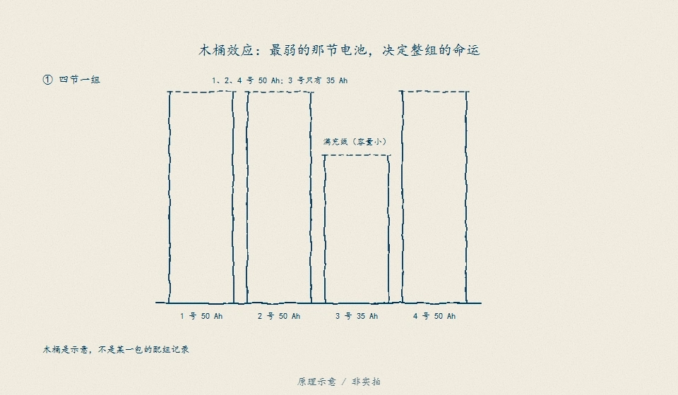
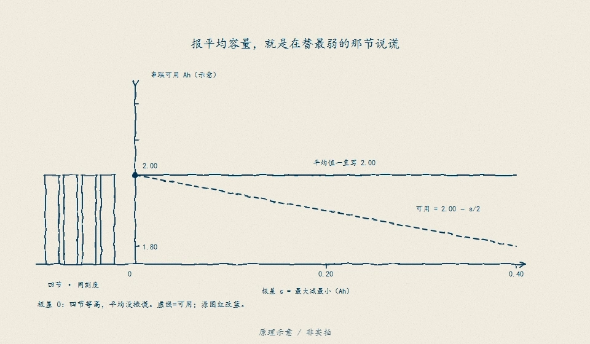

# D15　SOH 与老化：一个数字装不下三种寿命

:::: story 现场
售后说“健康度还有 85%，为什么质保要换？”——翻出记录才发现，85% 是容量型 SOH，按 25 °C、1 C 的标定数据算的；可这颗电芯在 45 °C 机柜里跑了一年，功率型 SOH 只有 72%，满功率放电时端电压先撞下限。同一颗电芯、同一时刻，三个“健康度”各自成立，唯独那个不带定义的 85% 不成立。这一单元把 SOH 拆成容量型、功率型、能量型三族，把老化写成可复算的合成轨迹，再用一个 45 °C 留出点证明：标定过的容量估计，换个温度就会失败，而且失败必须原样保留。
::::

<aside class="reading-bet" aria-label="开读押注">
<p class="reading-bet__eyebrow">开读押注 · 一个新循环等于多少老化</p>
<p>同一颗电芯跑 730 个循环，全程 25 °C，和前半程 25 °C、后半程 45 °C，循环数一样。25 °C 标定的“循环数→SOH”查表会给出什么？</p>
<ol><li>两者一样，循环数就是寿命</li><li>高温那段更老，查表会高估 SOH</li><li>温度只影响内阻，不影响容量</li></ol>
</aside>

:::: chapter-route 阅读路径
- **第一次主线**：D15.1–D15.2。老化两条通道（SEI 型 √t + 循环型线性）与 SOH 三族定义。
- **第二遍深挖**：D15.3。容量估计的标定数据要求、45 °C 留出失败与泄漏反事实。
- **动手验证**：D15.4。改 Ea、温度史和放电窗口，重算三族 SOH 与留出误差。
::::

**它不证明**：本单元的老化参数（Ea = 30 kJ/mol、k_cal、k_cyc、R₀ = 20 mΩ、Q = 2 Ah）全部是教学占位值，不是本电芯实测或拟合；老化轨迹与容量标定段都是合成数据，**不是器件实测、不是 HIL、不构成真人验收**。真实 SOH 估计必须用带数据身份（B05）的老化/标定数据重做，并通过独立温度点留出验证；合成数据上算得再准，也不能证明模型符合真实电芯。

## D15.1 老化不是一个斜率：SEI 型 √t 与循环型线性

合成老化模型把容量损失拆成两条可解释的通道：

$$
\Delta Q_{\text{cal}}(t)=k_{\text{cal}}\sqrt{t_{\text{eq}}},
\qquad
\Delta Q_{\text{cyc}}(N)=k_{\text{cyc}}N_{\text{eq}},
\qquad
t_{\text{eq}}=\sum_i \Delta t_i\,AF(T_i),\quad
N_{\text{eq}}=\sum_i \Delta t_i\,\dot N_i\,AF(T_i)
$$

第一项是 SEI 生长的扩散极限形状：损失随时间的平方根增长，前期快、后期慢；第二项是循环载荷的线性简化：每个等效循环扣固定容量，不建拐点（knee）、不建恢复、不建路径依赖。两项都通过 Arrhenius 因子折算成 25 °C 等效暴露：

$$
AF(T)=\exp\left[\frac{E_a}{R}\left(\frac{1}{T_{\text{ref}}}-\frac{1}{T}\right)\right],
\qquad T_{\text{ref}}=298.15\ \text{K},\quad R=8.314462618\ \text{J/(mol·K)}
$$

`D15-soh-aging` 的冻结教学链：`Ea = 30 kJ/mol`（**教学占位值**，落在文献常见 20–60 kJ/mol 区间，不是本电芯拟合结果），`k_cal = 0.35 %/√天`、`k_cyc = 0.01 %/循环`、内阻增长用同一结构但系数更大（`0.50 %/√天`、`0.02 %/循环`）。于是：

| 温度 | AF | 含义 |
|---|---|---|
| 25 °C | 1.0000 | 参考温度，1 个等效天/天 |
| 35 °C | 1.4810 | 同样 1 天只算 0.675 个“25 °C 天”的寿命 |
| 45 °C | 2.1399 | 同样 1 天算 2.14 个“25 °C 天” |

读法：AF 不是“温度系数”三个字，它是**把不同温度史折算到同一参考温度**的换算率。没有它，后面的循环数、日历天数都不能相加；有了它，也只能在模型有效域内相加（D15.7）。

老化路径分歧之外还有个体差异：同一批电芯也不会整齐地老。

<figure>

<figcaption>图 D15-F2　木桶效应：各节老化速度不同（√t 与线性路径叠加个体差异），整包先被最弱节触限。D15.1 的"老化不是一个斜率"既指机理（SEI/循环），也指对象（每节各自的一条线）——包级 SOH 是分布的下沿，不是平均值。原理示意 / 非实拍。</figcaption>
</figure>

## D15.2 SOH 定义族：容量型、功率型、能量型

同一颗电芯、同一时刻，三族 SOH 的定义与冻结值如下（合成工况：35 °C、1 循环/天、730 天）：

| 族 | 定义 | 冻结值 | 说明 |
|---|---|---|---|
| 容量型 `SOH_C` | `Q_now / Q_rated × 100` | **77.68%** | 还能存多少电荷；EOL 常用 80% |
| 功率型 `SOH_P` | `R_rated / R_now × 100` | **72.43%** | 固定电压窗下 `P_max ∝ 1/R` 的教学近似；不是峰值功率实测 |
| 能量型 `SOH_E` | `SOH_C × (V_loaded_now / V_loaded_BOL)` | **75.99%** | 额定电流 10 A 下可用电压保持率；不是容量型的同义词 |

该时刻的分解：日历损失 **11.51 pp** + 循环损失 **10.81 pp** = **22.32 pp**；内阻增长 **38.06%**（`R_now = 1.3806 R₀`）。能量型算法里，BOL 带载电压 `3.7 − 10×0.020 = 3.50 V`，老化后 `3.7 − 10×0.0276 = 3.4239 V`，电压保持率 **97.82%**，所以 `SOH_E = 77.68 × 0.9782 = 75.99%`。三族最大差 **5.25 pp**——这不是模型误差，是“健康度”这个词本身缺少定义。

三族各自的 EOL 阈值也不必相同：容量型常取 80%，功率型可能按“内阻增长 50%”或“额定功率下电压撞下限”定义，能量型则取决于负载曲线。**只写“SOH = 85%”而不写定义族、温度、倍率、EOL 阈值，等于没写**。报告里每个 SOH 数字必须带四件套：定义式、数据身份、工况、阈值。

三族定义共同压着同一笔账：串联同流、各节余量不同，最弱的那节先触线。

<figure>

<figcaption>图 D15-F1　最弱单体的安时账：串联电流相同，但各单体能到上、下限的余量不同；先碰线的那节决定整包何时停。SOH 三族（容量/功率/能量）量的就是"余量还剩多少"，平均数借不了余量。原理示意 / 非实拍。</figcaption>
</figure>

## D15.3 容量估计：标定数据要求与留出验证

容量估计只用一段放电的电荷量与两端静置后的 OCV：

$$
\hat Q=\frac{\Delta Q_{\text{Ah}}}{\Delta SOC/100},
\qquad
\Delta SOC = SOC(v_{\text{start}})-SOC(v_{\text{end}})
$$

`D15-capacity-holdout` 的内置数据：真实容量 `Q = 1.80 Ah`，1 A 恒流放电，端点按 25 °C 教学 OCV 表反查；表计偏移 +0.5 mV 烘进电压观测。**标定集**是 25 °C 的三段（90→30、85→35、80→40 pp），**留出集**是 45 °C 的 90→30 段。切分在查看结果前固定，45 °C 段从未参与调参。

| 样本 | 角色 | 温度 | 真值 Q / Ah | 估计 Q̂ / Ah | 误差 |
|---|---|---|---|---|---|
| C1 90→30 | 标定 | 25 °C | 1.80 | 1.8170 | +0.95% |
| C2 85→35 | 标定 | 25 °C | 1.80 | 1.8205 | +1.14% |
| C3 80→40 | 标定 | 25 °C | 1.80 | 1.8257 | +1.43% |
| V1 90→30 | **留出** | **45 °C** | 1.80 | **1.6317** | **−9.35%** |

标定最大误差 1.43%，在 3% 教学容差内；留出点 −9.35%，**判失败，原样保留**（`passed=false`、`failure_kept=true`）。

失败机制不是“噪声大”，而是**温度偏移被两条斜率不同地支放大**：45 °C 下合成 OCV 整体下移 6 mV（教学简化：−0.3 mV/K × 20 K，未建模 SOC 依赖）。起点在 0.8 V/SOC 陡支，6 mV 只折算 0.75 pp；终点在 0.08 V/SOC 平坦支，同样 6 mV 折算 7.5 pp。两端残差不等，`ΔSOC` 从 60 pp 被拉到 66.19 pp，容量因此被低估约 9.35%。这正是 D12“同一电压误差在平坦区被放大 10 倍”的容量版：**OCV 表的温度身份不是数据清洗项，是估计器的一部分**。

标定数据要求（每条都带可复算证据）：

1. **数据身份五字段**：来源、版本、单位、工况、行数/边界（B05）。报告 `identity` 段登记合成来源、版本 `d15-segments/1`、单位、温度/静置条件与 4 行样本；摘要只能证明文件没变，不能证明数据正确。
2. **先切分后看**：标定温度 {25 °C} 与留出温度 {45 °C} 在看结果前固定，`leakage=false`。若两个集合共享温度，报告必须标 `leakage=true`，留出通过也不算数。
3. **端点必须过静置门**：带载端电压不是 OCV。5 mV 极化残差落在 0.08 平坦支就是 6.25 pp；60 pp 窗口上容量误差约 **11.63%**。没有静置证据的端点只能当观测，不能当 OCV。
4. **温度必须进入 OCV 表身份**：单一温度标定不外推。25 °C 表用于 45 °C 留出点，就是上表的 −9.35%。
5. **窗口要够大**：端点 SOC 残差按窗口放大。0.5 mV 在 0.8/0.08 两支上折算 0.0625/0.6250 pp；40/50/60 pp 窗口的容量误差分别为 **1.43/1.14/0.95%**。窗口越小，同样的表计偏移越贵。
6. **电流计必须校准**：`ΔQ` 直接进分子。0.5% 增益误差直接变 0.5% 容量误差；20 mA 偏置 1 h 在 1.8 Ah 上约 **1.11%**。

**泄漏反事实**：把留出点的 6 mV 温度偏移反推回来再评分，误差被构造性压到 **0.95%**。这不是“45 °C 也能估”的证据，而是“用留出点调参”的现场演示；`leakage_counterfactual` 字段明确标注它**不能**算留出验证。

## D15.4 动手验证

```text
python code/engineering/identification/d15_soh_aging.py
python code/engineering/identification/d15_soh_aging.py --out <新目录>
python code/engineering/identification/d15_soh_aging.py --history <老化历史.csv> --out <新目录>
python code/engineering/identification/d15_soh_aging.py --segments <容量标定.csv> --out <新目录>
python -m pytest code/engineering/identification/test_d15_soh_aging.py -q --basetemp=.tmp-pytest-d15
```

`--out` 落盘四个工件：

- `report.json`：全部冻结数字与边界声明；
- `history.csv`：实际使用的老化史（`day_start,day_end,cycles_per_day,temp_c`，首尾相接、从 0 起）；
- `capacity_segments.csv`：标定/留出原始段（含 `v_start_v`、`v_end_v`、`delta_q_ah` 与只用于评分的真值 SOC 列）；
- `capacity_estimates.csv`：每段的 `q_true_ah`、`q_estimate_ah`、`error_pct`。

输入拒绝路径一律 exit 2：缺文件、表头不符、非有限值、温度越界、SOC 次序错误、电压越界、`role` 未知、缺 calibration/validation、重复 `segment_id`、老化历史时间不连续或倒退、循环/天越界。估计器只读电压与电荷量，**只改真值 SOC 列不会移动估计结果**（有回归测试钉住）——真值必须来自独立来源。

迁移任务：

1. 把 `Ea` 改成 50 kJ/mol，重算 AF(35)/AF(45) 与 25/35/45 °C 的 80% EOL 循环数；为什么“每升 10 °C 寿命减半”的经验规则在这里不成立？
2. 标定集加入 35 °C 段、仍留出 45 °C：容量估计会通过吗？如果不会，缺的是“更多标定点”还是“温度相关的 OCV 表”？
3. 设计一条**合法**的 45 °C 验证路径：需要哪些证据（温度分段的 OCV 表、静置门、独立容量基准）才能把 −9.35% 修成通过，而不碰留出点？
4. 把放电窗口从 60 pp 缩到 20 pp，用 0.5 mV 端点残差重算容量误差；为什么“短窗口快速点检”不能替代完整容量标定？

## D15.5 反例：循环数不是 SOH；与 D11/D12/D14 的接口

反例用两条**循环数完全相同**的老化史：都是 730 天、730 循环、1 循环/天。冷史全程 25 °C；热史前半程 25 °C、后半程 45 °C。25 °C 标定的“循环数→SOH”查表在 730 循环处给出 **83.24%**，对热史也照报 83.24%；热史真实容量型 SOH 只有 **76.69%**，系统性高估 **6.55 pp**，其中循环加速 **4.16 pp**、日历加速 **2.39 pp**。365 天分界处两条史相同、偏差为 0；偏差随高温暴露单调增长——这是“系统性”，不是一次性偏移。

反过来看同一 80% EOL：25 °C 需要 **931.68 循环**，35 °C 只需 **629.08**，45 °C 只需 **435.38**。**循环计数器记录的是 N，不是 N 在什么温度下发生**；它是温度加权损伤模型的输入，不是 SOH 本身。

接口：

- **D11**：HPPC 给出 `R₀/R₁/τ` 的辨识与留出合同；D15 的功率型 SOH 直接吃 `R_now`，但 D15 不重新拟合内阻参数。
- **D12**：OCV 校准的“静置够久、斜率够陡、迟滞同支”在本章变成容量估计的端点条件；平坦支放大 6 mV 的机制与 D12 同源。
- **D14**：可观测性与无真值诊断负责回答“没有容量基准时还能信什么”；D14 由并行单元 authoring，本单元不 import 它，只就地自含“端点残差/斜率放大”这一最小可观测性概念。
- **B05**：数据身份、先切分后看、泄漏三形态、合成与实测边界在本章逐条落地；留出失败不允许回拟合。

## D15.6 本单元已冻结的数字

| 锚点 | 值 | 出处 |
|---|---|---|
| Arrhenius 教学值 | Ea = 30 kJ/mol；AF(35 °C)=1.4810，AF(45 °C)=2.1399 | `d15_soh_aging.py` |
| 两通道老化 | 730 天/35 °C：日历 11.51 pp + 循环 10.81 pp = 22.32 pp | 同上 |
| SOH 三族 | 同一时刻容量型 77.68%、功率型 72.43%、能量型 75.99%（差 5.25 pp） | 同上 |
| 内阻增长 | 38.06%（`R_now = 1.3806 R₀`） | 同上 |
| EOL 循环数 | 25/35/45 °C 分别 931.68/629.08/435.38 循环 | 同上 |
| 循环数反例 | 730 循环：冷史 83.24% vs 热史 76.69%，高估 6.55 pp（循环 4.16 + 日历 2.39） | 同上 |
| 容量标定 | 25 °C 三段：1.8170/1.8205/1.8257 Ah，误差 +0.95/+1.14/+1.43%，通过 3% 容差 | `D15-capacity-holdout` |
| 容量留出 | 45 °C：1.6317 Ah，−9.35%，`passed=false`、失败原样保留 | 同上 |
| 泄漏反事实 | 反推 6 mV 温度偏移后 0.95%，只作泄漏演示 | 同上 |
| 端点放大 | 0.5 mV → 0.0625/0.6250 pp（0.8/0.08 斜率）；5 mV → 6.25 pp 平坦支 | 同上 |
| 窗口效应 | 40/50/60 pp 窗口：1.43/1.14/0.95% 容量误差（0.5 mV） | 同上 |
| 电流计 | 0.5% 增益 → 0.5% 容量误差；20 mA×1 h → 1.11% | 同上 |

## D15.7 装配边界

- 先修 D11/D12/D14 与 B05；本单元在 D17（SOP）之前交付。
- 全部老化轨迹与容量段为合成数据；真实寿命模型必须在多温度老化数据上拟合 Ea 并登记数据身份（B05）——老化实证的闭合路径是 OS08（BLAST 条件域），跨电芯/温度验证组归 SRC07。

- **占位数值不当估计**：Ea = 30 kJ/mol、`k_cal`、`k_cyc`、R₀ = 20 mΩ、Q = 2 Ah 都是教学值。它们只展示机制与量级，不能作为本电芯参数、寿命预测、质保承诺、设计余量或采购依据。真实拟合必须在多温度、多倍率老化数据上完成，并登记数据身份与置信区间。
- **有效域不当许可**：模型没有拐点、恢复、路径依赖与温度依赖的 OCV 表，只在合成设定与已登记温度/倍率/循环史内成立。25 °C 标定不许可 45 °C；45 °C 留出失败就是反证。SOH 跌破 60% 或内阻增长超过 200% 后，报告标 `in_valid_domain=false`，只能当外推观察，不能当寿命结论。
- **单一 SOH 含混**：容量型、功率型、能量型在同一时刻差 5.25 pp；没有定义族、工况与 EOL 阈值的“健康度”不可复算，不能用于许可、质保、梯次利用分级或安全结论。
- **合成数据边界**：老化轨迹与容量段都是合成数据，**不认定为器件实测、HIL 通过或真人验收**。算法能恢复合成真值，只证明算法在设定模型下自洽，不证明模型符合真实电芯。
- **固件边界**：固件 `BmsInputs`（`code/firmware/bms.h`）只有 `cell_mv/current_ma/temp_c10/charger_present`，没有时间戳、质量/新鲜度字段、循环计数或累计电荷。SOH 的时间、循环与电荷输入必须由上层提供并登记身份；不能把一帧瞬时读数当老化估计，也不能从固件结构直接推出“SOH 可观测”。
- 本单元的场景、回归与章节指纹已登记，登记处于操作者审阅状态，审阅前不作为已验收依据。
