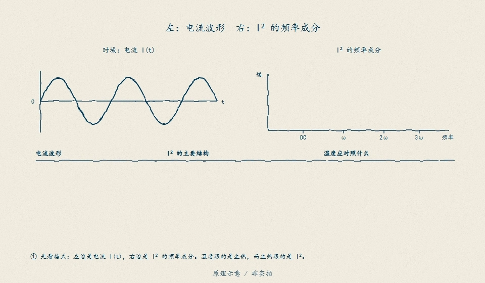

# D16　热模型与测点：壳温量的是壳，芯温藏在梯度后面

售后返修件解剖：电芯卷芯已经发软，壳温记录却全程没有越阈——保护没误动作，它只是没看见。这一单元用两节点集总热网络证明：NTC 贴在壳上，量到的永远是被热阻和热容削过的壳温；「芯-壳梯度 + 传感器自身滞后」叠加出一个**沉默带**——带内芯温已超芯限，所有壳温测点都还没到阈。全部热参数（R_th、C_th、芯限、壳阈、NTC 时间常数与热分压）是教学值，不认定为任何器件实测、热仿真验收或真人评审结论，也不证明任何具体电芯的热行为；真实参数必须按本单元的辨识合同从实测数据取得（B05 数据身份纪律）。

## D16.1 两节点网络：芯 → 壳/散热器 → 环境

焦耳热 P = I²R 全部进芯节点（教学口径忽略熵热与均流），芯经 R_cs 到壳、壳经 R_sa 到环境。网络参数（教学值）：R_int = 0.09 Ω、C_core = 36 J/K、R_cs = 3.0 K/W、C_case = 120 J/K、R_sa = 2.5 K/W（R_total = 5.5 K/W），环境 30 °C，芯限 70 °C，壳温 OT 阈 60 °C。两条模态：τ_fast = 76.95 s、τ_slow = 421.05 s（离散步长 1 s 远快于最快模态；解析快模态 108 s 与离散值的差是 C_case 分流所致，报告同时给两个数）。10 A 稳态：P = 9 W，芯-壳梯度 P·R_cs = 27 K，总温升 49.5 K——芯温 79.5 °C 已超芯限，壳温只有 52.5 °C。

进芯节点的焦耳热是 $I^2R$，而"电流平方"对不同波形的含义并不直观：手绘频谱对照补这一课。

<figure>

<figcaption>图 D16-F1　$I^2$ 并不总使频率"翻倍"：不同电流波形经平方后产热分量的频谱不同，再经芯-壳网络的热低通削平才成为温升。两节点模型吃的是 $I^2R$ 净热，波形语义是输入的一部分。原理示意 / 非实拍。</figcaption>
</figure>

## D16.2 沉默带：壳阈在带内永不触发

把「芯温到限而壳温未到阈」的电流区间算出来：8.99–11.55 A（环境 30 °C）。带的上沿处壳温刚到 60 °C 时，芯温已 96 °C——芯-壳差 36 K。可执行反例：10 A 恒流 1500 s，芯温峰值 78.45 °C（超芯限 8.45 K），壳温峰值 51.72 °C（距阈还有 8.28 K），三个测点全部未触发。保护没坏，它量的对象错了。

## D16.3 测点选择：分压与滞后是两笔不同的账

三个候选测点（名字 → NTC 时间常数 τ、热分压系数）：极耳 tab_bonded（10 s、1.0）、壳侧 case_side（45 s、0.92）、PCB 远端 pcb_remote（120 s、0.45）。13 A 阶跃后 60 s 窗口内芯温升 8.19 K，三个测点只测到 7.25% / 3.87% / 1.37%——滞后吃掉大头。拆开两笔账：假想「完美分压 + 慢 NTC」（τ=120 s、增益 1.0）在阶跃后 509 s 检测到阈，「分压 0.92 + 快 NTC」（τ=10 s）反而要 555 s——**热分压缺陷补不回来，再快的传感器也不行**。以 pcb_remote 为基准的改进量：tab_bonded 把芯限穿越瞬间的读数欠估从 34.23 K 收窄到 24.72 K（改善 9.51 K），case_side 收窄 7.67 K；但基准测点整段工况从未到阈——改善的只是「测到壳温」的忠实度，「壳≠芯」的结构性偏差一寸没动。

## D16.4 动手验证

```text
python code/engineering/cell_model/d16_thermal.py
python code/engineering/cell_model/d16_thermal.py --out <新目录>
python code/engineering/cell_model/d16_thermal.py --data <辨识.csv> --out <新目录>
python -m pytest code/engineering/cell_model -q
```

`--out` 落盘 `report.json`、`thermal_log.csv`（合成工况全轨迹）、`identification.csv`（辨识窗数据）；`--data` 回放你的辨识 CSV（表头 `t_s,q_w,t_case_c,t_ntc_c,t_core_c,ambient_c`）。数据合同强制执行：错表头、缺列、非有限、时间回退、采样间隔 >60 s、q_w 为负、样本 <20 一律 exit 2 拒绝，不猜。

辨识合同与盲区：稳态壳温数据只能辨识壳→环境那一段（全窗拟合 R_th ≈ 2.63 K/W ≈ R_sa，真值 5.5 K/W 的芯→壳段在稳态不可见——留出工况 11 A / 35 °C 不参与辨识，验证 RMS 0.998 K、max 2.05 K）；短窗（200 s）把 τ 推到网格上沿（5117 s，`tau_at_grid_edge=true` 报边界，不得当成估计值），朴素稳态差分在短窗把 R_th 低估 4 倍（0.639 vs 2.457 K/W）；贴壳 NTC 的自身滞后几乎原样加进 τ（678.9 vs 568.1 s，虚增 110.8 s）。采样 ≥1/7.7 s 才能抓住快模态；30 s 粗采样与 0.1 K 量化均不改变结论（报告给了两组对照）。

迁移任务：

1. 把 R_cs 从 3.0 改成 1.5 K/W（灌封电芯）：沉默带怎么移？谁受益、谁买单？
2. 设计一个「壳温 + 电流积分」的芯温观测器：需要额外标定什么？用 D16.3 的分压/滞后分解说明它的误差上界。
3. 若固件只有一个 temp_c10：从 thermal_log.csv 挑一条轨迹，论证 60 °C 壳阈应配多大的去抖拍数（对照 D8.2 的盲区账）。

## D16.5 与 D08/D17 的接口

D08 的最坏反应窗 72.263 ms 只覆盖电气链；OT 判决的总预算 = 热网络把壳温推到阈值的时间 + NTC 滞后 + 去抖拍数（本模块 `trip_delay_s` 给解析式）。实测分解：网络段 379 s + 传感器段 214 s = 593 s，是 D08 电气窗的 8206 倍——拿 D08 窗口当 OT 总预算会低估热链路三个数量级。D17（SOP）接口：稳态芯温不越限的持续电流 I = √((限−环境)/(R_total·R_int))，30 °C 环境 8.99 A、45 °C 环境 7.11 A——热契约是 SOP 的前置，D17 必须等本单元闭合。

## D16.6 本单元已冻结的数字

| 锚点 | 值 | 出处 |
|---|---|---|
| 两模态时间常数 | τ_fast 76.95 s / τ_slow 421.05 s（解析快模态 108 s） | `d16_thermal.py` |
| 10 A 稳态 | 芯 79.5 °C / 壳 52.5 °C；梯度 27 K | 同上 |
| 沉默带 | 8.99–11.55 A；带沿芯-壳差 36 K | 同上 |
| 沉默带反例 | 芯超 8.45 K、壳余 8.28 K、三测点零触发 | 同上 |
| 阶跃滞后 | 60 s 窗芯升 8.19 K；测到 7.25% / 3.87% / 1.37% | 同上 |
| 分压 vs 滞后 | 完美分压慢 NTC 509 s < 分压 0.92 快 NTC 555 s | 同上 |
| 测点改进量 | 欠估收窄 9.51 K（tab）/ 7.67 K（case_side），基准从未到阈 | 同上 |
| OT 预算分解 | 379 s + 214 s = 593 s = D08 窗的 8206 倍 | 同上 |
| SOP 持续电流 | 30 °C：8.99 A；45 °C：7.11 A | 同上 |
| 辨识全窗 | R_th 2.6266 K/W、τ 568.08 s、RMS 0.390 K | `D16-thermal-identification` |
| 短窗退化 | τ 5117 s 顶格（报边界）；朴素 R_th 低估 4 倍 | 同上 |
| 留出验证 | 11 A / 35 °C：RMS 0.998 K、max 2.05 K、终差 −0.48 K | 同上 |

## D16.7 装配边界

- 先修 D02/B02/B05；本单元在 D17（SOP）之前交付，D08 已冻结的电气窗不被本单元改动。
- 全部热参数为教学值；真实 R_th/C_th 必须按辨识合同从实测数据取得并登记数据身份（B05）——热参数标定与独立温度测点的闭合路径是 SRC04，整包热模型接口归 OS03。
- 固件 `BmsInputs` 只有单个 `temp_c10`、无时间戳、无质量位、无测点身份字段——固件层面无法区分「传感器滞后」与「热惯性」，也无法同时携带壳温/芯温两条链；本单元的两节点模型与多测点对比是教学补全，不证明固件已实现热状态估计。
