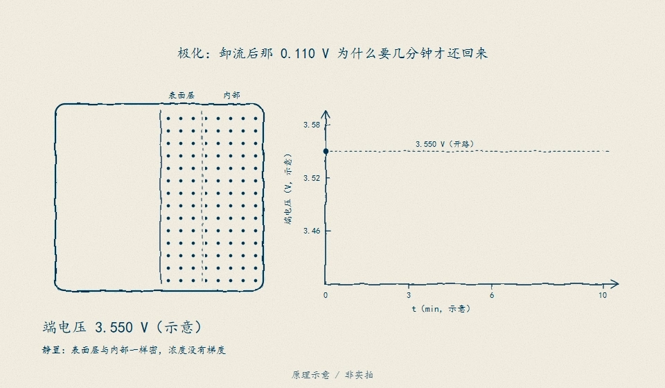
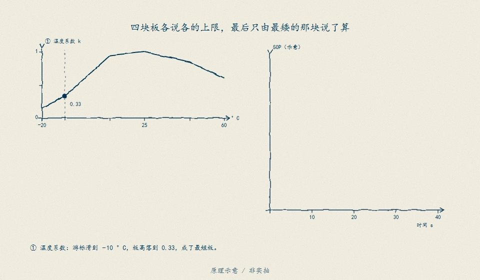

# D17　SOP 与多约束：窗口锚定、最弱环与单快照的虚高

一颗 3 Ah 教学电芯停在 90% SOC：只按「此刻 OCV 减去下限、再除以欧姆内阻」的闭式，它说还能放 **12.44 A**；把窗口锚成 10 s，许可掉到 **8.99 A**，锚成 600 s 只剩 **6.51 A**；换到 15% SOC 的长窗，SOC 墙把它压到 **0.90 A**。四个数回答的不是同一个问题：前者是「此刻电压余量除以电阻」，后者才是 SOP——「未来这个窗口内最多允许多大电流」。本单元把电压、SOC、热与绝对电流帽四条上限写成可计算的最弱环，逐窗给出主导约束、其余余量与端口功率。全部电芯与热参数为教学值，**不证明**任何真实电芯的功率承诺，**不代表**器件实测或热仿真验收；R(T)、整包最弱单节与瞬态热峰值余量仍是**待验**边界，**不能**把 30 °C 的单节数值外推到低温、整包或快充场景。

## D17.1 四条上限与取最小

**电压墙**。用 D02 的 OCV + 一阶 RC，`I > 0` 放电、`I < 0` 充电，端电压 `V = U(z) − I·R0 − v_p`；零阶保持下一拍精确递推：

$$
z_{k+1}=z_k-\frac{I_k\,\Delta t}{3600\,Q},\qquad
v_{p,k+1}=a\,v_{p,k}+R_1(1-a)I_k,\qquad a=e^{-\Delta t/\tau_1}
$$

对每个候选电流前向仿真整个窗口，要求 `min V ≥ v_min` 且 `max V ≤ v_max`。候选电流是常值时端电压在窗内至多一个内部极值，但本模块不靠这句话省事：二分内部逐拍扫描整窗，报告再用 1 s 步长在任何一档上复核 min/max。二分的是单调可行性（电流越大压降越大），零电流即越压时返回 **0.0**——当前状态不允许该方向电流，不返回负值、不返回 `inf`，也不对负数开方。

**SOC 墙**。库仑账是线性的（D12）：窗末停在下限（放电）或上限（充电），

$$
I_{soc}=\frac{(z_0-z_{\min})\cdot 3600Q}{\Delta t}
\quad\text{或}\quad
I_{soc}=\frac{(z_{\max}-z_0)\cdot 3600Q}{\Delta t}
$$

**热墙**。取 D16 的稳态契约（芯温不越限的持续电流），不另造参数：

$$
I_{th}=\sqrt{\frac{T_{\lim}-T_{amb}}{R_{total}\cdot R_{int}}}
=\sqrt{\frac{70-30}{5.5\times0.09}}=8.9893\ \text{A}\ (30\ ^\circ\text{C}),
\qquad 7.1067\ \text{A}\ (45\ ^\circ\text{C})
$$

分子非正时直接拒绝：环境已达芯限就没有正许可，不能把「已过温」翻译成某个电流。这道墙是**稳态**契约，对每个窗口档同样适用；「短窗靠热容多放一点」的峰值余量不在本闭式的承诺内（OS03 接口）。

**绝对电流帽**：20 A 放电、10 A 充电（连接器/熔断器，教学值）。

热墙的已知简化写在报告里：它沿用 D16 的单一发热内阻 0.09 Ω，电压模型的 R1 = 30 mΩ 耗散没有单独计入生热；若把 R1 也算进 `R_heat`，热墙会从 8.9893 A 降到 **7.785 A**（`thermal_contract.r1_dissipation_included_a`）。真实整包热模型（OS03）必须逐支路计热，不能把这两个数混用。

**取最小与功率合同**。四条上限都先写成电流幅值，再取最小；不许取平均，也不许先按方向翻符号再比较。窗口分档 10/30/60/600 s 与「持续」：持续档只问稳态压降（`R0+R1` 极化）与热，**不承诺跑空**，所以 SOC 墙在该档记 `null` 而不是编一个数。功率按合同 `P = V_窗末 × I_有符号`：放电为正（外送），充电为负（吸收）。

**参数不确定性如何缩限**。上面的 8.9893 A 等数字是「名义参数」的许可，不能直接当保证值。本单元声明五条教学不确定度：R0 ±20%、R1 ±30%、Q ±5%、R_total ±15%、OCV ±10 mV。缩限口径不是把上下限平均，而是**每条上限在自己的最坏角点重算，再取最小**：

- 电压墙：R0、R1 取高角点，OCV 取最不利偏移（放电向下、充电向上）；
- SOC 墙：Q 取低角点——可用容量少，同样的电量预算给出更小的电流；
- 热墙：R_total 取高角点；
- 电流帽精确，没有不确定度。

于是 `I_unc = min(I_voltage^corner, I_soc^corner, I_th^corner, I_cap)`。三个闭式能直接看出方向：`I_soc ∝ Q`，低角点就是 `I_soc × (1−5%)`；`I_th ∝ R_total^(−1/2)`，高角点就是 `8.9893/√1.15 = 8.3826 A`；电压墙没有闭式，用同一套整窗二分在角点参数上重跑（R1 的 τ 按 `R1·C1` 同步缩放，不把 τ 当独立参数）。报告 `uncertainty` 块逐档给出 nominal、uncertain、shrink、角点在限与主导参数；`scale` 是可审计倍率（0 = 名义、1 = 声明值、越大越紧），每档 `uncertain_a` 对 `scale` 单调不增——这是测试钉住的不变量，不是口号。

两个教学点。第一，收缩量不是「误差棒的平均」：高 SOC 的 10 s 档只被热墙收紧 0.6067 A，60 s 档名义仍由热墙在限（8.9893 A），角点后电压墙以 7.8658 A 反超，收缩 1.1235 A；其中 R0 单独贡献 0.8832 A，R1/OCV 单看不动、与 R0 联合后再多 0.2403 A（`joint_extra_a`）。同一组参数在不同窗口档的主导不同，必须逐档说清。第二，主导参数是「单独施加该角点、其余保持名义」时收缩最大的那个（`per_parameter_shrink_a`），联合角点比单参数最坏多出来的部分记在 `joint_extra_a`——它是非线性交互，不是另一条独立上限。充电侧 OCV 取高角点，方向与放电相反；这不是两套规则，而是「电压墙的最不利角点」在两个方向上的同一个定义。

电压墙背后是什么在吃掉余量，手绘给了物理图景：极化不是额外电阻，是带载后界面与浓度的重新分布。

<figure>

<figcaption>图 D17-F2　极化的物理图景：R0 的欧姆压降随撤流立刻回弹，R1/R2 的极化压降要经松弛才退——D17.1 电压墙按"窗末端极化已长到哪"取最不利，不是按名义内阻拍脑袋。原理示意 / 非实拍。</figcaption>
</figure>

## D17.2 核心机制：最弱环逐窗换人

高 SOC（0.90、30 °C）放电，四档的分解：

| 窗口 | 允许 | 主导 | 电压墙 | 热墙 | SOC 墙 | 窗末 SOC |
|---|---|---|---|---|---|---|
| 10 s | 8.9893 A | 热 | 11.4981 A（余 2.5088） | 8.9893 | 864.0 A | 89.1677 pp |
| 30 s | 8.9893 A | 热 | 10.2956 A（余 1.3062） | 8.9893 | 288.0 A | 87.503 pp |
| 60 s | 8.9893 A | 热 | 9.3312 A（余 **0.3419**） | 8.9893 | 144.0 A | 85.0059 pp |
| 600 s | 6.5067 A | 压 | 6.5067 A | 8.9893（余 2.4826） | 14.4 A | 53.8515 pp |
| 持续 | 8.9893 A | 热 | 9.3333 A（余 0.344） | 8.9893 | — | — |

三件事一眼可见：

1. **热墙压住所有短窗**。10/30/60 s 三档的允许值完全相同（8.9893 A），因为稳态热契约与窗口长短无关；把 10 s 档的 8.99 A 抄成「峰值能力」或把 60 s 档抄成「持续能力」，都是同一个数在不同标签下重复。
2. **电压墙在长窗反超**。600 s 档窗末电压正好落在 3.000007 V：1.12 V 的余量里，阻抗吃掉 6.5067×0.12 = 0.7808 V，SOC 下降再吃掉 0.3392 V（OCV 从 4.1200 掉到 3.7808 V）——30% 的余量被电量账拿走。60 s 档电压墙只差 0.34 A 就要反超热墙，最弱环不是永远同一个。
3. **SOC 墙只在低 SOC 长窗出现**。15% SOC、600 s：电量预算 `(0.15−0.10)×3 Ah = 0.15 Ah` 除以 600 s 只剩 **0.90 A**（窗末恰好 10.00 pp）；此时电压墙还有 1.7477 A（余 0.8477 A），热墙远在 8.9893 A。持续档在低 SOC 给 3.9084 A（电压稳态），比 600 s 档更松——因为它不算电量账，这不是矛盾，是口径不同：**持续档回答「能扛多久不越压」，窗口档回答「这个窗口内能不能撑住」**。

充电（0.50、30 °C）全部由电压墙在限：10 s 4.6526 A、60 s 3.8614 A、600 s 2.7361 A、持续 3.7500 A；600 s 档窗末恰好贴在 4.2 V（`P = −11.4917 W`）。充电侧靠近上限那一端，OCV 到 `v_max` 的余量本就比放电侧小，这是 CV 区的来源，也是充电许可必须更保守的原因之一（另一半是 D18 的温度地图）。

**窗口单调性**：窗口越长，电压墙（更多 RC + 更多 OCV 下降）与 SOC 墙（同样的电量预算除以更长时间）都只会更紧，热墙与电流帽不变，所以取最小后 `10 s ≥ 30 s ≥ 60 s ≥ 600 s`。持续档可以低于最短窗（低 SOC 的 3.9084 A < 4.846 A），但不会高于它——稳态极化 `R0+R1` 是最慢的压降。

**温度降额只动热在限的档**。45 °C 时热墙 8.9893 → 7.1067 A（降 **20.94%**），10/30/60 s 与持续档同步下降；600 s 档不动（6.5067 A，降 0.0%）——它的主导是电压墙，而本模型的 `R0/R1` 不随温度变化。真实电芯升温会同时推高内阻，电压墙也会收紧；这条温度耦合是 D15/D16 的接口，本单元不假装已经算进去。

多约束降额的总貌用一幅手绘收拢：四条上限各自画成一堵墙，SOP 是取最小后在限的那一堵。

<figure>

<figcaption>图 D17-F1　SOP 多约束降额：电压墙、SOC 墙、热墙与电流帽各自成墙，逐窗取最小；墙会随窗口与温度换人（D17.2 的 8.9893 → 7.1067 A 角点即热墙接任）。原理示意 / 非实拍。</figcaption>
</figure>

## D17.3 反例：单快照 SOP 的虚高

单快照 Rint 闭式 `I = (U(z_0) − v_min)/R0` 只除一条代数式。同一个 90% SOC 工况，它报 **12.4444 A**：

- 对 10 s 窗口（8.9893 A）高估 **38.4362%**——它没算 RC 极化，60 s 时 `R1(1−e^{−60/45}) = 0.0221 Ω` 已经是 `R0 = 0.09 Ω` 的 **24.5468%**；
- 对 600 s 窗口（6.5067 A）高估 **91.2559%**——除了极化，还漏掉 0.3392 V 的 OCV 下降；
- 低 SOC（0.15）长窗更刺眼：快照 **5.2112 A**，窗口只给 **0.90 A**，高估 **479.0259%**——它完全看不见 SOC 墙。

反例不是说「闭式公式错」：它算的是另一道题（此刻电压余量除以欧姆内阻），作为初值筛选或交叉检查仍有价值。**错的是把它当 SOP 报出去**。判据要写在交付物里：每个数必须带窗口、初始 SOC/极化、参数版本、四条上限的分解与主导约束（本书 14.6 的交付表），只报一个电流数字无法审计。

**只检查终点的反例**。恒流窗口里端电压对时间是单调的（充电同理），窗末就是最坏点；这时「只查窗末」与「整窗仿真」必然给出同一个判定——所以端点反例必须用**窗内换流**的剖面。内置工况在 t = 1500 s 把 12 A 切回静置：从 t = 1450–1490 s 出发的 60 s 窗口，窗内最小值仍在 12 A 脉冲末尾（2.097118 V），而窗末已经静置恢复（t = 1490 s 的窗末 3.418301 V，t = 1450 s 的窗末 3.248761 V），只看窗末会判「不越压」。逐拍同时算两个口径，内置工况冻结为：整窗实际剖面违约 **35** 拍、只看窗末违约 **30** 拍、**端点漏报 5 拍**（t = 1450/1460/1470/1480/1490 s）。对照 t = 1300 s 的恒流窗口：`trajectory_min_v = endpoint_v = 2.231388 V`，两个口径一致——漏报只可能来自「窗内不是同一条恒流」。这条反例不是保守/激进的取舍问题，而是**会漏掉整段脉冲**的判据错误；SOP 的窗口合同必须检查全程。

## D17.4 动手验证

```text
python code/engineering/power/d17_sop.py
python code/engineering/power/d17_sop.py --out <新目录>
python code/engineering/power/d17_sop.py --profile <工况.csv> --out <新目录>
python -m pytest code/engineering/power -q
```

`--out` 落盘 `report.json`、`sop_tiers.csv`（3 个工作点 × 5 档 = 15 行）、`profile.csv`（181 拍合成工况）、`profile_audit.csv`（逐拍 SOC / 允许电流 / 主导约束 / 是否越限 / 整窗 min-max / 端点电压 / 端点漏报）。`report.json` 另含 `uncertainty` 块（逐档 nominal / uncertain / shrink / 角点在限 / 主导参数）与 `profile_replay.endpoint_only`（两口径违约帧数与漏报帧）。`--profile` 回放你的电流剖面：表头**至少**含 `t_s,current_a` 两列（多余列忽略）。数据合同强制执行：缺文件、错表头/缺列、非有限值、`t_s` 未严格递增（含重复）、样本 <10 拍、回放积分让 SOC 越出 [0,1]，一律 **exit 2** 并在 stderr 给原因，不猜、不静默限幅。默认场景 exit 0。

回放口径写在报告 `conventions` 里：CSV 没有 SOC 列，回放从声明的 90% 起算并按库仑账积分；极化从 0 起、逐拍 ZOH 递推。`profile_audit.csv` 的 `allowed_a` 是「该拍状态 + 60 s 窗口」的 SOP，`exceeded` 是实际电流是否超过它（容差 0.05 A），`window_violation` 是拿实际电流（常值假设）整窗仿真是否真的越压——两个口径分别回答「超过许可」与「真的越压」，内置工况里它们都是 30 拍，但报告仍分开记。端点审计另起两列：`trajectory_min_v/max_v` 按剖面**实际电流**仿真 60 s，`endpoint_v` 只取窗末；`endpoint_only_violation` 是只看窗末的判定，`endpoint_missed` 标记「整窗已越压、窗末却看不出来」的拍。内置工况冻结：整窗 35 拍违约、端点 30 拍违约、漏报 5 拍（t = 1450–1490 s），见 D17.3 与 D17.6。

内置工况：90% 静置 5 min → 6 A 基载 10 min → 静置 5 min → 12 A 过载 5 min → 静置 5 min。90 个带载拍里 30 拍超过 60 s 窗口 SOP，首拍 t = 1200 s，最大超出 **9.932 A**（t = 1490 s，允许只剩 2.068 A）；6 A 基载全程在包线内（`profile_audit.csv` 里最紧的一拍允许 6.5244 A，余 0.5244 A）。回放能量账：放电 2.0 Ah、窗末 23.3333 pp、能量 5.53585 Wh。

迁移任务：

1. 把环境改 45 °C、芯限改 60 °C（两者同时改）：哪些档换主导约束？600 s 档为什么可能仍不动？用 `sop_tiers` 的四个上限逐个解释。
2. 把 R1 从 30 mΩ 改成 10 mΩ（新电芯）与 60 mΩ（老化）：快照与 600 s 窗口的差距分别怎么变？哪一个对老化更敏感，为什么？
3. 用 `profile_audit.csv` 设计一个在线降额触发条件：用「余量 < 0.5 A 连续 N 拍」还是「已经越限」？说明采样延迟、D18 充电地图与执行器滞后各自把哪一段风险留在了窗口内。

## D17.5 与相邻单元的接口

**D16（前置）**。热墙直接取 D16 的稳态闭式 `√((T限−T环境)/(R_total·R_int))`，同一组教学参数（R_total 5.5 K/W、R_int 0.09 Ω、芯限 70 °C）给出 30 °C 8.9893 A、45 °C 7.1067 A。D16 的两节点瞬态与测点滞后不进入本单元：想在 10 s 峰值上多放一点，必须接 OS03 的整包热模型并给出瞬态证据，本单元不主张峰值超过持续。热时间常数 τ_th = 858 s 只用于说明「600 s 内热惯性还没走完」，不作为许可依据。

**D18（下游）**。充电许可的合同是 `I_permit = min(充电器能力, 温度充电地图限值, SOP 窗口充电限值)`；本单元提供第三项：0.50 SOC / 30 °C 下 10 s 4.6526 A、60 s 3.8614 A、600 s 2.7361 A、持续 3.7500 A，全部由电压墙在限。本单元同时给 nominal 与 uncertain 两列：对外承诺或跨单元合流用 uncertain（同一工况 600 s 档为 **2.2981 A**），nominal 只用于解释分解与定位主导参数；把 nominal 当保证值会把 R0/R1/Q/R_total/OCV 的参数误差漏进充电许可。温度充电地图与析锂边界归 D18：低温高 SOC 的许可不能把本单元 30 °C 的数值外推，本单元也没有对析锂做任何建模。

**D02/D12（模型与账本）**。电压墙用的 OCV 形状与一阶 RC 来自 D02 的教学口径（τ1 = 45 s）；SOC 墙就是 D12 的库仑账在窗口上的闭式解，`z` 不做限幅，越界由调用方拒绝。

**D08/D15（保护与老化）**。D08 的最坏反应窗是保护链的电气预算，不是 SOP 预算：SOP 是许可，保护是最后一道线，两者不能互相替代。Q 与 R0/R1 随 SOH 变化（D15），内阻涨了同样功率下压降更大——本单元所有数值都必须随 SOH 重算，不能冻结成产品常数。

## D17.6 本单元已冻结的数字

| 锚点 | 值 | 出处 |
|---|---|---|
| 教学电芯 | Q 3 Ah；R0 90 mΩ；R1 30 mΩ；C1 1500 F；τ1 45 s | `d17_sop.py` |
| 边界与帽 | v 3.00–4.20 V；z 0.10–0.95；20 A 放 / 10 A 充 | 同上 |
| 热契约 | 30 °C 8.9893 A；45 °C 7.1067 A；τ_th 858 s；计入 R1 耗散时 7.785 A | 同上 |
| 高 SOC 放电（0.90、30 °C） | 10/30/60 s 均 8.9893 A（热）；600 s 6.5067 A（压）；持续 8.9893 A（热） | 同上 |
| 高 SOC 60 s 余量 | 电压墙 9.3312 A，余 0.3419 A | 同上 |
| 高 SOC 600 s 分解 | `impedance_drop_v` 0.7808 + `ocv_drop_v` 0.3392 = 1.12 V；窗末 3.000007 V；P 19.5202 W | 同上 |
| 低 SOC 放电（0.15、30 °C） | 10 s 4.846 A（压）；600 s 0.9 A（SOC，窗末 10.0 pp）；持续 3.9084 A（压） | 同上 |
| 低 SOC 600 s 余量 | 电压墙 1.7477 A，余 0.8477 A | 同上 |
| 充电（0.50、30 °C） | 10 s 4.6526 / 60 s 3.8614 / 600 s 2.7361 / 持续 3.75 A（全压） | 同上 |
| 单快照反例 | 12.4444 vs 8.9893（+38.4362%）/ 6.5067（+91.2559%）；低 SOC 5.2112 vs 0.9（+479.0259%） | 同上 |
| 温度降额 | 8.9893→7.1067（−20.94%）；600 s 档 6.5067（0.0%） | 同上 |
| 不确定性参数（教学） | R0 ±20%；R1 ±30%；Q ±5%；R_total ±15%；OCV ±10 mV；scale 1 | `uncertainty.parameters` |
| 工况回放 | 181 拍 / 1800 s；90 带载拍中 30 拍越限；首拍 1200 s；最大超出 9.932 A | `D17-profile-replay` |
| 端点反例汇总 | 整窗违约 35 拍 / 端点违约 30 拍 / 漏报 5 拍；首漏 1450 s | `profile_replay.endpoint_only` |
| 回放账 | 放电 2.0 Ah；窗末 23.3333 pp；能量 5.53585 Wh；最小允许 2.068 A | 同上 |
| 回放主导约束计数 | voltage 87 / thermal 3 / soc 0 / hardware 0 | 同上 |

### 参数不确定性的逐档冻结表（scale = 1）

`uncertain_a` 是四条上限在各自最坏角点重算后的最弱环；`joint_extra_a` 是联合角点比单参数最坏多收缩的部分。充电工作点的 OCV 角点取高方向（放电取低），其余参数方向相同。

| 工作点 | 档 | nominal A | uncertain A | shrink A | 角点在限 | 主导参数 | joint_extra A |
|---|---|---|---|---|---|---|---|
| discharge_high_soc | 10s | 8.9893 | 8.3826 | 0.6067 | thermal | r_total | 0.0 |
| discharge_high_soc | 30s | 8.9893 | 8.3826 | 0.6067 | thermal | r_total | 0.0 |
| discharge_high_soc | 60s | 8.9893 | 7.8658 | 1.1235 | voltage | r0 | 0.2403 |
| discharge_high_soc | 600s | 6.5067 | 5.5369 | 0.9698 | voltage | r0 | 0.3279 |
| discharge_high_soc | sustained | 8.9893 | 7.551 | 1.4383 | voltage | r0 | 0.5649 |
| discharge_low_soc | 10s | 4.846 | 3.9938 | 0.8522 | voltage | r0 | 0.0924 |
| discharge_low_soc | 30s | 4.3807 | 3.6402 | 0.7405 | voltage | r0 | 0.1104 |
| discharge_low_soc | 60s | 4.001 | 3.3247 | 0.6763 | voltage | r0 | 0.1455 |
| discharge_low_soc | 600s | 0.9 | 0.855 | 0.045 | soc | q | 0.0 |
| discharge_low_soc | sustained | 3.9084 | 3.1225 | 0.7859 | voltage | r0 | 0.2761 |
| charge_mid_soc | 10s | 4.6526 | 3.8304 | 0.8222 | voltage | r0 | 0.0922 |
| charge_mid_soc | 30s | 4.2126 | 3.4956 | 0.717 | voltage | r0 | 0.1095 |
| charge_mid_soc | 60s | 3.8614 | 3.2009 | 0.6605 | voltage | r0 | 0.1439 |
| charge_mid_soc | 600s | 2.7361 | 2.2981 | 0.438 | voltage | r0 | 0.1682 |
| charge_mid_soc | sustained | 3.75 | 2.9932 | 0.7568 | voltage | r0 | 0.2677 |

单调性：`scale` 从 0 增到 2 时，15 档 `uncertain_a` 逐档不增，`shrink_a` 逐档不减且非负；`scale = 0` 时 15 档收缩全为 0。测试 `test_uncertainty_scale_zero_is_nominal_and_monotone` 钉住这条链。

## D17.7 装配边界

- 先修 D02/D12/D16；本单元在 D18（充电许可）之前交付，D08 的电气保护窗不被本单元改动。
- 全部电芯、边界、电流帽与热参数为教学值；真实 SOP 必须按本单元的窗口合同、以登记过身份的数据（B05）重算。倍率能力模型的层级与事件边界属 OS01（PyBaMM `rate_capability` 一类的对照要冻结版本、网格与容差，并用能量积分独立核对）；整包热模型与最弱单节接口属 OS03；独立温度测点与充电许可的实证闭合属 SRC04——在本单元里，这三项都是**待验**边界，不是已证结论。
- 固件 `BmsInputs` 只有 `cell_mv[]`、`current_ma`、`temp_c10`、`charger_present`，没有 SOP 窗口、没有约束分解字段、没有任何降额输出；本模块的多约束分解与逐窗 SOP 是教学补全，不证明固件已实现 SOP 计算或降额策略。固件 `current_ma > 0` 充电，与本模块的 `I > 0` 放电在边界处差一次负号（`I_legacy = −I`），映射只能做一次。
