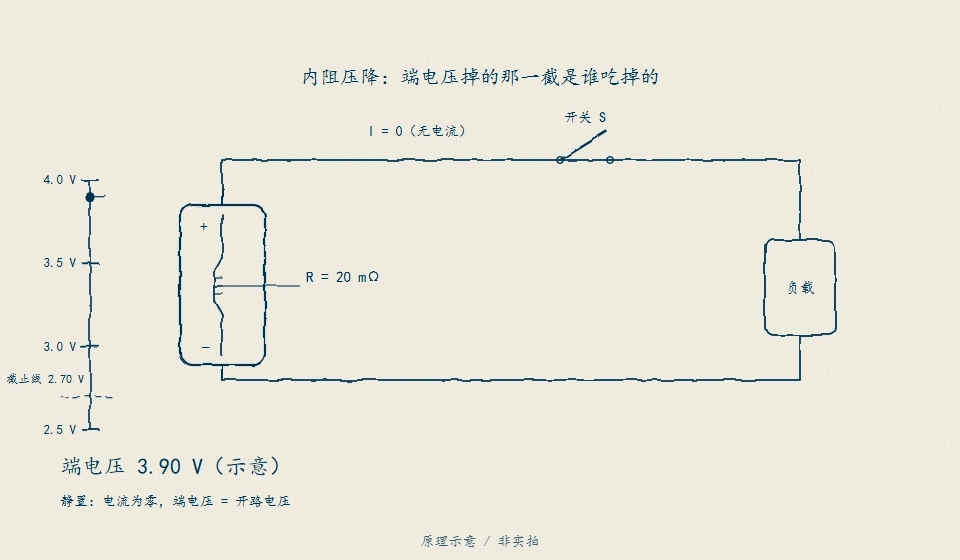
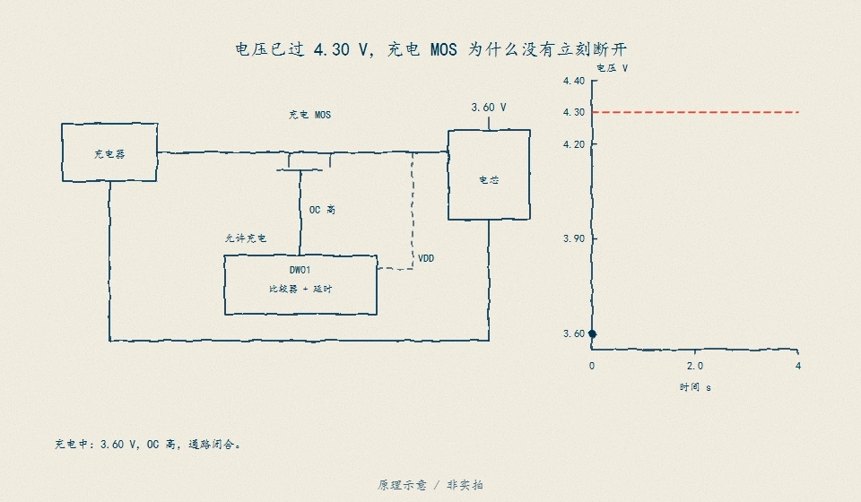

# D18　充电控制与许可：许可不是一条曲线，是一串同时成立的否决

快充桩挂在冷库门口，枪一插就想要 3 A；电芯在 0 °C、SOC 0.62，地图说这个温度只许 0.4 A，析锂禁区说 0.80 以上一安培都不许给。控制器如果只认「充电器能力」这一条曲线，前 40 分钟就会把 0.30 Ah 灌进析锂区，而截止条件（电压到 4.20 V、电流 taper 到 0.1 A）全部照常成立——**截止成立不等于充电合规**。本单元把充电许可写成 min（充电器能力，温度地图，SOP 窗口约束，绝对上限）再叠一条独立的析锂否决，电芯模型只认净电流 i_net = i_cmd − i_aux（附件/车载负载先分走），充电器侧与电芯侧两本账分开记；再用 CC/CV 控制环、截止证据三元（taper、时间上限、温度/析锂边界，外加 SOC 交叉核对）和能量账把「谁在限、谁只是没轮到」逐帧钉住。全部参数（Q、OCV 折线、R0/R1/R2、V_max、地图形状、热参数、taper、时间上限、表计偏置）是教学值，**不证明**任何具体电芯在该温度下可以这样充；地图**不代表**电芯手册，许可**待验**于 SRC04 的器件证据，热边界**不能**用本单元替代 D16 的辨识合同。

## D18.1 模型与推导

电芯身份与第 11 章 CC-CV 算例同源：Q = 2 Ah；OCV 折线 `3.50 + 0.70·z`（z ≤ 0.80），拐点 4.06 V，以上 `4.06 + 0.887·(z − 0.80)`（z = 1 → 4.2374 V）；V_max = 4.20 V；R0 = 50 mΩ、R1 = 20 mΩ / τ1 = 30 s、R2 = 5 mΩ / τ2 = 1 s；步长 1 s。许可链：

```
I_perm(z, T, t) = min( 充电器能力, 地图(T), SOP窗口(W), 绝对上限 2.6 A ) ，再被析锂否决劈成 0
```

- **地图**（教学形状，取自第 11 章 stage-4 §4.7b，2 Ah 电芯、1C 档）：T < 0 °C → 0；0–10 °C → 0.2C = 0.4 A；10–45 °C → 1C = 2.0 A；45–55 °C → 0.5C = 1.0 A；≥ 55 °C → 0。
- **析锂否决**（独立于地图的第二道门）：T < 10 °C 且 z ≥ 0.80 → 0 A。地图只描述「这个温度允许多快」，不描述「这个温度 + 这个 SOC 允不允许充」。
- **SOP 窗口约束**：对窗长 W，预测窗末端 `z_end = z + I·W/7200`，要求 `OCV(z_end) + I·(R0 + R1(1−e^(−W/τ1)) + R2(1−e^(−W/τ2))) ≤ 4.20`；同时 SOC 余量 `z_end ≤ 0.98`，热余量用单节点闭式解 `ΔT = I²·R_heat·R_th·(1−e^(−W/τ_th)) ≤ 70 − T_amb`（C_th = 156 J/K、R_th = 5.5 K/W、R_heat = 0.09 Ω，与 D16 契约同源）。电压项用二分求解，不猜。
- **CC/CV**：CC 段取 min 的其余项；当 1 s 窗的电压项比地图更紧时进入 CV——**CV 环就是 1 s 窗的电压约束**，同一套求解器，每帧把端电压顶在 4.20 V 以内（实测峰值 4.199992 V）。
- **截止三元**：taper（I < 0.1 A 连续 30 s）、时间上限 9000 s、温度/析锂边界。三者都监测；只有「taper 到达 ∧ 无析锂帧 ∧ 温度在界内」才立满充锚点——时间上限单独到达不是满充证明。
- **净电流与两本账**：充电器侧指令 `i_cmd`，附件/车载负载先分走 `i_aux`（教学值 0.4 A；默认场景为 0），电芯实际吃到 `i_net = i_cmd − i_aux`。SOC 积分、端电压、CV 切换与 taper 判定一律用 `i_net`；充电器能力先扣附件（`charger − aux`），电压约束落在充电器出口（线缆压降 `(i_net+i_aux)·R_cable`，教学值 0.25 Ω，仅假满充反例使用）。充电器侧 Ah/Wh 用 `i_cmd` 与充电器出口电压积分（含 `i_cmd²·R_cable`），电芯侧用 `i_net` 与电芯端电压；两本账的差是附件耗电与线缆损耗，不是电芯的电荷。
- **能量账**：端口 `∫v·i dt` 与 OCV 解析积分 `Q·∫ocv dz` 独立对账，差额拆成 `I²R0` 与 RC 支路两项；Ah 账另与 `Q·Δz` 对账。
- **满充锚点**：taper 到达 ∧ 无析锂帧 ∧ 温度在界内 ∧ **SOC ≥ 0.94**。最后一项是独立交叉核对——taper 与电压截止可以在低 SOC 同时成立（见 D18.3 的假满充反例），所以锚点不能只看电流与电压。

端电压表达式里的欧姆项有一幅手绘对照（handraw 首批导出的独立算例，数值为其自带教学值，非本单元冻结数字）：ΔV = I×R 是过原点的直线，斜率就是内阻。

<figure>

<figcaption>图 D18-F2　内阻压降：端电压掉的那一截是谁吃掉的。同一电流下，内阻翻倍压降翻倍（20 mΩ → 0.40 V、60 mΩ → 1.20 V）——D18.1 电压约束里 `I·(R0 + R1(1−e^(−W/τ1)) + …)` 的每一项都是"谁吃掉了多少电压"的逐段记账，斜率口径必须与参数来源一致。独立算例，数值为 handraw 导出自带教学值，非本单元冻结数字。原理示意 / 非实拍。</figcaption>
</figure>

## D18.2 核心机制：每一帧都问「谁在限」

四个探针（25 °C 除非注明）覆盖 min 的四个分支：充电器 1.5 A → 在限 `charger`（1.5 A，地图余量 0.5 A）；地图 1C → 在限 `map`（2.0 A，SOP 电压余量 8.4 A）；近满 60 s 窗 → 在限 `sop_voltage`（0.643785 A，地图余量 1.356215 A）；5 °C、z = 0.85 → 在限 `plating`（0 A，地图本身还给 0.4 A）。在限项余量为 0，其余项给出正余量——「谁只是没轮到」是报告的一等输出，不是脚注。

净电流口径下「谁在限」多一个分叉：充电器 3.0 A + 附件 0.4 A 时 charger 分量是 2.6 A，地图 2.0 A 仍更紧（在限 `map`，充电器侧指令 2.4 A）；充电器 1.0 A + 附件 0.4 A 时净电流只剩 0.6 A，在限项变成 `charger`——同一句「充电器能力」在两种口径下给出不同的数，差的就是附件电流。默认场景 aux = 0，上一段的探针与冻结数字不变。

窗口分级（z = 0.90 静置，25 °C）：10 s 0.8287 A / 3.4807 W；30 s 0.7191 A / 3.0203 W；60 s 0.6438 A / 2.7039 W；600 s 0.3445 A / 1.4468 W。窗越长，越早看见窗末的 OCV 抬升，许可越紧——功率边界一律用**窗末端端电压 × 允许电流**，不是当前端电压。持续档（1 s 瞬时电压墙 ∩ 稳态热 ∩ 绝对帽）在 z = 0.90 是 0.9511 A；它不套 SOC 窗（∞ 窗的 SOC 余量按定义退化），所以比 10 s 档更「松」，这不是矛盾而是定义不同。

热项的位置要诚实：1C = 2 A 充电时热契约给 8.9893 A（30 °C）/ 7.1067 A（45 °C）/ 4.4947 A（60 °C），余量 3.5–4.5 倍，**永远不是最弱环**；只有把电流帽放宽到 10 A 的探针（z = 0.10）热项才露头。它在许可链里必须是活的输入（D16 接口），但不能为了戏剧性假装它在限。

默认轨迹 4531 s：CC 2648 s（在限 `map`，2648 帧），CV 1883 s（在限 `sop_voltage`，1884 帧），切换点 z = 0.785556 / V = 4.199812 V；CV 占 41.56% 时间却只收 18.24% 电量（0.328232 Ah），截止 SOC 0.949672、截止电流 0.095113 A。控制窗从 1 s 放宽到 60 s：切换提前 1.6389 pp、峰值电压低 0.619 mV、总时长 +103 s、末端 SOC 低 0.073 pp——**窗语义是真实的取舍**，不是换一个参数的重命名。

充电许可链里最刺眼的一路是过充保护：它不是「满充」的同义词，而是一堵独立的墙。

<figure>

<figcaption>图 D18-F1　过充保护链：接近电压上限时保护路径独立动作（切断/降流），与「taper 截止=满充」的账本判据不是同一路——这正是 D18.3 假满充反例里「预算幻觉」与「电芯真未满」能共存的原因。原理示意 / 非实拍。</figcaption>
</figure>

## D18.3 反例与分解

同一条件（0 °C、z0 = 0.62、6000 s、充电器 3.0 A）跑两遍：

- **无温度地图**（只留充电器/电压/SOP/绝对帽）：2368 s 就 taper 到 0.1 A，收了 0.659344 Ah；其中 **1829 帧落在析锂区**，0.298923 Ah 是在禁区里灌进去的，第一帧在 540 s，区内最大电流 1.841131 A。截止三元里 taper 与电压都「正常」，锚点仍然不成立——**控制器说自己充满了，电芯在析锂**。
- **有地图 + 否决**：3240 帧在限 `map`、2761 帧在限 `plating`，电流在 z = 0.80 处被劈到 0，停在 0.36 Ah 等加热，6000 s 触时间上限；峰值电压 4.089961 V（根本没机会到 CV），锚点同样不成立，但原因是「没充满」，不是「充坏了」。
- **增量**：无地图多灌 0.299344 Ah（14.9672 pp SOC），其中 **99.8594% 落在析锂区**；时间比 0.3947（无地图只用了有地图 39.5% 的时间）。这 0.3 Ah 就是「省下来的时间」的价格。

**假满充反例一：上游限流 + 线缆压降。** 充电器被限到 1.0 A，附件仍分走 0.4 A，线缆 0.25 Ω。电芯净电流只有 0.6 A，出口电压 4.2 V 减去线缆压降后，电芯端电压在 z = 0.5785 就触到自己的 CV 上限（6342 s 进 CV，在限计数 charger 6342 帧 / sop_voltage 5877 帧）；taper 在 12218 s 以 0.09885 A 成立，但末端 SOC 只有 **0.808838**（默认轨迹 0.949672，差 14.0834 pp），电芯侧只收到 1.517676 Ah。充电器出口峰值 4.199989 V，电芯端峰值 4.075276 V——**124.713 mV 的压降**让「电压到 4.2 V」与「taper 到 0.1 A」同时成立而电芯没满；满充锚点的 SOC 交叉核对（≥0.94）把这一帧拦下，锚点不成立。

**假满充反例二：附件耗电与预算账。** 同一条默认轨迹加 0.4 A 附件（无电缆，充电器 3.0 A）：电芯侧轨迹几乎不变（4531 s taper，z 0.949672，1.799343 Ah），充电器侧却记到 2.302788 Ah / 9.216211 Wh——差 **0.503444 Ah（21.8624%）/ 2.038548 Wh（22.1192%）**，全部是附件耗电。若拿「充电器侧安时 = 满充预算 1.799343 Ah」当满充判据，预算在 2700.742 s 就命中，此时电芯只到 **z = 0.79963**（电芯侧 1.499261 Ah，比默认终点低 15.0042 pp），后面还要再充 30 分钟。预算账不是电荷账：充电器电表读到的是附件 + 电芯的总能量。

能量分解（默认轨迹）：端口 7.177663 Wh，OCV 解析 6.931455 Wh，欧姆 0.164374 Wh + RC 支路 0.081834 Wh，损耗 3.4302%，平均端电压 3.989046 V；逐帧 OCV 积分与解析积分残差 2e-9 Wh，端口 = 化学能 + 两项损耗残差 −0.0 Wh。两条独立账一致，才说明「Ah 与 Wh 不是同一套数字凑出来的」。

计量与反查的坑：+20 mA 的电流表偏置在 4531 s 上累积出 +1.2586 pp 的 SOC 虚高；拿 4.20 V 的**带载**端电压去反查 OCV 会虚高 0.8155 pp；充满后静置 600 s，端电压 4.192759 V 与 OCV 只差 2.47781 mV——所以回放合同要求首拍静置，OCV 是唯一不依赖积分历史的绝对参照（D12）。

## D18.4 动手验证

```text
python code/engineering/power/d18_charge.py
python code/engineering/power/d18_charge.py --out <新目录>
python code/engineering/power/d18_charge.py --data <你的轨迹.csv> --out <新目录>
python -m pytest code/engineering/power -q --basetemp=.tmp-pytest-d18
```

默认导出 `report.json`、`charge_trace.csv`（含首 120 s 静置与尾 600 s 静置的全轨迹）、`counterexample.csv`（0 °C 两条对照）、`replay_template.csv`（可直接喂 `--data` 的模板）、`net_current.csv`（0.4 A 附件场景的充电器侧/电芯侧双电流与双电压，4532 帧 + 表头）。回放表头 `t_s,current_a,v_meas,temp_c`；数据合同强制执行：缺文件、错表头、缺列、非有限、时间回退、采样间隔 > 60 s、电流越出 [0, 2.6] A、温度越出 [−40, 85] °C、电压越出 [2.5, 4.5] V、样本 < 20、首拍电流非 0，一律 exit 2 并给出原因，不猜。回放输出在 `replay.user`：逐帧审计许可（不含未知的充电器能力）、析锂帧、电压一致性、Ah/Wh 账与截止核对；模板 5251 帧 0 越权 0 析锂、反例 3088 帧 2368 帧越权 1828 帧析锂——审计能抓住本单元自己造的反例，才谈得上审你的数据。

迁移任务：

1. 把地图的 10–45 °C 档从 1C 改成 1.5C（3 A），重跑默认场景：哪些冻结数变、哪些不变？CV 段占比为什么反而上升？
2. 把充电器换成 1.0 A：整条许可链、截止时间、能量账分别怎么动？在限计数里谁接管？
3. 在 `replay_template.csv` 的 z ≈ 0.85、0 °C 处注入 300 s 的 3 A 脉冲（超过绝对帽与地图），跑 `--data`：审计报几帧越权、几帧析锂？越权 Ah 与脉冲 Ah 的关系说明什么？
4. 把 `simulate_charge(aux_a=0.4)` 的充电器侧轨迹（i_cmd、v_charger）当作「仪表读数」写成一个回放 CSV，跑 `--data`：审计会不会把它判成合规？再改成电芯侧口径（i_net、v_cell）呢？两本账哪个才是许可证据？

## D18.5 与相邻单元的接口

- **D17（SOP）**：本单元的 `sop_windows` 就是 D17 的窗口约束实现——电压余量、SOC 余量、热持续电流、绝对上限四分量取最弱环，窗分级 10/30/60/600 s 与持续档，功率边界 = 窗末端端电压 × 允许电流。D17 若给出不同的窗长集合，只需换 `window_s` 列表，求解器与语义不变；D18 把 D17 的许可当**输入**，不重新定义 SOP。
- **D16（热）**：温度在本单元不是建议而是许可输入——热项在许可链里是并行的第四道否决；1C 下它有余量（8.99/7.11 A 契约），但接口必须存在，否则恒流段一放宽就会越过 70 °C 芯限。热参数与芯限归 D16 辨识合同，本单元不重标定。
- **D10（均衡）**：被动均衡在充电末段与恒压段争同一段「还在充电」的许可边界——均衡电阻的泄放电流是叠加负载，不能记成充电电流的一部分；本单元许可链里没有均衡项，装配时必须把均衡状态作为额外否决/修正输入，否则末段许可会被高估。
- **D15（老化）**：AF(T) = exp(Ea/R·(1/T_ref − 1/T))，Ea = 30 kJ/mol 教学占位，AF(45 °C) = 2.1399（与 D15 冻结值一致）。同一次充满：25 °C 用 4531 s，45 °C 因地图降到 0.5C 用 7370 s，折算暴露 4531 vs 15771 s，比 3.4807——**高温慢充不等于低老化**；AF 只折温度，电流/循环项要回 D15/OS08 的多温度老化数据，本单元不拟合寿命。

## D18.6 本单元已冻结的数字

| 锚点 | 值 | 出处 |
|---|---|---|
| 默认轨迹 | 4531 s；CC 2648 s / CV 1883 s（58.44% / 41.56%） | `d18_charge.py` |
| 切换点 | z 0.785556、t 2648 s、V 4.199812 V | 同上 |
| 末端 | z 0.949672；I 0.095113 A；峰值 V 4.199992 V；峰值芯温 26.8903 °C | 同上 |
| 充电总量 | 1.799343 Ah（CC 1.471111 / CV 0.328232，CV 占电 18.24%） | 同上 |
| 在限计数 | map 2648 帧 / sop_voltage 1884 帧 | 同上 |
| 能量账 | 端口 7.177663 Wh；OCV 6.931455 Wh；欧姆 0.164374 + RC 0.081834 Wh；损耗 3.4302%；均值 3.989046 V | 同上 |
| 静置回查 | 600 s 后 4.192759 V，与 OCV 差 2.47781 mV | 同上 |
| 表计偏置 | +20 mA → +1.2586 pp；带载反查 4.20 V 虚高 0.8155 pp | 同上 |
| SOP 窗 z 0.90 | 10 s 0.8287 A / 3.4807 W；30 s 0.7191 / 3.0203；60 s 0.6438 / 2.7039；600 s 0.3445 / 1.4468 | 同上 |
| 持续档 z 0.90 | 0.9511 A；热契约 8.9893 A @30 °C / 7.1067 A @45 °C / 4.4947 A @60 °C | 同上 |
| 低 SOC 探针 z 0.05 | 窗 10/30/60/600 s 电压项 10.4 / 9.4247 / 8.5118 / 4.9875 A，绝对帽 2.6 A 在限 | 同上 |
| 窗口效应 1 s→60 s | 切换 −1.6389 pp；峰值 −0.619 mV；时长 +103 s；末端 −0.073 pp | 同上 |
| 反例 0 °C | 无地图 2368 s / 0.659344 Ah / 析锂 1829 帧 / 0.298923 Ah；有地图 6000 s 上限 / 0.36 Ah / 2761 帧停在 0.80 | 同上 |
| 反例增量 | +0.299344 Ah（14.9672 pp），析锂区占 99.8594%；时间比 0.3947 | 同上 |
| 老化耦合 | AF(45 °C) 2.1399；4531 s vs 7370 s（折算 15771 s），暴露比 3.4807 | 同上 |
| 净电流两本账 | 电芯 1.799343 Ah / 7.177663 Wh；充电器 2.302788 Ah / 9.216211 Wh；差 0.503444 Ah（21.8624%）/ 2.038548 Wh（22.1192%） | `d18_charge.py` |
| 预算幻觉 | 0.4 A 附件：充电器侧预算 1.799343 Ah 在 2700.742 s 命中，电芯 z 0.79963（差 15.0042 pp） | 同上 |
| 上游限流假满充 | 1.0 A + 0.4 A + 0.25 Ω：z_switch 0.5785 @6342 s；taper 12218 s / 0.09885 A；z_end 0.808838；SOC 差 14.0834 pp；锚点不成立 | 同上 |
| 线缆压降 | 充电器出口 4.199989 V vs 电芯 4.075276 V；压降 124.713 mV | 同上 |
| 回放模板 | 5251 帧、0 越权 / 0 析锂、taper 30 s、满充锚点成立 | `D18-charge-replay` |
| 回放反例 | 3088 帧、2368 帧越权 / 0.599344 Ah、1828 帧析锂 / 0.298897 Ah、锚点不成立 | 同上 |

## D18.7 装配边界

- 先修 D02/D12/D15/D16；本单元与 D17 并行交付，D17 的窗口约束实现与本单元独立，双方以 §D18.5 的窗长集合与功率口径对齐。
- 闭合来源：**OS01**（模型边界——OCV + 2RC 等效电路只是 PyBaMM 模型层级里的教学层，参数不来自器件反演，不能当模型验收）；**OS08**（老化证据域——BLAST-Lite 的多温度/多倍率条件域才是寿命结论的来源，AF 只是单位换算）；**SRC04**（充电许可最终回电芯手册与受控台架——本单元的地图是教学形状，不是许可授予，任何真实电流值必须由器件数据重新签发）。
- 固件现状（读 `code/firmware/bms.h` 核实）：`BmsInputs` 只有 `cell_mv/current_ma/temp_c10/charger_present`，无时间戳、无质量位；`Bms` 输出只有 `charge_mos_on`，没有充电电流请求/许可字段；`BmsConfig` 只有 `full_mv/full_cutoff_ma` 的满充判据，没有温度地图与析锂否决。本单元的许可链、窗口 SOP 与地图是**教学控制层参考实现**，不证明固件已实现对应功能；装配时需要新增许可输出与地图配置面，并把时间戳/质量位补进输入契约。
- 净电流口径：附件 0.4 A 与线缆 0.25 Ω 是教学值，不认定为整车负载或线束参数；默认场景 aux = 0，既有冻结数字不变。假满充反例说明 taper + 电压截止可以与低 SOC 同时成立，满充判据必须带 SOC/能量交叉核对；**教学模型不生成电芯许可**，真实许可与满充判据回 SRC04。
- 全部数字为合成数据下的教学值，登记（manifest/experiments/claims）由集成者统一处理；本单元的测试是新增回归，审阅前状态是 unverified，不自签 verified。
