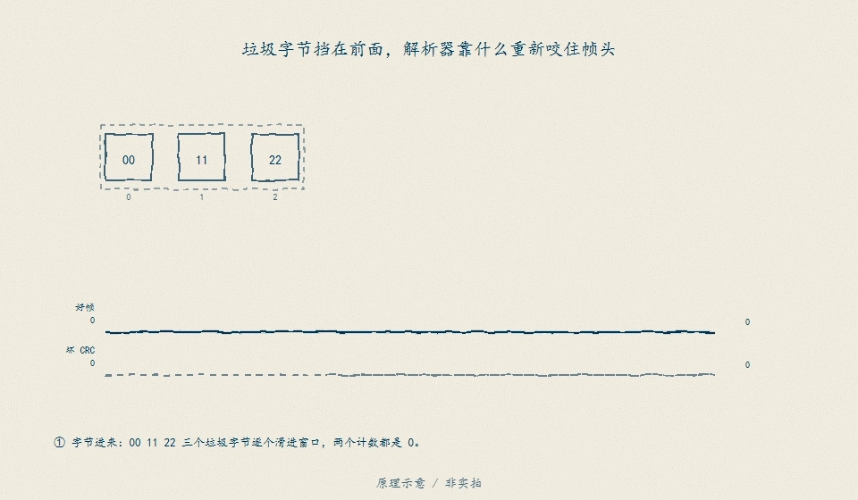

# D19　总线与端到端数据：CRC 全对的一帧，也可能是三秒前的旧值

现场故事的开头很朴素：仪表上的 SOC 停在 63%，连续三秒不动。示波器和总线分析仪都显示「一切正常」——每一帧 CRC 正确、长度正确、周期准时。问题不在线上，而在接收端把「帧没坏」当成了「数据是新的」。这一单元把一帧从位、字节到物理信号的路径拆开，再把接收端的判定链摊平：身份、CRC、会话、计数器窗口、到达时间各回答不同的问题，任何一项都不能被前一项替代。全部时序、电平、超时预算与编码因子都是教学值，**不证明**任何收发器的实测行为、总线一致性测试结论或在环（HIL）验收；真实总线证据必须按 SRC05 取得。本模块自包含，不 import `code/protocol`（那是协议维护源，不是本单元依赖）。

## D19.1 模型与推导：从位到物理信号，从字节到帧

一帧 CAN 2.0A 风格数据帧（11 bit ID、8 B 载荷）的位预算可以逐段数出来：SOF 1 + ID 11 + RTR 1 + IDE 1 + r0 1 + DLC 4 + 数据 64 + CRC 15 + CRC 定界 1 + ACK 2 + EOF 7 + 帧间隔 3 = **111 位**。位填充只作用于 SOF 到 CRC 序列这 **98 位**：连续 5 位同值就插 1 位反相，填充位自身计入下一段连续计数，所以最坏是 $1+\lfloor(98-5)/4\rfloor=$ **24** 位，最坏帧长 **135 位**。500 kbit/s 下一位 2 µs：名义帧 **222 µs**、最坏帧 **270 µs**。最容易犯的错是拿「载荷全 0」当最坏：整段填充区同值只有 $\lfloor 98/5 \rfloor=$ **19** 位、260 µs；最坏情形是首次 5 位同值之后，数据每 4 位翻一次，让填充位把新的连续段凑满。

帧的时间账要和它的用途分开：20 ms 周期、270 µs 最坏帧，总线负载只有 **1.35%**——带宽从来不是这类链路的瓶颈，超时和新鲜度才是。超时预算按书 18.3 的口径相加：

$$t_{timeout} \ge t_{period}+t_{jitter}+t_{transport}+t_{schedule\_margin}=20+5+25+50=100\ \text{ms}$$

四项都是教学值；重点是它给了「100 ms」一个可复查的构成，而不是把「丢三帧就算超时」当成常量。

字节到物理信号用一张 8 B 载荷编码表固定下来（因子、偏移、单位都在模块里，报告逐项给出）：

| 信号 | 位置 | 位宽 | LSB | 偏移 | 单位 | 首帧样例 |
|---|---|---|---|---|---|---|
| session | byte0 [7:4] | 4 | 1 | 0 | 会话号 | 1 |
| counter | byte0 [3:0] | 4 | 1 | 0 | 计数 | 0 |
| status | byte1 | 8 | 1 | 0 | 标志（degraded/charger/init） | 0 |
| pack_mv | byte2..3（大端） | 16 | 1 mV | 0 | mV | 51200 |
| current_da | byte4..5（大端，有符号） | 16 | 0.1 A | 0 | A | 120 → 12.0 A |
| temp_c | byte6 | 8 | 1 °C | −40 | °C | 75 → 35 °C |
| soc_pp | byte7 | 8 | 0.5 % | 0 | % | 120 → 60.0 % |

CRC-16/CCITT-FALSE（poly 0x1021、init 0xFFFF、不反射、无 xorout）覆盖 `msg_id(2B 大端) | dlc | payload[8]`。先用标准检查值证明程序本身对：`"123456789"` → **0x29B1**。首帧（计数器 0、会话 1）的冻结字节：载荷 `1000c80000784b78`、覆盖域 `018f081000c80000784b78`、CRC `46FA`、完整线上字节 `018f081000c80000784b7846fa`，解码为 51.2 V / 12.0 A / 35 °C / 60.0%。

物理层用最少的教学口径：显性位逻辑 0、CAN_H 3.5 V / CAN_L 1.5 V、差分 2.0 V；隐性位逻辑 1、两端 2.5 V、差分 0 V。这些数字只解释「0 为什么能盖住 1」，**不是**任何收发器的规格，也不能用于选型或终端匹配设计。

## D19.2 核心机制：判定链与窗口语义

接收端只做一件事：决定这一帧的值能不能交付。判定链的顺序是 **identity → crc → session → counter**，且**显式短路**：前一关不过，后面的判据不再解释。理由是字段不可信时解释字段只会制造幻觉——CRC 不过的帧里，计数器那个半字节本身也可能是坏的，把它记成「迟到」等于替坏帧编故事。

| 段 | 问题 | 失败原因码 | 动作 |
|---|---|---|---|
| arrival | 这一拍有没有帧？ | timeout / missing slot | 保持上次可信值并置超时标志 |
| identity | msg_id 与 DLC 是目标报文吗？ | `identity` | 拒绝，计数器不推进 |
| integrity | CRC 对得上吗？ | `crc` | 拒绝，字段不再解释 |
| session | 是本次上电生命周期的帧吗？ | `session` | 拒绝；重同步需带外证据 |
| counter | 序号在窗口内吗？ | `duplicate`/`late`/`gap_too_large`/`ambiguous` | 拒绝；degraded 内改走连续计数重同步 |
| publish | 这个值现在能交付吗？ | degraded | 保持上次可信值 |

**窗口语义**：4 bit 计数器模 16，对「最后已接受帧」取模差 $d=(c_{new}-c_{last})\bmod 16$。$d=0$ 重复；$d\in\{1,2\}$ 接受；$3 \le d \le 7$ 缺口过大；$d=8$ 歧义（半圈，无法区分「丢了 7 帧」与「倒退 9 帧」）；$9 \le d \le 15$ 迟到。所谓「±2 窗口」在接收方向上只向**前**开：模 16 把「落后 1」和「超前 15」混同一个数，向后开窗等于把前向缺口一起吞掉。三条边界因此是：

- 15→0：$d=1$ 接受（回绕是正常事件）；
- 15→1：$d=2$ 接受（恰好在窗口边缘）；
- 15→2：$d=3$ 拒绝（越过窗口，即使只差一格）。

**会话**：计数器只能证明「这一次上电内没漏」，不能证明「这不是上一次上电的帧」。会话字段在 CRC 之后、计数器之前判；首次收到即学习，此后不匹配一律拒。自动采纳新会话需要启动证据（谁复位了、什么时候），本模块不实现——那是待验边界，不是可以靠「连续几帧看着像」猜出来的东西。

**超时与降级**：丢帧数按**到达间隔**计——已知周期 20 ms，间隔 120 ms 就是丢 5 拍；计数器缺口只用于窗口判定，不重复记账（否则一帧会被计两次）。连续丢 ≥3 帧进入 `degraded`：发布值冻结在上次可信值，置超时标志。另一本账是**数据年龄** $t_{now}-t_{last\_accepted}$：帧到了不等于数据新。默认场景里第 26–28 帧到达时数据已 140/160/180 ms（判据 100 ms），发布值一直停在 61.0%，记 3 次持续过期；第 29 帧到达时数据年龄 200 ms，但它发布了新值，所以不算「持续过期」——两条账分开记，才不会把「恢复」误记成「又坏了一次」。恢复不是「来一帧好的就放开」：degraded 内按**观察到的连续计数**重同步，连续 3 拍计数递增才退出并采纳新值；重同步锚取**最后可信计数**，不取坏帧自己的计数器（坏 CRC 的帧连它的序号都不该被相信）——这正是书 18.5 的坑：偶发恢复一帧可能只是接触不良。

**超时是时钟属性，不是帧属性**：接收端不靠「下一帧到达」才发现超时。`advance_to(now)` 只看时钟：自最后到达以来的拍数按周期累计，条件首次成立的时刻就是转移时间戳（末帧 660 ms 之后静默，第 3 拍命中 deadline，降级记在 **720 ms**，不是等到调用 `advance_to` 的时刻或下一帧）。degraded 内继续推进时钟只加深保持，**绝不自行恢复**——恢复只能靠真实帧。因此默认回放的视界必须显式写出来：缺省视界 = 末帧时刻（660 ms，不追加静默尾），所以 29 帧回放的冻结数字不变；`--horizon-ms` 可以把视界显式拉长。报告的 `silent_bus` 块用 +5 拍（760 ms）演示纯静默：720 ms 降级、视界终点仍 degraded、时钟补记 5 拍缺失，且视界内没有任何新帧可以依赖。

判定链的地基是字节流重同步：边界找不回来，身份/CRC/计数器都无从谈起。

<figure>

<figcaption>图 D19-F1　字节流重同步：垃圾、坏帧与合法帧交错到来时，解析器先恢复边界，身份、CRC、计数器窗口、到达时序四层判定才有对象——与 D19.2 判定链「不互替」的层级一致。原理示意 / 非实拍。</figcaption>
</figure>

## D19.3 四个反例（数字全部冻结）

**反例 A：合法 CRC 的旧帧。** 计数器 0..9 正常接受后，重放 3 帧计数器 7 的旧帧。它们与第 8 帧（计数器 7）**逐字节相同**，CRC 全对。对最后已接受帧 9 的模差 $d=14$ → `late`，3 帧全拒，接受数停在 10，可信值不变。结论只有一句：**CRC 保完整性，不保新鲜度**；只要字节没变，CRC 就永远是对的。

**反例 B：序号回绕。** 三个独立序列都在计数器 15 之后分叉：15→0（$d=1$）接受、15→1（$d=2$）接受、15→2（$d=3$）拒收 `gap_too_large`。接受数分别 5 / 5 / 4，拒收 0 / 0 / 1。回绕不是倒退，判断依据是模差而不是「数字变小了」。

**反例 C：乱序 5,7,6。** 到达序 5、7、6：5 接受；7 对 5 的 $d=2$，接受并成为新的基准；6 对 7 的 $d=15$ → `late` 拒收。注意 6 相对 5 的 $d$ 只有 1，**仍在窗口内**——但窗口的基准已经换人。判定按「对最后已接受帧的模差」，不按到达顺序；这也解释了为什么接收端不能靠「缓存重排」修乱序：它根本不知道 6 会来。

**反例 D：总线恢复。** 正常接受 3 帧后静默 120 ms（丢 5 拍、超时事件 1 次），随后计数器 8 到达：对最后已接受帧 2 的 $d=6$ → `gap_too_large` 拒收，同时因连续丢帧 ≥3 进入 `degraded`（第 4 帧、160 ms）。之后 9、10 是两拍重同步观察（发布值不动），第 3 拍 11（220 ms）退出并接受。转换拍数：进入 1 拍、观察 2 拍、恢复 1 拍；degraded 区间共 4 次到达，缺失 5 拍、超时 1 次，最终计数器 11。

**两个补充判定**：计数器重复到达（$d=0$）拒绝且不刷新数据年龄（4 接受 / 1 拒绝 / 4 次发布）；计数器在窗内但会话不同（$d=1$，窗口本来会接受）被会话门拦下，随后本会话的同一计数器可以正常接受（5 接受 / 1 拒绝）。**CRC 短路**另有回归钉住：一帧「旧计数器 + 坏 CRC」只记 `crc` 一次，判定记录里的 `checks_evaluated` 停在 `["identity","crc"]`，`counter_evaluated=false`。

## D19.4 动手验证

```text
python code/engineering/bus/d19_bus_data.py
python code/engineering/bus/d19_bus_data.py --out <新目录>
python code/engineering/bus/d19_bus_data.py --frames <帧序列.csv> --out <新目录>
python code/engineering/bus/d19_bus_data.py --horizon-ms 760 --out <新目录>
python -m pytest code/engineering/bus -q --basetemp=.tmp-pytest-d19
```

`--out` 落盘三件工件：`report.json`（判定链、窗口、反例、默认回放）、`frames.csv`（默认到达脚本的线上帧，可直接回放）、`decisions.csv`（逐帧判定：counter/session/crc_ok/delta/resync_delta/decision/reason/state_after/checks_evaluated/发布值/数据年龄/持续过期/缺失拍数/超时标志）。默认脚本 29 帧：正常段 10 + 旧帧重放 3 + 坏 CRC 1 + 同计数器好帧 1 + 跨会话 1 + 本会话 1 + 回绕段 7 + 跳号 1 + 静默后恢复段 4。

回放合同（`--frames`）：

- 必填 `seq,data`；可选 `t_ms,crc_hex`；未知列直接拒收。
- `data` 必须是 16 个十六进制字符（8 B 载荷）；`crc_hex` 是**收到的** CRC，不是重算值——写错就注入一帧坏 CRC，回放不会替你「洗白」。
- `seq` 与 `t_ms` 必须严格递增；`t_ms` 必须有限、非负；没有 `t_ms` 时按标称周期 20 ms 推进。
- 缺文件、错表头、缺列、非有限、时间回退、越界（负序号 / 载荷长度不对 / CRC 格式错）、样本 <10 一律 **exit 2** 并在 stderr 给原因。
- `--horizon-ms` 指定仿真视界（ms，必须不早于末帧）：视界内没有到达也按时钟推进，静默降级作为 `source: "clock"` 的转移写进 `report.json`；早于末帧同样 **exit 2**。缺省视界 = 末帧时刻，即回放只在观测到的帧范围内记账。
- 导出的 `frames.csv` 回放后与默认场景逐行一致：`decisions.csv` 逐字节相同，`rejected_by_reason` 同为 `{crc:1, gap_too_large:2, late:3, session:1}`。

迁移任务：

1. 把窗口从 +2 改成 +1（只接受 $d=1$）：三个回绕边界里哪个先翻？`out_of_order` 的结论变不变？为什么「窗口越窄越安全」在这里不成立？
2. 把恢复拍数从 3 改成 1：`bus_recovery` 的退出时刻提前到哪一帧？用「偶发接触不良」的解释说明这个改动为什么危险（对照 D08 的恢复去抖）。
3. 拿一段真实总线抓包：先用已知帧确定 CRC 参数（poly/init/refin/xorout 六项缺一不可），再按「单变量定位字段」找电压与 SOC 的字节位置；写出在宣布窗口语义之前必须补的证据清单（SRC05）。

## D19.5 与相邻单元的接口

**D08（保护与时间预算）**：D19 的 `degraded` 是**数据侧**的本地保护——保持上次可信值、置超时标志；D08 的锁存是**输出侧**的——inhibit/open 掩码只升不降、恢复要 `clear=1` 且连续 3 拍无活动故障。两者都要求「好帧不带证据不放行」，但条件不同：D19 恢复看的是计数连续，D08 恢复看的是故障消失与清旗。接线时不能让数据侧的恢复自动清掉输出侧锁存。

**D20（实时固件与数据所有权）**：D19 每次接受只发布**一个**值（`published_soc_pp`），degraded 期间不更新。D20 的消费方必须保证「一帧只取一次采样」：同一帧的电压、电流、温度若被两个任务各读一次，就会出现「一帧混用两次采样」——D19 把发布点收敛成单点，D20 负责让这个单点在调度上原子可见。

**D21/D22（记录与诊断）**：`decisions.csv` 的 `reason` 与 `state_after` 是后续 DTC 与冻结帧的原料；D21 的时间对齐要拿 `t_ms` 与 `seq` 做双重校验，D22 的 DTC 去抖拍数不能直接复用本模块的恢复拍数（一个是通信恢复，一个是故障确认）。

## D19.6 本单元已冻结的数字

| 锚点 | 值 | 出处 |
|---|---|---|
| CRC 检查值（`"123456789"`） | 0x29B1 | `d19_bus_data.py` |
| 首帧线上字节 | `018f081000c80000784b7846fa`（CRC `46FA`） | 同上 |
| 首帧解码 | 51.2 V / 12.0 A / 35 °C / 60.0 % | 同上 |
| 位预算 | 名义 111 位 / 222 µs；最坏 135 位 / 270 µs | 同上 |
| 最坏填充 | 24 位（同值对照 19 位 / 260 µs） | 同上 |
| 总线负载 | 1.35%（20 ms 周期） | 同上 |
| 超时预算 | 20 + 5 + 25 + 50 = 100 ms | 同上 |
| 字符时间对照 | UART 10 位 @115200 = 0.086806 ms；Modbus 3.5 字符 = 0.303819 ms | 同上 |
| 窗口 | 4 bit / 模 16；前向 2、后向 0；恢复 3 拍；丢 3 拍降级 | 同上 |
| 反例 A 旧帧 | 3 帧全拒，`late`，模差 14，接受数 10→10 | 同上 |
| 反例 B 回绕 | 15→0 / 15→1 / 15→2：模差 1/2/3，接受 5/5/4 | 同上 |
| 反例 C 乱序 | 5,7,6 → 接受/接受/拒；模差 1（对 5） vs 15（对 7） | 同上 |
| 反例 D 恢复 | 丢 5 拍、超时 1 次；进入第 4 帧（160 ms）、退出第 7 帧（220 ms） | 同上 |
| 反例 D 判定序列 | accept×3 → reject(`gap_too_large`) → 观察×2 → accept(`recovered`) | 同上 |
| 补充判定 | 重复帧 4 接受 / 1 拒；跨会话 5 接受 / 1 拒（窗口本会接受） | 同上 |
| 短路顺序 | identity → crc → session → counter；坏 CRC 时 `counter_evaluated=false` | 同上 |
| 默认回放 | 29 帧：20 接受、7 拒、2 观察、9 保持；缺失 5、超时 1 | `D19-frame-replay` |
| 数据年龄 | 持续过期 3 拍（判据 100 ms，`stale_data_events=3`） | 同上 |
| 拒收分类 | `crc:1, gap_too_large:2, late:3, session:1` | 同上 |
| 状态转移（帧来源） | seq 1 init→normal；seq 26 normal→degraded；seq 29 degraded→normal（均 `source: frame`） | 同上 |
| 默认回放视界 | 660.0 ms（= 末帧时刻，不追加静默尾）；`clock_missing_slots` 0 | `D19-frame-replay` |
| 静默降级（时钟来源） | 末帧 660 ms 后静默：deadline 720 ms 进入 degraded，视界 760 ms 终点仍 degraded，`clock_missing_slots` 5、`frames_after_last` 0 | `D19-bus-lifecycle` |
| `--horizon-ms 760` 回放 | `final_state=degraded`、`silent_degraded_at_ms=720.0`、`clock_missing_slots=5`；逐帧 `decisions.csv` 不变 | `D19-frame-replay` |
| 最终可信值 | 计数器 11，SOC 65.5% | 同上 |

## D19.7 装配边界

- 先修 B04（时钟/复位语义）与基础 16–18；本单元在 D20 之前交付，D08 已冻结的电气窗口不被本单元改动。
- **闭合来源：SRC05**（真实总线实测与在环证据）。位时间、填充上界、差分电平、超时预算与编码因子全部是教学值，不认定为器件实测、总线一致性测试或 HIL 结论；真实协议口径必须在具体收发器、具体波特率与实测波形上重取。CRC 参数六项（宽度、poly、init、refin、refout、xorout）与字节序、缩放也必须逐项对齐，缺一项就会把一个可解释的现场变成猜谜。
- `code/protocol/` 是协议维护源（CRC 基准向量与帧解析器的家），**不是**本模块的依赖：本模块独立实现教学帧，换厂商协议必须重写字节布局，不能直接套用本单元的解析器。
- 固件 `BmsInputs`（`code/firmware/bms.h`）只有 `cell_mv[]`、`current_ma`、`temp_c10`、`charger_present`，没有时间戳、没有质量位、没有计数器/会话字段——固件里没有地方存放帧年龄与帧序号。本模块的窗口、超时账与降级保持是教学补全，不证明固件已实现新鲜度门。
- 会话重同步（发送端复位后如何受控换会话）在本单元是**待验**边界：真实实现需要启动标识、复位次数与人工放行证据，不能用「连续几帧看着像」替代。全部数字为合成到达脚本下的教学值；登记（manifest/experiments/claims）由集成者统一处理，本单元只提供可复现工件。
