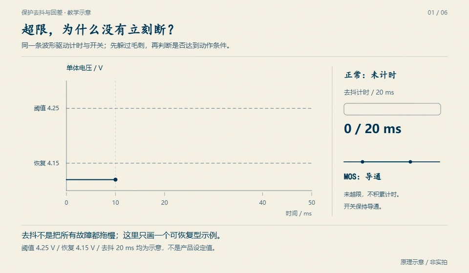

# D20　实时固件与数据所有权：一帧不能混两次采样，一次超限不能悄悄过去

采样中断把电压写进全局结构，快任务读一半时中断又来了一次——这一帧的电压属于第 8 次采样，电流却已经是第 9 次；CRC 没错、长度没错、字段也都在范围内，但**这一帧从来不是任何一次真实采样**。本单元把实时固件的三件所有权写成可执行证据：泳道与 WCET/抖动、双缓冲快照的 epoch 语义、参数 A/B 槽与提交计数器。三件反例——一帧混用两次采样、单拍 WCET 超限、写参数中途断电——都在软件在环时间线上逐拍冻结。全部 WCET、抖动、看门狗超时、故障拍号与阈值都是构造的教学值，**不证明**任何 MCU 的真实调度行为，**不代表**示波器/HIL 记录，也不能当作功能安全论证；真实 WCET 与看门狗行为必须回到目标硬件测量（待验），本单元只给出可以复算的边界。

## D20.1 模型与推导

三条泳道，固定优先级、可抢占、单核（教学值）：

| 泳道 | 周期 | WCET 预算 | 截止期 | 工作 |
|---|---:|---:|---:|---|
| ISR | 1 ms | 0.2 ms | 1 ms | 采样点：把 ADC 结果写入环形缓冲 |
| fast | 10 ms | 10 ms | 10 ms | 取上一窗 10 个样本，校验、保护判决、发布快照、喂狗 |
| slow | 100 ms | 40 ms | 100 ms | 滤波、估计（D17 的估计任务在这里）、日志 |

调度器的语义只有三条：高优先级抢占低优先级；同一泳道作业不重叠；截止期从释放时刻起算，不从启动时刻起算。执行时间用 8 拍循环的确定性表（fast 4.870–5.230 ms、slow 11.250–13.500 ms、ISR 0.090–0.160 ms），在 fast 第 37 拍注入 14.000 ms；没有随机源，重跑逐位相同。

**响应时间分析（RTA）**。固定优先级下 $R=C+\sum_h \lceil R/T_h\rceil C_h$，用名义最坏执行时间迭代到不动点：fast $R=5.230+\lceil R/1\rceil\cdot0.160=6.350$ ms；slow $R=13.500+\lceil R/10\rceil\cdot5.230+\lceil R/1\rceil\cdot0.160=47.330$ ms。两条都低于各自截止期。把 fast 的 $C$ 换成 14.000 ms：fast 上界 16.720 ms 已越过 10 ms 截止期；slow 的迭代超过 1 s 仍不收敛（利用率被抬到 1 以上），报告写 `slow_bounded=false`，不编一个有限数。

**抖动记账**。启动抖动 = 首次启动 − 释放，响应 = 完成 − 释放。实测（构造时间线）fast 无故障拍最大启动抖动 1.970 ms、最大响应 7.735 ms；slow 最大启动抖动 7.735 ms、最大响应 38.375 ms；ISR 是时间基准，抖动 0。故障拍单独记：fast 第 37/38 拍启动抖动 6.130 ms、响应 16.000/11.970 ms——把它们混进基线会把教学模型自己的反例洗成“正常波动”。

**看门狗规则**。看门狗是独立计时器，超时 35 ms（≈3.5 个 fast 周期）。喂狗不是“任务跑完就喂”，而是**只有快照完整（上一窗 10/10 个 ISR 样本都已落地）且 fast 未过截止期**才喂；迟到拍与残缺拍都不喂。喂狗间隔从上次成功喂狗算起，达到 35 ms 就复位，不看任务自己报的计数器。连续 3 次完整且准时的快照才退出 DEGRADED。

**双缓冲与 epoch**。写侧先把整帧字段拷进非活动缓冲，再原子发布 epoch（序号 +1）；读侧取最新完整 epoch，拷贝整块缓冲，再读一次 epoch 判断是否在拷贝期间翻过页。双缓冲的充分条件是**读侧拷贝时间短于写侧一个周期**：写侧最多在下一个周期开始时写另一块缓冲，读侧若在此之前完成，就不会读到被覆盖的字节。本单元读拷贝 6 ms、写周期 10 ms，余量 4 ms；把拷贝改成 12 ms 时报告 `safe=false`，不装作还成立。

**参数 A/B 槽与提交协议**。每槽 20 B：`magic(2) | schema(2) | gen(4) | ovp_mv(2) | uvp_mv(2) | ot_c10(2) | ocp_ma(4) | crc16(2)`，CRC-16/CCITT-FALSE 覆盖前 18 B。提交顺序是：失效 magic → 写 payload → 写代数 gen → 写 CRC → 恢复 magic。上电校验链固定为 **CRC → 版本 → 范围**：CRC 不通过（含 magic 丢失）整槽拒绝；版本不等于 2 拒绝但不擦除（可能是更新固件写的）；任一字段越界拒绝；两槽都坏才落到安全默认值。选择器只用通过整条链的槽，取最大 gen，同代优先 A。反例选择器只按 gen 取最大，用来证明“计数器不是原子性”。

## D20.2 核心机制

**泳道与预占**。fast 每 10 ms 释放一次，读的是**上一窗**的 10 个样本：第 k 拍释放于 10(k+1) ms，窗口为 [10k, 10k+10) ms。这样快照完整性有明确含义：不是“拍脑袋说齐了”，而是 10 个 ISR 作业的完成时间都早于 fast 的完成时间。slow 在 100 ms 边界释放，被 fast 与 ISR 按优先级抢占；它的响应时间包含被抢占的碎片，而不是把执行时间当墙钟。

**快照生命周期**。写侧每 10 ms 发布一次：先写字段（每字段间隔 0.1 ms），最后一个字段在 +0.4 ms 完成；epoch 在 +9.6 ms 发布（写侧拷贝 9.2 ms，留 0.4 ms 给发布本身）。读侧在 +9.5 ms 开始，拷贝 6 ms。读侧拿到的是上一个已发布 epoch（旧一拍，年龄 9.9 ms），但五个字段全部来自同一 epoch——**陈旧是公开的，混用是不允许的**。epoch 回绕用模运算：`d=(new−old) mod 65536`；D19 的 4 bit 帧计数器用同一规则，`d=0` 重复、`d=1` 连续、`2..7` 跳号、`8` 歧义、`9..15` 迟到或复位。第 18 章的 14→1 例子：`d=3`，跳号，缺 2 帧（15、0），不是倒退。

**喂狗与降级的状态机**。`boot → RUN` 只在参数校验通过时发生。任一 fast 拍超时或快照不完整：该拍不喂狗，`RUN → DEGRADED`（在截止期时刻检测，不等任务完成）；恢复要求连续 3 次完整且准时的快照，`DEGRADED → RUN`。若两次成功喂狗之间的间隔达到 35 ms，`→ RESET`，之后不再喂——复位不是降级，二者不能混写。报告把 `withheld`、`transitions`、`reset_at_us` 分别列出，读的人能回答“是没发现、发现太晚，还是发现了却没执行”。

**参数原子性**。断电可能落在任意一条指令之间，所以“写一半”不是异常而是常态。提交协议把**可见性**放在最后一步：magic 先失效，读者立刻知道这槽不可用；代数先落盘，用于诊断“原本想提交第几代”；CRC 最后写，覆盖整段 payload。上电时 CRC 先于版本、版本先于范围；范围失败不夹取成边界值，而是整槽拒绝并回退到旧槽——夹取会把一个错误的配置伪装成合法配置。恢复动作是用旧槽内容重写坏槽，代数保持不变（41），而不是把未完成的新代数（42）当成已提交。

本单元的时间语义不止在调度表上：保护侧的确认与迟滞同样按拍记账，是另一种「时间所有权」。

<figure>

<figcaption>图 D20-F1　保护去抖与回差：确认窗、迟滞带按拍累计——与 D20.2 的快照 epoch、喂狗截止期同一套「时间片内做决策」语义：拍数不够不动，拍数够了不犹豫。原理示意 / 非实拍。</figcaption>
</figure>

## D20.3 反例与分解

### 反例 A：一帧混用两次采样

共享结构逐字段更新，读侧在 +9.5 ms 开始按 1.5 ms 的字段间隔组装 5 个字段（电压、电流、温度、充电器在场、ISR 序号）。写侧每 10 ms 在 +0 到 +0.4 ms 之间逐字段落盘。读侧的电压字段落在第 k 次采样，后 4 个字段落在第 k+1 次：40 帧里 **40 帧混用**，字段来源偏斜最多 1 次采样。第一帧的来源是 `[0, 1, 1, 1, 1]`：电压来自 0 号采样，电流/温度/充电器/序号来自 1 号。

第 8 帧是电流阶跃的证据：电压 3710 mV 来自 8 号采样（充电 +18 A），电流 −30000 mA 来自 9 号采样（放电 −30 A），一步跨了 **−48000 mA**；而帧里的 `isr_seq=9` 却声称这是第 9 次采样。没有 epoch 时，接收方无法从帧内发现“电压比序号老一次”——它只能看到一个自洽的数值组合。帧级证据保存在 `snapshot_frames.csv`，逐帧列出五个字段各自的来源 epoch 与 `mixed` 标志。

同一读节奏换成双缓冲 + epoch：40 帧 **0 帧混用**，但 40 帧都旧一拍，最大陈旧 9.9 ms；重试 0 次。陈旧不是缺陷而是账：读侧知道自己在读哪个 epoch，就能把它交给上层做新鲜度判断；混用则是账本上根本不存在的帧。安全条件（读拷贝 6 ms < 写周期 10 ms）在报告 `epoch.safety` 里显式给出，12 ms 的探针被标成 `safe=false`。

### 反例 B：单拍 WCET 超限的传播链

第 37 拍预算 10 ms，实际跑到 14 ms（超出 4 ms）。冻结链：

1. 第 37 拍释放于 380.000 ms，14 ms 执行 + ISR 抢占，完成于 396.000 ms，响应 **16.000 ms**；
2. 截止期 390.000 ms 到点时检测到超时，`RUN → DEGRADED`；
3. 该拍快照其实完整（10/10 样本都在），但迟到，所以**不喂狗**；
4. 第 38 拍释放于 390.000 ms，被上一拍拖到 396 ms 才启动，完成于 401.970 ms，响应 **11.970 ms**，再次超时、再次不喂；
5. 喂狗间隔从上一次成功喂狗（第 36 拍完成，375.750 ms）到第 39 拍完成（407.735 ms），最大 **31.985 ms**，距 35 ms 超时只剩 **3.015 ms**；
6. 第 39/40/41 拍连续三次完整且准时，第 41 拍完成于 425.750 ms，`DEGRADED → RUN`。

一次 14 ms 的超限没有直接触发复位，却传播成两次缺喂与一次降级；余量只剩 3.015 ms——把它当成“还能扛”就是拿余量当保证。看门狗复位探针把第 37、38 拍都改成 14 ms：最大喂狗间隔 53.365 ms，在 **410.750 ms** 复位，最终状态 RESET，缺喂 4 次。RTA 侧同一件事：快任务上界 16.720 ms，慢任务上界不收敛（`slow_bounded=false`）。三条证据说的是同一件事，不是三个结论。

### 反例 C：写参数中途断电与 CRC 位翻转

**中途断电**。槽 A 是合法第 41 代；槽 B 先镜像 A，然后按提交顺序写：magic 置零 → 代数写 42 → `ot_c10` 写新值 550（55.0 °C）→ 断电。此时 B 的 `ocp_ma` 还是旧值 30000，`ot_c10` 已是 550，magic 无效，CRC 仍是覆盖旧内容的 14330，而新字节算出的 CRC 是 22051。稳健链拒绝 B，选 A：状态 DEGRADED，原因 `slot_b_crc_rejected`，代数 **41**。朴素选择器只看代数：选 B 的第 **42** 代，拿到 `ot_c10=550` / `ocp_ma=30000` 的撕裂配置——两个字段各自合法，组合却不是任何一次提交。恢复路径是用 A 的内容重写 B（代数仍 41），第二次上电两槽一致、健康；原本想提交的第 42 代丢失，必须由操作者重新提交。冻结值：boot1 用 A/41，boot2 用 A/41，恢复后计数器 41，未完成代数 42，两次上电恢复。

**CRC 位翻转**。B 完整写成第 42 代，但 `ot_c10` 的 550（0x0226）被翻成 0x0A26 = 2598（259.8 °C），CRC 失配。稳健链回退 A 的 600（60.0 °C）；恢复路径与中途断电相同：用 A 重写 B（代数 41），第二次上电健康。朴素选择器取第 42 代，把过温阈值读成 **259.8 °C**——OT 实际上永不触发。这个反例说明 CRC 不是“格式检查”，它是把“字段还是那一代的值”变成可判定命题的唯一证据。

**启动降级逐项**。六个上电场景：双槽合法取 B/42；中途断电回退 A/41（crc）；位翻转回退 A/41（crc）；schema=3 回退 A/41（version，保留 B 不擦除）；OVP=5000 mV 回退 A/41（range，`[4000,4300]`）；双槽全坏落到安全默认值（gen 0），随后以代数 1 重写两槽。每一次降级都带 `slot`、`stage`、`reason`，测试逐条钉住。

## D20.4 动手验证

```text
python code/engineering/firmware/d20_rt_firmware.py
python code/engineering/firmware/d20_rt_firmware.py --out <新目录>
python code/engineering/firmware/d20_rt_firmware.py --trace <task_trace.csv> --out <新目录>
python -m pytest code/engineering/firmware -q --basetemp=.tmp-pytest-d20
```

默认导出到证据目录：`report.json`（场景 `D20-rt-scheduling`，内含 `replay` 块给出 `D20-trace-replay` 的内置回放）、`task_trace.csv`（666 行作业 + 表头，列 `job,lane,release_us,start_us,finish_us,exec_us`）、`snapshot_frames.csv`（naive 40 帧 + epoch 40 帧 + 表头，逐帧字段来源与 `mixed/stale`）、`param_boot.csv`（6 个启动场景 ×2 槽 + 表头）。`--trace` 回放用户任务 trace，输出场景 `D20-trace-replay` 的 `report.json`，重算 WCET/启动抖动/响应/截止期违约/喂狗间隔；回放只覆盖调度与喂狗，快照混用与参数槽不在 trace 列里，不能由回放证明。

回放数据合同强制执行：缺文件、错表头、缺列、非整数（含 `nan`/`inf`）、负时间、`release > start > finish` 顺序错误、`exec` 大于墙钟跨度、`exec` 超过泳道上界、时间回退、同泳道作业重叠、未知泳道、重复 job、总行数少于 20、缺少 fast 或 slow 泳道，一律 exit 2 并在 stderr 给出原因；默认场景 exit 0。回放不接受“先猜一个缺失列”，也不把 `nan` 当 0。

迁移任务：

1. 把 fast 预算从 10 ms 改成 8 ms，重跑默认场景：哪些冻结数变？RTA 的 6.350 ms 还成立吗？14 ms 超限拍的传播链是否改变？先写出预期再跑。
2. 把看门狗超时从 35 ms 改成 30 ms（其余不变）：默认场景会不会复位？复位时刻是哪一拍？说明“降级”和“复位”的边界为什么不只差一个阈值。
3. 把参数提交顺序改成“先写 CRC 再写 payload”，模拟在 payload 写一半时断电：magic、代数、CRC 各处于什么状态？朴素选择器还能不能挑出撕裂配置？用 `encode_slot`/`decode_slot` 构造并验证。

## D20.5 与相邻单元的接口

- **D08（保护与时间预算）**：D08 冻结的最坏电气反应窗 **72.263 ms** 不被本单元改动。D08 里的 5 ms 调度项是声明的教学上界；本单元快任务无故障拍的最大启动抖动 **1.970 ms**，落在该上界内（`within_d08_scheduling_term=true`），因此不重新分配这 5 ms。注入 14 ms 的第 37/38 拍是反例，单独报告，不混进基线；把它拿来重算 D08 会把“故障拍”当成“正常调度”。
- **D19（总线与端到端数据）**：D20 发布快照 epoch，D19 的帧携带计数器；两者共用模运算判新旧规则（16 进制计数器：14→1 是 `d=3`、跳号缺 2 帧，不是倒退）。D19 负责身份、CRC、连续性与新鲜度，D20 只负责“这一帧来自哪一次完整采样”；epoch 是快照身份，不是时间戳，也不能替代 D19 的 CRC/身份检查。读侧如实报告“旧一拍 9.9 ms”，而不是用 epoch 把陈旧洗成新鲜。
- **D17（SOP 与多约束）**：D17 的滤波/估计任务在 100 ms 慢泳道里占 **8 ms** 预算（40 ms 的 20%），剩 32 ms 给滤波、日志与通信；本单元实测慢任务 WCET 13.1 ms、响应 38.375 ms，都在 40 ms 预算和 100 ms 截止期内。D17 改变窗口集合（10/30/60/600 s）不改变本泳道预算；若估计任务涨到 40 ms 以上，必须先改写本节的泳道合同，而不是偷偷占用快任务余量。

## D20.6 本单元已冻结的数字

| 锚点 | 值 | 出处 |
|---|---|---|
| fast 泳道 | 60 作业；名义 WCET 5.230 ms、实测峰值 14.000 ms；名义抖动 1.970 ms、故障拍 6.130 ms；名义响应 7.735 ms、故障拍 16.000 ms；负载 0.5145 | `report.json` `lanes.fast` |
| slow 泳道 | 6 作业；WCET 13.100 ms；抖动 7.735 ms；响应 38.375 ms；负载 0.1222 | `lanes.slow` |
| ISR 泳道 | 600 作业；WCET 0.160 ms；抖动 0；响应 0.160 ms；负载 0.125 | `lanes.isr` |
| 超限拍 | tick 37：释放 380.000 ms、执行 14.000 ms、响应 16.000 ms；tick 38：响应 11.970 ms | `timeout` |
| 截止期违约 | tick 37、38；检测于 390.000 ms；DEGRADED 恢复于 425.750 ms | `timeout` / `watchdog.transitions` |
| 喂狗 | 58 次成功、2 次扣留；最大间隔 31.985 ms；距 35 ms 余量 3.015 ms | `watchdog` |
| 看门狗复位探针 | 双 14 ms 拍：最大间隔 53.365 ms；410.750 ms 复位；缺喂 4 次 | `watchdog.reset_probe` |
| RTA 名义 | fast 6.350 ms、slow 47.330 ms；均在截止期内 | `rta.nominal` |
| RTA 超限探针 | fast 16.720 ms（违约）；slow 上界发散 | `rta.overrun_probe` |
| naive 组装 | 40 帧全混用；最大字段偏斜 1 次采样；首帧来源 [0,1,1,1,1] | `snapshot.naive` |
| 混用证据帧 | 第 8 帧：电压 3710 mV 来自 8 号、电流 −30000 mA 来自 9 号；阶跃 −48000 mA；帧序号 9 | `snapshot.naive.sign_flip_evidence` |
| epoch 方案 | 0 混用；40 帧旧一拍；最大陈旧 9.900 ms；重试 0 | `snapshot.epoch` |
| 双缓冲条件 | 读拷贝 6 ms < 写周期 10 ms，余量 4 ms；12 ms 探针 `safe=false` | `snapshot.probes` |
| 参数中途断电 | B 代数 42、ot 550、ocp 30000、magic 无效、CRC 14330 vs 计算 22051；稳健选 A/41 | `params.mid_write_recovery` |
| 参数恢复 | boot1 A/41 DEGRADED；重写 B 后 boot2 A/41 健康；未提交代数 42 丢失 | 同上 |
| CRC 位翻转 | 朴素选择器读 ot 2598（259.8 °C）；稳健回退 600（60.0 °C）；恢复同中途断电（A/41 → 重写 → 健康） | `params.bitflip_evidence` |
| 版本/范围降级 | schema=3 → A/41；OVP=5000 → A/41（`[4000,4300]`） | `params.boot_chain` |
| 双槽全坏 | 安全默认值、gen 0；重写后代数 1 | `params.defaults_boot` |
| D19 计数器 | 14→1：`delta=3`、`gap`、缺 2 帧；8→0：`ambiguous` | `interfaces.d19.probes` |
| D08 接口 | 72.263 ms 不改写；快任务名义抖动 1.970 ms ≤ 5 ms 调度项 | `interfaces.d08` |
| D17 接口 | 估计 8 ms / 慢泳道 40 ms = 0.2；余量 32 ms | `interfaces.d17` |
| 回放场景 | `D20-trace-replay`：fast WCET 14.000 ms、违约 tick 37/38、喂狗 58/2 | `report.json` `replay` |

## D20.7 装配边界

- **闭合来源 SRC05**（通信/诊断/刷写）：本单元只闭合工程层的可执行证据，协议来源、刷写恢复与真实会话安全仍归 SRC05 的后续追踪；不把“CRC 正确”当认证，也不把本单元的 A/B 槽当完整刷写方案。
- **先修 D08 与 D19**：D08 的 72.263 ms 反应窗与 D19 的帧来源是本单元的上游；D20 不改写 D08 的数字，也不重新定义 D19 的帧格式与 CRC。D17 的估计任务在本单元的慢泳道里有明确预算（8/40 ms），但本单元不替 D17 选窗口。
- **固件边界**：`BmsInputs` 只有 `cell_mv[]`、`current_ma`、`temp_c10`、`charger_present`，没有时间戳、质量位或采样序号；固件骨架也没有任务表、看门狗与参数 A/B 槽。本单元是教学补全，**不证明**固件已实现双缓冲、喂狗或参数原子性；真实实现必须在目标硬件上测 WCET、看门狗与掉电恢复。
- **书层缺口**：`bms-book/book/33-实时固件与数据所有权.md` 尚缺；本单元不虚构引用，也不声称书层解释已经闭合。工程层证据在 `code/engineering/firmware/`，书层补写是独立任务。
- 全部数字为教学构造；未烧录、未用示波器/逻辑分析仪测量、未做 WCET 静态分析或 HIL 验收。软件在环通过不等于硬件通过。
