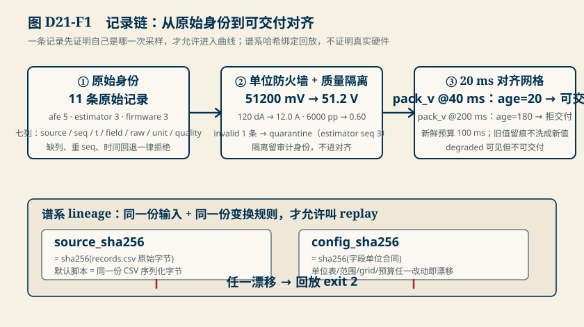

# D21　记录与可复现数据链：一份记录先证明自己是哪一次采样

记录链的问题不是“有没有日志”，而是每条记录能不能回答：它来自哪个源、第几次采样、什么单位、当时质量如何、后来经过哪次变换。D19 给了帧的判定链，D20 给了快照 epoch 的所有权，B05 给了先切分后看的数据纪律；本单元把这三件事落到可重放的记录工件上。当前切片先交付字段合同、单位变换、时间对齐、质量隔离与回放谱系；真实总线抓包、固件非易失日志、数据库、时钟同步和 D22 诊断语义仍是待验边界，本单元不证明它们已经验收。

## D21.1 模型与推导：记录的最小身份

一条可复算记录至少携带七列：`source_id, record_seq, t_ms, field, raw_value, unit, quality`。前四列回答“哪一路、第几次、什么时刻、哪个量”；后三列回答“原始读数是什么、单位是什么、这拍能不能交付”。缺任何一列，后面的曲线只是不可追溯的数。

本切片冻结五类字段合同：字段合同纪律——写入记录体系的数据会被程序吸纳成真值，虚构记录一律标注 `synthetic: true`，不要把现实条款当真测写入。

| field | 允许单位 | 规范单位 | 变换后范围 |
|---|---|---|---|
| `pack_v` | `mV`, `V` | V | 0–1000 |
| `pack_current_a` | `mA`, `dA`, `A` | A | −1000–1000 |
| `pack_temp_c` | `c10`, `degC` | degC | −40–125 |
| `soc` | `pp`, `percent`, `fraction` | fraction | 0–1 |
| `epoch` | `epoch` | epoch | 0–65535 |

这里的 `pp` 与 D19 的载荷缩放保持一致：6050 `pp` 表示 60.50%。单位防火墙是字段级的：电流不能借电压单位通过，换算后才暴露的荒谬值也拒绝，而不是夹取到边界冒充合法记录。

## D21.2 核心机制：变换账本、对齐与谱系

记录进入链条后只做三件事。第一，按字段合同做单位变换，保留 `raw_value`、`unit`、`value` 和 `canonical_unit`，所以每个规范值都能回到原始记录。第二，按 `source_id` 检查 `record_seq` 与 `t_ms` 是否严格递增：重复序号说明账本重页，时间回退说明时钟或回放顺序已经失真，二者都拒绝而不是猜测。第三，按固定网格做时间对齐：每个字段取不晚于当前网格点的最新记录，显式写出 `source_t_ms` 与 `age_ms`；`age_ms` 超过新鲜预算，或记录质量不是 `ok`，该行不可交付。

质量不是布尔垃圾桶。`invalid` 记录保留在 `quarantine`，写明 `quarantine_reason`，但不进入对齐结果；`degraded` 记录保留在对齐结果里作为状态证据，但不交付。这样日志既不会丢失败，也不会让失败静默参与曲线。

回放谱系由两个哈希组成：`source_sha256` 绑定原始记录工件字节，`config_sha256` 绑定字段合同。用 `--metadata` 回放时，任一哈希不匹配都 exit 2。谱系证明的是“这次回放用了同一份输入和同一份变换规则”，不是“这份数据来自真实硬件”。



## D21.3 反例（数字冻结）

默认脚本共有 11 条原始记录：AFE 5 条、估计器 3 条、固件 epoch 3 条。其中 `estimator` 第 3 拍 `quality=invalid`，进入隔离区；它保留审计身份，但不出现在 `aligned_series.csv`。

四个必须拒绝的输入边界已经钉成回归：同一 `source_id` 内时间回退报 `time rollback`；重复 `record_seq` 报 `record_seq`；字段借非法单位报 `unit`；未知字段报 `field`。另一个更危险的边界是“单位看起来对、换算后离谱”：`pack_v` 写 51200 `V` 会得到 51.2 kV，报告拒绝并给出 `range`，不把它当成高压样本。

对齐结果的可复算样例：`pack_v` 在 40 ms 网格点采用 AFE 20 ms 的 51.3 V，`age_ms=20` 且可交付；到 200 ms 时仍停留在 20 ms 的样本，`age_ms=180`，超过 100 ms 新鲜预算，因此不可交付。这个“陈旧但可追溯”正是记录链要保留的证据：它不把旧值洗成新值，也不把旧值静默丢掉。

## D21.4 动手验证

安装态检查：`python -V` 显示 ≥ 3.8，`pytest` 可导入。

```text
python code/engineering/datachain/d21_record_chain.py
python code/engineering/datachain/d21_record_chain.py --out <新目录>
python code/engineering/datachain/d21_record_chain.py --records <records.csv> --out <新目录>
python code/engineering/datachain/d21_record_chain.py --records <records.csv> --metadata <旧目录>/lineage.json --out <重放目录>
python code/engineering/datachain/d21_record_chain.py --metadata <旧目录>/lineage.json --out <默认记录重放目录>
python -m pytest code/engineering/datachain/test_d21_record_chain.py -q --basetemp=.tmp-pytest-d21
python code/engineering/datachain/make_d21_figures.py
python -m pytest code/engineering/datachain/test_d21_figures.py -q --basetemp=.tmp-pytest-d21-fig
```

倒数第二条回放外部记录文件；最后一条回放内置默认记录，二者都必须通过 `source_sha256` 与 `config_sha256` 校验。

`--out` 固定落五件工件：`records.csv`、`normalized_records.csv`、`aligned_series.csv`、`report.json`、`lineage.json`。输入文件回放合同要求 `source_id, record_seq, t_ms, field, raw_value, unit, quality` 七列齐全；未知列允许存在，但缺列、错表头、非有限数值、负时间、时间回退、重复序号、非法单位、未知字段或换算后越界都 exit 2。默认脚本回放时 `counts` 必须逐项一致。

迁移任务：

1. 把 AFE 的 `pack_v` 单位从 `mV` 改成 `V`，但保留原始数值 51200：哪一层最先拒绝？为什么“只改单位不改数”比“写错数值”更容易漏过普通格式检查？
2. 把新鲜预算从 100 ms 改成 20 ms：默认脚本里哪些对齐行从可交付变为不可交付？这和 D19 的 100 ms 超时预算是什么关系？
3. 用 D19 的 `decisions.csv` 作为新 `source_id` 接入：哪些列可以直接映射，哪些 DTC/状态语义必须留给 D22，不能在本单元提前解释？

## D21.5 与相邻单元的接口

**D19（总线与端到端数据）**：D19 的 `t_ms` 与 `seq` 是帧判定证据；D21 把同样的双重要求推广到所有记录源。D19 的 `degraded` 是通信状态，D21 的质量列只是记录身份，二者不能互相替代。

**D20（实时固件与数据所有权）**：D20 的 epoch 回答“这帧来自哪次完整采样”；D21 的 `record_seq + source_id` 回答“这条记录在哪条账本里”。快照陈旧可以公开，记录混账必须拒绝。

**B05（数据身份与留出）**：B05 的“先切分后看”在 D21 中落实为谱系与回放合同。当前切片只证明同一工件可重放；训练/验证分组、泄漏对照和跨工况外推仍按 B05 与 D27/R03 的后续任务执行。

**D22（诊断、刷写与生命周期）**：本单元隔离 `invalid` 记录，但不解释 DTC、冻结帧或刷写恢复。D22 需要消费这里的 `quarantine_reason`、`sequence_gaps` 与 `time_gaps_ms`，不能倒过来把诊断语义写进记录链。

## D21.6 本单元已冻结的数字

| 锚点 | 值 | 出处 |
|---|---|---|
| 默认原始记录数 | 11 | `report.json counts.raw_records` |
| 隔离记录 | 1（`estimator` seq=3，`quality=invalid`） | `report.json quarantine` |
| `pack_v` 首拍 | 51200 mV → 51.2 V | `normalized_records.csv` |
| `pack_current_a` 样例 | 120 dA → 12.0 A | 同上 |
| `soc` 估计器样例 | 6000 pp → 0.60 fraction | 同上 |
| `epoch` 固件样例 | 41 epoch → 41 | 同上 |
| 对齐网格 | 20 ms；新鲜预算 100 ms | `report.json` |
| `pack_v @40 ms` | 51.3 V，source_t=20 ms，age=20 ms，deliverable=true | `aligned_series.csv` |
| `pack_v @200 ms` | age=180 ms，deliverable=false | 同上 |
| 拒绝词 | `time rollback`、`record_seq`、`unit`、`field`、`range` | CLI stderr / `ValueError` |
| 谱系哈希 | `source_sha256`、`config_sha256` | `lineage.json` |

## D21.7 装配边界

- 先修 D04、D19、B05；本切片不改写 D19 的帧格式、CRC、窗口语义，也不改写 D20 的 epoch/双缓冲结论。
- 所有输入为合成教学记录；未使用真实总线抓包、固件非易失存储、数据库、网络时钟或硬件时间戳，因此不证明任何真实数据链已经验收。
- 图版 D21-F1 已由 `code/engineering/datachain/make_d21_figures.py` 生成（记录链三站与谱系概念图，数字取自 `d21_record_chain.py` 的默认报告）；D22 的诊断语义仍留给下一批。
- `code/protocol/` 与 `code/soc/real_data.py` 仍是各自维护源；本单元只复用其数据身份思想，不把旧协议解析器或参考 SOC 口径偷渡进 D21。
