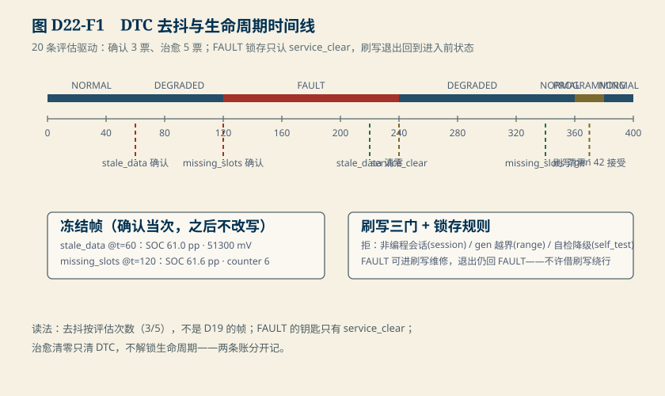

# D22　诊断、刷写与生命周期：故障要先被确认，才被记住

诊断层回答的问题不是“总线怎么样了”（D19），也不是“记录是哪一次采样”（D21），而是“这个系统现在还能不能信任、还能不能修”。DTC 不是一帧报错：一个监视器要连续失败若干次评估才确认故障，确认那一刻的整车信号被冻结成帧，安全类故障会把生命周期锁进 FAULT，刷写只能在编程会话里进行，且配置代数必须在受支持区间内。当前切片先交付评估流驱动的 DTC 去抖、冻结帧、生命周期状态机与刷写门；UDS 服务表、真实 Bootloader 协议、HIL 注入与售后诊断仪交互仍是待验边界，本单元不证明它们已经验收。

## D22.1 模型与推导：确认、冻结、处置三段式

一条诊断结论的生命周期分三段。**确认**：监视器每次评估只记一票，连续失败达到确认门限才立 DTC；连续通过达到治愈门限才允许清。把“一次失败”直接当“故障存在”是误报工厂；把“一次通过”直接当“故障消失”会把间歇问题洗白。**冻结**：确认当次的信号快照（SOC、电压、电流、计数器、会话）成为冻结帧，之后信号恢复也不改写——它回答的是“故障发生那一刻系统在干什么”。**处置**：质量类故障确认后功能降额（DEGRADED），安全类故障确认后锁存 FAULT；FAULT 不随治愈自动解除，必须服务清除加重新治愈才回 NORMAL。

## D22.2 核心机制：评估计数语义与生命周期状态机

本切片两个监视器：`stale_data`（质量类，确认 3 次评估、治愈 5 次评估）与 `missing_slots`（安全类，确认 3、治愈 5）。计数单位是**评估次数**，不是 D19 的帧：D19 的“丢 3 拍降级、丢 5 拍恢复”描述的是通信接收状态机，本单元的 3/5 描述的是故障确认与治愈的信任门限——两者数值相近纯属教学构造的巧合，语义不互通，不可互相代用（`axis_boundary = evaluation_count_not_frame_count`）。清零不是免疫证明：治愈后的监视器再度失败，从第一票重新计数，确认门限照旧。

生命周期状态机：`INIT → NORMAL`（自检通过）；质量类确认 `NORMAL → DEGRADED`；安全类确认 `→ FAULT`（锁存）；`service_clear` 事件使 `FAULT → DEGRADED` 并把安全类 DTC 重置为治愈中（重新计通过票）；全部活跃 DTC 清零后 `DEGRADED → NORMAL`；`NORMAL/FAULT` 可经请求进入 `PROGRAMMING`，**退出时回到进入前状态**——NORMAL 进 NORMAL 出；FAULT 进 FAULT 出，锁存不解：刷写是维修通道，不是绕过 service_clear 的暗门。

刷写门三条：① 只在 `PROGRAMMING` 会话接受刷写，其余会话一律拒绝（reason=`session`）；② 镜像配置代数必须在受支持区间内（本切片 41–42，越界拒绝 reason=`range`）；③ 自检降级启动（self_test=defaults）时拒绝刷写（reason=`self_test`）——存储都不可信的机器不许换固件。



## D22.3 反例（数字冻结）

默认脚本 20 条评估，时间线全部冻结：`stale_data` 在 t=20/40/60 连挂 3 次评估，t=60 确认，冻结帧 SOC 61.0 pp、51300 mV、12.2 A；`missing_slots` 在 t=80/100/120 连挂 3 次，t=120 确认并把生命周期推进 FAULT。治愈段：`stale_data` 在 t=140–220 连过 5 次，t=220 清零——但此时生命周期仍在 FAULT，清零不解锁；t=240 `service_clear` 使 `FAULT → DEGRADED`；`missing_slots` 在 t=260–340 连过 5 次，t=340 清零且 `DEGRADED → NORMAL`。刷写段：t=360 请求进 `PROGRAMMING`，t=370 刷入 gen 42（受支持区间 41–42）被接受，t=380 退出复检通过回 `NORMAL`，存储代数 41→42。

三个必须拒绝的边界已经钉成回归：非编程会话刷写（`session`）、gen 43 越界（`range`）、自检降级时刷写（`self_test`）；未知监视器报 `monitor`，坏表头报 `header`。两个解析边界同样钉死：`ok` 列只认字面的 `True`/`False`，写 `yes`/`1`/`FALSE` 一律报 `ok` 拒绝——不许把 malformed 静默当失败票推 DTC 去确认 FAULT；事件流必须按 `t_ms` 升序，时间回退报 `time rollback`。

复发语义钉成回归：`stale_data` 在 t=220 治愈清零后，t=260/280/300 再挂 3 票，t=300 重新确认，冻结帧历史保留两帧（t=60 与 t=300，旧帧不改写）。没有 `service_clear` 的剧本里，安全 DTC 即使治愈，生命周期终点仍是 FAULT——钥匙只有一把。

## D22.4 动手验证

```text
python code/engineering/diagnostics/d22_diagnostics.py
python code/engineering/diagnostics/d22_diagnostics.py --out <新目录>
python code/engineering/diagnostics/d22_diagnostics.py --events <events.csv> --out <重放目录>
python -m pytest code/engineering/diagnostics -q --basetemp=.tmp-pytest-d22
```

`--out` 固定落五件工件：`events.csv`、`dtcs.csv`、`lifecycle_log.csv`、`freeze_frames.csv`、`report.json`。事件 CSV 九列合同：`t_ms, monitor, ok, soc_pp, pack_v_mv, pack_current_a, counter, session, image_gen`；前三列必需，后六列通常可空（= 上游未提供，冻结帧原样记 null，绝不编造）——**例外：FLASH 事件的 `image_gen` 是动作参数，可空即合同违例**（`flash event requires image_gen`）；表头不符或未知监视器 exit 2。默认脚本回放时 `counts` 必须逐项一致。

迁移任务：

1. 把 `stale_data` 的确认门限从 3 改成 2：默认脚本里确认时刻从 t=60 移到哪一拍？冻结帧内容会不会变？为什么门限改动会移动审计锚点？
2. 删掉 t=240 的 `service_clear`：生命周期终点停在哪？这说明 FAULT 锁存的“钥匙”在谁手里？
3. 用 D21 的 `time_gaps_ms` 驱动一个新监视器 `record_gaps`：它应归为质量类还是安全类？门限该用评估次数还是 gap 条数，为什么？

## D22.5 与相邻单元的接口（适配器已交付，边界如钉）

**D19（总线与端到端数据）**：`code/engineering/diagnostics/d22_upstream_adapter.py` 的 `events_from_decision_rows` 已消费 D19 决策行（`run_scenario(...)["rows"]` 或 `decisions.csv`）。映射按证据类别分派，不看裸 decision：`accept` 行 → `stale_data` 通过；新鲜度拒收（`reason ∈ late/duplicate/gap_too_large/ambiguous`）或老化超时（行内 `stale_data=True`）→ `stale_data` 失败；完整性/身份/会话拒收（`identity/crc/session`）与 `resync_observation` 行**不产生** `stale_data` 事件——它们不是陈旧度评估（`axis_boundary = integrity_rejection_is_not_staleness`，回归 `test_fresh_crc_reject_is_not_stale_data_failure`）。行内 `missing_slots` 计数（非负整数，CSV 字符串严格解析，`"False"/"0"` 不作裸 bool）逐行驱动安全监视器；未知 `reason` 一律拒绝。边界仍钉：D19 的恢复拍数（丢 3 降级、丢 5 恢复）是通信状态机语义，不能搬进 D22 当去抖门限。

**D20（实时固件与数据所有权）**：D20 的参数双槽 CRC 与代数（41→42）是数据所有权问题；D22 的刷写门消费代数概念但加了会话与区间约束。D20 的快照陈旧可以公开，D22 的 FAULT 锁存必须服务清除。

**D21（记录与可复现数据链）**：`events_from_chain_report` 已消费 D21 `build_report`：隔离记录与序号缺口边界（由 normalized+quarantine 行重导）各产生一条 `missing_slots` 失败事件，刻点为该行 `t_ms`。`time_gaps_ms` 摘要**不消费**：它只带间隔不带绝对时刻（`axis_boundary = gap_intervals_without_absolute_time`）。边界仍钉：D21 隔离记录保留审计身份，D22 的冻结帧只在确认当次取样，两者都不改写历史。

**证据**：`test_d22_upstream_adapter.py` 12 条回归（映射类别、CRC 新鲜拒收不误报、CSV 字符串严格解析、未知 reason 拒绝、DTC 确认集成、CSV 往返、CLI 合同与 CLI 拒绝）。上游未提供的测量（母线电压/电流）在适配器事件里为 null，冻结帧原样记 null，绝不编造。

**D26/D28（后续）**：诊断码表与工具链留待后续单元；本切片只钉状态机与门限，不定义 UDS 服务标识。

## D22.6 本单元已冻结的数字

| 锚点 | 值 | 出处 |
|---|---|---|
| 默认评估数 | 20 | `report.json counts.events` |
| 监视器 | `stale_data`（质量类）、`missing_slots`（安全类） | `report.json dtcs` |
| 确认/治愈门限 | 3 / 5 次评估（两者同） | 同上 |
| `stale_data` 确认 | t=60.0 ms，冻结 SOC 61.0 pp | `freeze_frames.csv` |
| `stale_data` 清零 | t=220.0 ms | `dtcs.csv` |
| `missing_slots` 确认 | t=120.0 ms | 同上 |
| `missing_slots` 清零 | t=340.0 ms | 同上 |
| 生命周期迁移 | 0 NORMAL←自检；60 DEGRADED；120 FAULT；240 DEGRADED（service_clear）；340 NORMAL；360 PROGRAMMING；380 NORMAL | `lifecycle_log.csv` |
| 刷写 | gen 41→42 接受；43 拒（range）；非编程会话拒（session）；自检降级拒（self_test） | `report.json flash` |
| 存储代数 | 启动 41，刷写后 42 | 同上 |
| 复发再确认 | 治愈后再挂 3 票于 t=300 重新确认；冻结帧历史两帧（t=60/t=300） | `test_dtc_recurrence_reconfirms_after_heal` |
| 无钥匙终态 | 无 `service_clear` 时安全 DTC 治愈后生命周期仍 FAULT | `test_fault_persists_without_service_clear` |
| 拒绝词 | `monitor`、`header`、`ok`（非字面 True/False）、`time rollback` | CLI stderr / `ValueError` |

## D22.7 装配边界

- 先修 D19、D20、D21；本切片不改写 D19 帧判定、D20 双缓冲 epoch、D21 记录链合同的任何结论。
- D19/D21 接口适配器已由 `d22_upstream_adapter.py` 交付（见 D22.5）；图版 D22-F1 已由 `make_d22_figures.py` 生成（数字取自默认报告）。
- 所有输入仍为合成教学评估流（含经适配器派生的事件）；未使用真实 UDS/Bootloader 协议、HIL 注入、诊断仪会话或售后工具链，因此不证明任何真实刷写或诊断流程已经验收。
- `code/protocol/`、`code/soc/real_data.py` 与 D20 参数槽仍是各自维护源；本单元只引用其代数与状态语义，不偷渡协议实现。
