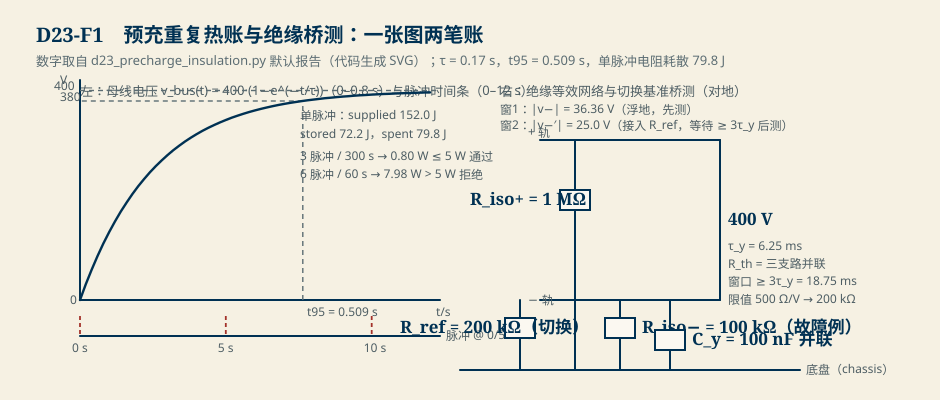

# D23　预充、高压与绝缘：两笔账都不许凭感觉

S3 已经回答过"母线充到 95% 为什么还不能直接合主接触器"——τ、t95、单脉冲能量、合闸许可门控都在 S3 冻结。D23 不重复那笔账，只加 S3 没覆盖的两件事：预充电阻的**重复热账**（能不能再预充一次，由平均功率而不是单次能量说了算），以及高压对地的**绝缘等效网络与桥测边界**（一个绝缘阻值读数在什么条件下才配叫"测量结果"）。真实预充开关驱动、接触器粘连诊断、绝缘监测芯片行为与整车高压安规验收仍是待验边界；本单元全部数字为教学假设，不证明任何器件选型。

## D23.1 薄切片定位与交付物

前置：D07（需求）、D08（架构）、D09（电驱）、B01（术语）、B02（证据分级）。S3 覆盖单次 RC 预充；D23 的增量是重复热账与绝缘测量。

交付物：`code/engineering/hv/d23_precharge_insulation.py`（`default_report()` / `repetition_report()` / `insulation_report()` / CLI）、`test_d23_precharge_insulation.py`（10 条回归）、`make_d23_figures.py` + 图版 D23-F1、本文件、实验登记 E16、声明 D23-C01/C02。

## D23.2 核心机制：两笔账的判据



图版 D23-F1 已由 `code/engineering/hv/make_d23_figures.py` 生成，数字全部取自 `d23_precharge_insulation.py` 默认报告。

**第一笔：重复热账。** 热应力落在**电阻**上，所以单脉冲能量取电阻耗散，不取电容储能：充到合闸许可 fraction（95%）时，电源供给 `fraction·C·V²` = 152.0 J，电容储能 `½·C·(fraction·V)²` = 72.2 J，差额 **spent = 79.8 J** 耗在预充电阻上——与 S3 `energy_account` 的 supplied/stored/spent 完全同账。重复合法性由平均功率判：`n·E / window ≤ rating_avg` 且 `E ≤ rating_pulse`（默认 5 W / 100 J）。3 次脉冲落在 300 s 窗口 → 0.798 W，通过；同样 79.8 J 的脉冲 6 次挤进 60 s → 7.98 W，拒绝。S3 的 `retry_interval_s = 3600 s` 是**重试锁**（下一次许可尝试的间隔），本单元不复验这把锁；重复合法性只看热平均窗——两账在 C3 集成时同判，不互替（`axis_boundary = retry_lockout_not_retested`）。

**第二笔：绝缘桥测。** 等效网络：正负母线对底盘各经 `R_iso+` / `R_iso−`（默认 1 MΩ / 100 kΩ 故障例），负 Rail 侧并联 Y 电容 `C_y = 100 nF`。测量用切换基准电阻 `R_ref = 200 kΩ` 打两个窗口：窗 1 浮地测负轨对底盘电压 `v− = −V·g+/(g+ + g−)` = **−36.36 V**；窗 2 把 `R_ref` 从底盘接到负轨，等 DC 目标 `v−′ = −25.0 V`，两窗比值 `r = 0.6875` 反解总电导 `a = r/((1−r)·R_ref)`，再分别得 `R_iso+`、`R_iso−`。

**测量边界（本单元的核心主张）。** 两个 validity 门缺一，读数只配叫"尝试"，不配叫"结果"：

1. **时间门**：`C_y` 的瞬态须按完整网络求戴维南电阻——置零理想压源后正负轨短接，`R_th = R_iso− ∥ R_ref ∥ R_iso+` = 62.5 kΩ，`τ_y = R_th·C_y` = **6.25 ms**，窗口须 ≥ `3τ_y` = **18.75 ms**（只算负轨侧两支路会高估 τ_y，这是本单元已踩过又钉住的天真错误）。窗口 5 ms 时采样落在 55.1% 趋稳处，反解出 `R_iso− ≈ 45.7 kΩ`——离真值 100 kΩ 差 54%，判 `window_too_short`，`estimates_valid = False`。
2. **量程门**：估计只在 `[R_min, R_max]` = `[20 kΩ, 5 MΩ]` 内有效，且**按仪表可见的估计值判定**——真值在车上不可假设已知。`R_iso = 10 MΩ` 时 `v−` 与 `v−′` 之差缩到 ADC 勉强可辨，估出来也不背书，判 `out_of_range`。

门全过，才拿 500 Ω/V 限值（400 V → **200 kΩ**）做判定：默认故障例 `R_iso− = 100 kΩ < 200 kΩ` → `isolation_fault`；健康例双 1 MΩ → `pass`。测量自己的注入会扰动被测网络（`R_ref` 并上去就改变了 `v−`）——这正是用两窗比值而不是单窗绝对值的原因，也是"测量边界"四个字的实义（`axis_boundary = estimate_validity_window`）。

## D23.3 反例（数字冻结）

默认剧本：预充 3 脉冲 @ t = 0/5/10 s、窗口 300 s → 0.798 W ≤ 5 W，`pass`；绝缘窗 2 等待 0.2 s（= 32τ_y，裕量充足）→ 恢复 `R_iso− ≈ 100 kΩ`、`R_iso+ ≈ 1 MΩ`，判定 `isolation_fault`。τ = 0.17 s，t95 = 0.509 s，单脉冲 supplied 152.0 J / stored 72.2 J / spent 79.8 J。

四个反例已钉成回归：6 脉冲 / 60 s → 7.98 W > 5 W `deny`；单脉冲额定 100 J 降到 50 J 时同一脉冲 `deny`；窗口 5 ms（τ_y = 6.25 ms，仅 0.8τ_y）→ `window_too_short` 且偏估 45.7 kΩ 不被放行；估计值越出 [20 kΩ, 5 MΩ]（10 MΩ 例）→ `out_of_range`。健康双 1 MΩ → `pass`。

## D23.4 与 S3 的关系（显式不重复）

S3 冻结的单脉冲 RC 账（170 Ω、1 mF、400 V、τ = 0.17 s、t95 = 0.509 s、合闸许可以 95% + 残压复检为准）与三向能量账（supplied 152.0 / stored 72.2 / spent 79.8 J）被本单元原样引用为 `pulse_energy_account()` 与图版左半；S3 的合闸许可状态机、带载预充、主接触器 making-current 复检与 `retry_interval_s = 3600 s` 重试锁不在本单元重测。D23 的增量只有两个判据：`n·E/window ≤ rating_avg`（E 取 spent）与桥测双 validity 门。任何一边改数，两边的账都要重对（D23.6 表与 S3 章节的冻结表是同一组源数字的两份副本）。

## D23.5 动手验证

```bash
python code/engineering/hv/d23_precharge_insulation.py            # 打印 counts
python code/engineering/hv/d23_precharge_insulation.py --out /tmp/d23   # report.json + precharge.csv + insulation.csv
python -m pytest code/engineering/hv -q
```

## D23.6 本单元已冻结的数字

| 锚点 | 值 | 出处 |
|---|---|---|
| τ / t95 | 0.17 s / 0.509 s | S3 同源，`report.json precharge` |
| 单脉冲能量账 | supplied 152.0 J；stored 72.2 J；spent 79.8 J（热账取 spent） | 同上，`energy_source = resistor_dissipation_supplied_minus_stored` |
| 重复热账 | 3 脉冲/300 s → 0.798 W 通过；6 脉冲/60 s → 7.98 W 拒绝 | `test_repetition_over_rate_denied` |
| 绝缘网络 | R_iso+ 1 MΩ、R_iso− 100 kΩ、C_y 100 nF、R_ref 200 kΩ | `report.json insulation` |
| 桥测两窗 | v− = −36.36 V；v−′ = −25.0 V（窗 0.2 s） | `test_bridge_recovers_fault_resistance` |
| Y 电容时间门 | R_th = R_iso−∥R_ref∥R_iso+ = 62.5 kΩ，τ_y = 6.25 ms，窗口 ≥ 3τ_y = 18.75 ms；5 ms 窗偏估 45.7 kΩ | `test_short_window_y_cap_biases_estimate` |
| 量程门 | [20 kΩ, 5 MΩ]，按估计值判定，越界 `out_of_range` | `test_out_of_range_not_a_number` |
| 绝缘限值 | 500 Ω/V → 400 V 下 200 kΩ；100 kΩ → `isolation_fault` | `report.json insulation` |

## D23.7 装配边界

- 真实值边界：预充开关与接触器的驱动时序、粘连检测、绝缘监测芯片注入波形、整车高压安规与 Y 电容实测，全部留待真实样机与 SRC05 数据；本单元不证明。
- 数值为教学假设（电阻额定 5 W/100 J 等为讲授构造），不是任何器件的数据手册值。
- C3 交接：本单元交出两个可判定接口——`repetition_report()` 的热账判定与 `insulation_report()` 的双门测量判定；C3 综合时与 D20 参数槽、D22 故障门对接，合成 C3 剧本。
- `code/soc/real_data.py`、`code/precharge/s3_precharge.py` 与 D20 参数槽仍是各自维护源；本单元引用 S3 数字但不做 S3 的复验主体。
