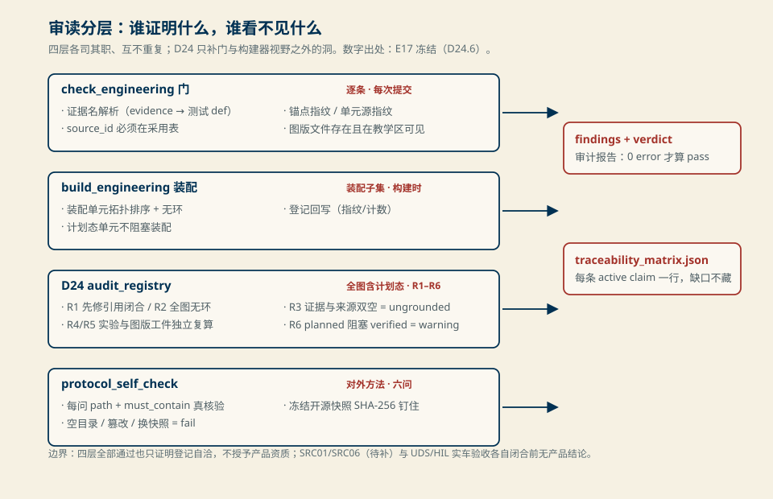

# D24 系统架构与开源审读

> P6.1 的 D24 部分：绑定需求与证据，而不授予产品资质。本单元交付的是**审读方法**与**一次真实审计记录**：登记自洽不证明物理正确，也不授予产品合规——真实料号限值与产线/EOL 证据（SRC01/SRC06，均待补）和 UDS/HIL 实车验收各自闭合前，本单元的任何结论都不是产品结论。

## D24.1 定位

计划主线 P6.1：「D24 架构、D25 安全论证、D26 标定生产在役，绑定需求与证据而不授予产品资质。」

「架构」在本书有具体含义：先修 DAG（P1 最小包已把它定为主线纪律）加上每个单元对自己边界的显式声明。构建器只对**装配子集**做拓扑排序，于是两类架构问题在构建器视野之外：

- 计划态单元引用了不存在的先修 id（笔误即静默悬空）；
- 全图（含 planned 单元）存在环——装配时才会炸，越早发现越便宜。

「开源审读」指：面对任何 BMS 相关外部代码库（开源实现、示例固件、供应商驱动），用同一组问题审读它，而不是因为它"开源"就默认其语义可借。



图 D24-F1 是本章的地图：四层各证明什么、各自看不见什么。门逐条校验，构建器只看装配子集，D24 审计器看全图（含计划态），协议核验把六问方法落到真实文件与冻结快照上——四层全部通过也只证明登记自洽，不授予产品资质。

## D24.2 证据分级与产线边界

本单元只新增**离线方法工件**（审计器 + 协议清单），零新增产线主张：

- 离线方法工件：审读协议、审计器、审计报告；
- 真实产线资料：SRC05（UDS）、SRC06（产线/EOL，仍待补）；
- 教学值：D09 FMEA 小案例（真实 FMEDA 用现场失效率）。

## D24.3 机制：全 manifest 先修审计（R1–R6）

`code/engineering/architecture/d24_architecture_audit.py` 对整本登记的工程单元执行六条规则：

| 规则 | 检查 | 严重级 |
|---|---|---|
| R1 | 先修引用的 id 必须存在于 manifest | error |
| R2 | 全图（含 planned）先修关系无环 | error |
| R3 | 每条 claim 的 evidence 与 source_ids 同时为空（ungrounded） | error |
| R4 | 每个 experiment 的 script/tests 文件在盘上 | error |
| R5 | 每个 figure 的文件在盘上 | error |
| R6 | planned 单元是先修于 locally_verified 单元 | warning |

与现有门的关系：**不重复**——`check_engineering.py` 校验证据名解析与锚点指纹，构建器校验装配子集拓扑；R1/R2 覆盖构建器视野外的全图，R3 覆盖它不要求的非空约束，R4/R5 是独立复算（审计不信任构建器的结论）。

本次交付中审计器首次运行在**活 registry** 上即抓到 4 个真实缺口（审计的价值实证），处置原则只有一条：**补证据，不编来源；规则错了修规则，不逼数据全绿**：

- `D19-C05` ← `SRC05`：D19 全单元来源族即协议/刷写（SRC05 采用表行），时钟/陈旧语义属总线合同，来源成立；
- `D09-C02` 零证据：D09 三个测试均未覆盖 FMEA 共因声明，新增特征化回归 `test_fmea_declares_common_supply_gap_with_residual_risk` 钉住「共同供电两路同时离线 + 共因缺口行控制栏显式声明 + 残余风险留痕」；
- `S1-C09`、`D03-C02` 缺 `source_ids`：核对后**不补**——S1-C09 是教学反例、D03 章 D3.1 明示 12 字段表是「结构工具，不提供产品合格结论」，二者均无明确外部溯源；照抄兄弟条目的 OS 编号是编造，不是溯源。它们由测试证据钉住，诚实的登记就是 `source_ids: []`。
- 由此 R3 规则本身修正：初版要求「source_ids 非空」，对本地合成合同过宽、诱导编造来源；定版 R3（`ungrounded_claim`）只在**证据与来源同时为空**时报错——grounding 可以来自可执行证据，也可以来自外部来源，至少其一。

**前向追溯矩阵（精通视图）**——`traceability_matrix(root)` 把门逐条校验的链接横切成一张表：每行一条 active claim，列齐 `source_ids → unit → claim → anchor → evidence → experiments`，按来源排序。它的纪律只有一条：**行不许丢**。证据名悬空的 claim 不删行、不跳过，而是留在表里标 `evidence_resolved: false` 并进 `unresolved` 清单——矩阵的价值是让缺口可见，而不是让报表好看。`--matrix <file>` 导出 JSON；冻结数字见 D24.6。

## D24.4 反例教学：伪造 registry 的五类发现

`test_d24_architecture_audit.py` 用 tmp 构造的最小 registry 钉住每条规则的拒绝路径：

- 悬空前修（`missing_prereq`）；
- 双单元互为先修（`prereq_cycle`）；
- 零证据声明（`empty_evidence`）；
- 实验 script 指向不存在文件（`missing_artifact`）；
- planned 阻塞 verified：产生 warning，verdict 仍 pass——架构风险被看见但不阻塞装配。

## D24.5 动手验证（学生任务）

入门——跑起来并读懂输出：

```bash
python -m pytest code/engineering/architecture -q
python code/engineering/architecture/d24_architecture_audit.py
```

预期打印计数块，`verdict` 为 `pass`；加 `--out <dir>` 落 `audit_report.json` 与 `protocol_self_check.json`。回答：R6 为什么是 warning 不是 error？

进阶——亲手造一个会失败的 registry：在临时目录按 `test_d24_architecture_audit.py` 的 `_write_mini_registry` 结构写 manifest/claims/experiments（四个 JSON），先造悬空前修，再造双单元互为先修，最后造一条既无证据又无来源的 claim。三次运行 `audit_registry`，把每条 finding 的 `kind` 对上规则编号。回答：R3 为什么要求「双空」而不是「缺来源即报错」——用 D03-C02 的例子说明。

精通——端到端追一条需求并对外作答：

```bash
python code/engineering/architecture/d24_architecture_audit.py --matrix /tmp/matrix.json
```

打开矩阵，任选一个有 `source_ids` 的 claim，从来源编号沿 `unit → anchor → evidence → experiments` 走到测试文件里的 `def`，确认每一步解析得到。然后选一个有证据、无来源的行（如 D03-C02），解释它为什么是诚实的登记而不是缺口。最后把六问协议用于一个你选定的外部 BMS 代码库：逐问写下 path/证据与日期，答不出的标「不知道」——这份留痕就是审读结论的边界。

## D24.6 冻结数字（E17）

- manifest：42 单元 / 91 claims / 35 experiments / 62 figures（D24 自身登记含 D24-F1 已计入）；
- 审计 verdict `pass`，findings 0 error / 0 warning（活 registry 的 42 单元现全为 `locally_verified`；R6 的 planned→verified warning 分支由 mini-registry 回归覆盖，不是本次活数据发现）；
- 六问协议 self-check 六行 `ok=true` + 冻结开源快照 SHA-256 钉住（`252688ab4ab53800`）；
- 追溯矩阵 91 行 = active claims 91，`unresolved_evidence` 0；
- 审计器对活 registry 首跑 4 个 error → 处置：D19-C05←SRC05（来源族成立）、D09-C02 补特征化测试、S1-C09/D03-C02 核对为本地合成/教学反例保持 `source_ids: []`（不编来源），R3 规则同步修正为双空才报错；处置后归零。

## D24.7 开源审读协议：六问方法工件

对外部 BMS 代码库的审读不改标准、不授予资质，只问六个问题（`open_source_review_protocol()` 钉住，顺序与措辞为合同）：

1. **license** — 这段代码以什么条件授予你使用权？
2. **provenance** — 这些数字/代码从哪来，谁能改写历史？
3. **freshness** — 完整性通过但数据过期，系统会说什么？
4. **debounce** — 故障确认按帧、按评估还是按时间？门限各是多少？
5. **evidence** — 每条声明的测试名解析得到吗？
6. **boundaries** — 哪些语义被显式声明为不互替？

self-check 不是口头对照：每一问带 `{path, must_contain}` 机器核验——文件必须存在、文本必须含指定符号（LICENSE 含 "CC BY-SA 4.0"、manifest 含 `"fingerprint"`、d19_bus_data.py 含 `def classify_counter`、d22_diagnostics.py 含 `MONITOR_CONFIG`、check_engineering.py 含证据门报错串、D22 章含 `axis_boundary`），任一不满足即 fail；并以 SHA-256 钉住冻结开源快照 `docs/superpowers/plans/2026-11-08-bms-open-source-snapshot.json`（`252688ab4ab53800`，快照漂移即 fail）。空目录、删改证据、快照被换三类负例都有回归钉住。这些本地映射证明协议**可执行**；映射是工作样例，**不是**对任何外部项目的认证。借用外部代码前逐问作答并留痕；答不出的问题按"不知道"处理，不得用"开源"二字替代回答。

## D24.8 与相邻单元的关系

- 先修 D03（需求规格）、D09（FMEA 共因）、D19（数据链）、D20（数据所有权）——审计规则以其登记形态为输入；
- 下游 D25（安全论证）、D26（标定生产在役）：它们各自交付时须通过本审计器全图检查；
- 同组 R01–R04：研究支线登记同样受 R1–R6 约束。

## D24.9 验收边界

- 本单元是**方法与纪律**，不授予产品资质；SRC01/SRC06（待补）与 UDS/HIL 实车验收的边界不变，本单元不改写其中任何一条；
- 审计 verdict `pass` 只证明登记自洽（引用闭合、无环、证据非空、工件存在），不证明物理正确性；
- 对外部项目的六问答卷留痕后，结论仍须标注来源与日期。

## 参考

- `code/engineering/architecture/d24_architecture_audit.py` / `test_d24_architecture_audit.py`
- `tools/check_engineering.py`（证据名解析与指纹门，350 行附近）
- `bms-book/engineering/manifest.json` / `claims.json` / `experiments.json`
- 计划：P6.1（`docs/superpowers/plans/2026-11-08-bms-depth-rebuild.md`）
