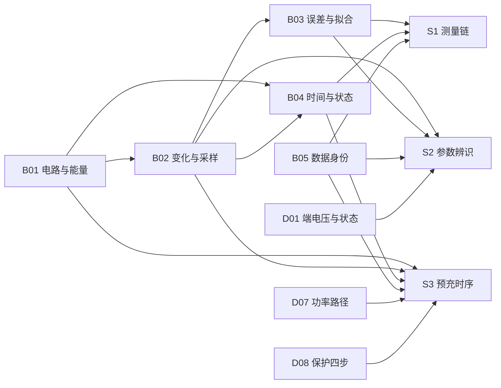

# P1.0 最小先修包

这份包只解决一件事：让第一次读深研样章的读者不缺"概念齿轮"。它不替代完整先修册，也不把读过某章当掌握。每项配一个可核对的小任务；做对即通过，做错就回到对应桥梁。

## 先修清单

| ID | 内容 | 桥梁 | 用在哪 | 核对题 |
|---|---|---|---|---|
| B01 | 参考点、KCL/KVL、功率与能量守恒 | [B01](../bridges/B01-电路与能量.md) | S1 误差折算、S2 压降归属、S3 能量账 | 理想源给空电容充电，源、电阻、电容各分多少能量？ |
| B02 | 一阶指数解、积分即面积、采样区间归属 | [B02](../bridges/B02-变化与采样.md) | S2 拟合合同、S3 预充曲线、S1 建立时间 | τ=45 s、Δt=0.5 s 的离散系数是多少？10 s 走到稳态几成？ |
| B03 | 偏差/方差、协方差、最坏界与 RSS、两未知量最小二乘 | [B03](../bridges/B03-误差矩阵与拟合.md) | S1 误差合成、S2 K/A 与 τ 的可辨识性 | ρ=0.75 时两个 0.6/0.8 mV 源合成标准差多少？ |
| B04 | 采样时刻、状态与输出、因果性、截止时间相加 | [B04](../bridges/B04-时间与状态.md) | S1 反馈预算、S3 合闸时序、S2 撤流时刻 | 首拍 20 ms、确认 3 拍、判决 2 ms、反馈 15 ms，最坏总延迟？ |
| B05 | 数据身份、先切分后看、泄漏、合成与实测边界 | [B05](../bridges/B05-数据身份与留出.md) | S1/S2/S3 全部实验与报告 | 用全段数据选完窗长，再报这段残差，算独立验证吗？ |

## 三个概念补丁

先修册只补工具，不补"这个系统里谁是谁"。下面三块按需读原章，不另写第二份事实源。

### D01 端电压与内部状态

- 端电压是**外部可见输出**，由开路电压、欧姆压降、极化压降共同决定；SOC 与极化是**内部状态**，不能由单个电压读数唯一确定。
- 同一个低电压至少有五种解释：真实低 SOC、负载电流、低温内阻、极化未恢复、测量通路错误。
- 因此任何"从电压反推 SOC"的说法，都必须附带模型、工况与验证条件。

入口：[第 1 章](../book/01-电池里在发生什么.md)（1.2–1.5 节）。读完后应能画出三项电压的去向，并说明哪一项随电流立即变化。

### D07 功率路径

- 电流从正端经主回路到负载，再回到负端；主触点、预充支路、母线电容各在路径上的不同位置。
- MOS 的体二极管方向决定了"关断"并不等于"两个方向都断"，这也是背靠背器件的理由。
- 预充不是"等电压到某个数"，而是用电阻限制合闸前的浪涌。

入口：[第 4 章](../book/04-保护板解剖.md)（4.2–4.4 节）。读完后应能指出：主触点断开时，电流如果仍存在，可能走哪条路。

### D08 保护四步

- 一次保护要留下四个时间点：越限、确认、命令、反馈；只记录阈值与命令位，证据链缺最后一段。
- 阈值、确认拍数与恢复线必须成套出现；故障态不能停止对其他项目的评估。
- 硬件、软件与接触器负责不同时间尺度；微秒级事件不能等软件 tick。

入口：[第 7 章](../book/07-保护tick48.md)（7.1–7.5 节）。读完后应能说清"命令发出"与"能量已切断"的区别。

## 依赖关系

## 通过标准

- 桥梁的五组核对题能独立做对，并能解释错项原因；
- D01/D07/D08 的"读完后应能"各能口述一遍，不背书；
- 进入 S1/S2/S3 时不再需要临时补高中电路或统计定义。

## 这份包不能证明什么

- 它不证明读者已掌握对应知识点，只是消除了术语与推导断点；
- 它不含硬件、实测或独立工程审读；
- 它不替代样章正文、实验与独立任务。
